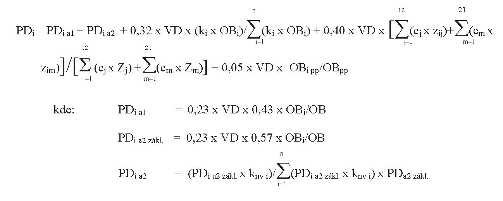

# Čl. I

Nariadenie vlády Slovenskej republiky č. 668/2004 Z. z. o rozdeľovaní výnosu dane z príjmov územnej samospráve v znení nariadenia vlády Slovenskej republiky č. 519/2006 Z. z., nariadenia vlády Slovenskej republiky č. 623/2007 Z. z. a nariadenia vlády Slovenskej republiky č. 412/2008 Z. z. sa mení a dopĺňa takto:

- 1. V § 2 ods. 1 písm. c) prvom bode sa na konci pripájajú tieto slová: „ak toto nariadenie vlády neustanovuje inak,“.

- 2. Príloha č. 3 znie:

- „Príloha č. 3 k nariadeniu vlády č. 668/2004 Z. z.

- KOEFICIENTY ZÁKLADNEJ UMELECKEJ ŠKOLY, MATERSKEJ ŠKOLY, JAZYKOVEJ ŠKOLY A ŠKOLSKÉHO ZARIADENIA PRE JEDNOTLIVÉ KATEGÓRIE ZÁKLADNÝCH UMELECKÝCH ŠKÔL, MATERSKÝCH ŠKÔL, JAZYKOVÝCH ŠKÔL A ŠKOLSKÝCH ZARIADENÍ V ZRIAĎOVATEĽSKEJ PÔSOBNOSTI OBCE A KOEFICIENT NA ZÁUJMOVÉ VZDELÁVANIE

- Tabuľka č. 1 – Hodnoty koeficientov spolu s koeficientmi materských škôl s počtom detí nad 25

- Index j | Žiak (dieťa) základnej umeleckej školy a školského zariadenia | Koeficient

- 1 | Žiak základnej umeleckej školy v individuálnej forme vyučovania | 13,0

- 2 | Žiak základnej umeleckej školy v skupinovej forme vyučovania | 8,0

- 3 | Dieťa materskej školy vo veku do troch rokov1) | 61,0

- 4 | Dieťa materskej školy vo veku od troch rokov | 31,0

- 5 | Dieťa školského klubu detí | 6,0

- 6 | Potenciálny stravník – žiak základnej školy zriadenej obcou2) | 2,0

- 7 | Potenciálny stravník – žiak základnej školy internátnej zriadenej obcou3) | 4,0

- 8 | Potenciálny stravník – žiak základnej školy a základnej školy pre žiakov so špeciálnymi výchovno-vzdelávacími potrebami zriadenej krajským školským úradom4) | 2,0

- 9 | Potenciálny stravník – žiak základnej školy internátnej a základnej školy internátnej pre žiakov so špeciálnymi výchovno-vzdelávacími potrebami zriadenej krajským školským úradom5) | 4,0

- 10 | Poslucháč jazykovej školy | 0,6

- 11 | Dieťa školského internátu | 15,0

- 12 | Potenciálne dieťa v centre voľného času a v školskom stredisku záujmovej činnosti (ďalej len „záujmové vzdelávanie“)6) | 1,1

- 1) Za dieťa do troch rokov sa považuje dieťa, ktoré dovŕši vek troch rokov najskôr k 1. septembru kalendárneho roka.

- 2) Potenciálny stravník – žiak základnej školy zriadenej obcou, je každý žiak základnej školy na území obce zriadenej obcou.

- 3) Potenciálny stravník – žiak základnej školy internátnej zriadenej obcou, je každý žiak základnej školy internátnej na území obce zriadenej obcou.

- 4) Potenciálny stravník – žiak základnej školy a základnej školy pre žiakov so špeciálnymi výchovno-vzdelávacími potrebami zriadenej krajským školským úradom, je každý žiak základnej školy a základnej školy pre žiakov so špeciálnymi výchovno-vzdelávacími potrebami na území obce zriadenej krajským školským úradom, ktorý sa stravuje v zariadení školského stravovania zriadeného obcou z dôvodu, že táto škola nemá na území obce zriadené vlastné zariadenie školského stravovania.

- 5) Potenciálny stravník – žiak základnej školy internátnej a základnej školy internátnej pre žiakov so špeciálnymi výchovno-vzdelávacími potrebami zriadenej krajským školským úradom, je každý žiak základnej školy internátnej a základnej školy internátnej pre žiakov so špeciálnymi výchovno-vzdelávacími potrebami na území obce zriadenej krajským školským úradom, ktorý sa stravuje v zariadení školského stravovania zriadeného obcou z dôvodu, že táto škola nemá na území obce zriadené vlastné zariadenie školského stravovania.

- 6) Do počtu detí na záujmové vzdelávanie v centrách voľného času a strediskách záujmovej činnosti sa započítava počet obyvateľov obce vo veku päť až štrnásť rokov s trvalým pobytom na jej území k 1. januáru predchádzajúceho kalendárneho roka.

- Tabuľka č. 2 – Hodnoty, o ktoré sa zvyšujú koeficienty pre materskú školu, ak celkový počet detí v materskej škole alebo materských školách zriaďovateľa nepresahuje 25

- Počet detí v materskej škole (materských školách) zriaďovateľa | Zvýšenie koeficientov (bez ohľadu na vek dieťaťa) o hodnotu

- do 10 | 20,6

- od 11 do 15 | 12,6

- od 16 do 20 | 6,5

- od 21 do 25 | 1,7

- “.

- 3. V prílohe č. 3a v tabuľke sa vypúšťa šiesty riadok.

- Doterajšie riadky 7 až 22 sa označujú ako riadky 6 až 21.

- 4. Príloha č. 4 znie:

- „Príloha č. 4 k nariadeniu vlády č. 668/2004 Z. z.

- VZOREC

- NA VÝPOČET PODIELU OBCE NA VÝNOSE DANE

- 

- Vysvetlivky:

- PDi | – | podiel obce „i“ na výnose dane v eurách

- PDi a1 | – | podiel obce „i“ na výnose dane v eurách neupravený koeficientom nadmorskej výšky obce

- PDi a2 | – | podiel obce „i“ na výnose dane v eurách upravený koeficientom nadmorskej výšky obce

- VD | – | výnos dane podľa § 2 zákona v eurách

- OBi | – | počet obyvateľov obce „i“ k 1. januáru predchádzajúceho kalendárneho roka

- OB | – | počet obyvateľov Slovenskej republiky k 1. januáru predchádzajúceho kalendárneho roka

- knv i | – | koeficient nadmorskej výšky obce „i“

- ki | – | koeficient obce „i“

- cj | – | koeficient základnej umeleckej školy, materskej školy, jazykovej školy a školského zariadenia v zriaďovateľskej pôsobnosti obce a na záujmové vzdelávanie v centrách voľného času a školských strediskách záujmovej činnosti „j“

- cm | – | koeficient základnej umeleckej školy, materskej školy, materskej školy pre deti so špeciálnymi výchovno-vzdelávacími potrebami, jazykovej školy a školského zariadenia „m“ v zriaďovateľskej pôsobnosti cirkvi alebo súkromnej osoby

- zij | – | počet žiakov (detí, poslucháčov) základnej umeleckej školy, jazykovej školy, materskej školy a školských zariadení v zriaďovateľskej pôsobnosti obce „i“ a potenciálnych stravníkov k 15. septembru predchádzajúceho kalendárneho roka a počet obyvateľov obce vo veku päť až štrnásť rokov s trvalým pobytom na jej území k 1. januáru predchádzajúceho kalendárneho roka na záujmové vzdelávanie v centrách voľného času a školských strediskách záujmovej činnosti

- zim | – | počet žiakov (detí, poslucháčov) základnej umeleckej školy, jazykovej školy, materskej školy, materskej školy pre deti so špeciálnymi výchovno-vzdelávacími potrebami, školského klubu detí a školského klubu detí pri základnej škole pre žiakov so špeciálnymi výchovno-vzdelávacími potrebami v zriaďovateľskej pôsobnosti cirkvi alebo súkromnej osoby na území obce „i“ a potenciálnych stravníkov k 15. septembru predchádzajúceho kalendárneho roka do 15 rokov veku

- | – | skutočný priemerný prepočítaný denný počet detí za predchádzajúci školský rok v materskej škole a materskej škole pre deti so špeciálnymi výchovno-vzdelávacími potrebami pri zdravotníckom zariadení, školskom klube detí pri zdravotníckom zariadení, diagnostickom centre, liečebno-výchovnom sanatóriu, reedukačnom centre v zriaďovateľskej pôsobnosti cirkvi alebo súkromnej osoby na území obce „i“ do 15 rokov veku; pri novovzniknutom školskom zariadení sa počet žiakov na kalendárny rok určí ako skutočný počet žiakov prijatých do školského zariadenia podľa stavu k 15. septembru kalendárneho roka, v ktorom sa štatistické zisťovanie uskutočňuje

- | – | skutočný počet evidovaných detí za predchádzajúci školský rok v centre pedagogicko-psychologického poradenstva a prevencie a v centre špeciálnopedagogického poradenstva v zriaďovateľskej pôsobnosti cirkvi alebo súkromnej osoby na území obce „i“ do 15 rokov veku; pri novovzniknutom školskom zariadení sa počet detí na kalendárny rok určí ako skutočný počet detí prijatých do školského zariadenia podľa stavu k 15. septembru kalendárneho roka, v ktorom sa štatistické zisťovanie uskutočňuje

- Zj | – | celkový počet žiakov (detí, poslucháčov) „j“ v Slovenskej republike v základných umeleckých školách, materských školách, jazykových školách a školských zariadeniach v zriaďovateľskej pôsobnosti obcí a potenciálnych stravníkov k 15. septembru predchádzajúceho kalendárneho roka a počet obyvateľov obcí vo veku päť až štrnásť rokov s trvalým pobytom na ich území k 1. januáru predchádzajúceho kalendárneho roka na záujmové vzdelávanie v centrách voľného času a školských strediskách záujmovej činnosti

- Zm | – | celkový počet žiakov (detí, poslucháčov) „m“ v Slovenskej republike v základných umeleckých školách, materských školách, materských školách pre deti so špeciálnymi výchovno-vzdelávacími potrebami, jazykových školách, školských kluboch detí, školských kluboch detí pri základných školách pre žiakov so špeciálnymi výchovno-vzdelávacími potrebami v zriaďovateľskej pôsobnosti cirkví a súkromných osôb a potenciálnych stravníkov k 15. septembru predchádzajúceho kalendárneho roka do 15 rokov veku

- | – | celkový skutočný priemerný prepočítaný denný počet detí v Slovenskej republike za predchádzajúci školský rok v materských školách a materských školách pre deti so špeciálnymi výchovno-vzdelávacími potrebami pri zdravotníckych zariadeniach, školských kluboch detí pri zdravotníckych zariadeniach, diagnostických centrách, liečebno-výchovných sanatóriách, reedukačných centrách „m“ v zriaďovateľskej pôsobnosti cirkví a súkromných osôb do 15 rokov veku; pri novovzniknutých školských zariadeniach sa počet detí na kalendárny rok určí ako skutočný počet detí prijatých do školských zariadení podľa stavu k 15. septembru kalendárneho roka, v ktorom sa štatistické zisťovanie uskutočňuje

- | – | celkový skutočný počet evidovaných detí v Slovenskej republike za predchádzajúci školský rok v centrách pedagogicko-psychologického poradenstva a prevencie a v centrách špeciálnopedagogického poradenstva v zriaďovateľskej pôsobnosti cirkví a súkromných osôb do 15 rokov veku; pri novovzniknutých školských zariadeniach sa počet detí na kalendárny rok určí ako skutočný počet detí prijatých do školských zariadení podľa stavu k 15. septembru kalendárneho roka, v ktorom sa štatistické zisťovanie uskutočňuje

- OBi pp | – | počet obyvateľov obce „i“, ktorí dovŕšili vek 62 rokov k 1. januáru predchádzajúceho kalendárneho roka

- OBpp | – | počet obyvateľov Slovenskej republiky, ktorí dovŕšili vek 62 rokov k 1. januáru predchádzajúceho kalendárneho roka

- i | – | údaj týkajúci sa príslušnej obce

- j | – | údaj týkajúci sa príslušnej základnej umeleckej školy, materskej školy, jazykovej školy alebo školského zariadenia v zriaďovateľskej pôsobnosti obce a záujmového vzdelávania v centrách voľného času a školských strediskách záujmovej činnosti

- m | – | údaj týkajúci sa príslušnej základnej umeleckej školy, materskej školy, materskej školy pre deti so špeciálnymi výchovno-vzdelávacími potrebami, jazykovej školy alebo školského zariadenia v zriaďovateľskej pôsobnosti cirkvi a súkromnej osoby

- n | – | počet obcí“.

- “.
