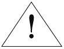

# Čl. I

Nariadenie vlády Slovenskej republiky č. 658/2005 Z. z., ktorým sa ustanovujú požiadavky na kozmetické výrobky v znení nariadenia vlády Slovenskej republiky č. 538/2006 Z. z., nariadenia vlády Slovenskej republiky č. 108/2007 Z. z., nariadenia vlády Slovenskej republiky č. 418/2007 Z. z., nariadenia vlády Slovenskej republiky č. 124/2008 Z. z., nariadenia vlády Slovenskej republiky č. 374/2008 Z. z., nariadenia vlády Slovenskej republiky č. 141/2009 Z. z., nariadenia vlády Slovenskej republiky č. 522/2009 Z. z. a nariadenia vlády Slovenskej republiky č. 81/2010 Z. z. sa mení a dopĺňa takto:

- 1. Za § 17e sa vkladajú § 17f až 17i, ktoré vrátane nadpisov znejú:

- 㤠17f

- Prechodné ustanovenie k úpravám účinným od 15. júla 2010

- Kozmetické výrobky, ktoré obsahujú látky uvedené v prílohe č. 3 časti 1 pod referenčnými číslami 26 až 43, 47 a 56, možno podľa predpisov účinných do 14. júla 2010 uvádzať do obehu do 14. októbra 2010.

- § 17g

- Prechodné ustanovenie k úpravám účinným od 1. decembra 2010

- Kozmetické výrobky, ktoré obsahujú látku uvedenú v prílohe č. 3 časti 1 pod referenčným číslom 208 a nie sú označené podľa predpisov účinných od 1. decembra 2010, možno umiestňovať na trh do 31. októbra 2011 a predávať do 31. októbra 2012.

- § 17h

- Prechodné ustanovenia k úpravám účinným od 15. februára 2011

- (1)

- Kozmetické výrobky, ktoré obsahujú látku uvedenú v prílohe č. 3 časti 1 pod referenčným číslom 130, možno podľa predpisov účinných do 14. februára 2011 predávať do 14. augusta 2011.

- (2)

- Kozmetické výrobky, ktoré obsahujú látku uvedenú v prílohe č. 3 časti 1 pod referenčným číslom 151a a nespĺňajú požiadavky podľa predpisov účinných od 15. februára 2011, možno predávať do 14. augusta 2011.

- § 17i

- Prechodné ustanovenie k úpravám účinným od 1. novembra 2011

- Kozmetické výrobky, ktoré obsahujú látky uvedené v prílohe č. 3 časti 1 pod referenčnými číslami 8, 8a, 9, 9a, 16, 22, 193, 202, 203, 205 a v prílohe č. 3 časti 2 pod referenčnými číslami 3 až 6, 10 až12, 16, 19 až 22, 25, 27, 31 až 39, 44, 48 až 50, 55 a 56, možno podľa predpisov účinných do 31. októbra 2011 predávať do 31. októbra 2012.“.

- 2. V prílohe č. 2 referenčné číslo 450 znie:

- „450. Esenciálne oleje z verbeny (Verbena essential oils o) Lippia citriodora Kunth. a deriváty iné ako čisté extrakty (CAS 8024-12-2), ak sú použité ako vonná zložka“.

- 3. V prílohe č. 3 časti 1 referenčnom čísle 8 stĺpec b znie:

- „N-substituované deriváty p-fenyléndiamínu a ich soli, N substituované deriváty o-fenyléndiamínu2) okrem derivátov uvedených v inej časti tejto prílohy a v prílohe č. 2 pod referenčnými číslami 1309, 1311 a 1312

- N-substituted derivatives of p-Phenylenediamine and their salts; N-substituted derivatives of o-Phenylenediamine5), with exception of those derivatives listed elsewhere in this Annex and under reference numbers 1309, 1311, and 1312 in Annex II“.

- 4. V prílohe č. 3 časti 1 referenčnom čísle 8 stĺpci f písm. a) a b) sa veta „Môže vyvolať alergickú reakciu.“ nahrádza vetami, ktoré znejú:

- „Farby na vlasy môžu vyvolať vážne alergické reakcie.

- Prečítajte si pokyny a dodržiavajte ich.

- Tento výrobok nie je určený pre osoby mladšie ako 16 rokov.

- Dočasné tetovanie čiernou henou môže zvýšiť riziko alergie.

- Nefarbite si vlasy, ak:

- – máte na tvári vyrážky alebo máte citlivú, podráždenú alebo poškodenú pokožku hlavy,

- – ste v minulosti zaznamenali reakciu po farbení vlasov,

- – ste v minulosti zaznamenali reakciu na dočasné tetovanie čiernou henou.“.

- 5. V prílohe č. 3 časti 1 sa za referenčné číslo 8 vkladá referenčné číslo 8a, ktoré znie:

- „

- Ref. číslo | Látka | O b m e d z e n i a | | | Podmienky použitia a upozornenia, ktoré musia byť uvedené na obale kozmetického výrobku

- | | Oblasť aplikácie/použitia | Najvyššia prípustná koncentrácia v kozmetickom výrobku v hmotnostných percentách | Ďalšie obmedzenia a požiadavky |

- a | b | c | d | e | f

- 8a | p-fenyléndiamín a jeho soli2) p-Phenylenediamine ** CAS 106-50-3 EINECS 203-404-7 p-Phenylenediamine HCl ** CAS 624-18-0 EINECS 210-834-9 p-Phenylenediamine sulfate ** CAS 16245-77-5 EINECS 240-357-1 | Látka na farbenie vlasov v oxidačných výrobkoch na farbenie vlasov a) Všeobecné použitie b) Profesionálne použitie | | a), b) Po zmiešaní v oxidačných podmienkach najvyššie prípustná koncentrácia aplikovaná na vlasy nesmie prekročiť 2 % hm. vyjadrené v prepočte na voľnú bázu. | a) Môže vyvolať alergickú reakciu. Obsahuje fenyléndiamíny. Nepoužívať na farbenie obočia a mihalníc. b) Len na profesionálne použitie. Môže vyvolať alergickú reakciu. Obsahuje fenyléndiamíny. Použiť vhodné rukavice.

- “.

- 6. V prílohe č. 3 časti 1 referenčnom čísle 8a stĺpec f znie:

- „a)

- Farby na vlasy môžu vyvolať vážne alergické reakcie.

- Prečítajte si pokyny a dodržiavajte ich.

- Tento výrobok nie je určený pre osoby mladšie ako 16 rokov.

- Dočasné tetovanie čiernou henou môže zvýšiť riziko alergie.

- Nefarbite si vlasy, ak:

- – máte na tvári vyrážky alebo máte citlivú, podráždenú alebo poškodenú pokožku hlavy,

- – ste v minulosti zaznamenali reakciu po farbení vlasov,

- – ste v minulosti zaznamenali reakciu na dočasné tetovanie čiernou henou.

- Obsahuje fenyléndiamíny.

- Nepoužívať na farbenie obočia a mihalníc.

- Zmiešavací pomer je uvedený na obale.

- b)

- Len na profesionálne použitie.

- Farby na vlasy môžu vyvolať vážne alergické reakcie.

- Prečítajte si pokyny a dodržiavajte ich.

- Tento výrobok nie je určený pre osoby mladšie ako 16 rokov.

- Dočasné tetovanie čiernou henou môže zvýšiť riziko alergie.

- Nefarbite si vlasy, ak:

- – máte na tvári vyrážky alebo máte citlivú, podráždenú alebo poškodenú pokožku hlavy,

- – ste v minulosti zaznamenali reakciu po farbení vlasov,

- – ste v minulosti zaznamenali reakciu na dočasné tetovanie čiernou henou.

- Obsahuje fenyléndiamíny.

- Použiť vhodné rukavice.

- Zmiešavací pomer je uvedený na obale.“.

- 7. V prílohe č. 3 časti 1 referenčnom čísle 9 stĺpec b znie:

- „Metylfenyléndiamíny, ich N-substituované deriváty a ich soli2) okrem látky uvedenej v tejto prílohe pod referenčným číslom 9a a látok uvedených v prílohe č. 2 pod referenčnými číslami 364, 1310 a 1313

- Methylphenylenediamines, their N-substituted derivatives and their salts1) with the exception of the substance under reference number 9a in this Annex and substances under reference numbers 364, 1310 and 1313 in Annex II“.

- 8. V prílohe č. 3 časti 1 referenčnom čísle 9 stĺpec f znie:

- „a)

- Farby na vlasy môžu vyvolať vážne alergické reakcie.

- Prečítajte si pokyny a dodržiavajte ich.

- Tento výrobok nie je určený pre osoby mladšie ako 16 rokov.

- Dočasné tetovanie čiernou henou môže zvýšiť riziko alergie.

- Nefarbite si vlasy, ak:

- – máte na tvári vyrážky alebo máte citlivú, podráždenú alebo poškodenú pokožku hlavy,

- – ste v minulosti zaznamenali reakciu po farbení vlasov,

- – ste v minulosti zaznamenali reakciu na dočasné tetovanie čiernou henou.

- Obsahuje fenyléndiamíny (toluéndiamíny).

- Nepoužívať na farbenie obočia a mihalníc.

- b)

- Len na profesionálne použitie.

- Farby na vlasy môžu vyvolať vážne alergické reakcie.

- Prečítajte si pokyny a dodržiavajte ich.

- Tento výrobok nie je určený pre osoby mladšie ako 16 rokov.

- Dočasné tetovanie čiernou henou môže zvýšiť riziko alergie.

- Nefarbite si vlasy, ak:

- – máte na tvári vyrážky alebo máte citlivú, podráždenú alebo poškodenú pokožku hlavy,

- – ste v minulosti zaznamenali reakciu po farbení vlasov,

- – ste v minulosti zaznamenali reakciu na dočasné tetovanie čiernou henou.

- Obsahuje fenyléndiamíny (toluéndiamíny).

- Použiť vhodné rukavice.“.

- 9. V prílohe č. 3 časti 1 sa za referenčné číslo 9 vkladá referenčné číslo 9a, ktoré znie:

- „

- Ref. číslo | Látka | O b m e d z e n i a | | | Podmienky použitia a upozornenia, ktoré musia byť uvedené na obale kozmetického výrobku

- | | Oblasť aplikácie/použitia | Najvyššia prípustná koncentrácia v kozmetickom výrobku v hmotnostných percentách | Ďalšie obmedzenia a požiadavky |

- a | b | c | d | e | f

- 9a | Toluén-2,5-diamín a jeho soli 2) Toluene-2,5-diamine ** CAS 95-70-5 EINECS 202-442-1 Toluene-2,5-diamine sulfate ** CAS 615-50-9 EINECS 210-431-8 | Látka na farbenie vlasov v oxidačných výrobkoch na farbenie vlasov a) Všeobecné použitie b) Profesionálne použitie | | a), b) Po zmiešaní v oxidačných podmienkach najvyššie prípustná koncentrácia aplikovaná na vlasy nesmie prekročiť 4 % hm. vyjadrené v prepočte na voľnú bázu. | a) Môže vyvolať alergickú reakciu. Obsahuje fenyléndiamíny. Nepoužívať na farbenie obočia a mihalníc. b) Len na profesionálne použitie. Môže vyvolať alergickú reakciu. Obsahuje fenyléndiamíny. Použiť vhodné rukavice.

- “.

- 10. V prílohe č. 3 časti 1 referenčnom čísle 9a stĺpec f znie:

- „a)

- Farby na vlasy môžu vyvolať vážne alergické reakcie.

- Prečítajte si pokyny a dodržiavajte ich.

- Tento výrobok nie je určený pre osoby mladšie ako 16 rokov.

- Dočasné tetovanie čiernou henou môže zvýšiť riziko alergie.

- Nefarbite si vlasy, ak:

- – máte na tvári vyrážky alebo máte citlivú, podráždenú alebo poškodenú pokožku hlavy,

- – ste v minulosti zaznamenali reakciu po farbení vlasov,

- – ste v minulosti zaznamenali reakciu na dočasné tetovanie čiernou henou.

- Obsahuje fenyléndiamíny (toluéndiamíny).

- Nepoužívať na farbenie obočia a mihalníc.

- Zmiešavací pomer je uvedený na obale.

- b)

- Len na profesionálne použitie.

- Farby na vlasy môžu vyvolať vážne alergické reakcie.

- Prečítajte si pokyny a dodržiavajte ich.

- Tento výrobok nie je určený pre osoby mladšie ako 16 rokov.

- Dočasné tetovanie čiernou henou môže zvýšiť riziko alergie.

- Nefarbite si vlasy, ak:

- – máte na tvári vyrážky alebo máte citlivú, podráždenú alebo poškodenú pokožku hlavy,

- – ste v minulosti zaznamenali reakciu po farbení vlasov,

- – ste v minulosti zaznamenali reakciu na dočasné tetovanie čiernou henou.

- Obsahuje fenyléndiamíny (toluéndiamíny).

- Použiť vhodné rukavice.

- Zmiešavací pomer je uvedený na obale.“.

- 11. V prílohe č. 3 časti 1 referenčnom čísle 16 stĺpec f znie:

- „Farby na vlasy môžu vyvolať vážne alergické reakcie.

- Prečítajte si pokyny a dodržiavajte ich.

- Tento výrobok nie je určený pre osoby mladšie ako 16 rokov.

- Dočasné tetovanie čiernou henou môže zvýšiť riziko alergie.

- Nefarbite si vlasy, ak:

- – máte na tvári vyrážky alebo máte citlivú, podráždenú alebo poškodenú pokožku hlavy,

- – ste v minulosti zaznamenali reakciu po farbení vlasov,

- – ste v minulosti zaznamenali reakciu na dočasné tetovanie čiernou henou.“.

- 12. V prílohe č. 3 časti 1 referenčnom čísle 22 stĺpci f písm. a) prvom a druhom bode sa na konci pripájajú tieto vety:

- „Farby na vlasy môžu vyvolať vážne alergické reakcie.

- Prečítajte si pokyny a dodržiavajte ich.

- Tento výrobok nie je určený pre osoby mladšie ako 16 rokov.

- Dočasné tetovanie čiernou henou môže zvýšiť riziko alergie.

- Nefarbite si vlasy, ak:

- – máte na tvári vyrážky alebo máte citlivú, podráždenú alebo poškodenú pokožku hlavy,

- – ste v minulosti zaznamenali reakciu po farbení vlasov,

- – ste v minulosti zaznamenali reakciu na dočasné tetovanie čiernou henou.“.

- 13. V prílohe č. 3 časti 1 referenčných číslach 26 až 43, 47 a 56 stĺpci f v druhej vete sa za slovo „obsahom“ vkladá slovo „zlúčenín“ a v poslednej vete sa slovo „fluór“ nahrádza slovom „fluorid“.

- 14. V prílohe č. 3 časti 1 referenčnom čísle 130 stĺpec b znie:

- „Terpenes and terpenoids“.

- 15. V prílohe č. 3 časti 1 sa za referenčné číslo 151 vkladá referenčné číslo 151a, ktoré znie:

- „

- Ref. číslo | Látka | O b m e d z e n i a | | | Podmienky použitia a upozornenia, ktoré musia byť uvedené na obale kozmetického výrobku

- | | Oblasť aplikácie/použitia | Najvyššia prípustná koncentrácia v kozmetickom výrobku v hmotnostných percentách | Ďalšie obmedzenia a požiadavky |

- a | b | c | d | e | f

- 151a | Allyl phenethyl ether ** CAS 14289-65-7 EINECS 238-212-2 | | | Koncentrácia voľného alyl-alkoholu v éteri musí byť 0,1 % hm. |

- “.

- 16. V prílohe č. 3 časti 1 referenčných číslach 193 a 205 stĺpci f písm. a) sa na konci pripájajú tieto vety:

- „Farby na vlasy môžu vyvolať vážne alergické reakcie.

- Prečítajte si pokyny a dodržiavajte ich.

- Tento výrobok nie je určený pre osoby mladšie ako 16 rokov.

- Dočasné tetovanie čiernou henou môže zvýšiť riziko alergie.

- Nefarbite si vlasy, ak:

- – máte na tvári vyrážky alebo máte citlivú, podráždenú alebo poškodenú pokožku hlavy,

- – ste v minulosti zaznamenali reakciu po farbení vlasov,

- – ste v minulosti zaznamenali reakciu na dočasné tetovanie čiernou henou.“.

- 17. V prílohe č. 3 časti 1 referenčných číslach 202 a 203 stĺpec f znie:

- „a)

- Farby na vlasy môžu vyvolať vážne alergické reakcie.

- Prečítajte si pokyny a dodržiavajte ich.

- Tento výrobok nie je určený pre osoby mladšie ako 16 rokov.

- Dočasné tetovanie čiernou henou môže zvýšiť riziko alergie.

- Nefarbite si vlasy, ak:

- – máte na tvári vyrážky alebo máte citlivú, podráždenú alebo poškodenú pokožku hlavy,

- – ste v minulosti zaznamenali reakciu po farbení vlasov,

- – ste v minulosti zaznamenali reakciu na dočasné tetovanie čiernou henou.

- Zmiešavací pomer musí byť uvedený na obale.

- b)

- Môže spôsobiť alergickú reakciu.“.

- 18. V prílohe č. 3 sa časť 1 dopĺňa referenčným číslom 206, ktoré znie:

- „

- Ref. číslo | Látka | O b m e d z e n i a | | | Podmienky použitia a upozornenia, ktoré musia byť uvedené na obale kozmetického výrobku

- | | Oblasť aplikácie/použitia | Najvyššia prípustná koncentrácia v kozmetickom výrobku v hmotnostných percentách | Ďalšie obmedzenia a požiadavky |

- a | b | c | d | e | f

- 206 | Verbena, čistý extrakt Lippia citriodoraKunth. Verbena absolute o CAS 8024-12-2 | | 0,2 % | |

- “.

- 19. V prílohe č. 3 sa časť 1 dopĺňa referenčným číslom 207, ktoré znie:

- „

- Ref. číslo | Látka | O b m e d z e n i a | | | Podmienky použitia a upozornenia, ktoré musia byť uvedené na obale kozmetického výrobku

- | | Oblasť aplikácie/použitia | Najvyššia prípustná koncentrácia v kozmetickom výrobku v hmotnostných percentách | Ďalšie obmedzenia a požiadavky |

- a | b | c | d | e | f

- 207 | Etyl N2-dodekanoyl-L-argi­ninát, hydrochlorid1) Ethyl lauroyl agrinate HCl ** CAS 60372-77-2 EINECS 434-630-6 | a) mydlá b) šampóny proti lupinám c) dezodoranty, okrem dezodorantov v sprejoch | 0,8 % | Na iné účely ako zabránenie rozmnožovaniu mikroorganizmov v kozmetickom výrobku. Tento účel musí vyplývať z prezentácie výrobku. |

- Vysvetlivky:

- 1) Ako konzervačná látka je uvedená v prílohe č. 6 časti 1 referenčnom čísle 58.“.

- 20. V prílohe č. 3 sa časť 1 dopĺňa referenčnými číslami 208 a 209, ktoré znejú:

- „

- Ref. číslo | Látka | O b m e d z e n i a | | | Podmienky použitia a upozornenia, ktoré musia byť uvedené na obale kozmetického výrobku

- | | Oblasť aplikácie/použitia | Najvyššia prípustná koncentrácia v kozmetickom výrobku v hmotnostných percentách | Ďalšie obmedzenia a požiadavky |

- a | b | c | d | e | f

- 208 | 1-(2-aminoetyl)amino- -4-(2-hydroxyetyl)oxy- -2-nitrobenzén a jeho soli 1-(beta-Aminoethyl) amino-4- -(beta-hydroxyethyl)oxy- -2-nitrobenzene o HC Orange č. 2 ** CAS 85765-48-6 EINECS 416-410-1 | Látka na farbenie vlasov v neoxidačných výrobkoch na farbenie vlasov | 1,0 % | Nepoužívať s nitrozačnými systémami. Najvyššie prípustné množstvo nitrozamínov 50 m/kg. Skladovať v nádobách neobsahujúcich dusitany. | Farby na vlasy môžu vyvolať vážne alergické reakcie. Prečítajte si pokyny a dodržiavajte ich. Tento výrobok nie je určený pre osoby mladšie ako 16 rokov. Dočasné tetovanie čiernou henou môže zvýšiť riziko alergie. Nefarbite si vlasy, ak: - máte na tvári vyrážky alebo máte citlivú, podráždenú alebo poškodenú pokožku hlavy, - ste v minulosti zaznamenali reakciu po farbení vlasov, - ste v minulosti zaznamenali reakciu na dočasné tetovanie čiernou henou.

- 209 | 2-[(2-metoxy)-4-nitro-fenyl)amino]etanol a jeho soli 2-[(2-methoxy-4-nitro-phenyl)amino]ethanol o 2-Hydroxyethylamino- -5-nitroanisole ** CAS 66095-81-6 EINECS 266-138-0 | Látka na farbenie vlasov v neoxidačných výrobkoch na farbenie vlasov | 0,2 % | Nepoužívať s nitrozačnými systémami. Najvyššie prípustné množstvo nitrozamínov 50 m/kg. Skladovať v nádobách neobsahujúcich dusitany. |

- “.

- 21. V prílohe č. 3 časti 2 referenčných číslach 3 až 6, 12, 19 až 22, 25, 32 až 39 a 44 stĺpec f znie:

- „Farby na vlasy môžu vyvolať vážne alergické reakcie.

- Prečítajte si pokyny a dodržiavajte ich.

- Tento výrobok nie je určený pre osoby mladšie ako 16 rokov.

- Dočasné tetovanie čiernou henou môže zvýšiť riziko alergie.

- Nefarbite si vlasy, ak:

- – máte na tvári vyrážky alebo máte citlivú, podráždenú alebo poškodenú pokožku hlavy,

- – ste v minulosti zaznamenali reakciu po farbení vlasov,

- – ste v minulosti zaznamenali reakciu na dočasné tetovanie čiernou henou.“.

- 22. V prílohe č. 3 časti 2 referenčných číslach 10, 11, 16, 31, 49, 50 a 55 stĺpec f znie:

- „a)

- Farby na vlasy môžu vyvolať vážne alergické reakcie.

- Prečítajte si pokyny a dodržiavajte ich.

- Tento výrobok nie je určený pre osoby mladšie ako 16 rokov.

- Dočasné tetovanie čiernou henou môže zvýšiť riziko alergie.

- Nefarbite si vlasy, ak:

- – máte na tvári vyrážky alebo máte citlivú, podráždenú alebo poškodenú pokožku hlavy,

- – ste v minulosti zaznamenali reakciu po farbení vlasov,

- – ste v minulosti zaznamenali reakciu na dočasné tetovanie čiernou henou.“.

- 23. V prílohe č. 3 časti 2 sa vypúšťajú referenčné čísla 26 a 29.

- 24. V prílohe č. 3 časti 2 referenčných číslach 27, 48 a 56 stĺpec f znie:

- „a)

- Farby na vlasy môžu vyvolať vážne alergické reakcie.

- Prečítajte si pokyny a dodržiavajte ich.

- Tento výrobok nie je určený pre osoby mladšie ako 16 rokov.

- Dočasné tetovanie čiernou henou môže zvýšiť riziko alergie.

- Nefarbite si vlasy, ak:

- – máte na tvári vyrážky alebo máte citlivú, podráždenú alebo poškodenú pokožku hlavy,

- – ste v minulosti zaznamenali reakciu po farbení vlasov,

- – ste v minulosti zaznamenali reakciu na dočasné tetovanie čiernou henou.

- b)

- Farby na vlasy môžu vyvolať vážne alergické reakcie.

- Prečítajte si pokyny a dodržiavajte ich.

- Tento výrobok nie je určený pre osoby mladšie ako 16 rokov.

- Dočasné tetovanie čiernou henou môže zvýšiť riziko alergie.

- Nefarbite si vlasy, ak:

- – máte na tvári vyrážky alebo máte citlivú, podráždenú alebo poškodenú pokožku hlavy,

- – ste v minulosti zaznamenali reakciu po farbení vlasov,

- – ste v minulosti zaznamenali reakciu na dočasné tetovanie čiernou henou.“.

- 25. Príloha č. 6 sa dopĺňa referenčným číslom 58, ktoré znie:

- „

- Ref. číslo | Látka | O b m e d z e n i a | | | Podmienky použitia a upozornenia, ktoré musia byť uvedené na obale kozmetického výrobku

- | | Oblasť aplikácie/použitia | Najvyššia prípustná koncentrácia v kozmetickom výrobku v hmotnostných percentách | Obmedzenia a požiadavky |

- a | b | c | d | e | f

- 58 | Etyl N2-dodekanoyl-L-argi-ninát, hydrochlorid1) Ethyl lauroyl agrinate HCl ** CAS 60372-77-2 EINECS 434-630-6 | | 0,4 % hm. | Nepoužívať v kozmetických výrobkoch na pery, na hygienu ústnej dutiny a v sprejoch. |

- Vysvetlivky:

- 1) Iné použitie ako konzervačnej látky je uvedené v prílohe č. 3 časti 1 referenčnom čísle 207.“.

- 26. Príloha č. 17 sa dopĺňa bodmi 67 až 72, ktoré znejú:

- „67. Smernica Komisie 2009/129/ES z 9. októbra 2009, ktorou sa mení a dopĺňa smernica Rady 76/768/EHS o kozmetických výrobkoch s cieľom prispôsobiť jej prílohu III technickému pokroku (Ú. v. EÚ L 267, 10. 10. 2009).

- 68. Smernica Komisie 2009/130/ES z 12. októbra 2009, ktorou sa mení a dopĺňa smernica Rady 76/768/EHS o kozmetických výrobkoch s cieľom prispôsobiť jej prílohu III technickému pokroku (Ú. v. EÚ L 268, 13. 10. 2009).

- 69. Smernica Komisie 2009/134/ES z 28. októbra 2009, ktorou sa mení a dopĺňa smernica Rady 76/768/EHS o kozmetických výrobkoch s cieľom prispôsobiť jej prílohu III technickému pokroku (Ú. v. EÚ L 282, 29. 10. 2009).

- 70. Smernica Komisie 2009/164/EÚ z 22. decembra 2009, ktorou sa mení a dopĺňa smernica Rady 76/768/EHS o kozmetických výrobkoch s cieľom prispôsobiť jej prílohy II a III technickému pokroku (Ú. v. EÚ L 344, 23. 12. 2009).

- 71. Smernica Komisie 2010/3/EÚ z 1. februára 2010, ktorou sa mení a dopĺňa smernica Rady 76/768/EHS o kozmetických výrobkoch s cieľom prispôsobiť jej prílohy III a IV technickému pokroku (Ú. v. EÚ L 29, 2. 2. 2010).

- 72. Smernica Komisie 2010/4/EÚ z 8. februára 2010, ktorou sa mení a dopĺňa smernica Rady 76/768/EHS o kozmetických výrobkoch s cieľom prispôsobiť jej prílohu III technickému pokroku (Ú. v. EÚ L 36, 9. 2. 2010).“.
