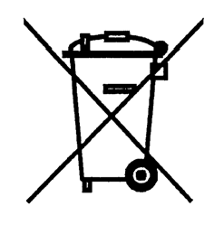
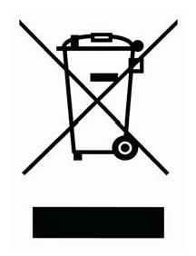

Príloha č. 2 k vyhláške č. 315/2010 Z. z.

- Vzory

  - Grafické symboly pre označenie elektrozariadenia

  - Označenie elektrozariadenia podľa § 54b ods. 1 písm. c) zákona

- 

  - Označenie elektrozariadenia uvázaného na trh po 13. auguste 2005 podľa § 54b ods. 1 písm. b) zákona

- 
