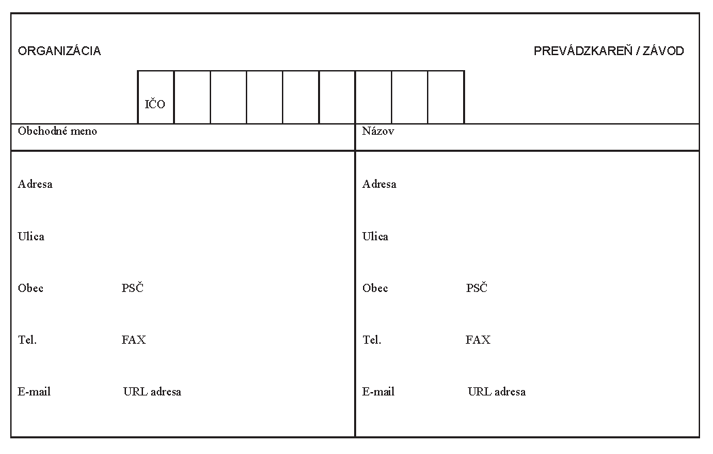
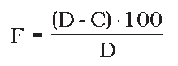
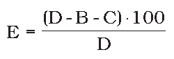

Príloha č. 3 k vyhláške č. 315/2010 Z. z.

- Vzor

  - Hlásenie spracovateľa elektroodpadu

  - Hlásenie za: ........../.......... štvrťrok/rok

- 

  - Materiálová bilancia elektroodpadu

  - Údaje o vstupoch do zariadenia na spracovanie elektroodpadu:

- Kategória | Podkategória elektroodpadu | Katalógové č. elektroodpadu | A (kg) | D (kg)

  - Údaje o výstupoch zo zariadenia na spracovanie elektroodpadu:

- Názov odpadu | Katalógové číslo | | | | | | IČO a obchodné meno nasledujúceho držiteľa | Kód činnosti | | | | R (kg) | B (kg) | C (kg)

- kondenzátory obsahujúce polychlórované bifenyly | | | | | | | | | | | | | |

- súčiastky obsahujúce ortuť, napr. spínače, lampy na podsvietenie | | | | | | | | | | | | | |

- batérie | | | | | | | | | | | | | |

- dosky s plošnými spojmi | | | | | | | | | | | | | |

- kazety s tonerom, kvapalné a husté, ako aj farebné tonery | | | | | | | | | | | | | |

- plasty obsahujúce brómované samozhášavé prísady | | | | | | | | | | | | | |

- súčiastky azbestové alebo obsahujúce azbest | | | | | | | | | | | | | |

- katódové trubice | | | | | | | | | | | | | |

- freóny (CFC, HCFC, HFC) | | | | | | | | | | | | | |

- uhľovodíky (HC) | | | | | | | | | | | | | |

- čpavok (NH3) | | | | | | | | | | | | | |

- plynové výbojky | | | | | | | | | | | | | |

- obrazovky s tekutými kryštálmi a ostatné obrazovky podsvietené plynovými výbojkami | | | | | | | | | | | | | |

- vonkajšie elektrické káble | | | | | | | | | | | | | |

- súčiastky obsahujúce ohňovzdorné keramické vlákna | | | | | | | | | | | | | |

- súčiastky obsahujúce rádioaktívne látky | | | | | | | | | | | | | |

- elektrolytické kondenzátory obsahujúce problémové látky | | | | | | | | | | | | | |

- oleje | | | | | | | | | | | | | |

- sklo | | | | | | | | | | | | | |

- plasty | | | | | | | | | | | | | |

- železné kovy | | | | | | | | | | | | | |

- neželezné kovy | | | | | | | | | | | | | |

- ostatné materiály, látky a súčiastky | | | | | | | | | | | | | |

- Spolu | | | | | | | | | | | | | |

- F (%) | | | | | | | | | | | | | |

- E (%) | | | | | | | | | | | | | |

  - Zodpovedná osoba:

  - Tlačivo HLÁSENIE SPRACOVATEĽA ELEKTROODPADU

  - Spôsob vypĺňania tlačiva HLÁSENIE SPRACOVATEĽA ELEKTROODPADU

  - V tomto tlačive sa uvádzajú sumárne údaje za predchádzajúci štvrťrok podľa nasledujúcich podkategórií elektrozariadení:

  - 1.a – chladiarenské, mraziarenské a klimatizačné zariadenia

  - 1.b – ostatné veľké domáce spotrebiče

  - 2. – malé domáce spotrebiče

  - 3.a – zobrazovacie zariadenia s katódovými trubicami

  - 3.b – ostatné informačné technológie a telekomunikačné zariadenia

  - 4.a – zobrazovacie zariadenia s katódovými trubicami

  - 4.b – ostatná spotrebná elektronika

  - 5.a – plynové výbojky

  - 5.b – ostatné osvetľovacie zariadenia

  - 6. – elektrické a elektronické nástroje (okrem veľkých stacionárnych priemyselných nástrojov)

  - 7. – hračky, zariadenia určené na športové a rekreačné účely

  - 8. – zdravotnícke zariadenia (okrem všetkých implantovaných a infikovaných výrobkov)

  - 9. – prístroje na monitorovanie a kontrolu

  - 10. – predajné automaty.

  - Údaje sa vypĺňajú za každú podkategóriu na samostatnom tlačive.

  - ORGANIZÁCIA

  - IČO – uvedie sa identifikačné číslo organizácie (spracovateľa elektroodpadu); ak má organizácia IČO menšie ako osemmiestne, zľava sa doplnia nuly na celkový počet 8 miest.

  - Obchodné meno – uvedie sa obchodné meno organizácie (spracovateľa elektroodpadu) tak, ako je zapísané v obchodnom registri alebo v živnostenskom liste.

  - Ulica, obec, PSČ – uvádza sa presná a úplná adresa organizácie, jej telefónne číslo, faxové číslo, e- mailová adresa a adresa URL.

  - PREVÁDZKAREŇ/ZÁVOD

  - Nasledujúca časť týkajúca sa samostatnej prevádzkarne/závodu sa vypĺňa v prípade, že nie je totožná s organizáciou.

  - Názov – uvádza sa, ak je zavedený vnútri organizácie.

  - Ulica, obec, PSČ – uvádza sa presná a úplná adresa samostatnej prevádzkarne, jej telefónne číslo, faxové číslo, e- mailová adresa a adresa URL.

  - MATERIÁLOVÁ BILANCIA ELEKTROODPADU

  - Údaje o vstupoch do zariadenia na spracovanie elektroodpadu:

  - Kategória – uvedie sa kategória elektrozariadenia, do ktorej spadá elektroodpad prijatý do zariadenia na spracovanie elektroodpadu alebo spracovaný elektroodpad (napr. kategória č. 1).

  - Podkategória elektroodpadu – uvedie sa podkategória elektroodpadu prijatého do zariadenia na spracovanie elektroodpadu alebo spracovaného elektroodpadu v rámci kategórie (napr. 1.a – chladiarenské, mraziarenské a klimatizačné zariadenia).

  - Katalógové číslo – uvedie sa katalógové číslo elektroodpadu podľa vyhlášky Ministerstva životného prostredia Slovenskej republiky č. 284/2001 Z. z., ktorou sa ustanovuje Katalóg odpadov v znení neskorších predpisov. V rámci jednej podkategórie sa uvádzajú jednotlivé katalógové čísla v samostatnom riadku.

  - A (kg) – uvedie sa celková hmotnosť elektroodpadu prijatého do zariadenia na spracovanie elektroodpadu v kilogramoch podľa katalógových čísiel.

  - D (kg) – uvedie sa celková hmotnosť spracovaného elektroodpadu v kilogramoch podľa katalógových čísiel.

  - Údaje o výstupoch zo zariadenia na spracovanie elektroodpadu:

  - Názov odpadu – obsahuje prednostne odobraté látky a súčiastky z elektroodpadu podľa § 4 ods. 5 a ďalšie odpady a materiály, ktoré vznikajú spracovaním elektroodpadu. V poslednom riadku sa dopĺňajú vyseparované látky, materiály a súčiastky, ktoré nie sú uvedené vyššie.

  - Katalógové číslo – uvedie sa katalógové číslo odpadu pri výstupe zo zariadenia na spracovanie elektroodpadu podľa vyhlášky Ministerstva životného prostredia Slovenskej republiky č. 284/2001 Z. z., ktorou sa ustanovuje Katalóg odpadov v znení neskorších predpisov.

  - IČO a obchodné meno nasledujúceho držiteľa – uvedie sa IČO a obchodné meno nasledujúceho držiteľa elektroodpadu, komu sa elektroodpad odovzdáva na ďalšie zhodnotenie, opätovné použitie alebo recykláciu.

  - Kód činnosti – uvedie sa kód činnosti (zhodnocovania alebo zneškodňovania) podľa príloh č. 2 a 3 zákona.

  - R (kg) – uvedie sa hmotnosť materiálovo zhodnoteného elektroodpadu v kilogramoch.

  - B (kg) – uvedie sa hmotnosť energeticky zhodnoteného elektroodpadu v kilogramoch.

  - C (kg) – uvedie sa hmotnosť zneškodneného elektroodpadu v kilogramoch.

  - F (%) – uvedie sa limit zhodnotenia elektroodpadu vypočítaného podľa nasledujúceho vzorca v percentách:

- 

  - E (%) – uvedie sa limit opätovného použitia a recyklácie elektroodpadu vypočítaného podľa nasledujúceho vzorca v percentách:

- 

  - Zodpovedná osoba – uvedie sa poverený pracovník, ktorý je v organizácii/prevádzkarni zodpovedný za vypĺňanie hlásenia spracovateľa elektroodpadu na príslušnom mieste organizácie/prevádzkarne.
