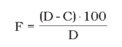
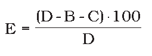

Príloha č. 4 k vyhláške č. 315/2010 Z. z.

- Vzor

  - Hlásenie výrobcu elektrozariadení za rok 20xx

  - Číslo registrácie: EZ 0000000

  - Obchodné meno:

  - Sídlo:

  - IČO:

  - Kolektívna organizácia:

  - Tabuľka A

- Elektrozariadenia | | | | | | | | Elektroodpad | | | | | | | | | | | |

- Kategória | | | | Podkategória | Uvedené na trh (kg) | | | Zozbieraný z domácností (kg) | | | | | | | Zozbieraný nie z domácností (kg) | Zozbieraný spolu (kg) | Spracovaný na území SR (kg) | Vyvezený a spracovaný v EÚ (kg) | Vyvezený a spracovaný mimo EÚ (kg) | Spracovaný spolu (kg)

- | | | | | v roku 20xx -1 | | v roku 20xx | | | | | | | | | | | | |

- 1. | | | | 1.a chladiarenské, mraziarenské a klimatizačné zariadenia | | | | | | | | | | | | | | | |

- | | | | 1.b ostatné veľké domáce spotrebiče | | | | | | | | | | | | | | | |

- | | | | spolu | | | | | | | | | | | | | | | |

- 2. | | | | 2. | | | | | | | | | | | | | | | |

- 3. | | | | 3.a zobrazova- cie zariadenia skatódovými trubicami | | | | | | | | | | | | | | | |

- | | | | 3.b ostatné informačné technológie | | | | | | | | | | | | | | | |

- | | | | spolu | | | | | | | | | | | | | | | |

- 4. | | | | 4.a zobrazovacie zariadenia skatódovými trubicami | | | | | | | | | | | | | | | |

- | | | | 4.b ostatná spotrebná elektronika | | | | | | | | | | | | | | | |

- | | | | spolu | | | | | | | | | | | | | | | |

- 5. | | | | 5.a plynové výbojky | | | | | | | | | | | | | | | |

- | | | | 5.b ostatné osvetľovacie zariadenia | | | | | | | | | | | | | | | |

- | | | | spolu | | | | | | | | | | | | | | | |

- 6. | | | | 6. | | | | | | | | | | | | | | | |

- 7. | | | | 7. | | | | | | | | | | | | | | | |

- 8. | | | | 8. | | | | | | | | | | | | | | | |

- 9. | | | | 9. | | | | | | | | | | | | | | | |

- 10. | | | | 10. | | | | | | | | | | | | | | | |

  - Tabuľka B

- Elektrozariadenia | Zhodnotenie | | | Opätovné použitie a recyklácia | | | Opätovné použitie ako celok

- Kategória | (kg) | | F (%) | (kg) | | E (%) | (kg)

- 1. | | | | | | |

- 2. | | | | | | |

- 3. | | | | | | |

- 4. | | | | | | |

- 5. | | | | | | |

- plynové výbojky | | | | | | |

- 6. | | | | | | |

- 7. | | | | | | |

- 8. | | | | | | |

- 9. | | | | | | |

- 10. | | | | | | |

  - Zodpovedná osoba:

  - Tlačivo HLÁSENIE výrobcu elektrozariadenÍ

  - Spôsob vypĺňania tlačiva HLÁSENIE výrobcu elektrozariadení

  - V tabuľke A tohto tlačiva výrobcovia elektrozariadení uvádzajú sumárne údaje za predchádzajúci kalendárny rok podľa jednotlivých podkategórií elektrozariadení v kilogramoch. V tabuľke B tohto tlačiva výrobcovia elektrozariadení uvádzajú sumárne údaje za predchádzajúci kalendárny rok podľa jednotlivých kategórií elektrozariadení (plynové výbojky sa uvádzajú samostatne) v kilogramoch/v percentách.

  - Číslo registrácie – uvedie sa číslo registrácie, pod akým Ministerstvo životného prostredia Slovenskej republiky zapíše výrobcu elektrozariadení do Registra výrobcov elektrozariadení a vydá mu Potvrdenie o zápise do Registra výrobcov elektrozariadení, ktorého vzor je uvedený v prílohe č. 3.

  - Obchodné meno – uvedie sa obchodné meno organizácie (výrobcu elektrozariadení) tak, ako je zapísané v obchodnom registri alebo v živnostenskom liste.

  - Sídlo – uvedie sa presná a úplná adresa organizácie (výrobcu elektrozariadení), jej telefónne číslo, faxové číslo, e-mailová adresa a adresa URL.

  - IČO – uvedie sa identifikačné číslo organizácie (výrobcu elektrozariadení); ak má organizácia IČO menšie ako osemmiestne, zľava sa doplnia nuly na celkový počet 8 miest.

  - Kolektívna organizácia – uvedie sa názov kolektívnej organizácie, ktorej je členom, ak neplní ustanovené povinnosti individuálne.

  - Tabuľka A

  - Elektrozariadenia

  - Uvedené na trh (kg)

  - v roku 20xx -1 – uvedie sa hmotnosť elektrozariadení v kilogramoch, ktoré výrobca uviedol na trh v kalendárnom roku (x-1), ktorý predchádza kalendárnemu roku (x), za ktorý sa podáva hlásenie,

  - v roku 20xx – uvedie sa hmotnosť elektrozariadení v kilogramoch, ktoré výrobca uviedol na trh v kalendárnom roku (x), za ktorý sa podáva hlásenie.

  - Elektroodpad zozbieraný z domácností (kg) – uvedie sa hmotnosť zozbieraného elektroodpadu z domácností podľa § 54a ods. 4 zákona v kilogramoch v kalendárnom roku, za ktorý sa podáva hlásenie.

  - Elektroodpad zozbieraný nie z domácností (kg) – uvedie sa hmotnosť zozbieraného elektroodpadu, ktorý nie je elektroodpadom z domácností podľa § 54a ods. 5 zákona v kilogramoch v kalendárnom roku, za ktorý sa podáva hlásenie.

  - Elektroodpad zozbieraný spolu (kg) – táto kolónka tlačiva sa vytvorí sčítaním údajov o množstvách zozbieraného elektroodpadu z domácností a o množstvách zozbieraného elektroodpadu nie z domácností v kilogramoch v kalendárnom roku, za ktorý sa podáva hlásenie. Množstvo elektroodpadu zozbieraného spolu sa rovná súčtu množstiev elektroodpadu spracovaného spolu a skladovaného elektroodpadu pred samotným spracovaním.

  - Elektroodpad spracovaný na území SR (kg) – uvedie sa hmotnosť spracovaného elektroodpadu na území SR v kilogramoch v kalendárnom roku, za ktorý sa podáva hlásenie.

  - Elektroodpad vyvezený a spracovaný v EÚ (kg) – uvedie sa hmotnosť vyvezeného a spracovaného elektroodpadu na území iného členského štátu EÚ ako SR podľa štvrtej časti zákona o odpadoch v kilogramoch v kalendárnom roku, za ktorý sa podáva hlásenie.

  - Elektroodpad vyvezený a spracovaný mimo EÚ (kg) – uvedie sa hmotnosť vyvezeného a spracovaného elektroodpadu na územie nečlenského štátu EÚ podľa štvrtej časti zákona o odpadoch v kilogramoch v kalendárnom roku, za ktorý sa podáva hlásenie.

  - Elektroodpad spracovaný spolu (kg) – táto kolónka tlačiva sa vytvorí sčítaním údajov o množstvách spracovaného elektroodpadu na území SR, vyvezeného a spracovaného v EÚ a vyvezeného a spracovaného mimo EÚ v kilogramoch v kalendárnom roku, za ktorý sa podáva hlásenie.

  - Tabuľka B

  - Elektroodpad

  - Zhodnotenie (kg) – uvedie sa celkové množstvo zhodnoteného elektroodpadu v kilogramoch v kalendárnom roku, za ktorý sa podáva hlásenie.

  - Zhodnotenie F (%) – uvedie sa limit zhodnotenia elektroodpadu v percentách v kalendárnom roku, za ktorý sa podáva hlásenie podľa nasledujúceho vzorca:

- 

  - D – hmotnosť spracovaného elektroodpadu v kilogramoch

  - C – hmotnosť zneškodneného elektroodpadu v kilogramoch.

  - Opätovné použitie a recyklácia (kg) – uvedie sa celkové množstvo opätovne použitého a recyklovaného elektroodpadu v kilogramoch v kalendárnom roku, za ktorý sa podáva hlásenie.

  - Opätovné použitie a recyklácia E (%) – uvedie sa limit opätovného použitia a recyklácie elektroodpadu v percentách v kalendárnom roku, za ktorý sa podáva hlásenie podľa nasledujúceho vzorca:

  - 

  - D – hmotnosť spracovaného elektroodpadu v kilogramoch

  - B – hmotnosť energeticky zhodnoteného elektroodpadu v kilogramoch

  - C – hmotnosť zneškodneného elektroodpadu v kilogramoch.

  - Opätovné použitie ako celok (kg) – uvedie sa celkové množstvo elektrozariadení, ktoré boli opätovne použité ako celok v kilogramoch v kalendárnom roku, za ktorý sa podáva hlásenie.

  - Zodpovedná osoba – uvedie sa poverený pracovník, ktorý je zodpovedný za vypĺňanie tlačiva Hlásenie výrobcu elektrozariadení na príslušnom mieste.
