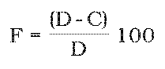
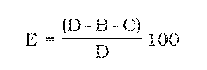

Príloha č. 6a k vyhláške č. 315/2010 Z. z.

- VZOR

  - HLÁSENIE SPRACOVATEĽA ELEKTROODPADU

  - [Vzor 01](../assets/738320626e5c53a4f960da79eea416583361a073c92c7b79bb09c0ac855bc632.pdf)

  - Tlačivo HLÁSENIE SPRACOVATEĽA ELEKTROODPADU

  - Spôsob vypĺňania tlačiva HLÁSENIE SPRACOVATEĽA ELEKTROODPADU

  - V tomto tlačive sa uvádzajú sumárne údaje za predchádzajúci štvrťrok podľa jednotlivých kategórií elektrozariadení (plynové výbojky sa uvádzajú samostatne) a opis spôsobu spracovania elektroodpadu.

  - ORGANIZÁCIA

  - IČO – uvedie sa identifikačné číslo organizácie (spracovateľa elektroodpadu); ak má organizácia IČO menšie ako osemmiestne, zľava sa doplnia nuly na celkový počet 8 miest.

  - Obchodné meno – uvedie sa obchodné meno organizácie (spracovateľa elektroodpadu) tak, ako je zapísané v obchodnom registri alebo v živnostenskom liste.

  - Ulica, obec, PSČ – uvádza sa presná a úplna adresa organizácie, jej telefón, fax, e-mail, adresa URL.

  - PREVÁDZKAREŇ/ZÁVOD

  - Nasledujúca časť týkajúca sa samostatnej prevádzkarne/závodu sa vypĺňa v prípade, že nie je totožná s organizáciou.

  - Názov – uvádza sa, ak je zavedený vnútri organizácie.

  - Ulica, obec, PSČ – uvádza sa presná a úplná adresa samostatnej prevádzkarne, jej telefón, fax, e-mail, adresa URL.

  - Elektrozariadenia

  - Druh – uvedie sa číslo druhu elektrozariadenia v rámci kategórie podľa prílohy č. 1.

  - Značka – uvedie sa značka jednotlivých druhov elektrozariadení samostatne.

  - D (kg) – uvedie sa hmotnosť elektroodpadu prijatého do zariadenia na spracovanie elektroodpadu v kilogramoch.

  - C (kg) – uvedie sa hmotnosť zneškodneného elektroodpadu v kilogramoch.

  - B (kg) – uvedie sa hmotnosť energeticky zhodnoteného elektroodpadu v kilogramoch.

  - F (%) – uvedie sa limit zhodnotenia elektroodpadu vypočítaného podľa nasledujúceho vzorca v percentách:

- 

  - E (%) – uvedie sa limit opätovného použitia a recyklácie elektroodpadu vypočítaného podľa nasledujúceho vzorca

  - v percentách:

- 

  - Poznámka – uvedú sa informácie podľa potreby spracovateľa elektroodpadu.

  - Opis spôsobu spracovania elektrodpadu – spracovateľ elektroodpadu uvedie bližšie informácie o spôsobe spracovania elektroodpadu podľa jednotlivých kategórií elektrozariadení pre výrobcu elektrozariadenia.

  - Zodpovedná osoba – uvedie sa poverený pracovník, ktorý je v organizácii /prevádzkarni zodpovedný za vypĺňanie hlásenia spracovateľa elektroodpadu na príslušnom mieste organizácie/prevádzkarne.
