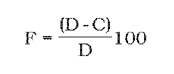
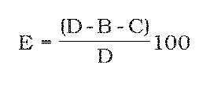

Príloha č. 6b k vyhláške č. 315/2010 Z. z.

- HLÁSENIE VÝROBCU ELEKTROZARIADENÍ ZA ROK 2010 [Vzor 02](../assets/d92014ac9038fd236089678319b27ff21aa631322143ee5c5ea347e8fe10fe41.pdf)

  - Tlačivo HLÁSENIE VÝROBCU ELEKTROZARIADENÍ

  - Spôsob vypĺňania tlačiva HLÁSENIE VÝROBCU ELEKTROZARIADENÍ

  - V tomto tlačive výrobcovia elektrozariadení uvádzajú sumárne údaje za predchádzajúci kalendárny rok podľa jednotlivých kategórií elektrozariadení (plynové výbojky sa uvádzajú samostatne).

  - Číslo registrácie – uvedie sa číslo registrácie, pod akým Ministerstvo životného prostredia Slovenskej republiky zapíše výrobcu elektrozariadení do Registra výrobcov elektrozariadení a vydá mu potvrdenie o zápise do Registra výrobcov elektrozariadení.

  - Obchodné meno – uvedie sa obchodné meno organizácie (výrobcu elektrozariadení) tak, ako je zapísané v obchodnom registri alebo v živnostenskom liste.

  - Sídlo – uvedie sa presná a úplna adresa organizácie (výrobcu elektrozariadení), jej telefón, fax, e-mail, adresa URL.

  - IČO – uvedie sa identifikačné číslo organizácie (výrobcu elektrozariadení); ak má organizácia IČO menšie ako osemmiestne, zľava sa doplnia nuly na celkový počet 8 miest.

  - Kolektívna organizácia – uvedie sa údaj o zapojení sa do kolektívnej organizácie spätného odberu elektrozariadení, oddeleného zberu alebo nakladania s elektroodpadom s identifikáciou kolektívneho systému, ak neplní ustanovené povinnosti individuálne.

  - Tabuľka A

  - Elektrozariadenia

  - Druh – uvedie sa číslo druhu elektrozariadenia v rámci kategórie podľa prílohy č. 1.

  - Značka – uvedie sa značka jednotlivých druhov elektrozariadení samostatne.

  - Uvedené na trh (kg) – uvedie sa hmotnosť elektrozariadení, ktoré výrobca uviedol na trh podľa § 54a ods. 18 zákona za predchádzajúci kalendárny rok v kilogramoch.

  - Elektroodpad zozbieraný z domácností (kg) – uvedie sa hmotnosť zozbieraného elektroodpadu z domácností podľa § 54a ods. 4 zákona za predchádzajúci kalendárny rok v kilogramoch.

  - Elektroodpad zozbieraný nie z domácností (kg) – uvedie sa hmotnosť zozbieraného elektroodpadu nie z domácností podľa § 54a ods. 5 zákona za predchádzajúci kalendárny rok v kilogramoch.

  - Elektroodpad zozbieraný spolu (kg) – táto kolónka tlačiva sa vytvorí sčítaním údajov o množstvách zozbieraného elektroodpadu z domácností a o množstvách zozbieraného elektroodpadu nie z domácností za predchádzajúci kalendárny rok v kilogramoch. Množstvo elektroodpadu zozbieraného spolu sa rovná súčtu množstiev elektroodpadu spracovaného spolu a skladovaného elektroodpadu pred samotným spracovaním.

  - Elektroodpad spracovaný na území SR (kg) – uvedie sa hmotnosť spracovaného elektroodpadu na území Slovenskej republiky za predchádzajúci kalendárny rok v kilogramoch.

  - Elektroodpad vyvezený a spracovaný v EÚ (kg) – uvedie sa hmotnosť vyvezeného a spracovaného elektroodpadu na území iného členského štátu Európskej únie ako Slovenskej republiky podľa štvrtej časti zákona za predchádzajúci kalendárny rok v kilogramoch.

  - Elektroodpad vyvezený a spracovaný mimo EÚ (kg) – uvedie sa hmotnosť vyvezeného a spracovaného elektroodpadu na územie nečlenského štátu Európskej únie podľa štvrtej časti zákona za predchádzajúci kalendárny rok v kilogramoch.

  - Elektroodpad spracovaný spolu (kg) – táto kolónka tlačiva sa vytvorí sčítaním údajov o množstvách spracovaného elektroodpadu na území Slovenskej republiky, vyvezeného a spracovaného v Európskej únii a vyvezeného a spracovaného mimo Európskej únie v kilogramoch v kalendárnom roku, za ktorý sa podáva hlásenie.

  - Tabuľka B

  - Elektrozariadenia

  - Druh – uvedie sa číslo druhu elektrozariadenia v rámci kategórie podľa prílohy č. 1.

  - Značka – uvedie sa značka jednotlivých druhov elektrozariadení samostatne.

  - Zhodnotenie (kg) – uvedie sa celkové množstvo zhodnoteného elektroodpadu za predchádzajúci kalendárny rok v kilogramoch.

  - Zhodnotenie F (%) – uvedie sa limit zhodnotenia elektroodpadu za predchádzajúci kalendárny rok podľa nasledujúceho vzorca:

- 

  - D – hmotnosť elektroodpadu prijatého do spracovateľského zariadenia v kilogramoch,

  - C – hmotnosť zneškodneného elektroodpadu v kilogramoch.

  - Opätovné použitie a recyklácia (kg) – uvedie sa celkové množstvo opätovne použitého a recyklovaného elektroodpadu za predchádzajúci kalendárny rok v kilogramoch.

  - Opätovné použitie a recyklácia E (%) – uvedie sa limit opätovného použitia a recyklácie elektroodpadu za predchádzajúci kalendárny rok podľa nasledujúceho vzorca v percentách:

- 

  - D – hmotnosť elektroodpadu prijatého do spracovateľského zariadenia v kilogramoch,

  - B – hmotnosť energeticky zhodnoteného elektroodpadu v kilogramoch,

  - C – hmotnosť zneškodneného elektroodpadu v kilogramoch.

  - Opätovné použitie ako celok (kg) – uvedie sa celkové množstvo elektrozariadení, ktoré boli opätovne použité ako celok v kilogramoch v kalendárnom roku, za ktorý sa podáva hlásenie.

  - Zodpovedná osoba – uvedie sa poverený pracovník, ktorý je zodpovedný za vypĺňanie tlačiva Hlásenie výrobcu elektrozariadení na príslušnom mieste.
