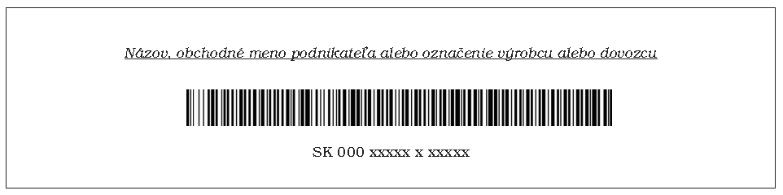
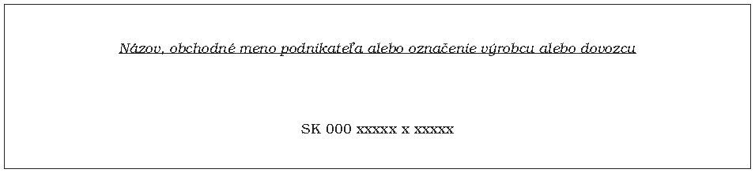

Príloha č. 1 k nariadeniu vlády č. 322/2010 Z. z.

- Jednoznačná identifikácia výbušniny

  - Jednoznačná identifikácia pozostáva z

    - A. čitateľnej časti identifikácie, ktorá obsahuje

      - a) meno, priezvisko a adresu výrobcu,

      - b) alfanumerický kód, ktorý obsahuje

        - 1. dve identifikačné písmená členského štátu Európskej únie (miesta výroby alebo dovozu na trh Európskej únie),

        - 2. tri čísla, identifikujúce názov miesta výroby, pridelené Hlavným banským úradom,

        - 3. jednoznačný kód výrobku a logistickú informáciu pridelenú výrobcom;

    - B. elektronicky čitateľnej identifikácie v podobe čiarového kódu alebo matricového kódu, ktorá sa vzťahuje priamo na alfanumerický kód.

      - Príklad čiarového kódu:

  - 

    - Príklad matricového kódu:

  - 

    - Pre položky príliš malé na to, aby k nim bol pripojený jednoznačný kód identifikácie výrobku a logistická informácia pridelená výrobcom, sa za dostatočné považujú informácie podľa písmena A písm. b) bodov 1 až 3.

    - Označenie členských štátov Európskej únie

  - Belgicko | BE

  - Bulharsko | BG

  - Česká republika | CZ

  - Dánsko | DK

  - Estónsko | EE

  - Fínsko | FI

  - Francúzsko | FR

  - Írsko | IE

  - Taliansko | IT

  - Cyprus | CY

  - Litva | LV

  - Lotyšsko | LT

  - Luxembursko | LU

  - Maďarsko | HU

  - Malta | MT

  - Nemecko | DE

  - Holandsko | NL

  - Poľsko | PL

  - Portugalsko | PT

  - Rakúsko | AT

  - Rumunsko | RO

  - Grécko | GR

  - Slovensko | SK

  - Slovinsko | SI

  - Spojené kráľovstvo | GB

  - Španielsko | ES

  - Švédsko | SE
