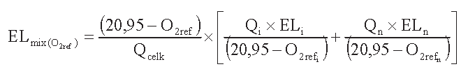
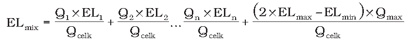

Príloha č. 4 k vyhláške č. 356/2010 Z. z.

- ŠPECIFICKÉ EMISNÉ LIMITY, TECHNICKÉ POŽIADAVKY A VŠEOBECNÉ PODMIENKY PREVÁDZKOVANIA STACIONÁRNYCH ZDROJOV

  - I. PALIVOVO-ENERGETICKÝ PRIEMYSEL

    - 1. TECHNOLOGICKÉ CELKY OBSAHUJÚCE STACIONÁRNE ZARIADENIA NA SPAĽOVANIE PALÍV ( TEPLÁRNE, ELEKTRÁRNE, VÝHREVNE, KOTOLNE A ZARIADENIA NA NEPRIAMY PROCESNÝ OHREV)

      - 1.1 Zariadenie na spaľovanie palív

      - 1.1.1 Zariadenie na spaľovanie palív je zariadenie, ktoré slúži na oxidáciu palív na účel výroby energie; vymedzuje sa podľa agregačných pravidiel ustanovených v bode 1.3.

      - 1.1.2 Bod 1. neplatí pre

        - a) zariadenia, v ktorých sa spaliny používajú na priame vykurovanie, sušenie alebo iné tepelné úpravy materiálov a predmetov (ďalej len „priamy procesný ohrev“),

        - b) koncové spaľovacie zariadenia určené na čistenie odpadových plynov spaľovaním, ak nie sú prevádzkované ako samostatné zariadenia na spaľovanie palív,

        - c) zariadenia na regeneráciu katalyzátorov pre katalytické krakovanie,

        - d) zariadenia na premenu sírovodíka na síru,

        - e) reaktory používané v chemickom priemysle okrem zariadení na nepriamy procesný ohrev,

        - f) koksárenské pece,

        - g) ohrievače vetra,

        - h) technické zariadenia používané na pohon vozidiel, lodí a lietadiel.

      - 1.1.3 Špecifické emisné limity a technické požiadavky a všeobecné podmienky prevádzkovania pre plynové turbíny sú ustanovené osobitne v bode 2 a pre stacionárne piestové spaľovacie motory v bode 3.

      - 1.2 Členenie zariadení na spaľovanie palív vo vzťahu k uplatňovaniu emisných limitov

      - 1.2.1 Zariadenia stacionárnych zdrojov, pre ktoré bolo vydané stavebné povolenie, alebo ak také nie je, povolenie na užívanie do 30. júna 1987.

      - 1.2.2 Zariadenia stacionárnych zdrojov, pre ktoré bolo vydané stavebné povolenie, alebo ak také nie je, povolenie na užívanie od 1. júla 1987 do 31. marca 1998, alebo bolo vydané stavebné povolenie do 31. marca 1998 a povolenie na užívanie do 31. marca 2001.

      - 1.2.3 Zariadenia stacionárnych zdrojov, pre ktoré bolo vydané stavebné povolenie od 31. marca 2001 do 27. novembra 2002 a uvedené do prevádzky do 27. novembra 2003.

      - 1.2.4 Zariadenia stacionárnych zdrojov, pre ktoré bolo vydané stavebné povolenie od 27. novembra 2002 a uvedené do prevádzky od 27. novembra 2003.

      - 1.3 Vymedzenie zariadenia na spaľovanie palív pre priradenie emisných limitov

      - 1.3.1 Agregačné pravidlá

      - Pre priradenie emisných limitov, ak odpadové plyny z dvoch alebo viacerých samostatných spaľovacích jednotiek, napríklad kotlov,

        - a) sú vypúšťané cez spoločný komín alebo

        - b) ide o zariadenia 1.2.2 až 1.2.4, ktoré by mohli byť podľa posúdenia príslušného orgánu po zohľadnení technických a ekonomických faktorov vypúšťané cez spoločný komín,

        - zariadenie sa vymedzuje ako jeden celok v závislosti od celkového menovitého tepelného príkonu takto:

      - 1.3.2 Zariadenie s celkovým menovitým tepelným príkonom ≥50 MW

      - Ak celkový súčet menovitých tepelných príkonov kotlov je ≥50 MW, pre priradenie emisných limitov sa príkony spočítavajú bez ohľadu na typ spaľovaného paliva.

      - 1.3.3 Zariadenie s celkovým menovitým tepelným príkonom (0,3 – 50) MW

        - Ak celkový súčet menovitých tepelných príkonov spaľovacích jednotiek je v rozmedzí (0,3 – 50) MW, pre priradenie emisných limitov sa spočítavajú príkony spaľovacích jednotiek spaľujúcich palivo rovnakého typu: tuhé, kvapalné, plynné. Pri viacpalivovom systéme sa pripočítava príkon kotla k ostatným kotlom podľa prevládajúceho paliva. Ak sú do jedného komína zaústené len kotly s viacpalivovým systémom, spočítajú sa ich príkony bez ohľadu na prevládajúce palivo. Osobitne sa spočítavajú príkony kotlov s cirkulujúcou fluidnou a pretlakovou vrstvou a osobitne kotlov s výtavným ohniskom.

      - 1.3.4 Zariadenie s menovitým tepelným príkonom < 0,3 MW

        - Kotol alebo iná technická jednotka na spaľovanie palív s menovitým tepelným príkonom < 0,3 MW sa považuje za samostatné zariadenie a nespočítava sa s ostatnými kotlami. Platia pre ne požiadavky podľa bodu 1.10. Emisie z takýchto zariadení musia zodpovedať požiadavkám podľa technických noriem a iných obdobných špecifikácií, ktoré sa na príslušné zariadenia vzťahujú.

      - 1.3.5 Zariadenie na núdzovú prevádzku

        - Pre zariadenie na spaľovanie palív s menovitým tepelným príkonom do 50 MW, ktoré je podľa dokumentácie používané na núdzovú a inú obdobnú prevádzku, ktorá má trvanie najviac 240 h/rok, sa emisné limity neuplatňujú. Emisie z takéhoto zariadenia musia zodpovedať požiadavkám podľa technických noriem a iných obdobných špecifikácií, ktoré sa na príslušné zariadenia vzťahujú.

      - 1.3.6 Zariadenie s ukončením prevádzky do 20 000 h

        - Je to zariadenie uvedené v bode 1.2.1, ktoré na základe písomného záväzku prevádzkovateľa predloženého príslušnému orgánu do 15. januára 2008 bude v období od 1. januára 2008 do 31. decembra 2015 prevádzkované najviac 20 000 hodín do ukončenia prevádzky. Emisné limity sa na toto zariadenie neuplatňujú.

        - Správu o počte využitých prevádzkových hodín za uplynulý rok a o počte prevádzkových hodín, ktoré ostávajú do vyčerpania časového limitu tohto zariadenia, prevádzkovateľ predkladá príslušnému orgánu každoročne do 15. februára počnúc rokom 2009.

      - 1.3.7 Zariadenie s obmedzeným prevádzkovým režimom

        - Zariadenie s obmedzeným prevádzkovým režimom je zariadenie, ktoré nie je v prevádzke viac ako

        - a) 2 000 hodín ročne do konca roku 2015,

        - b) 1 500 hodín ročne od 1. januára 2016

          - priemerne v období 5 rokov.

          - Správu o počte odprevádzkovaných hodín za uplynulý rok, ako aj päťročný priemer prevádzkovateľ predkladá príslušným orgánom každoročne do 15. februára.

      - 1.3.8 Zariadenie na nepriamy procesný ohrev

        - Zariadenie na nepriamy procesný ohrev je zariadenie na spaľovanie palív, ktoré je využívané na technologický ohrev, pričom spalinový prúd je od ďalšej technológie oddelený pevnou teplovýmennou plochou a množstvo a zloženie emisií je závislé len od množstva a zloženia paliva. Platia pre ne požiadavky ustanovené v bode 1 okrem špecifických technologických pecí, ako sú pekárenské cyklotermické pece, téglikové taviace pece a ohrevy taviacich vaní, s celkovým menovitým tepelným príkonom do 50 MW, kde konštrukčné riešenie zariadenia umožňuje iba obmedzene ovplyvniť tvorbu emisií; v takom prípade príslušný orgán určí emisné limity individuálne.

      - 1.4 Uplatňovanie emisných limitov a všeobecných podmienok prevádzkovania

      - 1.4.1 Uplatňovanie emisných limitov pre viacpalivové zariadenia

        - Viacpalivové zariadenie na spaľovanie palív je zariadenie, ktoré môže spaľovať súčasne alebo striedavo dva alebo viac druhov palív.

      - 1.4.1.1 Spaľovanie viacerých druhov palív v jednom zariadení striedavo

        - Pri spaľovaní viacerých druhov palív v jednom spaľovacom zariadení tak, že je spaľovaný vždy len jeden druh paliva, platí emisný limit pre spaľovaný druh paliva.

      - 1.4.1.2 Spaľovanie viacerých druhov palív v jednom zariadení súčasne

        - a) Pri spaľovaní viacerých druhov palív súčasne v jednom zariadení sa emisný limit určí takto:

        - 1. pre každé palivo a danú znečisťujúcu látku sa určí emisný limit zodpovedajúci celkovému menovitému tepelnému príkonu zariadenia,

      - 2. vypočíta sa vážený podiel emisných limitov pre jednotlivé palivá; tieto hodnoty sa získajú vynásobením hodnoty emisného limitu platného pre uvedené palivo menovitým tepelným príkonom dodaným týmto palivom a tento súčin sa vydelí celkovým menovitým príkonom zariadenia,

      - 3. modifikovaný vážený priemer emisných limitov sa určí ako súčet vážených podielov emisných limitov jednotlivých palív po prepočte na zodpovedajúci obsah kyslíka.

        - Postup výpočtu modifikovaného váženého priemeru emisných limitov vyjadruje vzťah:

      - 

        - kde:

        - ELmix(O2ref) – modifikovaný vážený priemer emisných limitov,

        - ELi – emisný limit pre dané palivo po prepočte na O2ref zodpovedajúci celkovému MTP zariadenia,

        - O2ref – referenčný obsah kyslíka v % objemu, ku ktorému je vztiahnutý ELmix(O2ref),

        - O2 refi – referenčný obsah kyslíka pre i-te palivo v % objemu,

        - Qi – tepelný príkon v i-tom palive,

        - Qcelk – celkový tepelný príkon.

        - b) Pre zariadenia s celkovým menovitým tepelným príkonom do 50 MW.

        - Ak podiel tepelného príkonu jedného paliva je 70 % a viac, platí emisný limit podľa prevládajúceho paliva.

      - 1.4.2 Osobitné podmienky spaľovania viacerých druhov palív v jednom zariadení platné v rafinériách

      - 1.4.2.1 Pri spaľovaní destilačných zvyškov alebo zvyškov z konverzie z rafinérskej výroby samostatne alebo v zmesi s inými palivami vo vlastných zariadeniach na spaľovanie palív sa určí emisný limit podľa určujúceho paliva.

        - Určujúce palivo je palivo, ktorého tepelný príkon je najmenej 50 % z celkového tepelného príkonu privedeného do zariadenia všetkými palivami. Ak je tepelný príkon určujúceho paliva menší ako 50 %, vypočíta sa emisný limit podľa tohto postupu:

        - a) určí sa emisný limit pre každé palivo a znečisťujúcu látku podľa tepelného príkonu zariadenia,

        - b) vypočíta sa emisný limit pre určujúce palivo, alebo ak ide o dve palivá s rovnakým emisným limitom, pre palivo s najväčším tepelným príkonom; táto hodnota sa získa vynásobením hodnoty emisného limitu platného pre uvedené palivo dvoma a odčítaním hodnoty emisného limitu pre palivo s najnižším emisným limitom,

        - c) vypočíta sa vážený podiel emisných limitov pre jednotlivé palivá; tieto hodnoty sa získajú, keď vypočítanú hodnotu emisného limitu určujúceho paliva vynásobíme príkonom určujúceho paliva a hodnoty emisných limitov ostatných palív vynásobíme príkonom dodaným každým palivom a tieto jednotlivé násobky vydelíme celkovým príkonom,

        - d) modifikovaný vážený priemer emisných limitov sa určí ako súčet vážených podielov emisných limitov jednotlivých palív.

          - Uvedený postup možno vyjadriť nasledujúcim matematickým vzťahom:

        - 

      - 1.4.2.2 Odchylne od bodu 1.4.2.1 môže príslušný orgán za podmienok, ak nedôjde k celkovému zvýšeniu množstva emisií, určiť emisný limit pre SO2 takto:

        - a) 1 000 mg/m3 v priemere pre všetky zariadenia na spaľovanie palív uvedené v bodoch 1.2.1 + 1.2.2 + 1.2.3 v rámci jednej rafinérie,

        - b) 600 mg/m3v priemere pre zariadenia uvedené v bode 1.2.4 v rámci jednej rafinérie s výnimkou plynových turbín.

      - 1.4.3 Zariadenie, pre ktoré sa uplatňujú rôzne emisné limity

        - Ak ide o zariadenie, na ktoré sa vzťahujú rôzne emisné limity z dôvodu rozšírenia alebo zmeny podľa bodu 1.4.4 alebo z dôvodu rôzneho spôsobu spaľovania, emisný limit sa vypočíta podľa bodu 1.4.1.

      - 1.4.4 Uplatňovanie emisných limitov pri rozširovaní kapacity a pri zmenách zariadenia

        - Ak sa kapacita zariadenia na spaľovanie palív rozšíri o menovitý tepelný príkon 50 MW a viac, pre novú časť sa uplatňuje emisný limit pre zariadenia uvedené v bode 1.2.4 podľa tepelného príkonu celého zariadenia; to sa nevzťahuje na prípady uvedené v bode 1.4.2. Ak sa na zariadení na spaľovanie palív vykoná podstatná zmena podľa osobitného predpisu,9) na predmetnú časť sa uplatňujú emisné limity pre zariadenia uvedené v bode 1.2.4 podľa tepelného príkonu celého zariadenia.

      - 1.4.5 Uplatňovanie emisných limitov pre zariadenia s celkovým menovitým tepelným príkonom 50 MW a viac, pre ktoré bolo vydané povolenie do 31. augusta 2009 – prechodné obdobie

        - Pre zariadenie s celkovým menovitým tepelným príkonom 50 MW a viac, pre ktoré bolo vydané povolenie do 31. augusta 2009, platí vymedzenie zariadenia ustanovené v bode 1.3.2 od 1. júla 2011. Do tohto termínu môže toto zariadenie uplatňovať emisné limity podľa vymedzenia v bode 1.3.3 alebo podľa prevládajúceho paliva podľa bodu 1.4.1.2 písm. b).

      - 1.5 Kombinovaná výroba tepla a elektriny

        - Pri príprave výstavby zariadenia uvedeného v bode 1.2.4 alebo pri rozširovaní zariadení uvedených v bodoch 1.2.1 až 1.2.3 podľa bodu 1.4.3 je potrebné preskúmať technické a ekonomické podmienky kombinovanej výroby tepla a elektriny. Ak sa ukážu trhové a distribučné možnosti, je potrebné realizovať kombinovanú výrobu tepla a elektriny.

      - 1.6 Podmienky prevádzkovania zariadení počas mimoriadnych prevádzkových stavov

      - 1.6.1 Zariadenie na spaľovanie palív možno prevádzkovať pri výpadku zariadenia na čistenie odpadových plynov najdlhšie 24 hodín, potom je potrebné obmedziť prevádzku alebo ju úplne odstaviť. Prevádzkovateľ oznámi výpadok alebo poruchu zariadenia na čistenie odpadových plynov príslušným orgánom do 48 hodín. Za žiadnych okolností nesmie celkový čas prevádzkovania zariadenia bez odlučovača presiahnuť v akomkoľvek dvanásťmesačnom období 120 hodín.

      - 1.6.2 Odchylne od bodu 1.4.6.1 môže príslušný orgán povoliť iný čas prevádzky,

        - a) ak preváži potreba zabezpečenia dodávky energie,

        - b) ak by bolo odstavené zariadenie na spaľovanie palív na obmedzený čas nahradené iným zariadením, ktorého prevádzka by spôsobila celkové zvýšenie emisií.

      - 1.6.3 Pre zariadenie, ktoré spaľuje palivo s takým obsahom síry, že emisný limit sa zabezpečuje bez odsírenia, možno z dôvodu prerušenia dodávky takéhoto paliva pre jeho vážny nedostatok povoliť na obmedzený čas, najviac však na šesť mesiacov, vyššie emisie SO2, ako ustanovené emisné limity.

      - 1.6.4 Pre zariadenie, ktoré za normálnych podmienok spaľuje výlučne plynné palivo, možno z dôvodu náhleho výpadku dodávky plynu povoliť na obmedzený čas vyššie emisie znečisťujúcich látok ako ustanovené emisné limity, najviac však na desať dní, s výnimkou, ak z dôvodu prevažujúcej potreby prednostnej dodávky energie je nutné spaľovať iné palivo, ktoré si na dodržanie emisných limitov vyžaduje odlučovanie.

      - 1.7 Palivá

        - Palivo je každá tuhá, kvapalná alebo plynná látka používaná na spaľovanie v zariadeniach na spaľovanie palív okrem odpadov a odpadových olejov, na ktoré sa vzťahujú ustanovenia piatej časti tejto prílohy. Sú to fosílne palivá a palivá z nich vyrobené, najmä hnedé a čierne palivové uhlie, lignit, rašelina, koks, brikety, nafta, vykurovacie oleje a ťažké ropné frakcie štandardizovanej kvality spaľované v rafinériách ako vlastná produkcia, rafinérske plyny, zemný plyn naftový a skvapalnené uhľovodíkové plyny, ďalej biomasa, bioplyn alebo priemyselné plyny, ak zodpovedajú nasledujúcim požiadavkám:

        - Biomasa

        - Biomasa používaná ako palivo sú produkty pozostávajúce z rastlinnej hmoty alebo časti rastlinnej hmoty pochádzajúce z poľnohospodárstva alebo lesného hospodárstva, ktoré možno využiť na výrobu energie. Drevný odpad a rastlinný odpad sú tiež biomasou, ak sú uvedené v V. časti bode 1.1.1 písm. b) v bodoch 1 až 5 alebo ak zodpovedajú požiadavkám technickej normy na tuhé biopalivá.10)

        - Zemný plyn

        - Zemný plyn je prírodný metán, ktorý neobsahuje viac ako 20 % objemu inertných plynov alebo iných zložiek.

        - Skvapalnené uhľovodíkové plyny

        - Skvapalnené uhľovodíkové plyny určené na vykurovanie sú zložené z plynných uhľovodíkov a ich zmesí, zodpovedajúce požiadavkám technických noriem.11)

        - Bioplyn

        - Bioplyn je produkt biologickej fermentácie v anaeróbnych podmienkach, napríklad skládkový plyn a kalový plyn a iné druhy.

        - Priemyselné plyny

        - Priemyselné plyny sú plyny uvedené v bodoch 1.8.3 a 1.9.3.

      - 1.8 STACIONÁRNE ZARIADENIA NA SPAĽOVANIE PALÍV SO SÚHRNNÝM MENOVITÝM TEPELNÝM PRÍKONOM 50 MW

      - 1.8.1 Tuhé palivá

      - 1.8.1.1 Emisné limity

    - Podmienky platnosti emisných limitov | | Štandardné stavové podmienky, suchý plyn, O2 ref: 6 % objemu | | | |

    - | | Ak vzhľadom na vlastnosti paliva nemožno dosiahnuť emisný limit SO2 vyjadrený ako hmotnostná koncentrácia, platí stupeň odsírenia za ustanovených podmienok. | | | |

    - | | Emisné limity pre ďalšie ZL sa neustanovujú a neuplatňujú sa ani všeobecné emisné limity. Pritom však treba využiť dostupné opatrenia s ohľadom na primeranosť nákladov na obmedzenie ich emisií. | | | |

    - Menovitý tepelnýpríkon [MW] | | Emisný limit [mg/m3] | | | |

    - od | do | TZL | SO2 | NOX | CO | TOC 1)

    - Zariadenia uvedené v bodoch 1.2.1 + 1.2.2 + 1.2.3 | | | | | |

    - ≥ 50 | < 100 | 100 | 2 000, 2001) | 600, 1 2002) | 250 | 50

    - ≥ 100 | < 500 | 100 | 2 000 – 4003) 8004), 2001) | 600, 1 2002) | 250 | 50

    - ≥ 500 | – | 50, 100 5) | 400, 8004), 2001) | 500, 6006)7), 1 2002) | 250 | 50

    - od 1. januára 2016 | | | | | |

    - ≥ 500 | – | 50, 100 5) | 400, 8004) 2001) | 200, 4507) 1 2002) | 250 | 50

    - Zariadenia uvedené v bode 1.2.4 | | | | | |

    - ≥ 50 | < 100 | 50 | 850, 2001) | 400 | 250 | 50

    - ≥ 100 | < 300 | 30 | 200 | 200, 3001) | 250 | 50

    - ≥ 300 | – | 30 | 200 | 200 | 250 | 50

    - | | Stupeň odsírenia [%] | | | |

    - | | Zariadenia 1.2.1 + 1.2.2 + 1.2.3 | Zariadenia 1.2.4 | | |

    - > 50 | ≤ 100 | 60, 858) | 92 % alebo SO2 ≤ 300 mg/m3 | | |

    - > 100 | ≤ 300 | 75, 858) | | | |

    - > 300 | ≤ 500 | 90 | 95 % a súčasne SO2 ≤ 400 mg/m3 | | |

    - > 500 | – | 94, 929) | | | |

      - 1) Platí pre spaľovanie biomasy.

      - 2) Platí pre palivá s nižším obsahom VOC ako 10 % hmotnosti, pre zariadenia, ktoré začali prevádzku s takýmto palivom do 31. decembra 2000, s platnosťou do 1. januára 2018.

      - 3) Emisný limit sa vypočíta podľa vzťahu EL = 2 400 – 4 x MTP.

      - 4) Platí pre zariadenia s obmedzeným prevádzkovým režimom s MTP 400 MW.

      - 5) Pre zariadenia uvedené v bode 1.2.1, ktoré spaľujú tuhé palivo s výhrevnosťou nižšou ako 5 800 kJ/kg, s obsahom vody vyšším ako 45 % hmotnosti, s kombinovaným obsahom vody a popola vyšším ako 60 % hmotnosti a s obsahom CaO vyšším ako 10 % hmotnosti.

      - 6) Platí pre zariadenia s MTP = 500 MW.

      - 7) Platí pre zariadenia uvedené v bode 1.2.1 s obmedzeným prevádzkovým režimom.

      - 8) Platí pre zariadenia na spaľovanie palív s cirkulujúcou alebo pretlakovou fluidnou vrstvou.

      - 9) Platí, ak odsírovacie zariadenie bolo uvedené do prevádzky do 31. decembra 2000.

      - 1.8.2 Kvapalné palivá

      - 1.8.2.1 Emisné limity

    - Podmienky platnosti emisných limitov | | Štandardné stavové podmienky, suchý plyn, O2 ref: 3 % objemu | | |

    - | | Ak sa emisné limity pre TZL dosahujú bez odlučovania, všeobecné emisné limity podľa prílohy č. 3 pre tuhé anorganické znečisťujúce látky zaradené v 2. skupine sa neuplatňujú. | | |

    - Menovitý tepelnýpríkon [MW] | | Emisný limit [mg/m3] | | |

    - od | do | TZL | SO2 | NOX | CO

    - Zariadenia uvedené v bodoch 1.2.1 + 1.2.2 + 1.2.3 | | | | |

    - ≥ 50 | ≤ 300 | 50, 1001) | 1 700 | 450 | 175

    - > 300 | ≤ 500 | 50, 1001) | 1 700 – 4002) | 450 | 175

    - > 500 | – | 50 | 400 | 400 | 175

    - Zariadenia uvedené v bode 1.2.4 | | | | |

    - ≥ 50 | < 100 | 50 | 850 | 400 | 175

    - ≥ 100 | < 300 | 30 | 400 – 2003) | 200 | 175

    - ≥ 300 | – | 30 | 200 | 200 | 175

      - 1) Platí pre zariadenia spaľujúce palivo s obsahom popola > 0,06 % hmotnosti.

      - 2) Emisný limit sa vypočíta podľa vzťahu EL = 3 650 – 6,5 x MTP.

      - 3) Emisný limit sa vypočíta podľa vzťahu EL = 500 – 1 x MTP.

      - 1.8.3 Plynné palivá

      - 1.8.3.1 Emisné limity

      - Podmienky platnosti emisných limitov | | | Štandardné stavové podmienky, suchý plyn, O2 ref: 3 % objemu | | |

      - Druh paliva | Menovitý tepelný príkon [MW] | | Emisný limit [mg/m3] | | |

      - | od | do | TZL | SO2 | NOX | CO

      - Zariadenia uvedené v bodoch 1.2.1 + 1.2.2 + 1.2.3 | | | | | |

      - Všeobecne | ≥ 50 | – | 5 | 35 | 200 | 100

      - Skvapalnené uhľovodíkové plyny | ≥ 50 | – | 5 | 5 | 300 | 100

      - Rafinérske plyny | ≥ 0,3 | – | 5 | 100 | 200 | 100

      - Priemyselné plyny | ≥ 0,3 | – | 5, 101),502) | 35, 8003) | 200 | 100

      - Zariadenia uvedené v bode 1.2.4 | | | | | |

      - Všeobecne | ≥ 50 | – | 5 | 35 | 200 | 100

      - Zemný plyn | ≥ 50 | ≤ 300 | 5 | 35 | 150 | 100

      - | > 300 | – | 5 | 35 | 100 | 100

      - Skvapalnené uhľovodíkové plyny | ≥ 50 | – | 5 | 5 | 200 | 100

      - Rafinérske plyny | ≥ 50 | – | 5 | 35 | 200 | 100

      - Priemyselné plyny | ≥ 50 | – | 5, 101), 302) | 35, 4004), 2005 ) | 200 | 100

        - 1) Platí pre vysokopecný plyn.

        - 2) Platí pre plyny z výroby ocele.

        - 3) Platí pre nízkovýhrevné priemyselné plyny, napríklad nízkokalorický plyn zo splynovania rafinérskych zvyškov, vysokopecný plyn, koksárenský plyn, ich zmesi.

        - 4) Platí pre nízkovýhrevný koksárenský plyn.

        - 5) Platí pre nízkovýhrevné vysokopecné plyny.

      - 1.9 STACIONÁRNE ZARIADENIA NA SPAĽOVANIE PALÍV SO SÚHRNNÝM MENOVITÝM TEPELNÝM PRÍKONOM OD 0,3 MW DO 50 MW

      - 1.9.1 Tuhé palivá

      - 1.9.1.1 Emisné limity

    - Podmienky platnosti emisných limitov | Štandardné stavové podmienky, suchý plyn, – biomasa: O2 ref: 11 % objemu – ostatné tuhé palivá: O2 ref: 6 % objemu | | | | |

    - | Pre zariadenia s vymedzeným MTP sa uplatňujú emisné limity pre SO2 a CO buď ako ustanovená hodnota hmotnostného toku, alebo hmotnostnej koncentrácie. | | | | |

    - | Ak vzhľadom na vlastnosti paliva nemožno dosiahnuť ustanovený emisný limit pre SO2 vyjadrený ako hmotnostná koncentrácia, platí emisný limit vyjadrený ako stupeň odsírenia. | | | | |

    - | Emisné limity pre ďalšie ZL sa neustanovujú a neuplatňujú sa ani všeobecne platné emisné limity. Pritom však treba využiť dostupné opatrenia s ohľadom na primeranosť nákladov na obmedzenie ich emisií. | | | | |

    - Menovitý tepelný príkon [MW] | | Emisný limit [mg/m3] | | | |

    - od | do | TZL | SO2 | NOX | CO | TOC1)

    - Zariadenia s kotlami s vydanýmpovolením do 31. decembra 2010 | | | | | |

    - Zariadenie s cirkulujúcou alebo pretlakovou fluidnou vrstvou | | | | | |

    - ≥ 0,3 | ≤ 2,5 | 150, 2502) | 2 5003) | 650 | 850 | 50, 1002)

    - > 2,5 | ≤ 7 | 100 | 2 500 | 400 | 850 | 50

    - > 7 | < 50 | 100 | 2 500 | 400 | 250 | 50

    - Zariadenie s výtavným ohniskom | | | | | |

    - ≥ 0,3 | ≤ 7 | 150, 2502) | 2 5003) | 1 200 | 850 |

    - > 7 | < 50 | 150 | 2 5003) | 1 200 | 250 |

    - Zariadenie s iným ohniskom a zariadenie na spaľovanie biomasy | | | | | |

    - ≥ 0,3 | ≤ 7 | 150, 2502) | 2 5003) | 650 | 850 | 50, 1002)

    - > 7 | < 50 | 150 | 2 5003) | 650 | 250 | 50

    - Zariadenia s kotlami s vydaným povolením od 1. januára 2011 | | | | | |

    - Zariadenie s cirkulujúcou alebo pretlakovou fluidnou vrstvou | | | | | |

    - ≥ 0,3 | < 2,5 | 100 | 1 000 | 400 | 400 | –

    - ≥ 2,5 | < 5 | 50 | 800 | 400 | 250 |

    - ≥ 5 | < 50 | 50 | 350 | 300 | 150 | –

    - Zariadenie s výtavným ohniskom | | | | | |

    - ≥ 0,3 | < 5 | 100 | 2 500 | 1 100 | 400 | –

    - ≥ 5 | < 50 | 50 | 2 500 | 1 100 | 250 | –

    - Zariadenie s iným ohniskom | | | | | |

    - ≥ 0,3 | < 5 | 100 | 2 500 | 650 | 400 | –

    - ≥ 5 | < 50 | 50 | 2 500 | 500 | 150 | –

    - Zariadenie spaľujúce biomasu | | | | | |

    - ≥ 0,3 | < 5 | 100 | – | 350 | 250 | 20

    - ≥ 5 | < 50 | 50 | – | 350 | 150 | 20

    - Hmotnostný tok[kg/h] | | | | | |

    - ≥ 0,3 | ≤ 5 | | 10 | | 5 |

    - < 5 | < 50 | | 10 | | |

    - | | Typ zariadenia | Stupeň odsírenia [%] | | |

    - > 2,5 | < 50 | Fluid4) | 85 | | |

      - 1) Platí len pre spaľovanie biomasy.

      - 2) Platí pre zariadenia s kotlami s vydaným povolením do 31. augusta 2009.

      - 3) Pre spaľovanie biomasy s MTP 2 neuplatňuje.

      - 4) Platí pre spaľovacie zariadenia s cirkulujúcou fluidnou vrstvou alebo s pretlakovou fluidnou vrstvou.

      - 1.9.2 Kvapalné palivá

      - 1.9.2.1 Všeobecná podmienka prevádzkovania

        - V zariadeniach na spaľovanie kvapalných palív s menovitým tepelným príkonom (0,3 –7) MW vrátane sa nesmie spaľovať palivo s obsahom síry vyšším ako 1 % hmotnosti.

      - 1.9.2.2 Emisné limity

    - Podmienky platnosti emisných limitov | | Štandardné stavové podmienky, suchý plyn, O2 ref: 3 % objemu | | |

    - | | Ak sa emisné limity pre TZL dosahujú bez odlučovania, všeobecné emisné limity podľa prílohy č. 3 pre tuhé anorganické znečisťujúce látky zaradené v 2. skupine sa neuplatňujú. | | |

    - Menovitý tepelný príkon [MW] | | Emisný limit [mg/m3] | | |

    - od | do | TZL | SO2 | NOX | CO

    - Zariadenia s kotlami s vydaným povolením do 31. decembra 2010 | | | | |

    - ≥ 0,3 | ≤ 7 | 100 | – | 500 | 175

    - > 7 | < 50 | 100 | 1 7001) | 450 | 175

    - Zariadenia s kotlami s vydaným povolením od 1. januára 2011 | | | | |

    - ≥ 0,3 | < 10 | 100 | – | 350 | 175

    - ≥ 10 | < 50 | 50 | 8501) | 350 | 80

      - 1) Pre zariadenia, ktoré spaľujú plynový olej s obsahom síry 0,1 % hmotnosti a nižším, sa emisný limit pre SO2 neustanovuje a neuplatňuje sa ani všeobecný emisný limit.

      - 1.9.3 Plynné palivá

      - 1.9.3.1 Emisné limity

    - Podmienky platnosti emisných limitov | | | Štandardné stavové podmienky, suchý plyn, O2 ref: 3 % objemu | | |

    - Druh paliva | Menovitý tepelný príkon [MW] | | Emisný limit [mg/m3] | | |

    - | od | do | TZL | SO2 | NOX | CO

    - Zariadenia s kotlami s vydaným povolením do 31. decembra 2010 | | | | | |

    - Všeobecne | ≥ 0,3 | < 50 | 5 | 35 | 200 | 100

    - ZPN | > 0,3 | < 50 | -1) | -1) | 200 | 100

    - Skvapalnené uhľovodíkové plyny | ≥ 0,3 | < 50 | -1) | -1) | 300 | 100

    - Rafinérske plyny | ≥ 0,3 | < 50 | 5 | 100 | 200 | 100

    - Priemyselné plyny | ≥ 0,3 | < 50 | 5, 102), 503) | 35, 8004) | 200 | 100

    - Zariadenia s kotlami s vydaným povolením od 1. januára 2011 | | | | | |

    - Všeobecne | ≥ 0,3 | < 50 | 5 | 35 | 1005), 200 | 80

    - ZPN | ≥ 0,3 | < 50 | -1) | -1) | 200 | 50

    - Skvapalnené uhľovodíkové plyny | ≥ 0,3 | < 50 | -1) | -1) | 300 | 50

    - Rafinérske plyny | ≥ 0,3 | < 50 | 5 | 100 | 200 | 80

    - Priemyselné plyny | ≥ 0,3 | < 50 | 5, 102), 303) | 35, 8004) | 200 | 80

      - ZPN – zemný plyn naftový

      - 1) Pre zariadenia, ktoré spaľujú zemný plyn z verejnej distribučnej siete alebo skvapalnené uhľovodíkové plyny, sa emisný limit pre TZL a SO2 neustanovuje a neuplatňujú sa ani všeobecné emisné limity.

      - 2) Platí pre vysokopecný plyn.

      - 3) Platí pre plyny z výroby ocele.

      - 4) Platí pre nízkovýhrevné priemyselné plyny, napríklad nízkokalorický plyn zo splynovania rafinérskych zvyškov, vysokopecný plyn, koksárenský plyn, ich zmesi a bioplyn.

      - 5) Platí pre zariadenia s pretlakovými horákmi.

      - 1.10 ZARIADENIA S MENOVITÝM TEPELNÝM PRÍKONOM < 0,3 MW

      - 1.10.1 Všeobecná podmienka prevádzkovania

      - 1.10.1.1 Spaľovanie uhlia {{V zariadeniach na spaľovanie tuhých palív sa môže spaľovať len palivo, ktoré spĺňa požiadavky na kvalitu palív podľa osobitného predpisu.12)

      - 1.10.1.2 Spaľovanie biomasy

        - V kotloch s menovitým tepelným príkonom do 0,3 MW sa môže spaľovať len čisté nekontaminované prírodné drevo mechanicky upravené podľa požiadaviek výrobcu kotla, napríklad kusové drevo, brikety, štiepky, pelety alebo iná prírodná biomasa upravená na palivo podľa požiadaviek výrobcu kotla, napríklad slama, trstina.

      - 1.10.1.3 Spaľovanie kvapalných palív

        - V zariadeniach na spaľovanie kvapalných palív sa môže spaľovať len palivo, ktoré spĺňa požiadavku na kvalitu palív podľa osobitného predpisu.12)

      - 1.10.2 Požiadavky na tmavosť dymu

    - Typ paliva | Prevádzkový stav | Tmavosť dymu | Doba

    - Tuhé palivo | Bežná prevádzka | 2. stupeň podľa Ringelmana |

    - | Rozkurovanie zo studeného stavu | 3. stupeň podľa Ringelmana alebo 60 % opacity | najviac 3 h

    - | Odstavovanie | | najviac 30 min

    - Kvapalné palivo | Bežná prevádzka | 4. stupeň podľa Bacharacha pre žiaden z troch po sebe idúcich testov a súčasne 3. stupeň podľa Bacharacha pre dva z troch po sebe idúcich testov |

    - | Rozkurovanie | – |

    - 2. PLYNOVÉ TURBÍNY

      - Plynová turbína je rotujúci stroj, ktorý premieňa tepelnú energiu na mechanickú prácu, a jej hlavnými strojnotechnologickými prvkami sú kompresor, spaľovacia komora, v ktorej sa palivo spaľuje na vyhriatie pracovného média, a turbína.

      - 2.1 Členenie a vymedzenie zariadenia pre priradenie emisných limitov

        - Zariadenie sa člení podľa bodu 1.2 a vymedzuje v súlade s kritériami ustanovenými v bode 1.3.1.

      - 2.2 Integrácia kotla s plynovou turbínou

        - Pri zaradení spalinového kotla za plynovú turbínu platia emisné limity a podmienky ich platnosti ako pre plynové turbíny.

        - Pri prikurovaní spalinového kotla, ak ide o:

        - a) zariadenie s celkovým menovitým tepelným príkonom ≥ 50 MW alebo

        - b) zariadenie s celkovým menovitým príkonom < 50 MW, ak tepelný príkon spalinového kotla je vyšší ako 30% z celkového príkonu, emisný limit sa počíta ako vážený priemer emisného limitu pre plynovú turbínu a spalinový kotol podľa vzťahu uvedeného v bode 1.4.1.

      - 2.3 Emisné limity

    - Podmienky platnosti emisných limitov | | Štandardné stavové podmienky, suchý plyn, O2 ref: 15 % objemu | | |

    - | | Tepelný príkon, účinnosť, základné zaťaženie plynových turbín sa uplatňuje podľa ISO normy. | | |

    - | | Emisné limity platia pre jednotlivé turbíny pri základnom zaťažení vyššom ako 70 %. | | |

    - | | Pre zariadenie s MTP 50 MW používané výlučne na núdzovú prevádzku do 500 h/rok sa emisné limity neuplatòujú. | | |

    - Menovitý tepelný príkonalebo objemový tok spalín | Druh paliva | Emisný limit | | |

    - | | Tmavosť dymu[stupne Bacharacha] | Hmotnostná koncentrácia [mg/m3] | |

    - | | TZL1) | SO22) | NOX | CO

    - Zariadenia uvedené v bodoch 1.2.1+1.2.2 + 1.2.3 | | | | |

    - < 20MW alebo < 60 000 m3/h | plynné | – | – | 3503) | 100

    - | kvapalné | všetky stavy: 4. st. | 600, 1 7004) | 3503) | 100

    - 20 MW alebo 60 000 m3/h | plynné | – | – | 3003) | 100

    - | kvapalné | trvalá prevádzka: 2. st. nábeh: 3. st. | 600, 1 7004) | 3003) | 100

    - Zariadenie uvedené v bode 1.2.4 | | | | |

    - < 20 MW | plynné | – | – | 1503) | 100

    - | kvapalné | všetky stavy: 4. st. | 6002) | 2003) | 100

    - 20 – 50 MW | plynné | – | – | 1503) | 100

    - | kvapalné | trvalá prevádzka: 2. st. nábeh: 3. st.1) | 6002) | 2003) | 100

    - 50 MW | zemný plyn | – | – | 50, 755) | 100

    - | iné plynné | – | – | 120 | 100

    - | kvapalné | trvalá prevádzka: 2. st. nábeh: 3. st.1) | 6002) | 1206) | 100

      - 1) Emisný limit pre TZL ustanovený pre nábeh sa preukazuje v intervale ustanovenom osobitným predpisom3) len vtedy, ak sa v tomto intervale nábeh uskutočňuje.

      - 2) Pri spaľovaní plynového oleja alebo motorovej nafty s obsahom síry do 0,1 % hmotnosti sa emisný limit pre SO2 neuplatňuje.

      - 3) Emisné limity platia pre jednotlivé plynové turbíny s tepelnou účinnosťou do 30 % vrátane. Pre plynové turbíny s účinnosťou viac ako 30 % sa emisný limit koriguje vynásobením hodnotou podielu h/30, kde h je skutočná účinnosť v %.

      - 4) Platí pre turbíny, ktoré boli uvedené do prevádzky do 31. marca 1998 alebo pre ktoré bolo vydané povolenie do 31. marca 1998 a ktoré boli uvedené do prevádzky do 31. marca 2001.

      - 5) Emisný limit 75 mg/m3 platí pre plynové turbíny použité

      - – v kombinovanej výrobe tepla a elektriny s celkovou účinnosťou viac ako 75 %,

      - – v zariadeniach s kombinovanými cyklami s celkovou elektrickou účinnosťou viac ako 55 % v ročnom priemere,

      - – na mechanický pohon.

      - Pre jednostupňové plynové turbíny, ktoré nepatria do žiadnej z uvedených kategórií a ktoré majú účinnosť vyššiu ako 35 % – pri základnom zaťažení určenom podľa podmienok ISO, sa emisný limit vypočíta podľa vzťahu:

      - EL = 50x η/35,

      - kde h je účinnosť plynovej turbíny v % pri základnom zaťažení podľa ISO.

      - 6) Emisný limit platí pre plynový olej a motorovú naftu.

    - 3. STACIONÁRNE PIESTOVÉ SPAĽOVACIE MOTORY

      - 3.1 Všeobecné podmienky prevádzkovania – obmedzenie obsahu síry v palive

        - V stacionárnych spaľovacích motoroch možno spaľovať len plynné palivá a kvapalné palivá s obsahom síry najviac 0,1 % hmotnosti.

      - 3.2 Emisné limity

        - A. Emisné limity pre jestvujúce zdroje

          - TABLE_16

          - 1) Platí pre spaľovanie kvapalných palív.

          - 2) Platí pre spaľovanie bioplynu.

        - B. Nové zdroje

          - TABLE_17

          - 1) Platí pre spaľovanie kvapalných palív a bioplynu.

          - 2) Platí pre spaľovanie kvapalných palív.

          - 3) Platí pre spaľovanie bioplynu.

    - 4. ZARIADENIA NA SUŠENIE ALEBO INÉ TEPELNÉ ÚPRAVY, PRI KTORÝCH DOCHÁDZA K PRIAMEMU STYKU SPALÍN ALEBO PLAMEŇA S OHRIEVANÝM MÉDIOM – PRIAMY PROCESNÝ OHREV

      - 4.1 Platnosť všeobecných podmienok prevádzkovania a emisných limitov

        - Všeobecné podmienky prevádzkovania podľa bodu 4.2 a emisné limity podľa bodu 4.3 platia pre všetky kategórie stacionárnych zdrojov, ak nie je ďalej ustanovené inak.

      - 4.2 Technické požiadavky a všeobecné podmienky prevádzkovania

      - 4.2.1 V zariadeniach na sušenie alebo na iné tepelné úpravy možno spaľovať len plynné palivá, skvapalnené uhľovodíkové plyny, kvapalné palivá s obsahom síry najviac 1 % hmotnosti alebo tuhé palivá s mernou sírnatosťou najviac 0,5 g/MJ.

      - 4.2.2 Nové zdroje: Pri procese sušenia je potrebné spaľovať palivo v samostatnej komore, odkiaľ sa spaliny následne odvádzajú do sušiaceho zariadenia. Táto požiadavka platí pre stacionárne zdroje s vydaným povolením od 1. januára 2011.

      - 4.3 Emisné limity

        - TABLE_18

        - 1) Emisný limit pre CO pre stacionárne zdroje s vydaným povolením do 31. decembra 2010 platí od 1. januára 2016.

    - 5. ZARIADENIE NA MLETIE ALEBO SUŠENIE UHLIA

      - 5.1 Technické požiadavky a všeobecné podmienky prevádzkovania pre nové zdroje

        - Odpadové plyny z mletia a zo sušenia uhlia je potrebné odvádzať do spaľovacej komory kotla; ak to nie je možné, je potrebné emisie TZL obmedzovať iným spôsobom, pričom platí emisný limit uvedený v bode 5.2.

      - 5.2 Emisný limit

        - Emisný limit pre nové zdroje

        - TABLE_19

        - 1) Pre stacionárne zdroje s vydaným povolením do 31. decembra 2010 platí uvedený emisný limit od 1. januára 2016.

    - 6. TRIEDENIE A ÚPRAVA UHLIA, BRIKETÁRNE

      - 6.1 Emisné limity

        - Emisné limity pre nové zdroje

        - TABLE_20

    - 7. VÝROBA KOKSU

      - 7.1 Technické požiadavky a všeobecné podmienky prevádzkovania

      - 7.1.1 Vykurovanie koksárenských batérií

        - Hmotnostná koncentrácia H2S vo vykurovacom plyne nesmie prekročiť hodnotu 500 mg/m3.

      - 7.1.2 Príprava koksárenskej vsádzky

        - Emisie TZL zo všetkých zariadení a miest vzniku sa musia podľa technických možností s ohľadom na primeranosť nákladov obmedziť, napríklad odsávaním, odprašovaním, hermetizáciou.

      - 7.1.3 Plnenie koksovacích komôr

        - a) Plniace plyny je potrebné zaviesť do technologického plynu alebo do inej koksovacej komory, ak je taký odvod s ohľadom na ďalšie spracovanie surového dechtu možný. V opačnom prípade sa musia spaľovať.

        - b) Všetky otvory koksárenských batérií musia byť utesnené tak, aby v uzavretom stave pri vizuálnej kontrole podiel dymiacich otvorov oproti celkovému počtu otvorov na koksovacej batérii nebol vyšší ako 10 %.

      - 7.1.4 Vytláčanie koksu

        - Vytláčať možno len úplne skoksovanú vsádzku. Pri vytláčaní koksu sa musia odpadové plyny odviesť do odprašovacieho zariadenia.

      - 7.1.5 Chladenie koksu

        - Pri chladení koksu je potrebné zaviesť procesy s nízkymi emisiami TZL, ako napríklad suché chladenie koksu.

      - 7.1.6 Triediarne koksu

        - Zariadenia na drvenie a triedenie koksu sa musia odsávať a odprašovať.

      - 7.1.7 Chemické prevádzky koksární

        - a) Zariadenia chemických prevádzok musia byť zabezpečené proti únikom prchavých látok do ovzdušia.

        - b) Odpadové vody z priameho chladenia plynu nesmú byť v priamom styku s ovzduším.

        - c) Koksárenský plyn na výstupe z chemických prevádzok môže obsahovať najviac 500 mg/m3 H2S.

        - d) Koksárenský plyn sa nesmie priamo vypúšťať do ovzdušia.

      - 7.2 Technické požiadavky a všeobecné podmienky prevádzkovania pre stacionárne zdroje s vydaným povolením do 31. marca 1998 a uvedené do prevádzky do 31. marca 2001

        - Technické požiadavky a všeobecné podmienky prevádzkovania pre uvedené stacionárne zdroje podľa bodu 7.1.5 platia pre uvedené zariadenia od 1. januára 2015 a podľa bodov 7.1.1, 7.1.7/b a 7.1.7/c platia od 1. januára 2011.

      - 7.3 Emisné limity

        - TABLE_21

        - 1) Platí pre zariadenia s vydaným povolením od 1. januára 2011.

        - 2) Platí pre zariadenia s vydaným povolením do 31. decembra 2010 od 1. januára 2012.

        - 3) Ringelmanovej stupnice.

        - 4) Platí v mesačnom priemere.

        - 5) Platí v ročnom priemere.

    - 8. SPLYNOVANIE A SKVAPALŇOVANIE UHLIA, VÝROBA GENERÁTOROVÉHO PLYNU, SVIETIPLYNU, SYNTÉZNYCH PLYNOV A VÝROBA BIOPLYNU

      - 8.1 Emisné limity

        - Emisné limity pre nové zdroje

        - TABLE_22

        - 1) Pre stacionárne zdroje s vydaným povolením do 31. decembra 2010 platia uvedené emisné limity od 1. januára 2016.

  - II. VÝROBA A SPRACOVANIE KOVOV

    - 1. ÚPRAVA ŽELEZNEJ RUDY

      - Príprava vsádzky pre aglomeráciu, aglomerácia, chladenie, drvenie, triedenie a manipulácia s aglomerátom.

      - 1.1 Technické požiadavky a všeobecné podmienky prevádzkovania

        - Emisie TZL zo všetkých zariadení a miest vzniku sa musia podľa technických možností s ohľadom na primeranosť nákladov obmedziť, napríklad odsávaním, odprašovaním, hermetizáciou.

      - 1.2 Emisné limity

        - A. Emisné limity pre jestvujúce zdroje

          - TABLE_23

          - 1) Platí pre aj Hg v plynnom skupenstve.

          - 2) Platí pri spracovaní sulfidických rúd.

          - 3) Platí pri spracovaní karbonátových rúd.

        - B. Emisné limity pre nové zdroje

          - TABLE_24

          - 1) Platí pre zariadenia s kapacitou:

          - > 150 t/d aglomerátu pre železnú rudu alebo koncentrát,

          - > 30 t/d aglomerátu pre praženie rudy s obsahom Cu, Pb alebo Zn alebo pre akékoľvek spracovanie rudy s obsahom

          - Au a Hg.

          - 2) Platí pri spracúvaní sulfidických rúd.

          - 3) Platí pri spracúvaní karbonátových rúd.

    - 2. VÝROBA SUROVÉHO ŽELEZA, VYSOKÉ PECE

      - Tento bod zahŕňa požiadavky na výrobu železa z prvotných alebo druhotných surovín vrátane kontinuálneho liatia.

      - 2.1 Technické požiadavky a všeobecné podmienky prevádzkovania

      - 2.1.1 Emisie TZL zo všetkých zariadení a miest vzniku je potrebné podľa technických možností a s ohľadom na primeranosť nákladov obmedziť, napríklad odsávaním, odprašovaním alebo hermetizáciou zariadenia.

      - 2.1.2 Nové zdroje: vysokopecné plyny musia byť energeticky využívané. Ak využívanie vysokopecných plynov nie je možné z dôvodu bezpečnosti, ako aj v núdzových prípadoch, musia byť odvádzané na poľný horák.

      - 2.2 Emisné limity

        - A. Emisné limity pre jestvujúce zdroje

          - TABLE_25

          - 1) Pri spracovaní druhotných surovín v zariadení, ktoré podlieha integrovanému povoľovaniu, platí emisný limit pre PCDD + PCDF podľa osobitného predpisu.8)

        - B. Emisné limity pre nové zdroje

          - TABLE_26

          - 1) Pri spracovaní druhotných surovín v zariadení, ktoré podlieha integrovanému povoľovaniu, platí emisný limit pre PCDD + PCDF podľa osobitného predpisu.8)

          - 2) Platí pre zariadenia s vydaným povolením do 31. augusta. 2009.

    - 3. VÝROBA OCELE

      - 3.1 Technické požiadavky a všeobecné podmienky prevádzkovania

      - 3.1.1 Emisie TZL zo všetkých zariadení a miest vzniku sa musia podľa technických možností s ohľadom na primeranosť nákladov obmedziť, napríklad odsávaním, odprašovaním, hermetizáciou zariadenia.

      - 3.1.2 Konvertorový plyn a ostatné odpadové plyny s obsahom CO je potrebné podľa možnosti zachytávať na ďalšie využitie alebo zneškodniť spaľovaním. Ak sa odpadové plyny privádzajú na dodatočné spaľovanie, príslušný orgán určí podmienky spaľovania, najmä účinnosť spaľovania, hmotnostnú koncentráciu CO, teplotu spaľovania a potrebnú zdržnú dobu.

      - 3.1.3 Pri delení ťažkého kovového odpadu na vsádzku rezaním kyslíkom je potrebné podľa technických možností s ohľadom na primeranosť nákladov zabezpečiť odsávanie a odprášenie odpadových plynov.

      - 3.1.4 Nové zdroje: odpadové plyny s obsahom prachu je potrebné zachytávať v mieste vzniku, napríklad pri plnení a vyprázdňovaní konvertoru, doplňovaní surového železa, odtruskovaní, pri úprave surovej ocele, a odvádzať na odprášenie. Pri doplňovaní surového železa možno obmedziť tvorbu odpadových plynov inertizáciou prostredia, napríklad atmosférou CO2.

      - 3.1.5 Nové zdroje: Konvertorový plyn musí byť energeticky využívaný. Ak nemožno konvertorový plyn využiť z bezpečnostno-technických dôvodov a v núdzových prípadoch je potrebné ho spaľovať na poľnom horáku.

      - 3.1.6 Nové zdroje: Odpadové plyny z elektrických oblúkových pecí je potrebné zachytávať primárne priamo z otvoru veka pece a sekundárne z priestoru haly pri vsádzke, tavení a odpichu a odvádzať na čistenie. Odfiltrovaný prach je potrebné v najväčšej miere využiť.

      - 3.2 Emisné limity

        - A. Emisné limity pre jestvujúce zdroje

          - TABLE_27

          - 1) Pri spracovaní druhotných surovín v zariadení, ktoré podlieha integrovanému povoľovaniu, platí emisný limit pre PCDD + PCDF podľa osobitného predpisu.8)

          - 2) Pre energetické využitie konvertorového plynu platia emisné limity ustanovené v prvej časti bodoch 1.8.3 a 1.9.3 podľa MTP zariadenia.

          - 3) Platí pre konvertorový plyn odvádzaný na poľný horák.

        - B. Emisné limity pre nové zdroje

          - TABLE_28

          - 1) Pri spracovaní druhotných surovín v zariadení, ktoré podlieha integrovanému povoľovaniu, platí emisný limit pre PCDD + PCDF podľa osobitného predpisu.8)

          - 2) Pre energetické využitie konvertorového plynu platia emisné limity ustanovené v prvej časti bode 1.8.3 alebo 1.9.3 podľa MTP zariadenia.

          - 3) Platí pre konvertorový plyn odvádzaný na poľný horák.

          - 4) Platí pre stacionárne zdroje s vydaným povolením od 1. januára 2016.

          - 5) Pre stacionárne zdroje s vydaným povolením do 31. decembra 2010 platí uvedený emisný limit od 1. januára 2016.

          - 6) Platí v ročnom priemere.

    - 4. ZLIEVARENSKÉ TECHNOLÓGIE

      - 4.1 Technické požiadavky a všeobecné podmienky prevádzkovania

      - 4.1.1 Emisie TZL zo všetkých zariadení a miest vzniku sa musia podľa technických možností a s ohľadom na primeranosť nákladov obmedziť, napríklad odsávaním, odprašovaním, hermetizáciou zariadenia.

      - 4.1.2 Organické plyny a pary vznikajúce pri výrobe jadier a foriem je potrebné odsávať a zachytávať. Pri používaní fenolformaldehydovej živice pri výrobe jadier príslušný orgán určí emisný limit pre fenol a formaldehyd.

      - 4.1.3 Pri spracovaní druhotných surovín v zariadení, ktoré podlieha integrovanému povoľovaniu, platí emisný limit pre PCDD + PCDF podľa osobitného predpisu.8)

    - 5. VÝROBA LIATINY

      - 5.1 Technické požiadavky a všeobecné podmienky prevádzkovania

      - 5.1.1 Emisie znečisťujúcich látok zo všetkých zariadení a miest vzniku je potrebné podľa technických možností s ohľadom na primeranosť nákladov obmedziť, napríklad odsávaním, odprašovaním, hermetizáciou zariadenia, využívaním alebo spaľovaním CO.

      - 5.1.2 Ak sa odpadové plyny privádzajú na dodatočné spaľovanie, príslušný orgán určí podmienky spaľovania, najmä účinnosť spaľovania, hmotnostnú koncentráciu CO, teplotu spaľovania a potrebnú zdržnú dobu.

      - 5.2 Emisné limity

        - A. Emisné limity pre jestvujúce zdroje

          - TABLE_29

          - 1) Pri spracovaní druhotných surovín v zariadení, ktoré podlieha integrovanému povoľovaniu, platí emisný limit pre PCDD + PCDF podľa osobitného predpisu.8)

          - 2) Platí pre horúcoveterné kuplové pece s rekuperátorom.

        - B. Emisné limity pre nové zdroje

          - TABLE_30

          - 1) Pri spracovaní druhotných surovín v zariadení, ktoré podlieha integrovanému povoľovaniu, platí emisný limit pre PCDD + PCDF podľa osobitného predpisu.8)

          - 2) Platí vrátane ostatných technologických uzlov, ako sú úpravárenské zariadenia, výroba foriem a jadier, odlievanie, vytĺkanie foriem, čistenie odliatkov, dokončievacie operácie.

          - 3) Platí pre horúcoveterné kuplové pece s rekuperátorom.

    - 6. HUTNÍCKA DRUHOVÝROBA

      - 6.1 Emisné limity

        - A. Emisné limity pre jestvujúce zdroje

          - TABLE_31

          - 1) Pre ohrievacie pece spaľujúce zemný plyn sa emisný limit pre TZL a SOX neuplatňuje.

          - 2) Platí pre vykurovací plyn ako zmes vysokopecného a koksárenského plynu.

          - 3) Platí pre zariadenia s predhrievaním vzduchu.

        - B. Emisné limity pre nové zdroje

          - TABLE_32

          - 1) Pre ohrievacie pece spaľujúce zemný plyn sa emisný limit pre TZL a SOX neuplatňuje.

          - 2) Pre ohrievacie pece spaľujúce zemný plyn sa emisný limit pre SOX neuplatňuje.

    - 7. VÝROBA A SPRACOVANIE NEŽELEZNÝCH KOVOV A FEROZLIATIN

      - Ustanovenia tohto bodu sa netýkajú výroby a spracúvania ortuti a hliníka.

      - 7.1 Technické požiadavky a všeobecné podmienky prevádzkovania

        - Emisie TZL zo všetkých zariadení a miest vzniku sa musia podľa technických možností s ohľadom na primeranosť nákladov obmedziť, napríklad odsávaním, odprašovaním, hermetizáciou zariadenia.

      - 7.2 Emisné limity

        - A. Emisné limity pre jestvujúce zdroje

          - TABLE_33

          - 1) Pri spracovaní druhotných surovín v zariadení, ktoré podlieha integrovanému povoľovaniu, platí emisný limit pre PCDD + PCDF podľa osobitného predpisu.8)

          - 2) Pri zabezpečení opatrení na obmedzenie emisií SO3.

        - B. Emisné limity pre nové zdroje

          - TABLE_34

          - 1) Pri spracovaní druhotných surovín v zariadení, ktoré podlieha integrovanému povoľovaniu, platí emisný limit pre PCDD + PCDF podľa osobitného predpisu.8)

          - 2) Platí vrátane pecí typu Imperial Smelting.

          - 3) Platí pre zariadenia na výrobu Cu, Pb a Zn z rúd, koncentrátov alebo druhotných surovín metalurgickými procesmi s kapacitou spracovania kovu:

          - pre primárne zariadenia > 30 t/d, pre sekundárne zariadenia > 15 t/d.

          - 4) Platí pre spracovanie odplynov na H2SO4 pri výrobe Cu, pri zabezpečení opatrení na obmedzenie emisií SO3.

    - 8. VÝROBA FEROZLIATIN ELEKTROTERMICKÝMI A METALOTERMICKÝMI POSTUPMI

      - 8.1 Emisné limity

        - Emisné limity pre nové zdroje

        - TABLE_35

        - 1) Pre stacionárne zdroje s vydaným povolením do 31. decembra 2010 platí uvedený emisný limit od 1. januára 2016.

    - 9. VÝROBA ORTUTI

      - 9.1 Emisné limity

        - TABLE_36

    - 10. VÝROBA HLINÍKA

      - 10.1 Všeobecné podmienky prevádzkovania pre nové zdroje

      - 10.1.1 Zariadenie na výrobu hliníka z druhotných surovín

      - 10.1.2.1 Na úpravu taveniny sa nesmie používať hexachlóretán.

      - 10.1.2.2 V zariadeniach možno spaľovať len zemný plyn naftový, skvapalnené uhľovodíkové plyny, kvapalné palivá s obsahom síry najviac 1 % hmotnosti alebo tuhé palivá s mernou sírnatosťou najviac 0,5 g/MJ.

      - 10.1.2 Zariadenia na výrobu hliníka z rúd elektrolytickými s predleptanými diskontinuálnymi anódami s vydaným povolením od 1. januára 2011

        - Elektrolytické pece musia byť uzavreté. Otváranie pecí a počet anódových efektov je potrebné obmedziť, pričom prevádzka elektrolytických pecí musí byť čo najviac automatizovaná.

      - 10.2 Emisné limity

        - TABLE_37

        - 1) Pri spracovaní druhotných surovín, ak ide o zdroje podliehajúce integrovanému povoľovaniu, platí emisný limit pre PCDD + PCDF podľa osobitného predpisu.8)

        - 2) Platí pre rotačné bubnové pece s kyslíkovopalivovými horákmi.

        - 3) Platí v dennom priemere.

    - 11. ŽIAROVÉ NANÁŠANIE OCHRANNÝCH POVLAKOV KOVOV

      - 11.1 Technické požiadavky a všeobecné podmienky prevádzkovania pre nové zdroje

        - Pri žiarovom pozinkovaní je potrebné odpadové plyny od pozinkovacích vaní odvádzať na čistenie.

      - 11.2 Emisné limity

        - A. Emisné limity pre jestvujúce zdroje

          - TABLE_38

          - 1) Platí pre vykurovací plyn ako zmes vysokopecného a koksárenského plynu.

          - 2) Platí pre zariadenia s predhrievaním vzduchu.

        - B. Emisné limity pre nové zdroje

          - TABLE_39

          - 1) Platí pre vykurovací plyn ako zmes vysokopecného a koksárenského plynu.

          - 2) Platí pre zariadenia s predhrievaním vzduchu.

    - 12. ZARIADENIE PRE POVRCHOVÚ ÚPRAVU KOVOV

      - Tento bod sa uplatňuje na zariadenia s použitím chemických a elektrolytických postupov, ako je morenie, leptanie, leštenie, pasivácia, brunírovanie, galvanizovanie a iné technológie, okrem úprav s použitím organických rozpúšťadiel a práškového lakovania.

      - 12.1 Emisné limity

        - Emisné limity pre nové zdroje

        - TABLE_40

    - 13. ČISTENIE NÁRADIA, NÁSTROJOV ALEBO INÝCH KOVOVÝCH PREDMETOV TERMICKÝMI POSTUPMI

      - 13.1 Emisné limity

        - Emisné limity pre nové zdroje

        - TABLE_41

  - III. VÝROBA NEKOVOVÝCH MINERÁLNYCH PRODUKTOV

    - 1. VÝROBA CEMENTU

      - 1.1 Technické požiadavky a všeobecné podmienky prevádzkovania pre nové zdroje

      - 1.1.1 Všetok sypký slinovací materiál musí byť skladovaný v silách alebo v uzavretých priestoroch.

      - 1.1.2 Odpadové plyny zo síl je potrebné odsávať a odvádzať na odprášenie.

      - 1.2 Emisné limity

        - A. Emisné limity pre jestvujúce zdroje

          - TABLE_42

          - 1) Platí v mesačnom priemere.

        - B. Emisné limity pre nové zdroje

          - 1) Pre pece s vydaným povolením do 31. decembra 2005.

          - 2) Platí v mesačnom priemere.

          - TABLE_43

    - 2. VÝROBA VÁPNA

      - 2.1 Všeobecné podmienky prevádzkovania pre nové zdroje

        - Pri výrobe vápna v šachtových peciach nesmie byť v odpadových plynoch obsah CO vyšší ako 2 % objemu.

      - 2.2 Emisné limity

        - TABLE_44

        - 1) Platí pre proces, v ktorom sa využíva odpadový plyn z pece na vápno.

        - 2) Platí v mesačnom priemere.

    - 3. VÝROBA MAGNEZITU

      - 3.1 Technické požiadavky a všeobecné podmienky prevádzkovania

      - 3.1.1 Pri vypaľovaní slinku z tuhých prachových a briketovaných odpadov z čistenia odpadových plynov a pri vypaľovaní žiaruvzdorných tvárnic možno použiť kvapalné palivá s obsahom síry najviac 1 % hmotnosti.

      - 3.1.2 Pri používaní plastifikátorov s obsahom síry viac ako 0,18 % hmotnosti je potrebné využiť všetky dostupné riešenia na použitie plastifikátorov s nižším obsahom síry zodpovedajúce možnostiam najlepšej dostupnej techniky.

      - 3.1.3 Nové zdroje: odpadové plyny z procesu sušenia tvárnic pred vypaľovaním je potrebné spaľovať.

      - 3.2 Emisné limity

        - TABLE_45

        - 1) Platí do 31. decembra 2011 pre stacionárne zdroje uvedené do prevádzky do 31. marca 1998 a pre stacionárne zdroje s vydaným povolením do 31. marca 1998, ktoré boli uvedené do prevádzky do 31. marca 2001.

        - 2) Platí pri použití plastifikátorov s obsahom síry > 0,18 % hmotnosti.

        - 3) Platí v mesačnom priemere; nevzťahuje sa na stacionárne zdroje uvedené v odkaze1.

    - 4. OBAĽOVNE BITÚMENOVÝCH ZMESÍ A MIEŠIARNE BITÚMENOV

      - 4.1 Technické požiadavky a všeobecné podmienky prevádzkovania

      - 4.1.1 Pri výrobe bitúmenových zmesí sa nesmie používať kvapalné palivo s obsahom síry vyšším ako 1 % alebo tuhé palivo s mernou sírnatosťou vyššou ako 0,5 g/MJ.

      - 4.1.2 Nové zdroje: Odpadové plyny s obsahom organických látok z bitúmenových zmesí napríklad od miešačky a z dopravníkov je potrebné odvádzať na čistenie alebo na spaľovanie do sušiaceho bubna.

      - 4.1.3 Nové zdroje s vydaným povolením od 1. januára 2011

        - Pri sušení kameniva sa musí palivo spaľovať v samostatnej komore, odkiaľ sa spaliny následne odvádzajú do sušiaceho zariadenia.

      - 4.2 Emisné limity

        - TABLE_46

        - 1) Pre zariadenia, ktoré boli uvedené do prevádzky do 31. marca 2001.

        - 2) Pre zariadenia s vydaným povolením do 31. decembra 2003 sa emisný limit pre CO a TOC neuplatňuje do 31. decembra 2015.

    - 5. VÝROBA SKLA, SKLÁRSKYCH VÝROBKOV VRÁTANE SKLENÝCH VLÁKEN

      - Požiadavky platia pre výrobu skla, sklárskych výrobkov a sklených vláken vrátane pretavovania z polotovarov a črepov.

      - 5.1 Emisné limity

        - TABLE_47

        - 1) Pri nitrátovom čerení hmotnostná koncentrácia NOx nesmie prekročiť dvojnásobok uvedených hodnôt.

        - 2) Platí pre zemný plyn.

        - 3) Platí pre generátorový plyn.

        - 4) Platí pre rekuperatívne kontinuálne taviace agregáty.

        - 5) Platí pre regeneratívne kontinuálne taviace agregáty.

        - 6) Platí pre diskontinuálne taviace agregáty.

    - 6. ZARIADENIA NA TAVENIE MINERÁLNYCH LÁTOK VRÁTANE SPRACOVANIA TAVENINY

      - 6.1 Tavenie minerálnych látok – emisné limity

        - A. Emisné limity pre stacionárne zdroje, pre ktoré sa začalo konanie o vydanie súhlasu na povolenie stavby do 31. decembra 2005 s platnosťou do 31. decembra 2010

          - TABLE_48

          - 1) Platí pre taviaci výkon pece – stacionárne zdroje, pre ktoré sa začalo konanie o vydanie súhlasu na povolenie stavby od 1. januára 2006

          - – stacionárne zdroje, pre ktoré sa začalo konanie o vydanie súhlasu na povolenie stavby do 31. decembra 2005 s platnosťou od 1. januára 2011

          - TABLE_49

          - MVTK – obsah minerálne viazaného tvarovacieho kameniva v zmesi

          - 1) Platí pre taviaci výkon pece 1) Platí pre zariadenia, pre ktoré sa začalo konanie o vydanie súhlasu na povolenie stavby do 31. decembra 2005 s platnosťou do 31. decembra 2010.

          - 2) Platí pre nanášanie vrstiev na tkaninu.

          - 3) Platí pre impregnáciu a sušenie.

        - B. Emisné limity pre nové zdroje

          - TABLE_51

          - 1) Platí pre nanášanie vrstiev na tkaninu.

          - 2) Platí pre impregnáciu a sušenie.

          - 3) Platí pre stacionárne zdroje s vydaným povolením od 1. januára 2011.

          - 4) Pre stacionárne zdroje s vydaným povolením do 31. decembra 2010 platí uvedený emisný limit do 31. decembra 2015.

    - 7. ZARIADENIA NA VYPAĽOVANIE KERAMICKÝCH VÝROBKOV PRI POUŽITÍ HLINY AKO SUROVINY

      - Napríklad výroba tehál, krytinových tašiek, obkladačiek, kameniny

      - 7.1 Emisné limity

        - A. Emisné limity pre jestvujúce zdroje

          - TABLE_52

        - B. Emisné limity pre nové zdroje

          - TABLE_53

          - 1) Platí pre kontinuálnu prevádzku.

          - 2) Platí pre diskontinuálnu prevádzku.

    - 8. ZARIADENIE NA EXPANDOVANIE PERLITU, BRIDLICE A HLINY

      - 8.1 Emisné limity pre nové zdroje

        - TABLE_54

    - 9. OSTATNÉ STACIONÁRNE ZDROJE PRIEMYSLU VÝROBY NEKOVOVÝCH MINERÁLNYCH PRODUKTOV

      - 9.1 Technické požiadavky a všeobecné podmienky prevádzkovania

        - Emisie TZL zo všetkých zariadení a miest vzniku sa musia podľa technických možností s ohľadom na primeranosť nákladov obmedziť, napríklad odsávaním, odprašovaním, hermetizáciou.

      - 9.2 Emisný limit

        - A. Emisný limit pre jestvujúce zdroje

          - TABLE_55

        - B. Emisný limit pre nové zdroje

          - TABLE_56

  - IV. CHEMICKÝ PRIEMYSEL

    - 1. VÝROBA CHLÓRU

      - 1.1 Technické požiadavky a všeobecné podmienky prevádzkovania

      - 1.1.1 Všetky druhy koncových, technologických a iných odpadových plynov obsahujúcich chlór sa musia zaviesť do zariadenia na odstránenie chlóru.

      - 1.1.2 Z pracovného priestoru elektrolýzy je potrebné zabezpečiť centrálne odsávanie a odvádzanie odpadových plynov alebo vykonať iné účinné opatrenia obmedzujúce úniky ortuti do pracovného priestoru.

      - 1.2 Emisné limity

        - A. Emisné limity pre jestvujúce zdroje

          - TABLE_57

          - 1) Platí v ročnom priemere.

        - B. Emisné limity pre nové zdroje

          - TABLE_58

          - 1) Platí v ročnom priemere.

    - 2. VÝROBA CHLOROVODÍKA A KYSELINY CHLOROVODÍKOVEJ

      - 2.1 Emisné limity

        - TABLE_59

        - 1) Platí v mesačnom priemere.

    - 3. VÝROBA SÍRY (CLAUSOV PROCES)

      - 3.1 Technické požiadavky a všeobecné podmienky prevádzkovania

        - Odpadové plyny s obsahom H2S sa musia dodatočne spaľovať.

      - 3.2 Emisné limity

        - A. Emisné limity pre jestvujúce zdroje

          - TABLE_60

        - B. Emisné limity pre nové zdroje

          - TABLE_61

    - 4. VÝROBA KYSELINY SÍROVEJ

      - 4.1 Emisný limit

        - TABLE_62

        - 1) Platí v ročnom priemere po prepočítaní na 100 % H2SO4.

    - 5. VÝROBA AMONIAKU

      - 5.1 Emisný limit

        - TABLE_63

        - 1) Platí v mesačnom priemere.

    - 6. VÝROBA KYSELINY DUSIČNEJ A JEJ SOLÍ

      - 6.1 Emisné limity

        - A. Emisné limity pre jestvujúce zdroje

          - TABLE_64

          - 1) Ak HNO3vzniká ako vedľajší produkt absorpcie pri odlučovaní odpadových plynov, emisné limity uvedené v tomto bode sa neuplatňujú.

        - B. Emisné limity pre nové zdroje

          - TABLE_65

          - 1) Ak HNO3vzniká ako vedľajší produkt absorpcie pri odlučovaní odpadových plynov, emisné limity uvedené v tomto bode sa neuplatňujú.

          - 2) Platí pre zariadenia, ktoré boli uvedené do prevádzky do 31. augusta 2009.

    - 7. VÝROBA HNOJÍV

      - 7.1 Emisné limity

        - A. Emisné limity pre jestvujúce zdroje

          - TABLE_66

          - 1) Platí pre zariadenie, pre ktoré sa začalo konanie o vydanie súhlasu na povolenie stavby do 31. decembra 2002.

        - B. Emisné limity pre nové zdroje

          - TABLE_67

          - 1) Platí pre zariadenie, pre ktoré sa začalo konanie o vydanie súhlasu na povolenie stavby do 31. decembra 2002.

          - 2) Platí pre celkový prach vrátane ťažko odbúrateľných a vysokotoxických organických látok.

    - 8. VÝROBA OXIDU TITANIČITÉHO

      - 8.1 Sulfátový proces výroby oxidu titaničitého

      - 8.1.1 Technické požiadavky a všeobecné podmienky prevádzkovania

        - Pri všetkých operáciách, pri ktorých môžu unikať do ovzdušia kvapôčky H2SO4, je potrebné inštalovať odlučovače kvapiek.

        - S cieľom znížiť emisie SOx je potrebné pre zariadenia na praženie solí vznikajúcich pri úprave odpadov voliť najlepšiu dostupnú techniku s ohľadom na primeranosť nákladov.

      - 8.1.2 Emisné limity

        - TABLE_68

        - 1) Platí pre všetky TZL z výrobného zariadenia, najmä rudný prach, prachový pigment a prach zo zuhoľnatených zvyškov.

        - 2) Platí vrátane kvapiek H2SO4 pre rôzne štádiá výrobného procesu a procesu úpravy inertného odpadu.

        - 3) Meranie hmotnostnej koncentrácie a objemového prietoku odpadových plynov je potrebné vykonať v rovnakom čase a za rovnakých podmienok teploty a vlhkosti.

      - 8.2 Chlórový proces výroby oxidu titaničitého

      - 8.2.1 Emisné limity

        - TABLE_69

        - 1) Platí pre všetky TZL z výrobného zariadenia, najmä rudný prach, prachový pigment a prach zo zuhoľnatených zvyškov.

        - 2) Platí v dennom priemere.

        - 3) Platí pre každú nameranú hodnotu.

    - 9. RAFINÉRIE ROPY, PETROCHEMICKÉ SPRACOVANIE ROPY

      - 9.1 Technické požiadavky a všeobecné podmienky prevádzkovania

      - 9.1.1 Emisie prchavých organických látok je potrebné obmedzovať.

      - 9.1.2 Opatrenia na obmedzovanie emisií prchavých organických látok s tlakom pár vyšším ako 1,32 kPa pri teplote 0 oC do 76 kPa pri pracovnej teplote

        - Opatrenia uvedené v bodoch A.1 a B.1 sa vzťahujú na každú skladovú nádrž s objemom 1 000 m3 alebo pre nádrž s ročným obratom 10 000 m3.

      - A. Skladovanie

        - 1. Pri skladovaní je potrebné

          - a) používať skladové nádrže s plávajúcou strechou vybavené účinným tesnením okrajov strechy,

          - b) vybaviť nádrže s pevnou strechou vnútornou plávajúcou membránou s tesnením,

          - c) zabezpečiť odvod pár z nádrží s pevnou strechou na spätné získavanie alebo na zneškodňovanie,

          - d) vykonať iné opatrenia, ktoré sa uvedeným riešeniam vyrovnajú.

        - 2. Tieto opatrenia musia zabezpečiť zníženie emisií aspoň o 90 % v porovnaní s nádržou s pevnou strechou bez plávajúceho zakrytia hladiny.

        - 3. Pri odvádzaní pár na zneškodňovanie alebo na spätné získavanie nesmie byť emisný stupeň vyšší ako

        - 5 %, čo zodpovedá účinnosti najmenej 95 %.

        - 4. Ak ide o kvapaliny, ktoré obsahujú nasledujúce znečisťujúce látky v uvedenom množstve

          - TABLE_70

          - pri ich skladovaní v nádrži s pevnou strechou s núteným dýchaním, je potrebné vznikajúce plyny a pary zaviesť do zberného systému plynov alebo na spaľovanie, ak očakávané hodnoty emisných hmotnostných tokov prekročia hodnoty uvedené v prílohe č. 3.

        - 5. Dýchanie nádrží je potrebné eliminovať na čo najmenšiu mieru, napríklad znížením teplotných výkyvov obsahu nádrže, jej vhodnou izoláciou alebo reflexným náterom s celkovou odrazovosťou sálavého tepla 70 %.

      - B. Prečerpávanie

        - 1. Pri prečerpávaní, napríklad pri stáčaní z automobilových alebo zo železničných cisterien, a pri plnení cisterien zo skladových nádrží je potrebné použiť osobitné opatrenia, ako napríklad recirkulovanie plynnej fázy alebo odvádzanie vytláčaných plynov do zneškodňovacieho zariadenia.

          - Emisný stupeň uhľovodíkov zo zariadenia na ich zneškodňovanie alebo na spätné získavanie nesmie byť vyšší ako 5 %, čo zodpovedá účinnosti najmenej 95 %.

        - 2. Na prečerpávanie je potrebné používať tesné čerpadlá bez odkvapov, napríklad čerpadlá mechanickou upchávkou.

        - 3. Technické podrobnosti pri skladovaní a prečerpávaní benzínov v distribučných skladoch sú ustanovené osobitným predpisom.7)

        - 4. Armatúry na odľahčenie tlaku a vyprázdňovacie zariadenia

          - Plyny a pary, ktoré vystupujú zo zariadení na odľahčenie tlaku a z vyprázdňovacích zariadení je potrebné odvádzať do zberného systému plynov. To neplatí pre prípady havárií a požiarov alebo pre prípady, keď môže nastať zvýšenie tlaku následkom polymerizácie alebo z iných obdobných dôvodov. Zachytené plyny je potrebné spaľovať v procesných peciach; ak to nie je možné, je potrebné ich odvádzať na poľný horák.

      - C. Odvádzanie odpadových plynov

        - Odpadové plyny z procesných zariadení, ktoré odchádzajú pri bežnej prevádzke, ako aj odpadové plyny a pary vznikajúce pri regenerácii katalyzátorov je potrebné odvádzať na koncové spaľovanie alebo realizovať obdobné účinné opatrenie na zníženie emisií.

      - D. Nábeh a odstavenie výroby

        - Plyny, ktoré odchádzajú pri nábehu a odstavení výroby, je potrebné zaviesť do zberného systému plynov. Ak to nie je možné, je potrebné ich odviesť na poľný horák. Poľný horák musí byť skonštruovaný a nastavený tak, aby bolo zabezpečené bezdymové spaľovanie.

      - E. Odpadové plyny s obsahom H2S

        - a) Plyny z odsírovacích zariadení alebo z iných častí zdroja s obsahom H2S väčším ako 0,4 % objemu a pri hmotnostnom toku H2S väčšom ako 2 t/d je potrebné spracovať.

        - b) Plyny, ktoré sa nebudú ďalej spracúvať, je potrebné odviesť na koncové spaľovanie, pričom hmotnostná koncentrácia H2S v odvádzaných plynoch nesmie prekročiť 10 mg/m3.

        - c) Odpadové vody a technologické vody s obsahom H2S sa musia odvádzať tak, aby sa zabránilo jeho úniku

        - do ovzdušia.

      - F. Technologické odpadové vody

        - Čistiarne odpadových vôd pre technologické odpadové vody s kapacitou 200 m3/h a viac je potrebné zakryť a odsávané plyny odvádzať na čistenie. Účinnosť zariadenia na čistenie odpadových plynov musí byť najmenej 80 %.

      - G. Kontrola úniku pár organických látok

        - V technologických prevádzkach je potrebné vykonávať pravidelnú kontrolu únikov prchavých organických látok najmä z čerpadiel a armatúr a pri zistení únikov operatívne vykonať nápravu.

      - 9.2 Emisné limity

        - TABLE_71

        - 1) Plyny s obsahom H2S a zapáchajúcich heterocyklických zlúčenín síry a dusíka.

    - 10. VÝROBA CELULÓZY

      - 10.1 Technické požiadavky a všeobecné podmienky prevádzkovania

        - Pri výrobe celulózy je potrebné využiť dostupné technické možnosti s ohľadom na primeranosť nákladov na zachytávanie a odstránenie pachových látok, najmä zlúčenín obsahujúcich redukovanú síru, odsávaných lokálne alebo centrálne zo zariadení, ako sú varne, odparky a vyvarovacie kolóny.

      - 10.2 Emisné limity

        - TABLE_72

        - 1) Platí pre zlúčeniny obsahujúce redukovanú síru vyjadrené ako H2S.

    - 11. VÝROBA A SPRACOVANIE VISKÓZY

      - 11.1 Technické požiadavky a všeobecné podmienky prevádzkovania

        - Odpadové plyny z výroby a spracovania viskózy je potrebné podľa technických možností s ohľadom na primeranosť nákladov odvádzať na zneškodňovanie alebo regeneráciu.

      - 11.2 Emisné limity

        - TABLE_73

    - 12. VÝROBA KYSLÍKATÝCH DERIVÁTOV UHĽOVODÍKOV

      - 12.1 Emisný limit

        - Emisný limit pre nové zdroje

        - TABLE_74

    - 13. VÝROBA DUSÍKATÝCH DERIVÁTOV UHĽOVODÍKOV

      - 13. 1 Technické požiadavky a všeobecné podmienky prevádzkovania pre nové zdroje

      - 13.1.1 Odpadové plyny z reakčného systému a absorbéru pri výrobe akrylonitrilu je potrebné odvádzať do spaľovacieho zariadenia. Odpadové plyny vznikajúce pri čistení produktov reakcie a pri procese doplňovania materiálu musia byť odvádzané do práčky plynov.

      - 13.1.2 Všetky plyny unikajúce pri spriadaní vlákien s obsahom akrylonitrilu a plyny z reaktorov, zberných nádob na suspenzie a prepieracích filtrov s obsahom akrylonitrilu a budadiénu je potrebné odvádzať do zariadenia na obmedzovanie emisií.

      - 13.2 Emisné limity

        - Emisné limity pre nové zdroje

        - TABLE_75

        - 1) Platí pre zariadenia na znižovanie emisií spaľovaním.

    - 14. VÝROBA POLYVINYLCHLORIDU

      - 14.1 Technické požiadavky a všeobecné podmienky prevádzkovania

      - 14.1.1 Odpadové plyny s obsahom vinylchloridu je potrebné odvádzať na čistenie alebo zneškodnenie.

      - 14.1.2 Na mieste prechodu z uzatvoreného systému na úpravu alebo na sušenie v otvorenom systéme zvyškový obsah vinylchloridu nesmie prekročiť tieto hodnoty:

        - TABLE_76

        - 1) Platí v mesačnom priemere.

      - 14.2 Emisný limit

        - TABLE_77

    - 15. VÝROBA EXPANDOVANÝCH PLASTOV

      - 15.1 Výroba penového polystyrénu

      - 15.1.1. Všeobecná podmienka prevádzkovania

        - Nové zdroje: pri výrobe penového polystyrénu je potrebné používať najmenej 50-percentný podiel suroviny s obsahom nadúvadiel (pentánu alebo iných organických látok) najviac do 5 %.

    - 16. SPRACOVANIE ŽIVÍC – VÝROBA LAMINÁTOV

      - 16.1 Všeobecná podmienka prevádzkovania

        - Je potrebné vykonať všetky dostupné technické opatrenia s ohľadom na primeranosť nákladov na ďalšie zníženie emisií styrénu pod hodnotu uvedenú v bode 16.2, napríklad použitím živíc s nízkym obsahom styrénu alebo bez styrénu. Pre stacionárne zdroje, pre ktoré sa začalo konanie o vydanie súhlasu na povolenie stavby do 31. decembra 2005, platí táto požiadavka od 1. januára 2011.

      - 16.2 Emisné limity

        - A. Emisný limit pre jestvujúce zdroje

          - TABLE_78

        - B. Emisné limity pre nové zdroje

          - TABLE_79

          - 1) Pre stacionárne zdroje s povolením vydaným do 31. decembra 2010 platí uvedený emisný limit do 31. decembra 2015. Ak vznikajú emisie znečisťujúcich látok 1. podskupiny 4. skupiny, napríklad fenolu, alkylakrylátov, 2-furaldehydu, príslušný orgán určí emisný limit individuálne.

          - 2) Platí výlučne pre formaldehyd. Pre stacionárne zdroje s povolením vydaným do 31. decembra 2010 platí uvedený emisný limit od 1. januára 2016.

    - 17. ZARIADENIA NA VÝROBU A SPRACOVANIE UHLÍKATÝCH MATERIÁLOV

      - 17.1 Technické požiadavky a všeobecné podmienky prevádzkovania

      - 17.1.1 Emisie organických látok z tepelných procesov pri výrobe uhlíkatých materiálov je potrebné podľa technických možností s ohľadom na primeranosť nákladov obmedzovať, napríklad odsávať a zneškodňovať.

      - 17.1.2 Nové zdroje: odpadové plyny vznikajúce pri výrobe sadzí a dreveného uhlia je potrebné dodatočne spaľovať.

      - 17.2 Emisné limity pre výrobu priemyselných sadzí

        - Emisné limity pre nové zdroje

        - TABLE_80

      - 17.3 Emisné limity pre výrobu dreveného uhlia

        - Emisné limity pre nové zdroje

        - TABLE_81

      - 17.4 Emisné limity pre výrobu uhlíkatých materiálov vypaľovaním

        - TABLE_82

    - 18. ZARIADENIE NA VÝROBU OLOVENÝCH AKUMULÁTOROV

      - 18.1 Technické požiadavky a všeobecné podmienky prevádzkovania pre nové zdroje

        - Pary H2SO4 vznikajúce pri formovaní musia byť zachytávané a odvádzané do zariadenia na čistenie odpadových plynov.

      - 18.2 Emisné limity

        - Emisné limity pre nové zdroje

        - TABLE_83

        - 1) Platí vrátane kvapiek H2SO4.

  - V. NAKLADANIE S ODPADMI, SPAĽOVANIE TIEL MŔTVYCH ZVIERAT A KREMATÓRIÁ

    - 1. SPAĽOVNE ODPADOV A ZARIADENIA NA SPOLUSPAĽOVANIE ODPADOV

      - 1.1 Rozsah platnosti

      - 1.1.1 Ustanovenia bodu 1 platia pre spaľovne odpadov a zariadenia na spoluspaľovanie odpadov okrem

        - a) experimentálnych zariadení používaných na výskum, vývoj a testovanie spaľovacích procesov, ak nespaľujú viac ako 50 t/rok odpadu,

        - b) spaľovacích zariadení, v ktorých sa nakladá výlučne s týmito odpadmi:

          - 1. rastlinný odpad z poľnohospodárstva a lesného hospodárstva,

          - 2. rastlinný odpad z potravinárskeho priemyslu, ak sa teplo zo spaľovania využíva na výrobu energie,

          - 3. vláknitý drevný odpad z prvotnej výroby celulózy a výroby papiera z celulózy, ak je spoluspaľovaný v mieste vzniku a teplo zo spaľovania sa využíva na výrobu energie,

          - 4. drevný odpad okrem drevného odpadu, ktorý by v dôsledku ošetrenia konzervačnými látkami alebo ochrannými nátermi mohol obsahovať halogénované organické zlúčeniny alebo ťažké kovy, a takto ošetreného drevného odpadu pochádzajúceho zo stavebných a búracích prác,

          - 5. korkový odpad,

          - 6. plynné odpady vypúšťané do ovzdušia,

          - 7. rádioaktívny odpad,

          - 8. telá mŕtvych zvierat,

          - 9. odpad, ktorý pochádza z prieskumu nálezísk ropy a plynu a ich ťažby, ak sa ťažba zabezpečuje z ťažobných ostrovov, kde sa odpad aj spaľuje.

      - 1.1.2 Požiadavky bodu 1 sa neuplatňujú, ak sú plyny, ktoré sa získavajú tepelným spracovaním odpadu splynovaním alebo pyrolýzou, vyčistené do takej miery, že pred spaľovaním už nie sú odpadom a pri spaľovaní nemôžu spôsobovať vyššie emisie a emisie iných znečisťujúcich látok, ako sú emisie zo spaľovania zemného plynu. V takom prípade sa uplatňujú emisné limity na zariadenia na spaľovanie palív podľa časti I bodov 1.8.3 a 1.9.3.

      - 1.2. Členenie spaľovní odpadov vo vzťahu k uplatňovaniu emisných limitov

      - 1.2.1 Jestvujúca spaľovňa odpadov alebo jestvujúce zariadenie na spoluspaľovanie odpadov je

        - a) spaľovňa odpadov alebo zariadenie na spoluspaľovanie odpadov uvedené do prevádzky do 28. decembra 2002,

        - b) spaľovňa odpadov alebo zariadenie na spoluspaľovanie odpadov s povolením vydaným do 28. decembra 2002 a uvedené do prevádzky do 28. decembra 2003,

        - c) spaľovňa odpadov alebo jestvujúce zariadenie na spoluspaľovanie odpadov, pre ktoré sa začalo konanie o vydanie súhlasu na povolenie stavby spaľovne odpadov do 28. decembra 2003 a uvedené do prevádzky do 28. decembra 2004.

      - 1.2.2 Nová spaľovňa odpadov alebo jestvujúce zariadenie na spoluspaľovanie odpadov je spaľovňa odpadov alebo jestvujúce zariadenie na spoluspaľovanie odpadov, ktoré nie je uvedené v bode 1.2.1.

      - 1.3 Uplatňovanie požiadaviek na spaľovanie nebezpečných odpadov

      - 1.3.1 Požiadavky na spaľovanie nebezpečných odpadov platia pre každý odpad kategorizovaný ako nebezpečný13) okrem

        - a) spáliteľných kvapalných odpadov vrátane odpadových olejov,14) ak spĺňajú tieto kritériá:

          - 1. hmotnosť obsahu PAH napríklad PCB alebo pentachlórfenolu (PCP) je v nižších koncentráciách ako hodnoty stanovené v osobitných predpisoch,

          - 2. tieto odpady sa nepovažujú za nebezpečné na základe obsahu ostatných zložiek uvedených v osobitnom predpise15) v množstvách alebo v hmotnostných koncentráciách, ktoré sú neprimerané s dosahovaním cieľov odpadového hospodárstva v súlade s požiadavkami ustanovenými v osobitnom predpise,16)

          - 3. ich výhrevnosť dosahuje najmenej 30 MJ/kg,

        - b) kvapalných odpadov, ktorých spaliny nemôžu obsahovať iné emisie alebo vyššiu hmotnostnú koncentráciu emisií ako pri spaľovaní plynového oleja.17)

      - 1.3.2 Ak sa plánuje spaľovanie nebezpečného odpadu v spaľovni odpadov alebo v zariadení na spoluspaľovanie odpadov, v ktorom sa doteraz nebezpečný odpad nespaľoval, považuje sa to za podstatnú zmenu. Ak ide o spaľovanie nebezpečného odpadu v zariadení, ktoré podlieha integrovanému povoľovaniu, postupuje sa podľa osobitného predpisu.

      - 1.4 Technické požiadavky a všeobecné podmienky prevádzkovania pre spaľovanie odpadov a spoluspaľovanie odpadov

      - 1.4.1 Pri prevádzkovaní spaľovní odpadov a zariadení na spoluspaľovanie odpadov je potrebné vykonať všetky preventívne opatrenia, aby sa pri dodávke, príjme, medziskladovaní a manipulácii s odpadmi v najväčšej miere obmedzili záporné vplyvy na životné prostredie, najmä znečisťovanie ovzdušia, pôdy, povrchových a podzemných vôd, ako aj hluk, zápach a priame ohrozenie zdravia ľudí v súlade s požiadavkami osobitných predpisov.18)

      - 1.4.2 Nové zdroje

        - Pri dodávke, medziskladovaní a manipulácii s odpadom, ktorý môže byť zdrojom emisií znečisťujúcich látok alebo zápachu, je potrebné vykonať tieto opatrenia:

        - a) ak ide o tuhý odpad,

          - 1. zásobník na tuhý odpad musí byť vyhotovený tak, aby sa v ňom mohol trvalo udržiavať podtlak,

          - 2. vzdušninu odsávanú zo zásobníka odvádzať do ohniska,

        - b) ak ide o kvapalný odpad:

      - 1. musí sa skladovať v uzavretých kontajneroch alebo cisternách vybavených s poistnými tlakovými ventilmi,

      - 2. pary vytláčané pri plnení cisterien treba odvádzať na spálenie,

      - 3. odsávať priestory, kde sa prečerpávajú odpady otvoreným systémom, a znečistenú vzdušninu odvádzať na spaľovanie,

      - 4. ak je spaľovacie zariadenie mimo prevádzky, plnenie skladovacích cisterien umožniť, len ak bude zabezpečené čistenie odsávaných plynov a pár a emisie zo skladovania vypúšťať vo výške, pri ktorej bude zabezpečený dostatočný rozptyl.

      - 1.4.3 Spaľovne odpadov musia byť prevádzkované s takou účinnosťou spaľovania, aby obsah TOC v zvyškovej škváre a spodnom popole z pece vyjadrený ako strata žíhaním, bol nižší ako 3 % alebo spáliteľný podiel bol nižší ako 5 % suchej hmotnosti spaľovaných odpadov. Ak je to potrebné, musí sa odpad pred spálením vhodne upraviť.

      - 1.4.4 Každé zariadenie na spaľovanie odpadov musí byť navrhnuté, vybavené, vybudované a prevádzkované tak, aby teplota spalín za posledným prívodom spaľovacieho vzduchu riadeným a rovnomerným spôsobom aj pri najnepriaznivejších podmienkach dosahovala počas najmenej dvoch sekúnd hodnotu:

        - a) 850 oC,

        - b) 1 100 oC, ak sa spaľujú nebezpečné odpady s obsahom organických zlúčenín chlóru viac ako 1 % vyjadrených ako Cl2.

          - Teplota sa musí merať v blízkosti vnútornej steny spaľovacej komory alebo na inom reprezentatívnom mieste podľa požiadaviek určených v súhlase, rozhodnutí alebo integrovanom povolení.

      - 1.4.5 Každá spaľovacia linka spaľovne odpadov musí byť vybavená najmenej jedným prídavným horákom, ktorý

        - a) sa automaticky uvedie do prevádzky, ak teplota spalín po poslednom prívode spaľovacieho vzduchu klesne pod hodnotu uvedenú v bode 1.4.4 v závislosti od druhu spaľovaných odpadov,

        - b) bude v prevádzke aj počas nábehu a odstavovania, aby teplota v žiadnom intervale spaľovania neklesla pod hodnotu uvedenú v bode 1.4.4 v závislosti od druhu spaľovaných odpadov, po celý čas, kým sa v spaľovacom priestore nachádza ešte nespálený odpad,

        - c) počas nábehu a odstavovania, pokým teplota spalín nedosiahne hodnotu uvedenú v bode 1.4.4 v závislosti od druhu spaľovaných odpadov, môže spaľovať len zemný plyn, skvapalnené uhľovodíkové plyny alebo kvapalné palivá, pri ktorých nebudú iné alebo vyššie emisie ako pri spaľovaní plynového oleja s obsahom síry najviac 0,1 % hmotnosti.

      - 1.4.6 Zariadenia na spoluspaľovanie odpadov musia byť navrhnuté, vybavené, vybudované a prevádzkované tak, aby teplota spalín pri spoluspaľovaní odpadov za posledným prívodom spaľovacieho vzduchu riadeným a rovnomerným spôsobom aj pri najnepriaznivejších podmienkach počas najmenej dvoch sekúnd dosahovala hodnotu

        - a) 850 oC,

        - b) 1 100 oC, ak sa spoluspaľuje nebezpečný odpad s obsahom organických zlúčenín chlóru viac ako 1 % vyjadrených ako chlór.

      - 1.4.7 Spaľovne odpadov a zariadenia na spoluspaľovanie odpadov musia byť vybavené automatickým systémom, ktorý pri prevádzke spaľovne a zariadenia na spoluspaľovanie odpadov zabezpečí odstavenie prísunu odpadu

        - a) pri nábehu, keď ešte teplota nedosiahla hodnotu 850 oC alebo 1 100 oC podľa druhu spaľovaných odpadov alebo hodnotu určenú príslušným orgánom podľa bodu 1.4.8 alebo 1.4.9,

        - b) pri každom poklese teploty pod hodnotu 850 oC alebo 1 100 oC podľa druhu spaľovaných odpadov alebo pod hodnotu určenú príslušným orgánom podľa bodu 1.4.8 alebo 1.4.9,

        - c) v každom prípade, keď kontinuálne meranie vykonávané podľa podmienok osobitného predpisu3) ukáže, že v dôsledku poruchy zariadenia na čistenie odpadových plynov boli prekročené emisné limity.

      - 1.4.8 Príslušný orgán môže pre určité kategórie odpadov alebo určité tepelné procesy špecifikované v súhlase alebo integrovanom povolení povoliť aj iné prevádzkové podmienky, ako sú uvedené v bodoch 1.4.4, 1.4.5 a, ak ide o teplotu v bode 1.4.7. Odlišné prevádzkové podmienky však nesmú spôsobiť vyššiu tvorbu zvyškov zo spaľovania alebo vyšší obsah organického uhlíka vo zvyškoch, ako je uvedené v bode 1.6.

      - 1.4.9 Príslušný orgán môže pre určité kategórie odpadov alebo určité tepelné procesy, ktoré musia byť vyšpecifikované v súhlase alebo integrovanom povolení, povoliť aj iné prevádzkové podmienky, ako sú uvedené v bode 1.4.6 a, ak ide o teplotu v bode 1.4.7 za podmienok, že emisné limity pre TOC a CO v odpadových plynoch nebudú prekročené.

        - Na spaľovanie vlastných odpadov z priemyslu výroby celulózy a papiera v jestvujúcom kotli na drevnú kôru v mieste vzniku odpadu môže príslušný orgán povoliť iné podmienky spaľovania v iba prípade, že aspoň emisný limit pre plynné organické látky vyjadrené ako TOC podľa bodu 1.7 bude dodržiavaný.

      - 1.4.10 Infekčný nemocničný odpad sa podáva do spaľovacieho zariadenia bez predbežného zmiešania s inými druhmi odpadov a bez priameho kontaktu obsluhy.

      - 1.4.11 Spaľovne odpadov a zariadenia na spoluspaľovanie odpadov musia byť navrhnuté, vybavené, vybudované a prevádzkované tak, aby emisie vypúšťané do ovzdušia nespôsobili významné znečistenie prízemného ovzdušia; odpadové plyny je potrebné riadene vypúšťať cez komín za podmienok dodržania kvality ovzdušia podľa osobitného predpisu.19) Výška komína sa musí voliť tak, aby sa zaručila ochrana zdravia ľudí a životného prostredia podľa prílohy č. 6.

      - 1.4.12 Teplo vznikajúce pri spaľovaní alebo spoluspaľovaní odpadov musí byť podľa možnosti využité.

      - 1.5 Podmienky prevádzkovania zariadení počas mimoriadnych prevádzkových stavov

      - 1.5.1 Pri poruche je potrebné prevádzku v čo najkratšom čase obmedziť alebo odstaviť dovtedy, kým sa parametre prevádzky nedostanú do riadneho prevádzkového stavu.

      - 1.5.2 Ak dôjde k prekročeniu emisného limitu, nemôžu sa odpady v spaľovni alebo v zariadení na spoluspaľovanie odpadov bez prerušenia ďalej spaľovať alebo spaľovacie linky pripojené k jednému čistiacemu zariadeniu ďalej neprerušene prevádzkovať viac ako štyri hodiny; požiadavky bodu 1.4.7 c) tým nie sú dotknuté. Celkový čas takého stavu počas roka nesmie prekročiť 60 hodín pre spaľovacie linky pripojené k jednému čistiacemu zariadeniu.

      - 1.5.3 Priemerná polhodinová hmotnostná koncentrácia TZL v emisiách nesmie prekročiť hodnotu 150 mg/m3; emisný limit CO a TOC nesmie byť prekročený. Všetky ostatné prevádzkové podmienky a požiadavky podľa bodu 1.4 a požiadavky týkajúce sa emisií CO sa musia dodržať.

      - 1.6 Zvyšky

        - Zvyškami sú všetky kvapalné a tuhé látky vrátane roštového popola a škváry, kotlového a filtračného popolčeka, tuhých reakčných produktov z čistenia spalín, kalov z čistenia odpadových vôd, použitých katalyzátorov a použitého aktívneho uhlia, definované ako odpad, ktoré vznikajú pri spaľovaní, čistení spalín, čistení odpadových vôd alebo pri iných procesoch v rámci spaľovne odpadov alebo zariadenia na spoluspaľovanie odpadov.

        - Pri prevádzke spaľovne odpadov alebo zariadenia na spoluspaľovanie odpadov je potrebné predchádzať tvorbe zvyškov alebo ich tvorbu podľa množstva a škodlivosti v najväčšom rozsahu obmedziť. Suché zvyšky vo forme prachu, napríklad kotlový popolček a vysušené zvyšky z čistenia spalín, sa musia dopravovať a medziskladovať tak, aby sa zamedzilo ich rozprašovaniu do prostredia, napríklad v uzavretých kontajneroch. Zvyšky je potrebné podľa možnosti zhodnotiť priamo v zariadení na spaľovanie odpadov alebo mimo neho.

        - Pri zneškodňovaní alebo zužitkovaní zvyškov zo spaľovania alebo spoluspaľovania odpadov sa postupuje podľa osobitných predpisov.20)

      - 1.7 Emisné limity pre spaľovne odpadov

        - TABLE_83

        - 1) Platí pre jestvujúce spaľovne odpadov s kapacitou do 6 t/h.

        - 2) Pre jestvujúce spaľovne odpadov s kapacitou do 6 t/h sa emisné limity pre NOx vyjadrené ako polhodinový priemer neuplatňujú.

        - 3) Pre spaľovne odpadov na princípe fluidného lôžka môže príslušný orgán určiť iné emisné limity CO, nie však vyššie ako 100 mg/m3 ustanovené ako hodinový priemer.

        - 4) Platí pre 10-minútové priemery.

        - 5) Platí aj pre emisie ťažkých kovov a ich zlúčenín v tuhom, kvapalnom a plynnom skupenstve.

      - 1.8 Emisné limity pre zariadenia na spoluspaľovanie odpadov

      - 1.8.1 Emisné limity pre zariadenia na spoluspaľovanie odpadov

        - Pre zariadenia, v ktorých sa spoluspaľujú odpady, platia emisné limity pre určené znečisťujúce látky a ustanovené ako celkový emisný limit „C“ v súlade s podmienkami platnosti emisných limitov uvedených ďalej.

        - Ak pre znečisťujúcu látku a technológiu nie je uvedený celkový emisný limit „C“, použije sa na výpočet emisného limitu, ktorý je vyjadrený ako modifikovaný vážený priemer, nasledujúci vzťah:

        - TABLE_84

        - 1) Zmesový komunálny odpad je odpad z domácností alebo komerčný priemyselný odpad, ktorý je v dôsledku svojej povahy a zloženia podobný odpadu z domácností okrem skupín odpadu 2001 a 2002 podľa osobitného predpisu.15)

      - 1.8.2 Osobitné požiadavky pre spoluspaľovanie odpadov v cementárskej peci

        - Emisné limity

        - TABLE_85

        - 1) Ak celkové množstvo emisií SO2 alebo TOC nepochádza výlučne zo spaľovania odpadov, môže príslušný orgán určiť inú hodnotu emisného limitu.

        - 2) Emisný limit pre cementárske rotačné pece, ktoré boli uvedené do prevádzky do 31. decembra 2001, aj keď začali spoluspaľovanie od 29. decembra 2004.

        - 3) Platí pre emisie ťažkých kovov a ich zlúčenín v tuhom, kvapalnom a plynnom skupenstve.

      - 1.8.3 Osobitné požiadavky pre spoluspaľovanie odpadov v zariadeniach na spaľovanie palív

      - 1.8.3.1 Všeobecné podmienky prevádzkovania

        - Spoluspaľovať odpady možno výlučne v kotloch na spaľovanie palív s tepelným príkonom 5 MW a viac. Ak nehrozí riziko ohrozenia životného prostredia, možno spoluspaľovanie povoliť aj v kotli s tepelným príkonom od 0,3 MW do 5 MW v závislosti od druhu, zloženia a množstva odpadu.

      - 1.8.3.2 C proces – pre tuhé palivá

        - TABLE_86

        - 1) Pre SO2 a NOx platia emisné limity ustanovené v prílohe č. 4 prvej časti bode 1.8.1 alebo 1.9.1 podľa MTP zariadenia.

        - 2) Stupeň odsírenia možno uplatňovať len pre domáce palivo.

      - 1.8.3.3 Cproces – pre kvapalné palivá

        - TABLE_87

        - 1) Pre SO2 a NOx platia emisné limity ustanovené v prílohe č. 4 prvej časti bode 1.8.2 alebo 1.9.2 podľa MTP zariadenia.

      - 1.8.3.4 C – celkové emisné limity pre ťažké kovy, PCDD a PCDF

        - TABLE_88

        - 1) Platí pre emisie ťažkých kovov a ich zlúčenín v tuhom, kvapalnom a plynnom skupenstve.

        - 2) Všetky priemerné hodnoty počas odberu vzorky v trvaní najmenej 30 min a najviac 8 h.

        - 3) Všetky priemerné hodnoty počas odberu vzorky v trvaní najmenej 6 h a najviac 8 h.

      - 1.8.4 Osobitné požiadavky pre spoluspaľovanie odpadov v ostatných technologických procesoch

        - Emisné limity

        - TABLE_89

        - 1) Platí pre emisie ťažkých kovov a ich zlúčenín v tuhom, kvapalnom a plynnom skupenstve.

        - 2) Všetky priemerné hodnoty počas odberu vzorky v trvaní najmenej 30 minút a najviac 8 hodín.

        - 3) Všetky priemerné hodnoty počas odberu vzorky v trvaní najmenej 6 hodín a najviac 8 hodín.

    - 2. Zariadenia na ZHODNOCOVANIE ODPADOV TEPELNÝMI POSTUPMI

      - Ustanovenia tohto bodu platia pre zariadenia na zhodnocovanie odpadov ich štiepením, ako je pyrolýza a krakovanie, ktorých účelom je rozloženie dlhých reťazcov uhľovodíkových molekúl.

      - 2.1 Emisné limity pre nové zdroje

        - Pre spaľovanie pyrolýznych, krakovacích a iných obdobných plynov z týchto procesov sa uplatňujú emisné limity

        - a) podľa bodu 1.1.2, ak plyny zodpovedajú požiadavkám ustanoveným v tomto bode,

        - b) v ostatných prípadoch podľa bodu 1.7 pre znečisťujúce látky, ktoré sa vyskytujú v odpadovom plyne; pre znečisťujúce látky TZL, SOX, NOX, TOC, HF, HCl sa emisný limit uplatňuje ako polhodinový priemer podľa stĺpca A.

      - 2.2 Pre stacionárne zdroje s vydaným povolením do 31. decembra 2010 platia emisné limity podľa bodu 2.1 od 1. januára 2016.

    - 3. Veterinárne Zariadenia na spaľovanie tiel mŕtvych zvierat

      - 3.1 Rozsah platnosti

      - 3.1.1 Ustanovenia bodu 3 platia pre spaľovacie zariadenia podľa osobitného predpisu21) s kapacitou do 50 kg/h a pre zariadenia s kapacitou od 50 kg/h vrátane do 10 t/d vrátane, v ktorých sa spaľujú výlučne tieto živočíšne vedľajšie produkty:

        - a) celé telá mŕtvych zvierat spaľované v areáloch veľkochovov hospodárskych zvierat,

        - b) časti tiel zvierat – zvyšky zo spracovania – v pôvodnom prirodzenom stave v areáloch bitúnkov mäsokombinátov a hydinárskych závodov, ktoré sú stredným zdrojom,

        - c) celé telá mŕtvych laboratórnych zvierat a domácich zvierat držaných na iné ako poľnohospodárske účely.22)

      - 3.1.2 Pre zariadenia s kapacitou viac ako10 t/d a pre zariadenia situované v areáli bitúnku, ktorý je veľkým zdrojom, platia požiadavky na spaľovanie odpadov.

      - 3.2 Umiestnenie zariadenia

      - 3.2.1 Zariadenia na spaľovanie tiel mŕtvych zvierat z chovov/bitúnkov možno umiestniť výlučne v areáli príslušného veľkochovu, bitúnka alebo hydinárskych závodov, kde dochádza k úhynu/zabitiu a spracovaniu zvierat.

      - 3.2.2 S ohľadom na miestne dispozičné podmienky a na smer prevládajúcich vetrov sa spaľovacie zariadenie má podľa možnosti umiestniť v čo najväčšom odstupe od iných objektov, najmä administratívnych a obytných, a od verejne dostupného priestoru, napríklad verejných komunikácií a podobne.

      - 3.3 Technické požiadavky a všeobecné podmienky prevádzkovania

      - 3.3.1 Zariadenie s príkonom do 0,3 MW musí byť vybavené nízkoemisnými horákmi.

      - 3.3.2 V zariadení na spaľovanie tiel mŕtvych zvierat nemožno spaľovať obaly na mŕtve zvieratá, ktoré obsahujú chlór, fluór, kovy alebo impregnačné látky, ako je decht a gumoasfalt, ani odpadové drevo, handry a podobne.

      - 3.3.3 Palivá na spaľovanie tiel mŕtvych zvierat

        - V zariadeniach na spaľovanie tiel mŕtvych zvierat možno spaľovať len zemný plyn naftový, skvapalnené uhľovodíkové plyny, bioplyn, vykurovací plynový olej, regenerovaný vykurovací olej a motorové palivá podľa osobitného predpisu.23)

      - 3.3.4 Obmedzovanie vzniku pachových látok pri prevádzke zariadenia

        - Pri vlastnej sanácii je potrebné zabezpečiť obmedzovanie vzniku pachových látok najmä

        - a) dokonalým spálením organického materiálu a čo najrýchlejším dosiahnutím prevádzkovej teploty uvedenej v písmene b),

        - b) zabezpečením, aby teplota spalín na výstupe zo spaľovacieho priestoru za posledným prívodom vzduchu dosahovala hodnotu 850 oC počas najmenej dvoch sekúnd,

        - c) s použitím sekundárnej dopaľovacej komory so sekundárnym horákom alebo iným obmedzovaním pachových látok.

      - 3.4 Emisné limity

        - Emisné limity pre nové zdroje

        - TABLE_90

        - 1) Platí pre zariadenia s kapacitou 50 kg/h do 10 t/d; pre zariadenia s kapacitou 2) Platí pre nízkovýhrevné plyny, ako je bioplyn a ďalšie. Pre ostatné palivá sa emisný limit neuplatňuje.

        - 3) Emisné limity pre NOx a CO sa neuplatňujú; požiadavky na emisie sa uplatňujú podľa aktuálnej technickej normy pre horák alebo spaľovacie zariadenie pre príslušné palivo.

    - 4. KREMATÓRIÁ

      - 4.1 Technické požiadavky a všeobecné podmienky prevádzkovania

      - 4.1.1 Na kremáciu je možné použiť výlučne rakvy, ktorých materiál, dekoračné prvky a prípravky, ktorými sú impregnované alebo inak chemicky ošetrené, nesmú obsahovať halogenované organické zlúčeniny alebo ťažké kovy.

      - 4.1.2 Nové zdroje: V krematóriách možno spaľovať výlučne zemný plyn naftový, skvapalnené uhľovodíkové plyny alebo plynový olej s obsahom síry do 0,1 % hmotnosti.

      - 4.1.3 Nové zdroje: V spaľovacom priestore za posledným prívodom vzduchu je potrebné udržovať teplotu najmenej 850 oC, ktorá zabezpečí termickú a oxidačnú deštrukciu, pri zdržnej dobe najmenej 1 sekundu.

      - 4.2 Emisné limity

        - Emisné limity pre nové zdroje

        - TABLE_91

    - 5. ZARIADENIA NA VÝROBU KOMPOSTU

      - 5.1 Technické požiadavky a všeobecné podmienky prevádzkovania pre nové zdroje

      - 5.1.1 Pachové látky emitované pri vykládke a z násypných bunkrov musia byť vzhľadom na dostupné technické možnosti obmedzované v čo najväčšom rozsahu. Ak ide o kompostovanie v uzavretých halách alebo zakrytých priestoroch, musia byť odvádzané k biologickému filtru alebo na iné čistenie odpadových plynov.

      - 5.1.2 Emisie TZL je potrebné čo najviac obmedzovať. Vzhľadom na technické možnosti je potrebné uplatňovať opatrenia na zníženie prašnosti, ako je kompostovanie v uzavretých priestoroch, vodné clony, skrápanie, zahmlievanie alebo odprašovanie.

      - 5.1.3 Skondenzovaná para a voda vznikajúce pri kompostovaní môžu byť pri stavebne neuzatvorených a nezakrytých zariadeniach na výrobu kompostu používané na vlhčenie, len ak nedôjde k obťažovaniu obyvateľstva zápachom.

    - 6. ZARIADENIA NA SUŠENIE ODPADOV A ČISTIARENSKÝCH KALOV

      - 6.1 Technické požiadavky a všeobecné podmienky prevádzkovania pre nové zdroje

      - 6.1.1 Pre príjem odpadov je potrebné zriadiť uzavreté násypné bunkre s komorou pre vozidlá. Pri vykládke musia byť odpadové plyny z bunkrov odsávané a odvádzané do zariadenia na čistenie.

      - 6.1.2 Odpadové plyny je potrebné zachytávať v mieste vzniku a odvádzať ich na čistenie.

      - 6.1.3 Množstvo odpadových plynov je potrebné obmedzovať napríklad viacnásobným využitím v procese sušenia po znížení vlhkosti alebo inými opatreniami.

      - 6.2 Emisné limity

        - Emisné limity pre nové zdroje

        - TABLE_92

  - VI. OSTATNÝ PRIEMYSEL A ZARIADENIA

    - 1. SPRACOVANIE DREVA

      - 1.1 Emisné limity

        - A. Emisné limity pre jestvujúce zdroje

          - TABLE_93

          - 1) Pre stacionárne zdroje, pre ktoré sa začalo konanie o vydanie súhlasu na povolenie stavby do 31. decembra 2005, platia emisné limity od 1. januára 2011.

        - B. Emisné limity pre nové zdroje

          - TABLE_94

          - 1) Pre zariadenia s vydaným povolením do 31. decembra 2010 platí uvedený emisný limit do 31. decembra 2015.

          - 2) Platí pre sušiareň triesok a pilín s nepriamym procesným ohrevom.

          - 3) Platí pre sušiareň triesok a pilín s priamym procesným ohrevom.

          - 4) Pre zariadenia s vydaným povolením do 31. decembra 2010 platí emisný limit od 1. januára 2016. Pre močovino-formaldehydové a melamín-formaldehydové lepidlá platí emisný limit pre formaldehyd. Pre fenol-formaldehydové lepidlá platí emisný limit pre súčet hmotnostných koncentrácií fenolu a formaldehydu.

    - 2. VÝROBA A RAFINÁCIA CUKRU

      - 2.1 Emisné limity

        - A. Emisné limity

          - TABLE_95

    - 3. SUŠIARNE POĽNOHOSPODÁRSKYCH PRODUKTOV

      - 3.1 Všeobecné podmienky prevádzkovania

        - V zariadeniach na sušenie možno spaľovať výlučne zemný plyn naftový, skvapalnené uhľovodíkové plyny, kvapalné palivá s obsahom síry najviac 1 % hmotnosti alebo tuhé palivá s mernou sírnatosťou najviac 0,5 g/MJ.

      - 3.2 Emisné limity

        - A. Emisné limity pre jestvujúce zdroje

          - TABLE_96

          - 1) Platí pre odpadový plyn zo sušiaceho priestoru.

        - B. Emisné limity pre nové zdroje

          - TABLE_97

          - 1) Platí pre odpadový plyn zo sušiaceho priestoru.

    - 4. ZARIADENIA NA PRAŽENIE A BALENIE KÁVY, KÁVOVÍN, KAKAOVÝCH BÔBOV ALEBO ORIEŠKOV

      - 4.1 Technické požiadavky a všeobecné podmienky prevádzkovania

      - – pre praženie a balenie kávy a kávovín

      - – pre praženie a balenie kakaových bôbov alebo orieškov – nové zdroje

      - 4.1.1 Technologické zariadenia vrátane skladovania materiálov, pri ktorých môžu vznikať emisie pachových látok, je potrebné umiestniť do uzavretých priestorov. Odpadové plyny s obsahom pachových látok je potrebné zachytávať a odvádzať na čistenie alebo realizovať iné rovnocenné opatrenia.

      - 4.1.2 Pri spaľovaní odpadových plynov určí príslušný orgán podmienky spaľovania, najmä teplotu spaľovania a potrebnú zdržnú dobu.

      - 4.2 Emisné limity

        - TABLE_98

        - 1) Pre zariadenia s vydaným povolením do 31.decembra 2010 platia emisné limity od 1. januára 2016.

    - 5. ZARIADENIA NA ÚDENIE MÄSA A RÝB

      - 5.1 Technické požiadavky a všeobecné podmienky prevádzkovania

        - Odpadové plyny z procesu údenia je potrebné zachytávať a odvádzať na čistenie alebo realizovať iné rovnocenné opatrenia na obmedzovanie emisií pachových látok.

    - 6. PRÁŠKOVÉ LAKOVNE

      - 6.1 Emisné limity

        - TABLE_99

    - 7. KONCOVÉ SPAĽOVACIE ZARIADENIA NA ČISTENIE ODPADOVÝCH PLYNOV

      - Termické alebo katalytické koncové spaľovacie zariadenie je zariadením na znižovanie množstva alebo škodlivosti emisií znečisťujúcich látok v odpadových plynoch spaľovaním, s využitím alebo bez využitia tepla.

      - 7.1 Technické požiadavky a všeobecné podmienky prevádzkovania pre nové zdroje

      - 7.1.1 Technické požiadavky na konštrukčné riešenia pre povoľovanie stacionárnych zdrojov

      - 7.1.1.1 Konštrukcia koncového spaľovacieho zariadenia musí zabezpečovať optimálne vedenie spaľovacieho procesu.

      - 7.1.1.2 Ak sa z dôvodu kolísania množstva alebo výhrevnosti spolu s odpadovým plynom spoluspaľuje stabilizačné palivo, spaľovacie zariadenie je potrebné vybaviť reguláciou na stálu optimalizáciu pomeru stabilizačného paliva, odpadového plynu a spaľovacieho vzduchu.

      - 7.1.1.3 Príslušný orgán určí podmienky spaľovania, najmä účinnosť spaľovania, teplotu spaľovania a potrebnú zdržnú dobu.

      - 7.1.2 Ako stabilizačné palivo možno použiť výlučne zemný plyn naftový alebo skvapalnené uhľovodíkové plyny.

      - 7.2. Emisné limity pre nové zdroje

        - TABLE_100

        - 1) Platí pre zariadenie s vydaným povolením do 31. decembra 2010.

        - 2) Ak sa v spaľovanom odpadovom plyne nachádzajú dusíkaté látky, príslušný orgán určí emisný limit individuálne; jeho hodnota nesmie presiahnuť hmotnostný tok 2 kg/h alebo hmotnostnú koncentráciu 350 mg/m3.

    - 8. POĽNÉ HORÁKY

      - Poľný horák je zariadenie na znižovanie množstva alebo škodlivosti emisií znečisťujúcich látok spaľovaním, ktoré sa využíva

        - a) pri havarijnom odvode odpadových plynov,

        - b) pri trvalej tvorbe inak ťažko spracovateľných odpadových plynov.

      - 8.1 Technické požiadavky a všeobecné podmienky prevádzkovania pre nové zdroje

      - 8.1.1 Technické požiadavky na konštrukčné riešenia pre povoľovanie stacionárnych zdrojov

      - 8.1.1.1 Pri povoľovaní dávať prednosť asistovaným horákom, ktoré majú konštrukčnú možnosť ovplyvňovať množstvo privádzaného vzduchu a teplotu spaľovania.

      - 8.1.1.2 Emisný stupeň TOC nesmie prekročiť 0,1 %. Pre poľné horáky spaľujúce odpadové plyny z prevádzkových porúch a z bezpečnostných ventilov emisný stupeň TOC nesmie prekročiť 1 %. Táto požiadavka sa nevzťahuje na spaľovanie bioplynu a rafinérie.

      - 8.1.1.3 Prevádzková teplota plameňa má dosiahnuť

        - a) pre bioplyn a odpadové plyny zo spracovania odpadov najmenej 1 000 oC,

        - b) pre spaľovanie ostatných odpadových plynov najmenej 850 oC s výnimkou poľných horákov na spaľovanie

        - plynov z prevádzkových porúch a bezpečnostných ventilov.

      - 8.1.1.4 Ak je potrebné s odpadovým plynom spoluspaľovať stabilizačné palivo z dôvodu kolísania výhrevnosti alebo množstva odpadového plynu, spaľovacie zariadenie je potrebné vybaviť reguláciou na stálu optimalizáciu pomeru stabilizačného paliva, spaľovacieho vzduchu a odpadového plynu.

      - 8.1.2 Ako stabilizačné palivo možno použiť výlučne zemný plyn naftový alebo skvapalnené uhľovodíkové plyny.

      - 8.1.3 Pre odpadové plyny s obsahom halogenovaných zlúčenín je potrebné zvoliť iný spôsob znižovania emisií ako spaľovanie na poľných horákoch.

    - 9. CHOVY HOSPODÁRSKYCH ZVIERAT

      - 9.1 Technické požiadavky a všeobecné podmienky prevádzkovania pre nové zdroje

      - 9.1.1 Chov hospodárskych zvierat je potrebné prevádzkovať v súlade so zásadami správnej poľnohospodárskej praxe s ohľadom na primeranosť nákladov.

      - 9.1.2 Ak ide o veľký zdroj znečisťovania ovzdušia, je potrebné obmedzovať emisie amoniaku zavedením nízkoemisných systémov a techník s cieľom dosiahnuť takéto zníženie emisií amoniaku:

        - TABLE_101

        - Zníženie emisií sa posudzuje voči emisiám NH3 z daného procesu bez použitia nízkoemisných techník.

      - 9.1.3 Pri výstavbe veľkých zdrojov je potrebné riešiť obmedzovanie emisií amoniaku komplexne, aby amoniak zachytený v jednom stupni nespôsobil zvýšenie emisií v ďalšom stupni spracovávania hnoja.

      - 9.2 Opatrenia na obmedzovanie emisií amoniaku z chovov hospodárskych zvierat

      - – zásady správnej poľnohospodárskej praxe

        - Celkové zníženie emisií amoniaku zo živočíšnej výroby je možné dosiahnuť aplikáciou nasledovných nízkoemisných techník. Dosiahnuté zníženie emisií amoniaku je potrebné hodnotiť individuálne. Hodnoty, aké možno realizáciou predmetnej nízkoemisnej technológie dosiahnuť, sú uvedené vo vestníku.24)

      - 9.2.1 Správna stratégia kŕmenia

        - Prísun proteínov v krmive musí zodpovedať produkčnej úrovni zvierat, čím sa dosiahne zníženie obsahu nadbytočného dusíka v exkrementoch. Stratégia kŕmenia poskytuje nákladovo najúčinnejšie možnosti znižovania emisií, nakoľko prináša efekt v každom stupni, kde sa amoniak môže uvoľňovať.

        - Na zníženie nadbytočných dávok proteínov sa odporúča využiť najmä tieto opatrenia:

        - a) zloženie krmiva prispôsobiť požiadavkám stavu chovných zvierat, napríklad podľa veku a váhy zvierat a štádia chovu,

        - b) náhrada časti čerstvej trávy vlákninou s nižším obsahom proteínov, napríklad kukuričnou silážou, senom, slamou a pod.,

        - c) vylúčenie intenzívneho hnojenia trávnych porastov určených na skrmovanie,

        - d) zvýšenie podielu pasenia,

        - e) primiešavanie biotechnologických prípravkov do krmiva.

      - 9.2.2 Ustajnenie zvierat

      - 9.2.2.1 Opatrenia pre ošipárne

        - Opatrenia pre ošipárne s produkciou hnojovice sú najmä:

        - Pri výstavbe stacionárnych zdrojov

        - a) riešenie podláh ako čiastočne roštové, najviac do 50 % plochy,

        - b) zmenšenie plochy exponovanej hnojovicou pod roštami, napríklad kanálikmi so zúženou plochou povrchu a zošikmenými stenami,

        - c) prekrytie alebo zmenšenie voľného povrchu hnojovice v zberných kanáloch,

        - d) zlepšenie návykov zvierat a riešenia výbehov.

          - Opatrenia pre ošipárne so slamenou podstielkou sú najmä:

        - a) pravidelná výmena podstielky, zabezpečenie suchého ležoviska,

        - b) predchádzanie vlhkosti – zabezpečenie žľabov a napájadiel proti voľnému úniku vody.

      - 9.2.2.2 Opatrenia pre kravíny

        - Opatrenia pre kravíny sú najmä:

        - a) čistenie a denná údržba kravínov, dvorov a priechodov podľa pracovného poriadku,

        - b) rýchly odvod močovky do záchytných nádrží, napríklad spádovaním, realizáciou hrebeňových, vrúbkovaných alebo žliabkovitých podláh.

      - 9.2.2.3 Opatrenia pre hydinárne

        - Výrazné obmedzenie emisie amoniaku sa dosiahne, keď obsah sušiny v truse a v podstielke je vyšší ako 60 %. Vhodné opatrenia sú najmä:

        - a) predchádzanie vlhkosti – napríklad zabezpečenie napájadiel proti pretekaniu a využitie vysúšacích mechanizmov,

        - b) obmedzovanie emisií amoniaku pri nakladaní s trusom, ako je:

          - 1. zber trusu na pás a následne vysúšanie trusu,

          - 2. ukladanie trusu do komôr pod klietkami uloženými v radoch, ako sú stilt houses, alebo voliérovým systémom.

      - 9.2.3 Skladovanie

      - 9.2.3.1 Skladovanie hnojovice a iných tekutých organických hnojív

        - Pri skladovaní hnojovice je potrebné zabezpečiť najmä

        - a) dostatočnú kapacitu nádrže vzhľadom na vhodný čas aplikácie,

        - b) prekrytie povrchu nádrží, napríklad plávajúce kryty z plastových fólií, prekrytie povrchu slamou alebo materiálom LECA,

        - c) v prípade, ak povrch chráni prirodzená kôra, obmedziť manipulačné zásahy, aby sa zabránilo jej poškodeniu.

      - 9.2.3.2 Skladovanie tuhých organických hnojív zo živočíšnej výroby

        - Pri skladovaní tuhých organických hnojív je potrebné zabezpečiť najmä

        - a) zmenšenie plochy povrchu – kopa tvaru písmena A,

        - b) prikrytie povrchu,

        - c) použitie biotechnologických prípravkov viažucich amoniak,

        - d) použitie bioreaktorov.

      - 9.2.4 Aplikácia hnojovice a hnoja do pôdy

        - Dávku a čas hnojenia je potrebné zosúladiť s požiadavkami porastu na dusík. Použiť vhodnú aplikačnú techniku na zabránenie vyplavovaniu živín a šíreniu zápachu. Pred aplikáciou zabezpečiť vhodné riedenie tekutých organických hnojív alebo mechanickú separáciu tekutej zložky organických hnojív.

      - 9.2.4.1 Nízkoemisné techniky pre hnojovice a iné tekuté organické hnojivá

        - Najúčinnejším spôsobom znižovania emisií amoniaku z tekutých organických hnojív je použitie vhodnej techniky aplikácie, ako sú:

        - a) injektory

        - Injektory redukujú emisie amoniaku tým, že umiestňujú organické hnojivo pod povrch pôdy. Používajú sa

          - 1. plytké alebo brázdové injektory – úzke brázdy s hĺbkou 4 – 6 cm vo vzdialenostiach 25 – 30 cm,

          - 2. hĺbkové injektory – aplikácia tekutých organických hnojív do pôdy pomocou injekčných vidlíc v hĺbke

          - 12 – 30 cm vo vzdialenostiach 50 cm,

          - 3. zaorávacie injektory – pružinové alebo pevné vidlicové kultivátory; sú použiteľné len na ornej pôde,

        - b) pásové rozdeľovače

          - Pásové rozdeľovače znižujú emisie z hnojovice zmenšením povrchovej plochy styku hnojiva so vzduchom, čím sa zamedzuje prevzdušňovaniu. Používajú sa techniky:

          - 1. Trailing hoses – aplikácia močoviny pomocou série ohybných hadíc na povrch medzi riadkami pooranej pôdy,

          - 2. Trailing shoes – aplikácia močoviny cez pevné trubky ukončené kovovými „podkovami“ vedenými nad povrchom pôdy mimo porastu.

      - 9.2.4.2 Znižovanie emisií z tuhého podielu organického hnojiva

        - Organické hnojivo je potrebné čo najrýchlejšie, najneskôr do 48 hodín po jeho aplikácii na pôdu zaorať.
