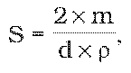

Príloha č. 3 k vyhláške č. 358/2010 Z. z.

- PRAHOVÉ SPOTREBY ROZPÚŠŤADIEL, VŠEOBECNÉ PODMIENKY PREVÁDZKOVANIA ZARIADENÍ A EMISNÉ LIMITY PRCHAVÝCH ORGANICKÝCH ZLÚČENÍN

  - 1. Emisný limit pre fugitívne emisie prchavých organických zlúčenín je podiel hmotností fugitívnych emisií z hmotnosti vstupných organických rozpúšťadiel uvedený v percentách.

  - 2. Emisný limit pre celkové emisie prchavých organických zlúčenín je podiel hmotnosti celkových emisií organických rozpúšťadiel a určenej vzťahovej veličiny, napríklad spotreby organického rozpúšťadla.

  - 1. Polygrafia

  - 1.1 Prahové spotreby rozpúšťadiel a emisné limity

- Podmienky platnosti emisných limitov | | | | Štandardné stavové podmienky, vlhký plyn | |

- Činnosť | | Prahová spotreba rozpúšťadla [t/rok] | | | Emisný limit |

- | | | | | Odpadové plyny | Fugitívne emisie

- | | | | | TOC [mg/m3] | VOC [%]

- Ia | Tepelný rotačný ofset | z | ≥ 0,6 | ≤ 15 | 120 | 301)

- | | z | > 15 | ≤ 25 | 100 | 301)

- | | | > 25 | – | 20 | 301)

- Ib | Publikačná rotačná hĺbkotlač vrátane kníhtlače | | ≥ 0,6 | ≤ 25 | 120 | 10, 152)

- | | | > 25 | – | 75 | 10, 152)

- Ic | Ostatné rotačné hĺbkotlače, | z z | ≥ 0,6 > 15 | ≤ 15 ≤ 25 | 120 100 | 25 25

- Id | Flexografia | | > 25 | – | 100 | 20

- Ie | Rotačná sieťotlač | | | | |

- If | Lakovanie a | | | | |

- Ig | Laminovanie | | | | |

- Ie | Rotačná sieťotlač na textil, lepenku a kartón | z | ≥ 0,6 | ≤ 15 | 120 | 25

- | | z | > 15 | ≤ 30 | 100 | 25

- | | | > 30 | – | 100 | 20

  - 2. Odmasťovanie a čistenie povrchu kovov, elektrosúčiastok a iných materiálov organickými rozpúšťadlami

  - 2.1 Technické požiadavky a všeobecné podmienky prevádzkovania

  - 2.1.1 Odmasťovanie treba vykonávať v osobitnom zariadení v uzavretom priestore s odsávaním odpadového plynu, alebo sa odmasťovanie vykonáva v striekacích kabínach pre nástrek náterových látok. Na odmasťovacie procesy vykonávané mimo odmasťovacieho zariadenia treba využívať odmasťovacie stoly alebo obdobné zariadenia a emisie VOC primerane obmedzovať.

  - 2.1.2 Ak sa používajú organické rozpúšťadlá skupiny A a skupiny B, nesmie sa odmasťovanie a čistenie povrchov vykonávať mimo uzavretého priestoru bez odsávania odpadových plynov. Tieto zariadenia treba prevádzkovať ako uzavretý systém.

  - 2.2. Prahové spotreby rozpúšťadiel a emisné limity

  - Pre zariadenia s prahovou spotrebou rozpúšťadiel menej ako 0,1 t/rok sa emisný limit pre TOC a VOC neustanovuje a neuplatňujú sa ani všeobecné emisné limity pre znečisťujúce látky 4. skupiny.9) Ak ide o riziko ohrozenia zdravia ľudí a životného prostredia, orgán ochrany ovzdušia určí emisný limit osobitne.

- Podmienky platnosti emisných limitov | | Štandardné stavové podmienky, vlhký plyn | | | |

- | | Emisie prchavých organických zlúčenín skupiny A a skupiny B v odpadovom plyne nesmú prekročiť buď uvedenú hodnotu hmotnostného toku, alebo koncentrácie. | | | |

- | | Emisný limit platí pre súčet hmotností jednotlivých VOC. | | | |

- Odmasťovanie a čistenie povrchov s použitím organických rozpúšťadiel | | Prahová spotreba rozpúšťadla [t/rok] | | | Emisný limit |

- | | | | | Odpadové plyny | Fugitívne emisie

- | | | | | ∑ VOC [mg/m3] | VOC [%]

- IIa | S obsahom VOC skupiny A | z | ≥ 0,1 | ≤ 1 | 2 | 15

- | | z | > 1 | ≤ 5 | 2 | 15

- | | | > 5 | – | 2 | 10

- IIa | S obsahom VOC skupiny B | z | 0,1 | ≤ 1 | 20 | 15

- | | z | > 1 | ≤ 5 | 20 | 15

- | | | > 5 | – | 20 | 10

- IIb | S obsahom VOC skupiny C | z | ≥ 0,6 | ≤ 2 | 1201) | 201)

- | | z | > 2 | ≤ 10 | 751) | 201)

- | | | > 10 | – | 751) | 151)

- | | | | | Hmotnostný tok VOC [g/h] |

- IIa | S obsahom VOC skupiny A | | ≥ 0,1 | – | 10 |

- IIb | S obsahom VOC skupiny B | | ≥ 0,1 | – | 100 |

  - 3. Chemické čistenie odevov a textílií

  - 3.1 Technické požiadavky a všeobecné podmienky prevádzkovania

  - Zariadenia na chemické čistenie odevov treba vybaviť systémom záchytu pár a úplnou recykláciou organického rozpúšťadla.

  - 3.2 Prahová spotreba rozpúšťadiel a emisný limit

- Podmienky platnosti emisných limitov | | | Pre organické rozpúšťadlo s obsahom VOC skupiny B sa emisný limit pre VOC podľa § 4 ods. 2 neuplatňuje.

- Činnosť | | Prahová spotreba rozpúšťadla [t/rok] | Emisný limit

- | | | Celkové emisie1)

- | | | VOC [g/kg]

- III | Chemické čistenie odevov | > 0 | 20

  - 4. Nanášanie náterov

    - Aplikácia náterových látok, napríklad elektroforetické a chemické procesy nanášania náterov, striekanie, navaľovanie, máčanie, polievanie a pod.

  - 4.1 Technické požiadavky a všeobecné podmienky prevádzkovania pri nanášaní náterov

    - Na obmedzenie emisií VOC je potrebné použiť najlepšie dostupné techniky, napríklad používanie lakovacích systémov s nízkym alebo žiadnym obsahom organických rozpúšťadiel, nanášanie lakovacích vrstiev s vysokou účinnosťou alebo čistenie odpadových plynov.

  - 4.2 Prahové spotreby rozpúšťadiel a emisné limity pre procesy nanášania na určité povrchy

- Podmienky platnosti emisných limitov | | Štandardné stavové podmienky, vlhký plyn | | | | |

- | | Pri nanášaní náterových látok, ktoré nemožno vykonávať za riadených podmienok, ako napríklad pri stavbe lodí, natieraní lietadiel, sa emisné limity v súlade s § 3 ods. 6 neuplatňujú. | | | | |

- | | Pre rotačnú sieťotlač na potlač textilu sa uplatňujú emisné limity pre polygrafiu uvedené v prvom bode. | | | | |

- Činnosť Nanášanie náterových látok na | | Prahová spotreba rozpúšťadla1) [t/rok] | | | Emisný limit | |

- | | | | | Odpadové plyny | | Fugitívne emisie

- | | | | | TZL1) [mg/m3] | TOC [mg/m3] | VOC [%]

- IVa | kovy, plasty, textil, tkaniny, fólie, papier | z | > 5 | ≤ 15 | 3 | 1002) | 20

- | | | > 15 | – | 3 | 50/75,3) 1504) | 20

- IVb | drevené povrchy | z | > 15 | ≤ 25 | 3 | 1002) | 25

- | | | > 25 | – | 3 | 50/753) | 20

- | | | | | Odpadové plyny | Celkové emisie5) |

- | | | | | TZL [mg/m3] | VOC [g/m2] |

- IVc | kožu | z | > 10 | ≤ 25 | 3 | 85, 1506) |

- | | | > 25 | – | 3 | 75, 1506) |

  - 4.3 Všeobecné podmienky prevádzkovania a uplatňovanie emisných limitov pre zariadenia s podprahovou spotrebou rozpúšťadla

    - Ak ide o nanášanie náterov v zariadeniach s nižšou prahovou spotrebou rozpúšťadla, ako je uvedená v bode 4.2

    - a) na účel vymedzený podľa osobitného predpisu,10) treba používať regulované výrobky podľa § 14 ods. 6 zákona, ktoré spĺňajú ustanovené hraničné hodnoty pre najvyšší obsah VOC. Používanie regulovaných výrobkov možno nahradiť plnením emisných limitov ustanovených pre zariadenia s najnižšou prahovou spotrebou rozpúšťadla uvedených v bode 4.2,

    - b) na iný účel, emisie VOC treba obmedzovať napríklad používaním regulovaných výrobkov uvedených v písmene a), ak to predmetná povrchová úprava umožňuje; v ostatných prípadoch, ak ide o stredné zdroje, orgán ochrany ovzdušia určí emisný limit pre VOC osobitne,

    - c) všeobecné emisné limity pre TZL a znečisťujúce látky 4. skupiny9) sa pre tieto zariadenia neuplatňujú.

  - 5. Nanášanie náterov v priemysle výroby automobilov

  - 5.1. Výpočet veľkosti natretého povrchu

    - Plocha povrchu výrobku uvedená v tabuľke 5.2 je definovaná

    - a) ako plocha povrchu vypočítaná ako súčet celkovej plochy, na ktorú bol nanesený elektroforézny náter, a plochy povrchu všetkých častí pripojených k výrobku v ďalších fázach procesu nanášania náteru, ktoré sú natierané tým istým náterom, alebo

    - b) ako celková plocha natretých produktov v danom zariadení.

    - Povrch elektroforeticky nastriekavanej plochy sa vypočítava podľa vzorca:

  - 

    - kde

    - S – povrch elektroforeticky nastriekavanej plochy,

    - m – celková hmotnosť natretej karosérie,

    - d – priemerná hrúbka kovového plášťa,

    - – hustota kovového plášťa.

    - Táto metóda sa použije aj pre iné časti pokryté náterom, ak sú vyrobené z plechu.

    - Na výpočet povrchu ostatných pridaných častí alebo celkovej plochy natretého povrchu v zariadení možno použiť počítačový model alebo inú ekvivalentnú metódu.

  - 5.2 Prahová spotreba rozpúšťadiel, prahová hodnota produkcie natieraných objektov a emisné limity

  - 5.2.1 Priemyselná výroba automobilov

    - Pre zariadenia na nanášanie náterov s ročnou projektovanou kapacitou nižšou ako 15 t platia emisné limity podľa bodu 5.2.2.

  - Podmienky platnosti emisných limitov | | Štandardné stavové podmienky, vlhký plyn | | |

  - | | Hodnota emisného limitu pre celkové emisie sa vzťahuje na všetky štádiá procesu vykonávané v tom istom zariadení od elektroforetického nanášania náteru alebo iného druhu nanášania náteru až po konečné voskovanie vrátane nanesenia vrchného náteru. Do celkových emisií sa započítavajú aj emisie z čistenia použitých nástrojov a technického vybavenia vrátane striekacích kabín počas výrobných aj nevýrobných stavov. | | |

  - Zariadenia s prahovou spotrebou rozpúšťadla ≥ 15 t/rok | | | | |

  - | | | Emisný limit | |

  - Činnosť | | | Odpadové plyny | Celkové emisie1) |

  - | | Produkcia vozidiel [ks/rok] | TZL [mg/m3] | VOC [g/m2] |

  - | | | | Nové zariadenia | Jestvujúce zariadenia

  - Va | Nátery osobných áut | > 5000 | 3 | 45 alebo 1,3 kg/karoséria+ 33 | 60 alebo 1,9 kg/karoséria+ 41

  - | | ≤ 5000 karosérií alebo > 3500 karosérií s namontovanými podvozkami | 3 | 90 alebo 1,5 kg/karoséria+ 70 | 90 alebo 1,5kg/karoséria+ 70

  - Va | Nátery kabín nákladných áut | ≤ 5000 | 3 | 65 | 85

  - | | > 5000 | 3 | 55 | 75

  - Va | Nátery dodávkových a nákladných áut | ≤ 2500 | 3 | 90 | 120

  - | | > 2500 | 3 | 70 | 90

  - Va | Nátery autobusov | ≤ 2000 | 3 | 210 | 290

  - | | > 2000 | 3 | 150 | 225

  - Zariadenia s prahovou spotrebou rozpúšťadla < 15 t/rok | | | | |

  - Va | Uplatňujú sa požiadavky podľa bodu 5.2.2 | | | |

  - 5.2.2 Nanášanie náterov v priemysle výroby automobilov mimo výrobnej linky a následná povrchová úprava vozidiel

  - Podmienky platnosti emisných limitov | | | | Štandardné stavové podmienky, vlhký plyn | |

  - Činnosť | | Prahová spotreba rozpúšťadla [t/rok] | | Emisný limit | |

  - | | | | Odpadové plyny | | Fugitívne emisie

  - | | | | TZL [mg/m3] | TOC [mg/m3] | VOC [%]

  - Va | Nanášanie náterov na nové vozidlá | > 0,5 | < 15 | 3 | 501) | 25

  - Vb | Následná povrchová úprava vozidiel | > 0,5 | – | 3 | 501) | 25

  - 5.2.3 Autoopravárenstvo (činnosť Vc)

  - 5.2.3.1 Všeobecné podmienky prevádzkovania

    - V zariadeniach autolakovní možno používať len regulované výrobky podľa § 14 ods. 6 zákona. Všeobecné emisné limity pre TZL a znečisťujúce látky 4. skupiny9) sa na tieto zariadenia neuplatňujú.

  - 6. Natieranie pásov a zvitkov

  - 6.1 Prahová spotreba rozpúšťadiel a emisné limity

  - Podmienky platnosti emisných limitov | | | Štandardné stavové podmienky, vlhký plyn | |

  - Činnosť | | Prahová spotreba rozpúšťadla1) [t/rok] | Emisný limit | |

  - | | | Odpadové plyny | | Fugitívne emisie

  - | | | TZL [mg/m3] | TOC [mg/m3] | VOC [%]

  - VI | Kontinuálne natieranie pásov a zvitkov | > 0,6 | 32) | 50, 1503) | 5, 104)

  - 7. Povrchová úprava navíjaných drôtov

  - 7.1 Prahová spotreba rozpúšťadiel a emisné limity

    - Pre zariadenia s prahovou spotrebou rozpúšťadla 0,6 – 5 t/rok sa emisný limit pre VOC neustanovuje a neuplatňujú sa ani všeobecné emisné limity pre znečisťujúce látky 4. skupiny.9) Ak ide o riziko ohrozenia zdravia ľudí a životného prostredia, orgán ochrany ovzdušia určí emisný limit osobitne.

  - Podmienky platnosti emisných limitov | | | Štandardné stavové podmienky, vlhký plyn |

  - Činnosť | | | Prahová spotreba rozpúšťadla [t/rok] | Emisný limit

  - | | | | Celkové emisie1)

  - | | | | VOC [g/kg]

  - VII | Natieranie navíjaných drôtov s priemerom | < 0,1 mm | > 5 | 10

  - | | ≥ 0,1 mm | > 5 | 5

  - 8. Nanášanie lepidla

  - 8.1 Prahová spotreba rozpúšťadiel a emisné limity

    - Pre zariadenia s prahovou spotrebou rozpúšťadla 0,6 – 5 t/rok sa emisný limit pre VOC neustanovuje a neuplatňujú sa ani všeobecné emisné limity pre znečisťujúce látky 4. skupiny.9) Ak ide o riziko ohrozenia zdravia ľudí a životného prostredia, orgán ochrany ovzdušia určí emisný limit osobitne.

  - Podmienky platnosti emisných limitov | | | | | Štandardné stavové podmienky, vlhký plyn |

  - Činnosť | | Prahová spotreba rozpúšťadla [t/rok] | | | Emisný limit |

  - | | | | | Odpadové plyny | Fugitívne emisie

  - | | | | | TOC [mg/m3] | VOC [%]

  - VIII | Nanášanie lepidla | z | ≥ 0,6 | ≤ 5 | 50, 1501) | –

  - | | z | > 5 | ≤ 15 | 50, 1501) | 25

  - | | | > 15 | – | 50, 1501) | 20

  - 9. Výroba obuvi

  - 9.1 Prahová spotreba rozpúšťadiel a emisné limity

    - Pre zariadenia s prahovou spotrebou rozpúšťadla 0,6 – 5 t/rok sa emisný limit pre VOC neustanovuje a neuplatňujú sa ani všeobecné emisné limity pre znečisťujúce látky 4. skupiny.9) Ak ide o riziko ohrozenia zdravia ľudí a životného prostredia, orgán ochrany ovzdušia určí emisný limit osobitne.

  - Činnosť | | Emisný limit |

  - | | Prahová spotreba rozpúšťadla | Celkové emisie1)

  - | | [t/rok] | VOC [g/pár obuvi]

  - IX | Výroba obuvi | > 5 | 25

  - 10. Výroba náterových zmesí, lakov, tlačiarenských farieb a lepidiel

  - 10.1 Prahová spotreba rozpúšťadiel a emisné limity

  - Podmienky platnosti emisných limitov | | | | | Štandardné stavové podmienky, vlhký plyn | |

  - Činnosť | | Prahová spotreba rozpúšťadla [t/rok] | | | Emisný limit | |

  - | | | | | Odpadové plyny | Fugitívne emisie1) | Celkovéemisie2)

  - | | | | | TOC [mg/m3] | VOC [%] | VOC [%]

  - X | Výroba náterových zmesí, lakov, tlačiarenských farieb a lepidiel | z | > 5 | ≤ 1000 | 150 | 5 | 5

  - | | | > 1000 | – | 150 | 3 | 3

  - 11. Výroba farmaceutických produktov

  - 11.1 Prahová spotreba rozpúšťadiel a emisné limity

  - Podmienky platnosti emisných limitov | | | | Štandardné stavové podmienky, vlhký plyn | |

  - Činnosť | | Prahová spotreba rozpúšťadla [t/rok] | | Emisný limit | |

  - | | | | Odpadové plyny | Fugitívne emisie1) | Celkové emisie2)

  - | | | | TOC [mg/m3] | VOC [%] | VOC [%]

  - XI | Výroba farmaceutických zmesí | > 5 | ≤ 50 | 20, 1503) | 5, 154) | 5, 154)

  - | | > 50 | – | 20, 1503) | 5, 154) | 5, 154)

  - 12. Výroba a spracovanie gumy

  - 12.1 Prahová spotreba rozpúšťadiel a emisné limity

    - Pre zariadenia s prahovou spotrebou rozpúšťadla 0,6 – 5 t/rok sa emisný limit pre TOC a VOC neustanovuje a neuplatňujú sa ani všeobecné emisné limity pre znečisťujúce látky 4. skupiny.9) Ak ide o riziko ohrozenia zdravia ľudí a životného prostredia, orgán ochrany ovzdušia určí emisný limit osobitne.

  - Podmienky platnosti emisných limitov | | | | Štandardné stavové podmienky, vlhký plyn | |

  - Činnosť | | Prahová spotreba rozpúšťadla [t/rok] | | Emisný limit | |

  - | | | | Odpadové plyny | Fugitívne emisie1) | Celkové emisie2)

  - | | | | TOC [mg/m3] | VOC [%] | VOC [%]

  - XII | Výroba a spracovanie gumy | > 5 | ≤ 15 | 20, 1503) | 25 | 25

  - | | > 15 | – | 20, 1503) | 25 | 25

  - 13. Extrakcia rastlinných olejov, živočíšnych tukov a rafinácia rastlinných olejov

  - 13.1 Všeobecné podmienky prevádzkovania

  - 13.1.1 Odpadové plyny znečistené parami extrakčných činidiel je potrebné odviesť do zariadenia na regeneráciu rozpúšťadla. Ak nemožno regeneráciou odpadových plynov zabezpečiť dodržiavanie emisného limitu, treba použiť ako druhý stupeň termické alebo katalytické spaľovanie.

  - 13.1.2 V zásobníkoch surovín, medziproduktov a hotových výrobkov treba udržovať podtlak so zreteľom na vonkajšie ovzdušie.

  - 13.1.3 Pri cirkulácii extrakčných činidiel treba používať tlakové čerpadlá, armatúry a potrubia, pri ktorých nedochádza k fugitívnym emisiám.

  - 13.2 Prahová spotreba rozpúšťadiel a emisné limity

    - Pre zariadenia s prahovou spotrebou rozpúšťadla 0,6 – 5 t/rok sa emisný limit pre VOC neustanovuje a neuplatňujú sa ani všeobecné emisné limity pre znečisťujúce látky 4. skupiny.9) Ak ide o riziko ohrozenia zdravia ľudí a životného prostredia, orgán ochrany ovzdušia určí emisný limit osobitne.

  - Činnosť | | Prahová spotreba rozpúšťadla [t/rok] | Emisný limit

  - XIII | Extrakcia rastlinných olejov, a živočíšnych tukov a rafinácia rastlinných olejov z týchto materiálov | | Celkové emisie1)

  - | | | VOC [kg/t]

  - | Živočíšny tuk | > 5 | 1,5

  - | Ricín | > 5 | 3

  - | Repkové semená | > 5 | 1

  - | Slnečnicové semená | > 5 | 1

  - | Sojové bôby (normálne drvenie) | > 5 | 0,8

  - | Sojové bôby (biele vločky) | > 5 | 1,2

  - | Ostatné semená a iný rastlinný materiál | > 5 | 32)

  - | Frakcionovanie s výnimkou odglejovania | > 5 | 1,5

  - | Odglejovanie (odstraňovanie živice z oleja) | > 5 | 4

  - 14. Impregnácia dreva

  - 14.1 Prahová spotreba rozpúšťadiel a emisné limity

  - Podmienky platnosti emisných limitov | | | Štandardné stavové podmienky, vlhký plyn | |

  - Činnosť | | Prahová spotreba rozpúšťadla1) [t/rok] | Emisný limit | |

  - | | | Odpadové plyny | Fugitívne emisie | Celkové emisie2)

  - | | | TOC [mg/m3] | VOC [%] | VOC[kg/m3]

  - XIV | Impregnácia dreva | > 0,6 | 1003) | 45 | 11

  - 15. Laminovanie dreva a plastov

  - 15.1 Prahová spotreba rozpúšťadiel a emisné limity

    - Pre zariadenia s prahovou spotrebou rozpúšťadla 0,6 – 5 t/rok sa emisný limit pre VOC neustanovuje a neuplatňujú sa ani všeobecné emisné limity pre znečisťujúce látky 4. skupiny.9) Ak ide o riziko ohrozenia zdravia ľudí a životného prostredia, orgán ochrany ovzdušia určí emisný limit osobitne.

  - Činnosť | | Emisný limit |

  - | | Prahová spotreba rozpúšťadla [t/rok] | Celkové emisie1)

  - | | | VOC[g/m2]

  - XV | Laminovanie dreva a plastov | > 5 | 30

    - Použité skratky:

    - TOC – prchavé organické zlúčeniny vyjadrené ako celkový organický uhlík

    - VOC – prchavé organické zlúčeniny

    - TZL – tuhé znečisťujúce látky
