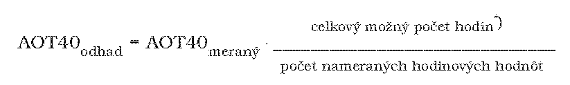

Príloha č. 7 k vyhláške č. 360/2010 Z. z.

- CIEĽOVÉ HODNOTY A DLHODOBÉ CIELE PRE OZÓN

  - A. Vymedzenie pojmov a kritériá

    - 1. Vymedzenie pojmov

      - AOT40 vyjadrený v (µg/m3).h je súčet rozdielov medzi hodinovými koncentráciami väčšími ako 80 µg/m3 (= 40 častí na miliardu) a 80 µg/m3 počas daného obdobia pri používaní len 1-hodinových hodnôt nameraných každý deň od 8.00 do 20.00 hod. stredoeurópskeho času (SEČ).

    - 2. Kritériá

      - Pri zhromažďovaní údajov a výpočte štatistických ukazovateľov sa na kontrolu platnosti použijú tieto kritériá:

    - Parameter | Vyžadovaný podiel platných údajov

    - 1-hodinové hodnoty | 75 %, t. j. 45 minút

    - 8-hodinové hodnoty | 75 % hodnôt, t. j. 6 hodín

    - Najväčšia denná 8-hodinová stredná hodnota z ôsmich po sebe nasledujúcich hodín | 75 % hodinových pohyblivých priemerov z ôsmich po sebe nasledujúcich hodín, t. j. 18 8-hodinových priemerov za deň

    - AOT40 | 90 % 1-hodinových hodnôt počas doby určenej na vypočítanie hodnoty AOT401)

    - Ročná stredná hodnota | 75 % 1-hodinových hodnôt letného obdobia od apríla do septembra a 75 % hodnôt zimného obdobia od januára do marca a od októbra do decembra samostatne

    - Počet prekročení a najväčšie hodnoty za mesiac | 90 % denných najväčších 8-hodinových stredných hodnôt, t. j. 27 dostupných denných hodnôt za mesiac, 90 % 1-hodinových hodnôt od 8.00 do 20.00 hod. SEČ

    - Počet prekročení a najväčšie hodnoty za rok | päť zo šiestich mesiacov počas letného obdobia od apríla do septembra

      - Poznámka:

      - 1) V prípadoch, keď nie sú k dispozícii všetky možné merané údaje, na vypočítanie hodnôt AOT40 sa použije tento faktor:

      - celkový možný počet hodín*)

    - 

      - počet nameraných hodinových hodnôt

      - *) Predstavuje počet hodín v rámci doby uvedenej v definícii AOT40, t. j. od 8.00 do 20.00 h SEČ každoročne od 1. mája do 31. júla na ochranu vegetácie a každoročne od 1. apríla do 30. septembra na ochranu lesov.

  - B. Cieľové hodnoty

  - Cieľ | Priemerované obdobie | Cieľová hodnota | Dátum, ku ktorému by sa mala cieľová hodnota dosiahnuť

  - Ochrana zdravia ľudí | najväčšia denná 8-hodinová stredná hodnota 3) | 120 µg/m3sa neprekročí viac ako 25 dní za kalendárny rok v priemere troch rokov4) | 2)

  - Ochrana vegetácie | od mája do júla | AOT40 vypočítaný z 1-hodinových hodnôt 18 000 µg/m3.hod. v priemere piatich rokov4) | 2)

    - Poznámky:

    - 2) Dodržiavanie cieľových hodnôt sa posudzuje od 1. 1. 2010. To znamená, že rok 2010 je prvým rokom, za ktorý sa použijú údaje na výpočet súladu počas nasledujúcich troch alebo piatich rokov.

    - 3) Najväčšia denná 8-hodinová stredná hodnota koncentrácie sa vyberie preskúmaním 8-hodinových pohyblivých priemerov vypočítaných z hodinových údajov a aktualizovaných každú hodinu. Každý takto vypočítaný 8-hodinový priemer sa priradí ku dňu, v ktorom končí, t. j. prvým výpočtovým obdobím pre ktorýkoľvek deň je obdobie od 17.00 hod. predchádzajúceho dňa do 1.00 hod. daného dňa; posledným výpočtovým obdobím pre ktorýkoľvek jeden deň je obdobie od 16.00 hod. do 24.00 hod. daného dňa.

    - 4) Ak nie je možné určiť trojročné alebo päťročné priemery na základe úplných a po sebe nasledujúcich súboroch ročných údajov, najmenšie ročné údaje vyžadované na kontrolu dodržiavania cieľových hodnôt sú tieto:

  - – pre cieľovú hodnotu na ochranu zdravia ľudí: platné údaje za jeden rok,

  - – pre cieľovú hodnotu na ochranu vegetácie: platné údaje za tri roky.

  - C. Dlhodobé ciele

  - Cieľ | Priemerované obdobie | Dlhodobý cieľ | Dátum, ku ktorému by sa mali dosiahnuť dlhodobé ciele

  - Ochrana zdravia ľudí | najväčšia denná 8-hodinová stredná hodnota v kalendárnom roku | 120 µg/m3 | neurčený

  - Ochrana vegetácie | od mája do júla | AOT40 vypočítaný z 1-hodinových hodnôt 6 000 µg/m3.hod. | neurčený
