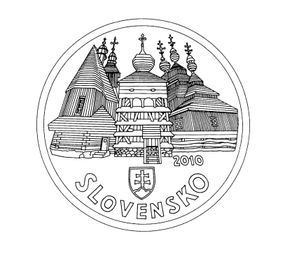
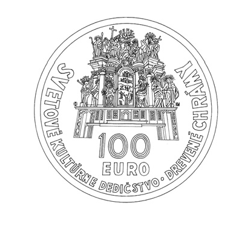

## 401

OZNÁMENIE

Národnej banky Slovenska

z 21. septembra 2010

## o vydaní zlatých zberateľských euromincí v nominálnej hodnote 100 eur s tematikou Svetové kultúrne dedičstvo – Drevené chrámy v slovenskej časti karpatského oblúka

1. Úvodné ustanovenia

- a) Národná banka Slovenska podľa § 17h ods. 1 zákona Národnej rady Slovenskej republiky č. 566/1992 Zb. o Národnej banke Slovenska v znení neskorších predpisov a podľa § 1 ods. 2 písm. d) zákona Národnej rady Slovenskej republiky č. 1/1993 Z. z. o Zbierke zákonov Slovenskej republiky v znení zákona č. 275/2002 Z. z. oznamuje, že vydáva do obehu zlaté zberateľské euromince v nominálnej hodnote 100 eur s tematikou Svetové kultúrne dedičstvo – Drevené chrámy v slovenskej časti karpatského oblúka (ďalej len „zberateľská eurominca“).

- b) Zberateľská eurominca má štatút zákonného platidla len v Slovenskej republike.

- c) Zberateľská eurominca sa razí zo zliatiny obsahujúcej 900 dielov zlata, 75 dielov striebra a 25 dielov medi; jej hmotnosť je 9,5 g a priemer 26 mm. Pri razbe euromince je povolená horná a dolná odchýlka v priemere 0,1 mm; povolená horná odchýlka v hmotnosti je 0,08 g a v obsahu zlata 10/1000.

2. Vzhľad zberateľskej euromince

- a) Na líci zberateľskej euromince sú v kompozícii vyobrazené tri drevené chrámy v slovenskej časti karpatského oblúka zapísané do Zoznamu svetového dedičstva. V ľavej časti mincového poľa je vyobrazený Kostol sv. Františka z Assisi v Hervartove, vpravo od neho zvonica z areálu kostola v Hronseku a Chrám sv. Mikuláša v Bodružali. V spodnej časti mincového poľa je štátny znak Slovenskej republiky, pod ktorým je v opise zľava doprava názov štátu „SLOVENSKO“. Letopočet „2010“ je umiestnený pod kompozíciou v spodnej časti mincového poľa.

- b) Na rube zberateľskej euromince je vyobrazený neskorobarokový hlavný oltár z Kostola Všetkých svätých v Tvrdošíne. Pod oltárom je v dvoch riadkoch umiestnené označenie nominálnej hodnoty zberateľskej euromince „100 EURO“. V opise zľava doprava od horného okraja mince smerom nadol je umiestnený nápis „SVETOVÉ KULTÚRNE DEDIČSTVO • DREVENÉ CHRÁMY“. Značka Mincovne Kremnica, štátny podnik, „MK“, medzi dvoma razidlami je umiestnená vľavo od oltára a štylizované iniciálky mena a priezviska autora výtvarného návrhu PhDr. Klimenta Mituru „KM“ sú umiestnené vpravo od neho.

- c) Hrana zberateľskej euromince je vrúbkovaná.

Štát vydania: Slovenská republika

Začiatok vydávania: december 2010

Jozef Makúch v. r.
