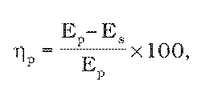

Príloha č. 1 k vyhláške č. 428/2010 Z. z.

- Rozsah hodnotenia a spôsob výpočtu energetickej účinnosti prenosu elektriny

  - Názov prevádzkovateľa prenosovej sústavy:

  - Adresa:

  - IČO:

  - Rozsah hodnotenia

  - Energetická účinnosť prenosu elektriny sa hodnotí na základe ročných bilančných údajov za prenosovú sústavu v rozsahu podľa tabuľky:

- Rok | Straty elektriny pri prenose | Množstvo prenesenej elektriny | Energetická účinnosť prenosu | Komentár

- | MWh | MWh | % |

  - V komentári prevádzkovateľ prenosovej sústavy uvedie všetky relevantné prevádzkové okolnosti, ktoré v hodnotenom období vplývali na celkovú energetickú účinnosť prenosu elektriny.

  - Spôsob výpočtu

  - Energetická účinnosť prenosu elektriny sa vypočíta z bilančných údajov podľa vzorca:

- 

  - kde

  - ηp – účinnosť prenosu elektriny vyjadrená v percentách,

  - Ep – množstvo prenesenej elektriny vyjadrené v megawatthodinách,

  - Es – straty elektriny pri prenose vyjadrené v megawatthodinách.
