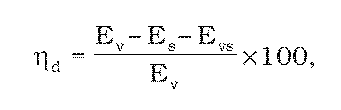

Príloha č. 2 k vyhláške č. 428/2010 Z. z.

- Rozsah hodnotenia a spôsob výpočtu energetickej účinnosti distribúcie elektriny

  - Názov prevádzkovateľa distribučnej sústavy:

  - Adresa:

  - IČO:

  - Rozsah hodnotenia

  - Energetická účinnosť distribúcie elektriny sa hodnotí na základe ročných bilančných údajov za príslušnú distribučnú sústavu v rozsahu podľa tabuľky:

- Rok | Množstvo elektriny na vstupe do distribučnej sústavy | Straty elektriny pri distribúcii | Vlastná spotreba elektriny pri distribúcii | Energetická účinnosť distribúcie | Komentár

- | MWh | MWh | MWh | % |

  - V komentári prevádzkovateľ distribučnej sústavy uvedie všetky relevantné prevádzkové okolnosti, ktoré v hodnotenom období vplývali na energetickú účinnosť distribúcie elektriny.

  - Spôsob výpočtu

  - Energetická účinnosť distribúcie elektriny sa vypočíta z bilančných údajov podľa vzorca:

- 

  - kde

  - ηd – účinnosť distribúcie elektriny vyjadrená v percentách,

  - Es – straty elektriny pri distribúcii vyjadrené v megawatthodinách,

  - Evs – vlastná spotreba elektriny pri distribúcii vyjadrená v megawatthodinách,

  - Ev – množstvo elektriny na vstupe do distribučnej sústavy vyjadrené v megawatthodinách.
