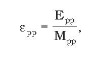

Príloha č. 3 k vyhláške č. 428/2010 Z. z.

- Rozsah hodnotenia a spôsob výpočtu energetickej náročnosti prepravy plynu

  - Názov prevádzkovateľa prepravnej siete:

  - Adresa:

  - IČO:

  - Rozsah hodnotenia

  - Energetická náročnosť prepravy plynu sa hodnotí na základe ročných bilančných údajov za prepravnú sieť v rozsahu podľa tabuľky:

- Rok | Množstvo energie spotrebovanej na prepravu plynu | | | | | Množstvo prepraveného plynu | Energetická náročnosť prepravy plynu | Komentár

- | Spotreba plynu na prepravu plynu a prevádzku prepravnej siete | | | Spotreba elektriny na prepravu plynu a prevádzku prepravnej siete | SPOLU | | |

- | MWh | | | MWh | MWh | MWh | MWh/MWh |

  - V komentári prevádzkovateľ prepravnej siete uvedie všetky relevantné prevádzkové okolnosti, ktoré v hodnotenom období vplývali na energetickú náročnosť prepravy plynu.

  - Spôsob výpočtu

  - Energetická náročnosť prepravy plynu sa vypočíta z bilančných údajov podľa vzorca:

- 

  - kde

  - εpp – energetická náročnosť prepravy plynu vyjadrená megawatthodinách na megawatthodinu,

  - Epp – množstvo energie spotrebovanej na prepravu plynu vyjadrené v megawatthodinách,

  - Mpp – množstvo prepraveného plynu vyjadrené v megawatthodinách.
