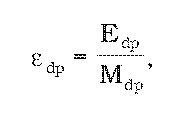

Príloha č. 4 k vyhláške č. 428/2010 Z. z.

- Rozsah hodnotenia a spôsob výpočtu energetickej náročnosti distribúcie plynu

  - Názov prevádzkovateľa distribučnej siete:

  - Adresa:

  - IČO:

  - Rozsah hodnotenia

  - Energetická náročnosť distribúcie plynu sa hodnotí na základe ročných bilančných údajov za príslušnú distribučnú sieť v rozsahu podľa tabuľky:

- Rok | Množstvo energie spotrebovanej na distribúciu plynu | | | | | | | Množstvo distri- buovaného plynu | Energetická náročnosť distribúcie plynu | Komentár

- | Spotreba plynu na prevádzku regulačných staníc | | | | Spotreba elektriny na prevádzku regulačných staníc | Ostatná spotreba elektriny na prevádzku distribučnej siete | SPOLU | | |

- | MWh | | | | MWh | MWh | MWh | MWh | MWh/MWh |

  - V komentári prevádzkovateľ distribučnej sústavy uvedie všetky relevantné prevádzkové okolnosti, ktoré v hodnotenom období vplývali na energetickú náročnosť distribúcie plynu.

  - Spôsob výpočtu

  - Energetická náročnosť distribúcie plynu sa vypočíta z bilančných údajov podľa vzorca:

- 

  - kde

  - εdp – energetická náročnosť distribúcie plynu vyjadrená v megawatthodinách na megawatthodinu,

  - Edp – množstvo energie spotrebovanej na distribúciu plynu vyjadrené v megawatthodinách,

  - Mdp – množstvo distribuovaného plynu vyjadrené v megawatthodinách.
