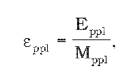

Príloha č. 5 k vyhláške č. 428/2010 Z. z.

- Rozsah hodnotenia a spôsob výpočtu energetickej náročnosti prepravy pohonných látok

  - Názov prevádzkovateľa potrubia na prepravu pohonných látok:

  - Adresa:

  - IČO:

  - Rozsah hodnotenia

  - Energetická náročnosť prepravy pohonných látok sa hodnotí na základe ročných bilančných údajov v rozsahu podľa tabuľky:

- Rok | Množstvo spotrebovanej energie na prepravu pohonných látok | Množstvo prepravených pohonných látok | Energetická náročnosť prepravy pohonných látok | Komentár

- | MWh | t | MWh/t |

  - V komentári prevádzkovateľ potrubia na prepravu pohonných látok uvedie všetky relevantné prevádzkové okolnosti, ktoré v hodnotenom období vplývali na energetickú náročnosť prepravy pohonných látok.

  - Spôsob výpočtu

  - Energetická náročnosť prepravy pohonných látok sa vypočíta z bilančných údajov podľa vzorca:

- 

  - kde

  - εppl– energetická náročnosť prepravy pohonných látok vyjadrená v megawatthodinách na tonu,

  - Eppl– množstvo energie spotrebovanej na prepravu pohonných látok vyjadrené v megawatthodinách, ktoré sa vypočíta ako suma energie spotrebovanej na prevádzku potrubia na prepravu pohonných látok najmä zo spotreby energie na prevádzku prečerpávacích staníc a spotreby energie na prevádzku potrubia na prepravu pohonných látok,

  - Mppl– množstvo prepravených pohonných látok vyjadrené v tonách.
