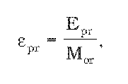

Príloha č. 6 k vyhláške č. 428/2010 Z. z.

- Rozsah hodnotenia a spôsob výpočtu energetickej náročnosti prepravy ropy

  - Názov prevádzkovateľa potrubia na prepravu ropy:

  - Adresa:

  - IČO:

  - Rozsah hodnotenia

  - Energetická náročnosť prepravy ropy sa hodnotí na základe ročných bilančných údajov v rozsahu podľa tabuľky:

- Rok | Množstvo spotrebovanej energie na prepravu ropy | Množstvo odovzdanej ropy | Energetická náročnosť prepravy ropy | Komentár

- | MWh | t | MWh/t |

  - V komentári prevádzkovateľ potrubia na prepravu ropy uvedie všetky relevantné prevádzkové okolnosti, ktoré v hodnotenom období vplývali na energetickú náročnosť prepravy ropy.

  - Spôsob výpočtu

  - Energetická náročnosť prepravy ropy sa vypočíta z bilančných údajov podľa vzorca:

- 

  - kde

  - εpr– energetická náročnosť prepravy ropy vyjadrená v megawatthodinách na tonu,

  - Epr – množstvo energie spotrebovanej na prepravu ropy v megawatthodinách, ktorá sa vypočíta ako suma energie spotrebovanej na prevádzku potrubia na prepravu ropy najmä zo spotreby energie na prevádzku prečerpávacích staníc a spotreby energie na prevádzku potrubia na prepravu ropy,

  - Mor – množstvo ropy odovzdanej spracovateľom ropy alebo ďalším prepravcom ropy vyjadrené v tonách.
