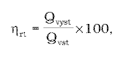

Príloha č. 7 k vyhláške č. 428/2010 Z. z.

- Rozsah hodnotenia a spôsob výpočtu energetickej účinnosti rozvodu tepla

  - Názov prevádzkovateľa verejného rozvodu tepla:

  - Adresa:

  - IČO:

  - Rozsah hodnotenia

  - Energetická účinnosť rozvodu tepla sa hodnotí na základe ročných bilančných údajov pre hydraulicky prepojené potrubia rozvodu tepla napájané z jedného alebo viacerých zdrojov tepla v rozsahu podľa tabuľky:

- Rok | Označenie rozvodu tepla | Teplonosná látka | Množstvo tepla dodaného do rozvodu tepla | Množstvo tepla na výstupe z rozvodu tepla | Energetická účinnosť rozvodu tepla | Komentár

- | | | MWh | MWh | % |

  - V komentári prevádzkovateľ verejného rozvodu tepla uvedie všetky relevantné prevádzkové okolnosti, ktoré v hodnotenom období vplývali na energetickú účinnosť rozvodu tepla.

  - Spôsob výpočtu

  - Energetická účinnosť rozvodu tepla sa vypočíta z bilančných údajov podľa vzorca:

- 

  - kde

  - ηrt– účinnosť rozvodu tepla vyjadrená v percentách,

  - Qvyst – množstvo tepla na výstupe z rozvodu tepla vyjadrené v megawatthodinách,

  - Qvst – množstvo tepla na vstupe do rozvodu tepla vyjadrené v megawatthodinách.
