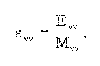

Príloha č. 8 k vyhláške č. 428/2010 Z. z.

- Rozsah hodnotenia a spôsob výpočtu energetickej náročnosti prevádzky verejných vodovodov

  - Názov prevádzkovateľa verejných vodovodov:

  - Adresa:

  - IČO:

  - Rozsah hodnotenia

  - Energetická náročnosť prevádzky verejných vodovodov sa hodnotí na základe ročných bilančných údajov v rozsahu podľa tabuľky:

- Rok | Spotreba energie na prevádzku verejných vodovodov | Množstvo predanej vody z verejných vodovodov | Energetická náročnosť prevádzky verejných vodovodov | Komentár

- | MWh | tis.m3 | MWh/tis.m3 |

  - V komentári prevádzkovateľ verejných vodovodov uvedie všetky relevantné prevádzkové okolnosti, ktoré v hodnotenom období vplývali na energetickú náročnosť prevádzky verejných vodovodov.

  - Spôsob výpočtu

  - Energetická náročnosť prevádzky verejných vodovodov sa vypočíta z bilančných údajov podľa vzorca:

- 

  - kde

  - εvv– energetická náročnosť prevádzky verejných vodovodov vyjadrená v megawatthodinách na tisíc metrov kubických,

  - Evv– množstvo energie spotrebovanej na prevádzku verejných vodovodov v megawatthodinách, ktoré sa určí ako suma spotrebovanej energie najmä pri čerpaní vody z vrtov, pri prečerpávaní vody do vodojemov a ostatnej spotreby prevádzkových zariadení verejných vodovodov,

  - Mvv – množstvo predanej vody z verejných vodovodov vyjadrené v tisícoch metrov kubických.
