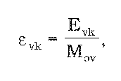

Príloha č. 9 k vyhláške č. 428/2010 Z. z.

- Rozsah hodnotenia a spôsob výpočtu energetickej náročnosti prevádzky verejných kanalizácií

  - Názov prevádzkovateľa verejných kanalizácií:

  - Adresa:

  - IČO:

  - Rozsah hodnotenia

  - Energetická náročnosť prevádzky verejných kanalizácií sa hodnotí na základe ročných bilančných údajov v rozsahu podľa tabuľky:

- Rok | Spotreba energie na prevádzku verejných kanalizácií | Množstvo odkanalizovanej vody | Energetická náročnosť prevádzky verejných kanalizácií | Komentár

- | MWh | tis.m3 | MWh/tis.m3 |

  - V komentári prevádzkovateľ verejných kanalizácií uvedie všetky relevantné prevádzkové okolnosti, ktoré v hodnotenom období vplývali na energetickú náročnosť prevádzky verejných kanalizácií.

  - Spôsob výpočtu

  - Energetická náročnosť prevádzky verejných kanalizácií sa vypočíta z bilančných údajov podľa vzorca:

- 

  - kde

  - εvv – energetická náročnosť prevádzky verejných kanalizácií vyjadrená v megawatthodinách na tisíc metrov kubických,

  - Evk – množstvo spotrebovanej energie na prevádzku verejných kanalizácií vyjadrené v megawatthodinách, ktoré sa určí ako suma spotrebovanej energie najmä na prevádzku čistiarní odpadových vôd, pri prečerpávaní odkanalizovanej vody a ostatnej spotreby prevádzkových zariadení verejných kanalizácií,

  - Mov – množstvo odkanalizovanej vody verejnými kanalizáciami vyjadrené v tisícoch metroch kubických.
