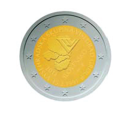

## 442

OZNÁMENIE

Národnej banky Slovenska

z 21. septembra 2010

## o vydaní pamätných obehových euromincí v nominálnej hodnote 2 eurá pri príležitosti 20. výročia vzniku Vyšehradskej skupiny

1. Úvodné ustanovenia

- a) Národná banka Slovenska podľa § 17h ods. 1 zákona Národnej rady Slovenskej republiky č. 566/1992 Zb. o Národnej banke Slovenska v znení neskorších predpisov a podľa § 1 ods. 2 písm. d) zákona Národnej rady Slovenskej republiky č. 1/1993 Z. z. o Zbierke zákonov Slovenskej republiky v znení zákona č. 275/2002 Z. z. oznamuje, že vydáva do obehu pamätné obehové euromince v nominálnej hodnote 2 eurá pri príležitosti 20. výročia vzniku Vyšehradskej skupiny (ďalej len „pamätná eurominca“).

- b) Pamätná eurominca má rovnaké technické parametre ako obehové euromince1) a na jej národnej strane bude použitý pamätný motív [bod 2 písm. b)].

- c) Pamätná eurominca má v celej eurozóne štatút zákonného platidla.

2. Vzhľad pamätnej euromince

- a) Pamätná eurominca sa vydáva s novou spoločnou európskou stranou.2)

- b) Na národnej strane pamätnej euromince je vyobrazená mapa štyroch krajín Vyšehradskej skupiny: Poľskej republiky, Českej republiky, Slovenskej republiky a Maďarskej republiky. Mapa je v hornej časti doplnená štylizovanou skratkou neformálneho zoskupenia krajín „V IV“. Názov štátu „SLOVENSKO“ je umiestnený v pravej spodnej časti mincového poľa šikmo zdola nahor. Letopočet „2011“ je umiestnený v ľavej spodnej časti mincového poľa šikmo zhora nadol. V opise vnútorného kruhu pamätnej euromince je zľava doprava text „VYŠEHRADSKÁ SKUPINA • VISEGRAD GROUP“ a v spodnej časti je dátum „15.2.1991“. Štylizované iniciálky autora výtvarného návrhu národnej strany pamätnej euromince Miroslava Rónaia „MR“ a značka Mincovne Kremnica, štátny podnik, „MK“, medzi dvoma razidlami sú umiestnené šikmo zdola nahor pod názvom štátu. Pri okraji pamätnej euromince je dvanásť do kruhu umiestnených hviezd Európskej únie.

- c) Na hrane pamätnej euromince je nápis „SLOVENSKÁ REPUBLIKA“. Začiatok a koniec nápisu je oddelený dvoma hviezdami, medzi ktorými je lipový list.

Štát vydania: Slovenská republika

Začiatok vydávania: január 2011

Jozef Makúch v. r.
