# Čl. I

Vyhláška Ministerstva dopravy, pôšt a telekomunikácií Slovenskej republiky č. 547/2009 Z. z., ktorou sa ustanovuje spôsob označenia úsekov diaľnic a rýchlostných ciest, ktorých užívanie podlieha úhrade, vzor nálepky a spôsob jej umiestnenia na motorovom vozidle v znení vyhlášky č. 146/2010 Z. z. a vyhlášky č. 197/2010 Z. z. sa mení a dopĺňa takto:

- 1. V § 4 ods. 8 sa slová „s mesačnou platnosťou“ nahrádzajú slovami „s ročnou platnosťou“.

- 2. V § 4 ods. 9 sa slová „s týždennou platnosťou“ nahrádzajú slovami „s mesačnou platnosťou“.

- 3. § 4 sa dopĺňa odsekom 10, ktorý znie:

- „(10)

- Vzor nálepky určenej pre prípojné vozidlá kategórie O1 a O2 s týždennou platnosťou a vzor textu na papierovej podložke nálepky sú uvedené v prílohe č. 6.“.

- 4. Prílohy č. 1 až 6 vrátane nadpisov znejú:

- „Príloha č. 1 k vyhláške č. 547/2009 Z. z.

- VZORY NÁLEPIEK s ročnou dobou platnosti pre motorové vozidlá a jazdné súpravy do 3,5 t

- 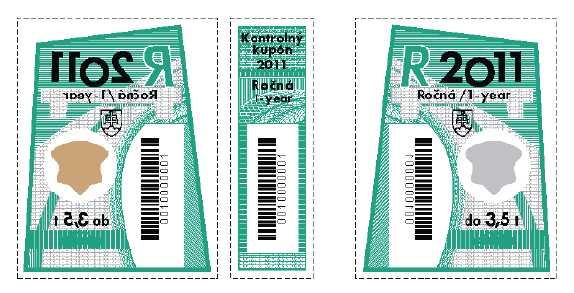

- VZORY TEXTOV NA PAPIEROVEJ PODLOŽKE NÁLEPIEK s ročnou dobou platnosti pre motorové vozidlá a jazdné súpravy do 3,5 t

- 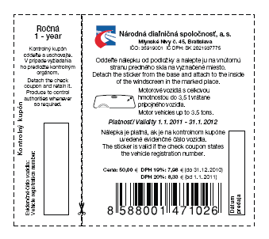

- Príloha č. 2 k vyhláške č. 547/2009 Z. z.

- VZORY NÁLEPIEK s mesačnou dobou platnosti pre motorové vozidlá a jazdné súpravy do 3,5 t

- 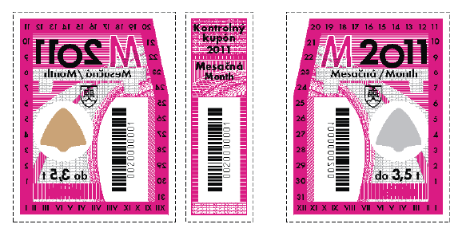

- VZORY TEXTOV NA PAPIEROVEJ PODLOŽKE NÁLEPIEK s mesačnou dobou platnosti pre motorové vozidlá a jazdné súpravy do 3,5 t

- 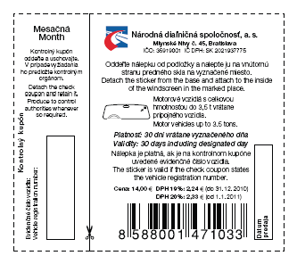

- Príloha č. 3 k vyhláške č. 547/2009 Z. z.

- VZORY NÁLEPIEK s týždennou dobou platnosti pre motorové vozidlá a jazdné súpravy do 3,5 t

- 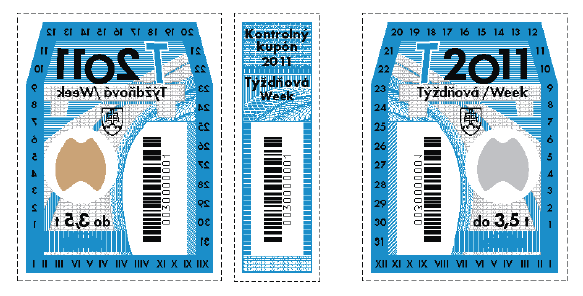

- VZORY TEXTOV NA PAPIEROVEJ PODLOŽKE NÁLEPIEK s týždňovou dobou platnosti pre motorové vozidlá a jazdné súpravy do 3,5 t

- 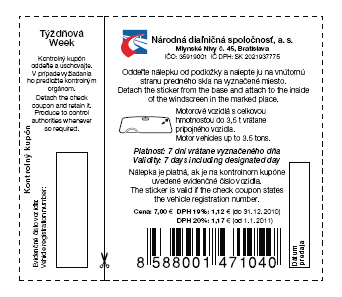

- Príloha č. 4 k vyhláške č. 547/2009 Z. z.

- VZORY NÁLEPIEK s ročnou dobou platnosti pre prípojné vozidlá kategórie O1 a O2

- 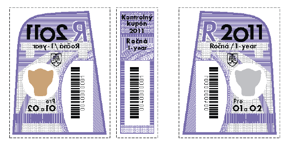

- VZORY TEXTOV NA PAPIEROVEJ PODLOŽKE NÁLEPIEK s ročnou dobou platnosti pre prípojné vozidlá kategórie O1 a O2

- 

- Príloha č. 5 k vyhláške č. 547/2009 Z. z.

- VZORY NÁLEPIEK s mesačnou dobou platnosti pre prípojné vozidlá kategórie O1 a O2

- 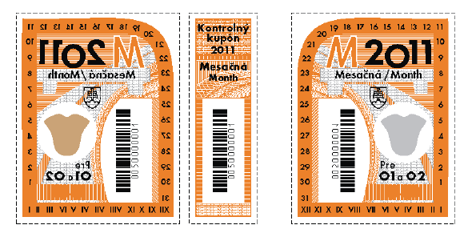

- VZORY TEXTOV NA PAPIEROVEJ PODLOŽKE NÁLEPIEK s mesačnou dobou platnosti pre prípojné vozidlá kategórie O1 a O2

- 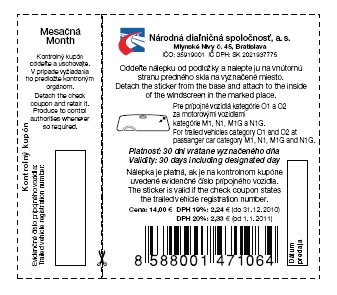

- Príloha č. 6 k vyhláške č. 547/2009 Z. z.

- VZORY NÁLEPIEK s týždennou dobou platnosti pre prípojné vozidlá kategórie O1 a O2

- 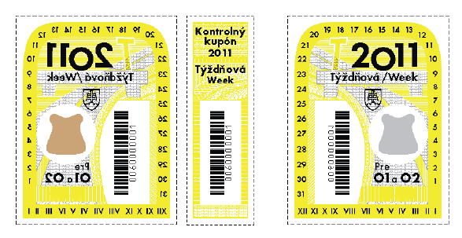

- VZORY TEXTOV NA PAPIEROVEJ PODLOŽKE NÁLEPIEK s týždennou dobou platnosti pre prípojné vozidlá kategórie O1 a O2“.

- 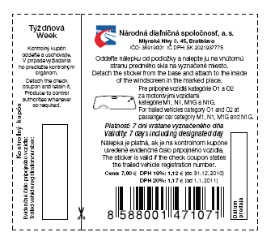
