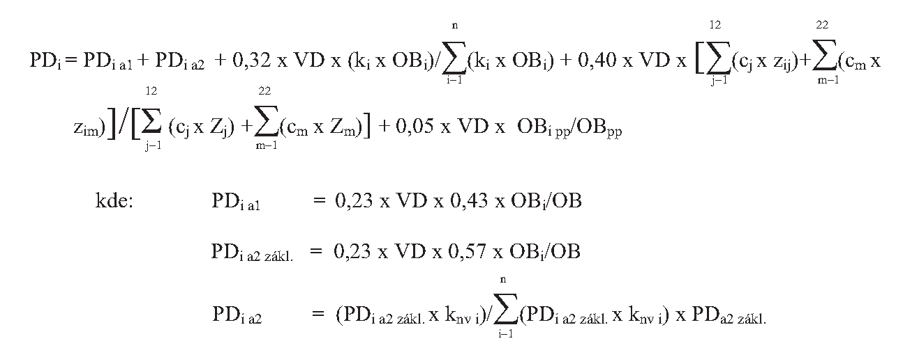

# Čl. I

Nariadenie vlády Slovenskej republiky č. 668/2004 Z. z. o rozdeľovaní výnosu dane z príjmov územnej samospráve v znení nariadenia vlády Slovenskej republiky č. 519/2006 Z. z., nariadenia vlády Slovenskej republiky č. 623/2007 Z. z., nariadenia vlády Slovenskej republiky č. 412/2008 Z. z. a nariadenia vlády Slovenskej republiky č. 276/2010 Z. z. sa mení takto:

Prílohy č. 3, 3a a 4 znejú:

„Príloha č. 3 k nariadeniu vlády č. 668/2004 Z. z.

KOEFICIENTY ZÁKLADNEJ UMELECKEJ ŠKOLY, MATERSKEJ ŠKOLY, JAZYKOVEJ ŠKOLY A ŠKOLSKÉHO ZARIADENIA PRE JEDNOTLIVÉ KATEGÓRIE ZÁKLADNÝCH UMELECKÝCH ŠKÔL, MATERSKÝCH ŠKÔL, JAZYKOVÝCH ŠKÔL A ŠKOLSKÝCH ZARIADENÍ V ZRIAĎOVATEĽSKEJ PÔSOBNOSTI OBCE

Tabuľka č. 1 – Hodnoty koeficientov spolu s koeficientmi materských škôl s počtom detí nad 25

Index j | Žiak (dieťa, poslucháč) základnej umeleckej školy, materskej školy, jazykovej školy a školského zariadenia | Koeficient

1 | Žiak základnej umeleckej školy v individuálnej forme vyučovania | 13,0

2 | Žiak základnej umeleckej školy v skupinovej forme vyučovania | 8,0

3 | Dieťa materskej školy vo veku do troch rokov1) | 61,0

4 | Dieťa materskej školy vo veku od troch rokov | 31,0

5 | Dieťa školského klubu detí | 6,0

6 | Dieťa centra voľného času a dieťa školského strediska záujmovej činnosti2) | 3,2

7 | Potenciálny stravník – žiak základnej školy zriadenej obcou a žiak päťročného, šesťročného a osemročného gymnázia na území obce zriadeného obcou3) | 2,0

8 | Potenciálny stravník – žiak základnej školy internátnej zriadenej obcou4) | 4,0

9 | Potenciálny stravník – žiak základnej školy a základnej školy pre žiakov so špeciálnymi výchovno-vzdelávacími potrebami zriadenej krajským školským úradom5) | 2,0

10 | Potenciálny stravník – žiak základnej školy internátnej a základnej školy internátnej pre žiakov so špeciálnymi výchovno-vzdelávacími potrebami zriadenej krajským školským úradom6) | 4,0

11 | Poslucháč jazykovej školy | 0,6

12 | Dieťa školského internátu | 15,0

1) Za dieťa do troch rokov sa považuje dieťa, ktoré dovŕši vek troch rokov najskôr k 1. septembru kalendárneho roka.

2) Do počtu detí v centre voľného času sa započítavajú deti, ktoré fyzicky navštevujú centrum voľného času na území obce a ktoré majú trvalý pobyt v okrese a v susediacich okresoch s okresom, v ktorom sídli príslušné centrum voľného času. To isté dieťa centra voľného času v zriaďovateľskej pôsobnosti obce sa započítava najviac jedenkrát.

Do počtu detí v školskom stredisku záujmovej činnosti sa uvádzajú deti, ktoré navštevujú školské stredisko záujmovej činnosti na území obce a ktoré majú trvalý pobyt v okrese a v susediacich okresoch s okresom, v ktorom sídli príslušné školské stredisko záujmovej činnosti. To isté dieťa školského strediska záujmovej činnosti v zriaďovateľskej pôsobnosti obce sa uvádza najviac jedenkrát.

Počet detí v školskom stredisku záujmovej činnosti zriadenom pri škole v zriaďovateľskej pôsobnosti obce nesmie byť vyšší ako počet žiakov príslušnej školy.

Dieťa, ktoré navštevuje školské stredisko záujmovej činnosti, ktoré nie je zriadené pri škole v zriaďovateľskej pôsobnosti obce a súčasne navštevuje aj centrum voľného času v zriaďovateľskej pôsobnosti tej istej obce, sa uvádza iba v jednom z týchto školských zariadení.

3) Potenciálny stravník – žiak základnej školy zriadenej obcou, je každý žiak základnej školy na území obce zriadenej obcou a žiak gymnázia je každý žiak gymnázia na území obce zriadeného obcou.

4) Potenciálny stravník – žiak základnej školy internátnej zriadenej obcou, je každý žiak základnej školy internátnej na území obce zriadenej obcou.

5) Potenciálny stravník – žiak základnej školy a základnej školy pre žiakov so špeciálnymi výchovno-vzdelávacími potrebami zriadenej krajským školským úradom, je každý žiak základnej školy a základnej školy pre žiakov so špeciálnymi výchovno-vzdelávacími potrebami na území obce zriadenej krajským školským úradom, ktorý sa stravuje v zariadení školského stravovania zriadeného obcou z dôvodu, že táto škola nemá na území obce zriadené vlastné zariadenie školského stravovania.

6) Potenciálny stravník – žiak základnej školy internátnej a základnej školy internátnej pre žiakov so špeciálnymi výchovno-vzdelávacími potrebami zriadenej krajským školským úradom, je každý žiak základnej školy internátnej a základnej školy internátnej pre žiakov so špeciálnymi výchovno-vzdelávacími potrebami na území obce zriadenej krajským školským úradom, ktorý sa stravuje v zariadení školského stravovania zriadeného obcou z dôvodu, že táto škola nemá na území obce zriadené vlastné zariadenie školského stravovania.

Tabuľka č. 2 – Hodnoty, o ktoré sa zvyšujú koeficienty pre materskú školu, ak celkový počet detí v materskej škole alebo materských školách zriaďovateľa nepresahuje 25

Počet detí v materskej škole (materských školách) zriaďovateľa | Zvýšenie koeficientov (bez ohľadu na vek dieťaťa) o hodnotu

do 10 | 20,6

od 11 do 15 | 12,6

od 16 do 20 | 6,5

od 21 do 25 | 1,7

Príloha č. 3a k nariadeniu vlády č. 668/2004 Z. z.

KOEFICIENTY ZÁKLADNEJ UMELECKEJ ŠKOLY, MATERSKEJ ŠKOLY, JAZYKOVEJ ŠKOLY A ŠKOLSKÉHO ZARIADENIA PRE JEDNOTLIVÉ KATEGÓRIE ZÁKLADNÝCH UMELECKÝCH ŠKÔL, MATERSKÝCH ŠKÔL, JAZYKOVÝCH ŠKÔL A ŠKOLSKÝCH ZARIADENÍ V ZRIAĎOVATEĽSKEJ PÔSOBNOSTI ŠTÁTOM UZNANEJ CIRKVI, NÁBOŽENSKEJ SPOLOČNOSTI (ĎALEJ LEN „CIRKEV“), FYZICKEJ OSOBY ALEBO INEJ PRÁVNICKEJ OSOBY (ĎALEJ LEN „SÚKROMNÁ OSOBA“)1)

Hodnoty koeficientov pre žiakov (detí, poslucháčov) do 15 rokov veku2)

Index m | Žiak (dieťa, poslucháč) základnej umeleckej školy, materskej školy, jazykovej školy a školského zariadenia | Koeficient

1 | Žiak základnej umeleckej školy v individuálnej forme vyučovania | 11,4

2 | Žiak základnej umeleckej školy v skupinovej forme vyučovania | 7,0

3 | Dieťa materskej školy vo veku do troch rokov3) | 53,7

4 | Dieťa materskej školy vo veku od troch rokov | 27,3

5 | Dieťa školského klubu detí | 5,3

6 | Dieťa centra voľného času a dieťa školského strediska záujmovej činnosti4) | 2,8

7 | Potenciálny stravník – žiak základnej školy, základnej školy pre žiakov so špeciálnymi výchovno-vzdelávacími potrebami a gymnázia zriadených cirkvou alebo súkromnou osobou5) | 1,8

8 | Potenciálny stravník – žiak základnej školy internátnej a základnej školy internátnej pre žiakov so špeciálnymi výchovno-vzdelávacími potrebami zriadenej cirkvou alebo súkromnou osobou6) | 3,6

9 | Potenciálny stravník – žiak základnej školy a základnej školy pre žiakov so špeciálnymi výchovno-vzdelávacími potrebami zriadenej krajským školským úradom7) | 2,0

10 | Potenciálny stravník – žiak základnej školy internátnej a základnej školy internátnej pre žiakov so špeciálnymi výchovno-vzdelávacími potrebami zriadenej krajským školským úradom8) | 4,0

11 | Dieťa materskej školy pre deti so špeciálnymi výchovno-vzdelávacími potrebami vo veku do troch rokov3) | 134,2

12 | Dieťa materskej školy pre deti so špeciálnymi výchovno-vzdelávacími potrebami vo veku od troch rokov | 68,2

13 | Dieťa materskej školy pri zdravotníckom zariadení9) | 40,9

14 | Dieťa školského klubu detí pri základnej škole pre žiakov so špeciálnymi výchovno-vzdelávacími potrebami vrátane internátnych škôl | 13,2

15 | Dieťa školského klubu detí pri zdravotníckom zariadení9) | 7,9

16 | Dieťa v diagnostickom centre a dieťa v reedukačnom centre9) | 117,0

17 | Dieťa v liečebno-výchovnom sanatóriu9) | 113,0

18 | Dieťa v centre pedagogicko-psychologického poradenstva a prevencie10) | 0,2

19 | Dieťa v centre špeciálnopedagogického poradenstva10) | 2,0

20 | Poslucháč jazykovej školy | 0,5

21 | Dieťa (žiak) v internáte z internátnej školy pre deti (žiakov) so špeciálnymi výchovno-vzdelávacími potrebami, z odborného učilišťa internátneho a z praktickej školy internátnej | 75,0

22 | Dieťa v internáte zo strednej školy | 15,0

1) § 19 ods. 2 písm. d) a e) zákona č. 596/2003 Z. z. o štátnej správe v školstve a školskej samospráve a o zmene a doplnení niektorých zákonov.

2) Za žiaka (dieťa, poslucháča) do 15 rokov veku podľa stavu k 15. septembru sa považuje žiak (dieťa, poslucháč), ktorý k 1. januáru kalendárneho roka, v ktorom sa zisťovanie uskutočňuje, nedovŕšil 15 rokov veku.

3) Za dieťa do troch rokov sa považuje dieťa, ktoré dovŕši vek troch rokov najskôr k 1. septembru kalendárneho roka.

4) Do počtu detí v centre voľného času v zriaďovateľskej pôsobnosti cirkvi alebo súkromnej osoby sa uvádzajú deti do 15 rokov veku, ktoré navštevujú centrum voľného času a ktoré majú trvalý pobyt v okrese a v susediacich okresoch s okresom, v ktorom sídli príslušné centrum voľného času. Dieťa centra voľného času v zriaďovateľskej pôsobnosti toho istého zriaďovateľa sa započítava najviac jedenkrát.

Dieťa, ktoré navštevuje centrum voľného času a súčasne navštevuje školské stredisko záujmovej činnosti toho istého zriaďovateľa, ktoré nie je zriadené pri škole, sa uvádza iba v jednom z týchto školských zariadení.

Do počtu detí v školskom stredisku záujmovej činnosti sa uvádzajú deti do 15 rokov veku, ktoré navštevujú školské stredisko záujmovej činnosti a ktoré majú trvalý pobyt v okrese a v susediacich okresoch s okresom, v ktorom sídli príslušné školské stredisko záujmovej činnosti. Dieťa školského strediska záujmovej činnosti v zriaďovateľskej pôsobnosti toho istého zriaďovateľa sa uvádza najviac jedenkrát.

Počet detí v školskom stredisku záujmovej činnosti zriadenom pri škole, ktorú zriaďuje cirkev alebo súkromná osoba, nesmie byť vyšší ako počet žiakov príslušnej školy.

Dieťa, ktoré navštevuje školské stredisko záujmovej činnosti, ktoré nie je zriadené pri škole v zriaďovateľskej pôsobnosti cirkvi alebo súkromnej osoby a súčasne navštevuje aj centrum voľného času toho istého zriaďovateľa, sa uvádza iba v jednom z týchto školských zariadení.

5) Potenciálny stravník – žiak základnej školy, základnej školy pre žiakov so špeciálnymi výchovno-vzdelávacími potrebami a gymnázia, zriadených cirkvou alebo súkromnou osobou, je každý žiak

a) základnej školy a základnej školy pre žiakov so špeciálnymi výchovno-vzdelávacími potrebami na území obce zriadenej cirkvou alebo súkromnou osobou,

b) 5-ročného, 6-ročného a 8-ročného gymnázia na území obce zriadeného cirkvou alebo súkromnou osobou vo veku do 15 rokov.

6) Potenciálny stravník – žiak základnej školy internátnej a základnej školy internátnej pre žiakov so špeciálnymi výchovno-vzdelávacími potrebami zriadenej cirkvou alebo súkromnou osobou, je každý žiak základnej školy internátnej a základnej školy internátnej pre žiakov so špeciálnymi výchovno-vzdelávacími potrebami na území obce zriadenej cirkvou alebo súkromnou osobou.

7) Potenciálny stravník – žiak základnej školy a základnej školy pre žiakov so špeciálnymi výchovno-vzdelávacími potrebami zriadenej krajským školským úradom, je každý žiak základnej školy a základnej školy pre žiakov so špeciálnymi výchovno-vzdelávacími potrebami na území obce zriadenej krajským školským úradom, ktorý sa stravuje v zariadení školského stravovania zriadeného cirkvou alebo súkromnou osobou z dôvodu, že táto škola nemá na území obce zriadené vlastné zariadenie školského stravovania.

8) Potenciálny stravník – žiak základnej školy internátnej a základnej školy internátnej pre žiakov so špeciálnymi výchovno-vzdelávacími potrebami zriadenej krajským školským úradom, je každý žiak základnej školy internátnej a základnej školy internátnej pre žiakov so špeciálnymi výchovno-vzdelávacími potrebami na území obce zriadenej krajským školským úradom, ktorý sa stravuje v zariadení školského stravovania zriadeného cirkvou alebo súkromnou osobou z dôvodu, že táto škola nemá na území obce zriadené vlastné zariadenie školského stravovania.

9) Počet detí na kalendárny rok sa určí ako skutočný priemerný prepočítaný denný počet detí za predchádzajúci školský rok. V novovzniknutých školských zariadeniach sa počet detí na kalendárny rok určí ako skutočný počet detí prijatých do školského zariadenia podľa stavu k 15. septembru kalendárneho roka, v ktorom sa štatistické zisťovanie uskutočňuje.

10) Počet detí na kalendárny rok sa určí ako skutočný počet evidovaných detí za predchádzajúci školský rok. V novovzniknutých školských zariadeniach sa počet detí na kalendárny rok určí ako skutočný počet detí prijatých do školského zariadenia podľa stavu k 15. septembru kalendárneho roka, v ktorom sa štatistické zisťovanie uskutočňuje.

Príloha č. 4 k nariadeniu vlády č. 668/2004 Z. z.

VZOREC

na výpočet podielu obce na výnose dane

Vysvetlivky:

PDi | – | podiel obce „i“ na výnose dane v eurách

PDi a1 | – | podiel obce „i“ na výnose dane v eurách neupravený koeficientom nadmorskej výšky obce

PDi a2 | – | podiel obce „i“ na výnose dane v eurách upravený koeficientom nadmorskej výšky obce

VD | – | výnos dane podľa § 2 zákona v eurách

OBi | – | počet obyvateľov obce „i“ k 1. januáru predchádzajúceho kalendárneho roka

OB | – | počet obyvateľov Slovenskej republiky k 1. januáru predchádzajúceho kalendárneho roka

knv | – | koeficient nadmorskej výšky obce „i“

ki | – | koeficient obce „i“

cj | – | koeficient základnej umeleckej školy, materskej školy, jazykovej školy a školského zariadenia „j“ v zriaďovateľskej pôsobnosti obce

cm | – | koeficient základnej umeleckej školy, materskej školy, materskej školy pre deti so špeciálnymi výchovno-vzdelávacími potrebami, jazykovej školy a školského zariadenia „m“ v zriaďovateľskej pôsobnosti cirkvi alebo súkromnej osoby

zij | – | počet žiakov (detí, poslucháčov) základnej umeleckej školy, materskej školy, jazykovej školy a školských zariadení v zriaďovateľskej pôsobnosti obce „i“ a potenciálnych stravníkov k 15. septembru predchádzajúceho kalendárneho roka

zim | – | počet žiakov (detí, poslucháčov) základnej umeleckej školy, materskej školy, materskej školy pre deti so špeciálnymi výchovno-vzdelávacími potrebami, jazykovej školy, školského klubu detí, centra voľného času, školského strediska záujmovej činnosti a školského klubu detí pri základnej škole pre žiakov so špeciálnymi výchovno-vzdelávacími potrebami v zriaďovateľskej pôsobnosti cirkvi alebo súkromnej osoby na území obce „i“ a potenciálnych stravníkov k 15. septembru predchádzajúceho kalendárneho roka do 15 rokov veku

| – | skutočný priemerný prepočítaný denný počet detí za predchádzajúci školský rok v materskej škole a materskej škole pre deti so špeciálnymi výchovno-vzdelávacími potrebami pri zdravotníckom zariadení, školskom klube detí pri zdravotníckom zariadení, diagnostickom centre, liečebno-výchovnom sanatóriu, reedukačnom centre v zriaďovateľskej pôsobnosti cirkvi alebo súkromnej osoby na území obce „i“ do 15 rokov veku; pri novovzniknutom školskom zariadení sa počet žiakov na kalendárny rok určí ako skutočný počet žiakov prijatých do školského zariadenia podľa stavu k 15. septembru kalendárneho roka, v ktorom sa štatistické zisťovanie uskutočňuje

| – | skutočný počet evidovaných detí za predchádzajúci školský rok v centre pedagogicko­-psychologického poradenstva a prevencie a v centre špeciálnopedagogického poradenstva v zriaďovateľskej pôsobnosti cirkvi alebo súkromnej osoby na území obce „i“ do 15 rokov veku; pri novovzniknutom školskom zariadení sa počet detí na kalendárny rok určí ako skutočný počet detí prijatých do školského zariadenia podľa stavu k 15. septembru kalendárneho roka, v ktorom sa štatistické zisťovanie uskutočňuje

Zj | – | celkový počet žiakov (detí, poslucháčov) „j“ v Slovenskej republike v základných umeleckých školách, v materských školách, v jazykových školách, v školských zariadeniach v zriaďovateľskej pôsobnosti obcí a potenciálnych stravníkov k 15. septembru predchádzajúceho kalendárneho roka

Zm | – | celkový počet žiakov (detí, poslucháčov) „m“ v Slovenskej republike v základných umeleckých školách, materských školách, materských školách pre deti so špeciálnymi výchovno-vzdelávacími potrebami, jazykových školách, školských kluboch detí, centrách voľného času, školských strediskách záujmovej činnosti, školských klubov detí pri základných školách pre žiakov so špeciálnymi výchovno-vzdelávacími potrebami v zriaďovateľskej pôsobnosti cirkví a súkromných osôb a potenciálnych stravníkov k 15. septembru predchádzajúceho kalendárneho roka do 15 rokov veku

| – | celkový skutočný priemerný prepočítaný denný počet detí v Slovenskej republike za predchádzajúci školský rok v materských školách a materských školách pre deti so špeciálnymi výchovno­-vzdelávacími potrebami pri zdravotníckych zariadeniach, školských kluboch detí pri zdravotníckych zariadeniach, diagnostických centrách, liečebno-výchovných sanatóriách, reedukačných centrách „m“ v zriaďovateľskej pôsobnosti cirkví a súkromných osôb do 15 rokov veku; pri novovzniknutých školských zariadeniach sa počet detí na kalendárny rok určí ako skutočný počet detí prijatých do školských zariadení podľa stavu k 15. septembru kalendárneho roka, v ktorom sa štatistické zisťovanie uskutočňuje

| – | celkový skutočný počet evidovaných detí v Slovenskej republike za predchádzajúci školský rok v centrách pedagogicko-psychologického poradenstva a prevencie a v centrách špe­ciálnopedagogického poradenstva v zriaďovateľskej pôsobnosti cirkví a súkromných osôb do 15 rokov veku; pri novovzniknutých školských zariadeniach sa počet detí na kalendárny rok určí ako skutočný počet detí prijatých do školských zariadení podľa stavu k 15. septembru kalendárneho roka, v ktorom sa štatistické zisťovanie uskutočňuje

OBi pp | – | počet obyvateľov obce „i“, ktorí dovŕšili vek 62 rokov k 1. januáru predchádzajúceho kalendárneho roka

OBpp | – | počet obyvateľov Slovenskej republiky, ktorí dovŕšili vek 62 rokov k 1. januáru predchádzajúceho kalendárneho roka

i | – | údaj týkajúci sa príslušnej obce

j | – | údaj týkajúci sa príslušnej základnej umeleckej školy, materskej školy, jazykovej školy alebo školského zariadenia v zriaďovateľskej pôsobnosti obce

m | – | údaj týkajúci sa príslušnej základnej umeleckej školy, materskej školy, materskej školy pre deti so špeciálnymi výchovno-vzdelávacími potrebami, jazykovej školy alebo školského zariadenia v zriaďovateľskej pôsobnosti cirkvi a súkromnej osoby

n | – | počet obcí.“.

“.
