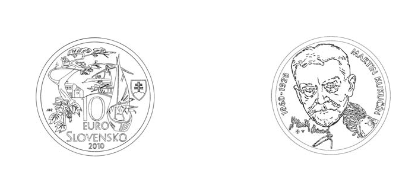

## 95

OZNÁMENIE

Národnej banky Slovenska

z 9. marca 2010

## o vydaní strieborných zberateľských mincí v nominálnej hodnote 10 eur pri príležitosti 150. výročia narodenia Martina Kukučína

1. Úvodné ustanovenia

- a) Národná banka Slovenska podľa § 17h ods. 1 zákona Národnej rady Slovenskej republiky č. 566/1992 Zb. o Národnej banke Slovenska v znení neskorších predpisov a podľa § 1 ods. 2 písm. d) zákona Národnej rady Slovenskej republiky č. 1/1993 Z. z. o Zbierke zákonov Slovenskej republiky v znení zákona č. 275/2002 Z. z. oznamuje, že pri príležitosti 150. výročia narodenia Martina Kukučína vydáva do obehu strieborné zberateľské mince v nominálnej hodnote 10 eur (ďalej len „minca“).

- b) Minca má štatút zákonného platidla len v Slovenskej republike.

- c) Minca sa razí zo zliatiny obsahujúcej 900 dielov striebra a 100 dielov medi; jej hmotnosť je 18 g a priemer 34 mm. Pri razbe mince je povolená horná a dolná odchýlka v priemere 0,1 mm; povolená horná odchýlka v hmotnosti je 0,4 g a v obsahu striebra 10/1000.

2. Vzhľad mince

- a) Na líci mince je vyobrazená štylizovaná kompozícia chorvátskej krajiny na ostrove Brač s autentickým „domom v stráni“ známym z rovnomenného literárneho diela Martina Kukučína. V ľavej časti kompozície je vyobrazený strom olivovníka v spodnej časti doplnený listami a plodmi viniča. V pravej časti kompozície je vyobrazená plachetnica. Vpravo od nej je štátny znak Slovenskej republiky. V strede mincového poľa je v dvoch riadkoch označenie nominálnej hodnoty mince „10 EURO“, pod ktorým je umiestnený názov štátu „SLOVENSKO“. Pod ním je letopočet „2010“. Štylizované iniciálky mena a priezviska autora výtvarného návrhu lícnej strany mince Miroslava Rónaia „MR“ sú umiestnené vľavo od viniča.

- b) Na rube mince je vyobrazený portrét Martina Kukučína. Vpravo od neho je vyobrazené mláďa kukučky, ktoré je symbolom jeho spisovateľského pseudonymu. Pod portrétom je faximile podpisu „Dr. Matej Bencúr“. Pri pravom okraji mince je v opise zľava doprava od horného okraja mince meno a priezvisko „MARTIN KUKUČÍN“ a vľavo od portrétu sú v opise zľava doprava letopočty jeho narodenia a úmrtia „1860 – 1928“. Pod faximile podpisu je umiestnená značka Mincovne Kremnica, štátny podnik, „MK“, medzi dvoma razidlami a vpravo od nej sú štylizované iniciálky mena a priezviska autora výtvarného návrhu rubovej strany mince Mgr. art. Petra Valacha „PV“.

- c) Na hrane mince je nápis do hĺbky „– PROZAIK – DRAMATIK – PUBLICISTA“.

- 

- Štát vydania: Slovenská republika

- Začiatok vydávania: máj 2010

Jozef Makúch v. r.
