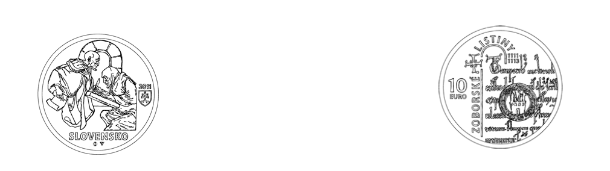

## 13

OZNÁMENIE

Národnej banky Slovenska

zo 7. decembra 2010

o vydaní strieborných zberateľských euromincí v nominálnej hodnote 10 eur pri príležitosti 900. výročia vzniku zoborských listín

1. Úvodné ustanovenia

a) Národná banka Slovenska podľa § 17h ods. 1 zákona Národnej rady Slovenskej republiky č. 566/1992 Zb. o Národnej banke Slovenska v znení neskorších predpisov a podľa § 1 ods. 2 písm. d) zákona Národnej rady Slovenskej republiky č. 1/1993 Z. z. o Zbierke zákonov Slovenskej republiky v znení zákona č. 275/2002 Z. z. oznamuje, že pri príležitosti 900. výročia vzniku zoborských listín vydáva do obehu strieborné zberateľské euromince v nominálnej hodnote 10 eur (ďalej len „zberateľská eurominca“).

b) Zberateľská eurominca má štatút zákonného platidla len v Slovenskej republike.

c) Zberateľská eurominca sa razí zo zliatiny obsahujúcej 900 dielov striebra a 100 dielov medi; jej hmotnosť je 18 g a priemer 34 mm. Pri razbe zberateľskej euromince je povolená horná a dolná odchýlka v priemere 0,1 mm; povolená horná odchýlka v hmotnosti je 0,4 g a v obsahu striebra 10/1000.

2. Vzhľad zberateľskej euromince

a) Na líci zberateľskej euromince je vyobrazená dvojica benediktínskych mníchov v imaginárnom interiéri dobového kláštora zachytená pri písaní listín. Vpravo od mníchov je štátny znak Slovenskej republiky. Nad ním je letopočet „2011“. V spodnej časti mincového poľa je umiestnený názov štátu „SLOVENSKO“. Značka Mincovne Kremnica, štátny podnik, „MK“, medzi dvoma razidlami a štylizované iniciálky mena a priezviska autora výtvarného návrhu Mgr. art. Petra Valacha „PV“ sú umiestnené pod názvom štátu.

b) Na rube zberateľskej euromince je v pravej časti mincového poľa vyobrazený fragment textu prvej zoborskej listiny doplnený pečaťou kapituly Kostola svätého Hypolita zo Zobora. V ľavej časti mincového poľa je súbežne s linkou naznačujúcou románsky oblúk nápis „ZOBORSKÉ LISTINY“, za ktorým sú v dvoch riadkoch letopočty „1111“ a „1113“. Označenie nominálnej hodnoty zberateľskej euromince „10 EURO“ je v dvoch riadkoch v ľavej časti mincového poľa.

c) Na hrane mince je nápis do hĺbky „• NAJSTARŠIE ZACHOVANÉ LISTINY NA SLOVENSKU“.

Štát vydania: Slovenská republika

Začiatok vydávania: marec 2011

v z. Viliam Ostrožlík v. r.
