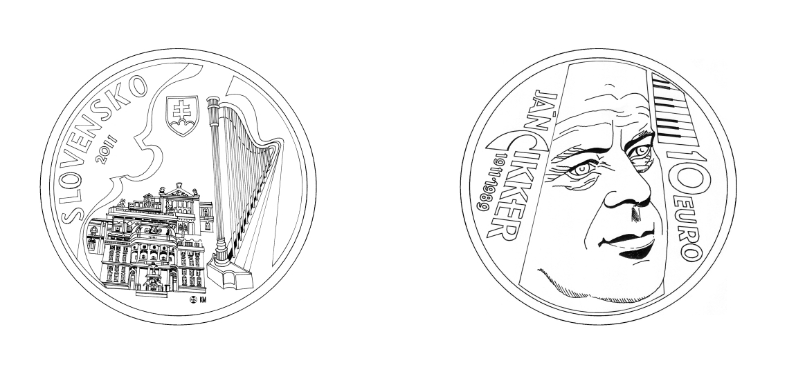

## 147

OZNÁMENIE

Národnej banky Slovenska

z 18. apríla 2011

o vydaní strieborných zberateľských euromincí v nominálnej hodnote 10 eur pri príležitosti 100. výročia narodenia Jána Cikkera

1. Úvodné ustanovenia

a) Národná banka Slovenska podľa § 17h ods. 1 zákona Národnej rady Slovenskej republiky č. 566/1992 Zb. o Národnej banke Slovenska v znení neskorších predpisov a podľa § 1 ods. 2 písm. d) zákona Národnej rady Slovenskej republiky č. 1/1993 Z. z. o Zbierke zákonov Slovenskej republiky v znení zákona č. 275/2002 Z. z. oznamuje, že pri príležitosti 100. výročia narodenia Jána Cikkera vydáva do obehu strieborné zberateľské euromince v nominálnej hodnote 10 eur (ďalej len „zberateľská eurominca“).

b) Zberateľská eurominca má štatút zákonného platidla len v Slovenskej republike.

c) Zberateľská eurominca sa razí zo zliatiny obsahujúcej 900 dielov striebra a 100 dielov medi; jej hmotnosť je 18 g a priemer 34 mm. Pri razbe zberateľskej euromince je povolená horná a dolná odchýlka v priemere 0,1 mm; povolená horná odchýlka v hmotnosti je 0,4 g a v obsahu striebra 10/1000.

2. Vzhľad zberateľskej euromince

a) Na líci zberateľskej euromince je vyobrazená štylizovaná silueta huslí v pravej časti doplnená harfou. V spodnej časti mincového poľa je vyobrazená kompozícia kultúrnych stánkov, v ktorých Ján Cikker pôsobil – Slovenského národného divadla v Bratislave, Viedenskej štátnej opery a Štátnej opery v Prahe. Štátny znak Slovenskej republiky je umiestnený v hornej časti mincového poľa. Pri ľavom okraji mincového poľa je v opise zľava doprava názov štátu „SLOVENSKO“ a vpravo od neho letopočet „2011“. Značka Mincovne Kremnica, štátny podnik, ktorú tvorí skratka „MK“ umiestnená medzi dvoma razidlami, a štylizované iniciálky mena a priezviska autora výtvarného návrhu zberateľskej euromince PhDr. Klimenta Mituru „KM“ sú v spodnej časti mincového poľa.

b) Na rube zberateľskej euromince je vyobrazený portrét Jána Cikkera vpravo hore kompozične doplnený časťou klavírnej klávesnice. Pod ňou je v smere zhora nadol označenie nominálnej hodnoty zberateľskej euromince „10 EURO“. V ľavej časti mincového poľa je v smere zhora nadol umiestnené meno a priezvisko „JÁN CIKKER“ a letopočty jeho narodenia a úmrtia „1911 – 1989“.

c) Na hrane mince je nápis do hĺbky „● HUDBA – UNIVERZÁLNA REČ ĽUDSTVA“.

Štát vydania: Slovenská republika

Začiatok vydávania: júl 2011

Jozef Makúch v. r.
