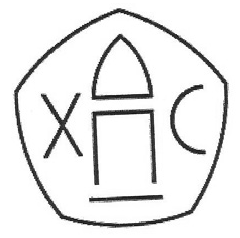

# Čl. I

Nariadenie vlády Slovenskej republiky č. 397/1999 Z. z., ktorým sa ustanovujú podrobnosti o technických požiadavkách a postupoch posudzovania zhody na strelné zbrane a strelivo v znení nariadenia vlády Slovenskej republiky č. 296/2000 Z. z., nariadenia vlády Slovenskej republiky č. 380/2003 Z. z. a nariadenia vlády Slovenskej republiky č. 182/2006 Z. z. sa mení a dopĺňa takto:

- 1. V § 1 ods. 1 písm. a) deviatom bode sa vypúšťajú slová „nabíjané ústím“.

- 2. V § 1 ods. 1 písm. a) sa vypúšťa bod 16.

- Doterajšie body 17 a 18 sa označujú ako body 16 a 17.

- 3. V § 1 ods. 1 sa písmeno b) dopĺňa siedmym bodom, ktorý znie:

- „7.

- airsoftové zbrane“.

- 4. V § 1 ods. 1 sa vypúšťa písmeno i).

- Doterajšie písmená j) až l) sa označujú ako písmená i) až k).

- 5. V § 1 ods. 1 písm. i) prvý bod znie:

- „1.

- strely z pevných materiálov,“.

- 6. § 2 sa dopĺňa písmenom j), ktoré znie:

- „j)

- expanzné prístroje podľa osobitného predpisu.1a)“.

- Poznámka pod čiarou k odkazu 1a znie:

- „1a)

- § 8 ods. 2 nariadenia vlády Slovenskej republiky č. 436/2008 Z. z., ktorým sa ustanovujú podrobnosti o technických požiadavkách a postupoch posudzovania zhody na strojové zariadenia.“.

- 7. V § 3 ods. 1 sa vypúšťajú slová „harmonizovanými slovenskými technickými normami a“ a slová „§ 5 ods. 5 a 6“ sa nahrádzajú slovami „§ 5 ods. 6“.

- 8. V § 3 ods. 3 sa za slová „Výrobca alebo dovozca“ vkladajú slová „(ďalej len „predkladateľ“)“.

- 9. § 3 sa dopĺňa odsekom 4, ktorý znie:

- „(4)

- Predkladateľ strelnej zbrane označí túto zbraň na hlavni a revolverovom valci obchodným menom alebo ochrannou známkou, výrobným číslom a označením kalibra použitého streliva, a to na každej hlavni a revolverovom valci, ak ide o hlavne rozdielneho kalibru alebo o valce rozdielneho kalibru.“.

- 10. V § 4 odsek 1 znie:

- „(1)

- Posudzovanie zhody vlastností strelných zbraní a streliva vykonáva autorizovaná osoba podľa § 11 zákona, uvedená v prílohe č. 2 bode 1.9, ktorá určí počty a termíny, v ktorých sa budú určené výrobky predkladať na posudzovanie zhody, a miesto, kde sa posudzovanie zhody vykonáva.“.

- 11. V § 5 ods. 1, 3 a § 6 sa slová „výrobca alebo dovozca“ vo všetkých tvaroch nahrádzajú slovom „predkladateľ“ v príslušnom tvare.

- 12. V § 5 ods. 1 sa slová „certifikát typu zbrane“ nahrádzajú slovami „certifikát o typovej skúške zbrane“.

- 13. V § 5 odsek 2 znie:

- „(2)

- Homologizácia strelnej zbrane a expanznej zbrane (ďalej len „homologizácia“) je postup, pri ktorom autorizovaná osoba po overení dvoch kusov z každého typu zbrane vydá certifikát o homologizácii a poverí predkladateľa označením zbrane homologizačnou značkou.“.

- 14. V § 5 ods. 3 písm. c) sa vypúšťajú slová „a expanzných prístrojov“.

- 15. V § 5 odseky 5 a 6 znejú:

- „(5)

- Kusové overenie strelnej zbrane (ďalej len „kusové overenie“) je postup, pri ktorom autorizovaná osoba overuje splnenie technických požiadaviek každej strelnej zbrane okrem homologizovanej zbrane. Autorizovaná osoba vydá predkladateľovi alebo osobe, ktorá požiadala o kusové overenie, protokol o kusovom overení a zbraň označí príslušnou overovacou značkou.

- (6)

- Autorizovaná osoba po vykonaní nového kusového overenia strelnej zbrane (ďalej len „nové kusové overenie“) podľa § 10 vydá predkladateľovi alebo osobe, ktorá požiadala o nové kusové overenie, protokol o novom kusovom overení alebo túto zbraň označí overovacou značkou podľa prílohy č. 2.“.

- 16. V § 7 odsek 1 znie:

- „(1)

- Predkladateľ predkladá na homologizáciu dve zbrane označené podľa § 3 ods. 4.“.

- 17. V § 7 ods. 2, nadpise § 9 a v § 15 ods. 6 sa slová „kusové overenie zbrane“ a „kusové overenie strelnej zbrane“ vo všetkých tvaroch nahrádzajú slovami „kusové overenie“ v príslušnom tvare.

- 18. V nadpise § 10, § 15 ods. 6 a 7 a v § 17 ods. 1 písm. e) a ods. 5 sa slová „nové kusové overenie zbrane“ a „nové kusové overenie strelnej zbrane“ vo všetkých tvaroch nahrádzajú slovami „nové kusové overenie“ v príslušnom tvare.

- 19. V § 7 ods. 2 sa vypúšťajú slová „a expanzných prístrojoch“.

- 20. V § 7 ods. 3 sa vypúšťajú slová „a expanzných prístrojov“.

- 21. V § 7 ods. 3 písm. c) sa vypúšťa slovo „overenie“.

- 22. V § 7 ods. 4 sa vypúšťajú slová „alebo expanzného prístroja“.

- 23. V § 7 ods. 5 sa slová „technické a personálne predpoklady“ nahrádzajú slovami „technické prostriedky, prístrojové vybavenie a zamestnancov, ktorí sú spôsobilí“.

- 24. V § 7 ods. 6 sa vypúšťajú slová „alebo expanzných prístrojov“.

- 25. V § 9 ods. 1, 6, 8 a 9 a v § 15 ods. 10 sa slovo „predkladateľ“ vo všetkých tvaroch nahrádza slovami „predkladateľ alebo osoba, ktorá požiadala o kusové overenie,“ v príslušnom tvare.

- 26. V § 9 ods. 1 sa vypúšťajú slová „strelných zbraní (ďalej len „kusové overenie“)“ a druhá veta a na konci sa pripájajú tieto vety: „Akustické zbrane musia byť konštruované tak, aby z nich nebolo možné vystreliť strelu z náboja príslušného kalibru. Zbraň určená na používanie brokových nábojov s oceľovými brokmi vysokého výkonu musí byť konštruovaná tak, aby zahrdlenie brokovej hlavne nebolo väčšie ako 0,5 mm pre kaliber 12 a 10/89 pri použití oceľových brokov s priemerom väčším ako 4 mm a pre kaliber 20 pri použití oceľových brokov s priemerom väčším ako 3,25 mm.“.

- 27. V § 9 sa vypúšťa odsek 13.

- 28. V § 10 ods. 1 sa vypúšťajú slová „strelných zbraní (ďalej len „nové kusové overenie“)“.

- 29. V § 10 sa vypúšťa odsek 2. Súčasne sa zrušuje označenie odseku 1.

- 30. V § 15 sa vypúšťajú odseky 1 a 2.

- Doterajšie odseky 3 až 10 sa označujú ako odseky 1 až 8.

- 31. V § 15 ods. 5 sa na konci pripája táto veta: „Autorizovaná osoba môže poveriť predkladateľa alebo osobu, ktorá požiadala o kusové overenie, označením zbrane príslušnými overovacími značkami podľa prílohy č. 2. Zbraň, na ktorej bola vykonaná skúška na oceľové broky, sa označí overovacími značkami podľa prílohy č. 2 bodov 1.8 a 1.9.“.

- 32. V § 15 ods. 7 sa za slovo „predkladateľovi“ vkladajú slová „alebo osobe, ktorá požiadala o kusové overenie alebo o nové kusové overenie,“.

- 33. V § 16 ods. 1 sa slová „Výrobca alebo dovozca“ nahrádzajú slovami „Predkladateľ alebo osoba, ktorá požiadala o kusové overenie,“.

- 34. V § 16 ods. 2 a 3 sa slová „Výrobca alebo dovozca“ nahrádzajú slovom „Predkladateľ“.

- 35. V § 16 sa odsek 4 vypúšťa.

- Doterajšie odseky 5 a 6 sa označujú ako odseky 4 a 5.

- 36. V § 16 ods. 4 sa slovo „Opravovňa“ nahrádza slovami „Predkladateľ alebo osoba, ktorá požiadala o nové kusové overenie,“.

- 37. V § 16 ods. 5 sa za slovo „držiteľ“ vkladajú slová „strelnej zbrane“.

- 38. V § 17 ods. 1 sa na konci úvodnej vety vypúšťa dvojbodka.

- 39. V § 17 ods. 1 písm. a) sa vypúšťajú slová „- o homologizácii“.

- 40. V § 17 ods. 1 sa za písmeno a) vkladá nové písmeno b), ktoré znie:

- „b)

- protokol o homologizácii,“.

- Doterajšie písmená b) až f) sa označujú ako písmená c) až g).

- 41. V § 17 ods. 1 písm. g) sa na konci bodka nahrádza čiarkou.

- 42. V § 17 sa odsek 1 dopĺňa písmenom h), ktoré znie:

- „h)

- potvrdenie zhody.“.

- 43. V § 17 ods. 2 úvodná veta znie:

- „(2)

- Protokol o typovej skúške zbrane a protokol o homologizácii zbrane obsahuje najmä“.

- 44. V 17 ods. 5 písm. a) sa za slová „predkladateľa zbrane“ vkladajú slová „alebo osoby, ktorá požiadala o kusové overenie alebo o nové kusové overenie“.

- 45. V § 17 sa za odsek 7 vkladá nový odsek 8, ktorý znie:

- „(8)

- Potvrdenie zhody obsahuje najmä

- a)

- identifikačné údaje osoby, ktorá požiadala o vykonanie posúdenia zhody,

- b)

- typové označenie strelnej zbrane, varianty strelnej zbrane,

- c)

- stručný opis strelnej zbrane,

- d)

- výsledok posudzovania zhody.“.

- Doterajší odsek 8 sa označuje ako odsek 9.

- 46. § 17 sa dopĺňa odsekom 10, ktorý znie:

- „(10)

- Potvrdenie zhody sa vydáva s platnosťou najviac tri roky.“.

- 47. § 18a znie:

- 㤠18a

- Toto nariadenie vlády bolo prijaté v súlade s právne záväzným aktom Európskej únie v oblasti technických noriem a technických predpisov.3)“.

- Poznámka pod čiarou k odkazu 3 znie:

- „3)

- Smernica Európskeho parlamentu a Rady 98/34/ES z 22. júna 1998, ktorou sa stanovuje postup pri poskytovaní informácií v oblasti technických noriem a predpisov, ako aj pravidiel vzťahujúcich sa na služby informačnej spoločnosti (Mimoriadne vydanie Ú. v. EÚ, kap. 13/zv. 20) v platnom znení.“.

- 48. V prílohe č. 1 časti Podrobnosti o podmienkach skúšobnej streľby piatom bode písm. a) tabuľka znie:

- „

- | Tlak na tlakomeri (v MPa) č.: | | | | | | | | |

- Kaliber | 1 | | | | 2 | | | 1 | | 2

- | Pri skúške | | | | | | | | |

- | bežnej | | | | vyššej | | | | |

- 14 a väčší | 93 | | | | 50 | | | 132 | | 50

- 16 | 98 | | | | 50 | | | 132 | | 50

- 20 a menší | 104 | | | | 50 | | | 132 | | 50

- 12/70 – oceľové broky | hybnosť ≤ 13,5 Ns | | | | | | | 132 | | 50

- | | | | | | | | hybnosť ≥15 Ns | |

- 12/73 a 12/76 – oceľové broky | hybnosť ≤ 15 Ns | | | | | | | 132 | | 50

- | | | | | | | | hybnosť ≥ 17,5 Ns | |

- 12/89 – oceľové broky | hybnosť ≤ 19 Ns | | | | | | | 132 | | 50

- | | | | | | | | hybnosť ≥ 22 Ns | |

- 10/89 – oceľové broky | hybnosť ≤ 22 Ns | | | | | | | 132 | | 50

- | | | | | | | | hybnosť ≥ 22 Ns | |

- 16/70 – oceľové broky | hybnosť ≤ 9,5 Ns | | | | | | | – | | –

- 20/70 – oceľové broky | hybnosť ≤ 11 Ns | | | | | | | 132 | | 50

- | | | | | | | | hybnosť ≥ 12,5 Ns | |

- 20/76 – oceľové broky | hybnosť ≤ 12 Ns | | | | | | | 132 | | 50

- | | | | | | | | hybnosť ≥ 14 Ns | |

- “.

- 49. V prílohe č. 1 časti Podrobnosti o podmienkach skúšobnej streľby piatom bode písm. c) sa vypúšťajú slová „,pracovné expanzné prístroje“ a posledná veta.

- 50. V prílohe č. 1 časti Podrobnosti o podmienkach skúšobnej streľby piatom bode sa vypúšťa písmeno e).

- Doterajšie písmená f) až n) sa označujú ako písmená e) až m).

- 51. V prílohe č. 1 časti Podrobnosti o podmienkach skúšobnej streľby piatom bode písm. h) sa vypúšťajú slová „skúšobných nábojov alebo nábojov určených na trh“.

- 52. V prílohe č. 2 sa časť 12 dopĺňa novou značkou:

- „12.5 |  | Overovacia značka Skúšobne Klimovsk II.“.

- 53. Slová „harmonizovaná slovenská technická norma“ vo všetkých tvaroch sa v celom texte nariadenia vlády nahrádzajú slovami „slovenská technická norma vhodná na posudzovanie zhody“ v príslušnom tvare.
