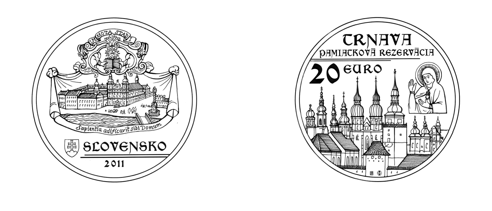

## 234

OZNÁMENIE

Národnej banky Slovenska

zo 14. júna 2011

## o vydaní strieborných zberateľských euromincí v nominálnej hodnote 20 eur s tematikou pamiatkovej rezervácie Trnava

1. Úvodné ustanovenia

a) Národná banka Slovenska podľa § 17h ods. 1 zákona Národnej rady Slovenskej republiky č. 566/1992 Zb. o Národnej banke Slovenska v znení neskorších predpisov a podľa § 1 ods. 2 písm. d) zákona Národnej rady Slovenskej republiky č. 1/1993 Z. z. o Zbierke zákonov Slovenskej republiky v znení zákona č. 275/2002 Z. z. oznamuje, že vydáva do obehu strieborné zberateľské euromince v nominálnej hodnote 20 eur s tematikou pamiatkovej rezervácie Trnava (ďalej len „zberateľská eurominca“).

b) Zberateľská eurominca má štatút zákonného platidla len v Slovenskej republike.

c) Zberateľská eurominca sa razí zo zliatiny obsahujúcej 925 dielov striebra a 75 dielov medi; jej hmotnosť je 33,63 g a priemer 40 mm. Pri razbe zberateľskej euromince je povolená horná a dolná odchýlka v priemere 0,1 mm; povolená horná odchýlka v hmotnosti je 0,4 g a v obsahu striebra 10/1000.

2. Vzhľad zberateľskej euromince

a) Na líci zberateľskej euromince je vyobrazená historická veduta Trnavskej univerzity s univerzitným Katedrálnym chrámom sv. Jána Krstiteľa. Štátny znak Slovenskej republiky je vyobrazený v spodnej časti mincového poľa. Vedľa neho je názov štátu „SLOVENSKO“, pod ktorým sú dve vodorovné linajky a letopočet „2011“.

b) Na rube zberateľskej euromince je kompozícia vytvorená z trnavských architektonických pamiatok – Synagógy status quo ante, Kostola sv. Anny, Kostola Nanebovzatia Panny Márie, Kostola sv. Jakuba, Baziliky sv. Mikuláša, Mestskej veže na Trojičnom námestí, Kostola Najsvätejšej Trojice, Kostola sv. Jozefa a veže mestských hradieb doplnená vyobrazením Panny Márie Trnavskej. V hornej časti mincového poľa je v dvoch riadkoch text „TRNAVA PAMIATKOVÁ REZERVÁCIA“, pod ktorým sú dve vodorovné linajky a označenie nominálnej hodnoty zberateľskej euromince „20 EURO“. Štylizované iniciálky mena a priezviska autora výtvarného návrhu zberateľskej euromince Mgr. art. Romana Lugára “RL” a značka Mincovne Kremnica, štátny podnik, ktorú tvorí skratka „MK“ umiestnená medzi dvoma razidlami, sú v spodnej časti mincového poľa vsadené do kompozície.

c) Na hrane mince je reliéfny nápis „NAJKRAJŠIE HISTORICKÉ MESTÁ“. Začiatok a koniec textu je oddelený vyobrazením štylizovaného kľúča.

Štát vydania: Slovenská republika

Začiatok vydávania: september 2011

v z. Viliam Ostrožlík v. r.
