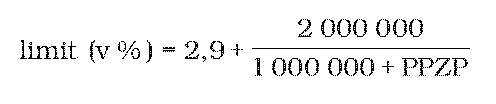

# Čl. I

Zákon č. 581/2004 Z. z. o zdravotných poisťovniach, dohľade nad zdravotnou starostlivosťou a o zmene a doplnení niektorých zákonov v znení zákona č. 719/2004 Z. z., zákona č. 353/2005 Z. z., zákona č. 538/2005 Z. z., zákona č. 660/2005 Z. z., zákona č. 25/2006 Z. z., zákona č. 282/2006 Z. z., zákona č. 522/2006 Z. z., zákona č. 12/2007 Z. z., zákona č. 215/2007 Z. z., zákona č. 309/2007 Z. z., zákona č. 330/2007 Z. z., zákona č. 358/2007 Z. z., zákona č. 530/2007 Z. z., zákona č. 594/2007 Z. z., zákona č. 232/2008 Z. z., zákona č. 297/2008 Z. z., zákona č. 461/2008 Z. z., zákona č. 581/2008 Z. z., zákona č. 192/2009 Z. z., zákona č. 533/2009 Z. z., zákona č. 121/2010 Z. z., zákona č. 34/2011 Z. z., nálezu Ústavného súdu Slovenskej republiky č. 79/2011 Z. z., zákona č. 97/2011 Z. z. a zákona č. 133/2011 Z. z. sa mení a dopĺňa takto:

- 1. V § 6 sa odsek 1 dopĺňa písmenom u), ktoré znie:

- „u)

- zaraďuje poskytovateľov ústavnej zdravotnej starostlivosti do pevnej siete podľa osobitného predpisu.16e).“.

- Poznámka pod čiarou k odkazu 16e znie:

- „16e)

- § 5 ods. 3 zákona č. 578/2004 Z. z. v znení zákona č. 250/2011 Z. z.“.

- 2. V § 6 sa odsek 4 dopĺňa písmenami i) a j), ktoré znejú:

- „i)

- predložiť úradu na požiadanie informácie o zmluvách podľa písmena h),

- j)

- sprístupniť elektronicky do 31. januára kalendárneho roka poskytovateľom všeobecnej ambulantnej zdravotnej starostlivosti a poskytovateľom špecializovanej ambulantnej gynekologickej starostlivosti, s ktorými má uzatvorenú zmluvu o poskytovaní zdravotnej starostlivosti, menný zoznam poistencov, s ktorými má príslušný poskytovateľ zdravotnej starostlivosti uzatvorenú dohodu o poskytovaní zdravotnej starostlivosti a ktorí sa k 1. januáru kalendárneho roka stali poistencami inej zdravotnej poisťovne.“.

- 3. V § 6 sa odsek 9 dopĺňa písmenom c), ktoré znie:

- „c)

- na úhradu plánovanej zdravotnej starostlivosti pre poistencov zaradených v zozname podľa odseku 2.“.

- 4. V § 6 sa za odsek 9 vkladá nový odsek 10, ktorý znie:

- „(10)

- Zdravotná poisťovňa vytvára technické rezervy podľa odseku 9 písm. c) vo výške nevyhnutnej na úhradu plánovanej zdravotnej starostlivosti. Technické rezervy podľa odseku 9 písm. c) zahŕňajú aj všetky predpokladané náklady spojené s vykonaním úhrady plánovanej zdravotnej starostlivosti; výška technickej rezervy sa stanovuje vo výške súčtu násobkov počtu poistencov zaradených v zozname podľa odseku 2 a ceny obvyklej za poskytovanú zdravotnú starostlivosť podľa jednotlivých chorôb.“.

- Doterajšie odseky 10 až 16 sa označujú ako odseky 11 až 17.

- 5. V § 6 sa odsek 13 dopĺňa písmenom e), ktoré znie:

- „e)

- nakladať s pohľadávkou voči fyzickej osobe alebo právnickej osobe povinnej odvádzať poistné37) podľa § 85g.“.

- 6. V § 6a odsek 1 znie:

- „(1)

- Zdravotná poisťovňa môže v kalendárnom roku vynaložiť na prevádzkové činnosti výdavky najviac do výšky zodpovedajúcej podielu na úhrne poistného pred prerozdelením poistného za kalendárny rok (ďalej len „ročný úhrn“). Podiel na ročnom úhrne sa vypočíta podľa vzorca, ktorý je uvedený v prílohe č. 1, a zaokrúhľuje sa na dve desatinné miesta smerom nahor.“.

- 7. V § 6a ods. 5 písm. c) sa slová „3,5 % z ročných úhrnov“ nahrádzajú slovami „podielu na ročnom úhrne podľa odseku 1“.

- 8. V § 6a sa odsek 5 dopĺňa písmenom e), ktoré znie:

- „e)

- peňažných prostriedkov získaných z poplatkov za vydané výkazy nedoplatkov podľa osobitného predpisu.18j)“.

- Poznámka pod čiarou k odkazu 18j znie:

- „18j)

- § 17a zákona č. 580/2004 Z. z. v znení neskorších predpisov.“.

- 9. V § 7 ods. 1 sa na konci bodka nahrádza bodkočiarkou a pripájajú sa tieto slová: „ak je verejná sieť poskytovateľov19a) na príslušnom území menšia ako verejná minimálna sieť poskytovateľov,19) je povinná uzatvárať zmluvy o poskytovaní zdravotnej starostlivosti s poskytovateľmi zdravotnej starostlivosti v rozsahu verejnej siete poskytovateľov.19a)“.

- Poznámka pod čiarou k odkazu 19a znie:

- „19a)

- § 6 zákona č. 578/2004 Z. z.“.

- 10. V § 7 ods. 3 sa spojka „a“ nahrádza čiarkou a na konci sa pripájajú tieto slová: „a s každým poskytovateľom zdravotnej starostlivosti, ktorý nie je verejne dostupný a poskytuje zdravotnú starostlivosť poistencom vo väzbe alebo vo výkone trestu odňatia slobody.“.

- 11. V § 7 odsek 16 znie:

- „(16)

- Po uplynutí minimálnej doby trvania zmluvy o poskytovaní zdravotnej starostlivosti podľa odseku 10 zdravotná poisťovňa a poskytovateľ zdravotnej starostlivosti sú oprávnení vypovedať zmluvu aj z iných dôvodov, ako sú uvedené v odsekoch 11 a 15, ak sa tak dohodnú v zmluve o poskytovaní zdravotnej starostlivosti. Výpoveď zmluvy o poskytovaní zdravotnej starostlivosti musí byť písomná. Výpovedná lehota je 12 mesiacov, ak zmluva neurčuje inak; začína plynúť prvým dňom mesiaca nasledujúceho po mesiaci, v ktorom bola výpoveď doručená.“.

- 12. V § 8a sa slová „z ročného prerozdeľovania poistného“ nahrádzajú slovami „z ročného prerozdeľovania poistného27aa)“.

- Poznámka pod čiarou k odkazu 27aa znie:

- „27aa)

- § 27a zákona č. 580/2004 Z. z. v znení neskorších predpisov.“.

- 13. § 9 vrátane nadpisu nad paragrafom znie:

- „Kontrolná činnosť

- § 9

- (1)

- Zdravotná poisťovňa vykonáva kontrolnú činnosť u poskytovateľov zdravotnej starostlivosti, ktorým uhrádza úhradu za poskytnutú zdravotnú starostlivosť. Zdravotná poisťovňa má právo vykonať kontrolu kedykoľvek a bez predchádzajúceho oznámenia.

- (2)

- Zdravotná poisťovňa vykonáva kontrolnú činnosť aj u platiteľov poistného. Ustanovenie odseku 1 poslednej vety platí rovnako.

- (3)

- Zdravotná poisťovňa môže vykonávať kontrolnú činnosť aj ako kontrolu na diaľku; kontrolou na diaľku sa rozumie vyhodnocovanie informácií o poskytovateľoch zdravotnej starostlivosti a platiteľoch poistného (ďalej len „kontrolovaný subjekt“) obsiahnutých v informačnom systéme zdravotnej poisťovne alebo tvoriacich dokumentáciu zdravotnej poisťovne podľa § 16.

- (4)

- Kontrolná činnosť zdravotnej poisťovne u poskytovateľov zdravotnej starostlivosti je zameraná na účelnosť, efektívnosť a hospodárnosť vynakladania prostriedkov verejného zdravotného poistenia, rozsah a kvalitu poskytovania zdravotnej starostlivosti a na dodržiavanie zmlúv o poskytovaní zdravotnej starostlivosti podľa § 7.

- (5)

- Zdravotná poisťovňa vykonáva kontrolnú činnosť u poskytovateľov zdravotnej starostlivosti revíznymi lekármi, revíznymi farmaceutmi a revíznymi sestrami; ak ide o kontrolu hospodárnosti vynakladania prostriedkov verejného zdravotného poistenia, aj inými zamestnancami poverenými výkonom kontroly.

- (6)

- Revízni lekári kontrolujú

- a)

- rozsah a kvalitu poskytnutej ambulantnej zdravotnej starostlivosti a ústavnej zdravotnej starostlivosti vzhľadom na zdravotný stav poistenca,

- b)

- účtovné doklady a dokumentáciu súvisiacu s rozsahom poskytnutej zdravotnej starostlivosti podľa písmena a),

- c)

- opodstatnenosť zaradenia poistenca do zoznamu a vedenia poistenca v zozname (§ 6 ods. 2).

- (7)

- Revízni farmaceuti vykonávajú

- a)

- kontrolu predpisovania a výdaja liekov a zdravotníckych pomôcok,

- b)

- finančnú a kusovú kontrolu liekov a zdravotníckych pomôcok, ktoré plne alebo čiastočne uhrádza zdravotná poisťovňa z prostriedkov verejného zdravotného poistenia.

- (8)

- Revízne sestry kontrolujú

- a)

- rozsah a kvalitu sestrami poskytnutej ošetrovateľskej starostlivosti vzhľadom na zdravotný stav poistenca,

- b)

- účtovné doklady a dokumentáciu súvisiacu s rozsahom poskytnutej ošetrovateľskej starostlivosti podľa písmena a).

- (9)

- Iní zamestnanci poverení výkonom kontroly vykonávajú

- a)

- kontrolu dodržiavania zmlúv o poskytovaní zdravotnej starostlivosti podľa § 7,

- b)

- finančnú a kusovú kontrolu liekov a zdravotníckych pomôcok, ktoré plne alebo čiastočne uhrádza zdravotná poisťovňa z prostriedkov verejného zdravotného poistenia.

- (10)

- Kontrolná činnosť zdravotnej poisťovne u platiteľov poistného je zameraná na zistenie správnej výšky vymeriavacieho základu, vykázaného poistného, odvádzaných preddavkov na poistné, na zistenie správneho výpočtu ročného zúčtovania poistného a dodržiavania lehoty splatnosti preddavkov na poistné a nedoplatku z ročného zúčtovania poistného.“.

- 14. Za § 9 sa vkladá § 9a, ktorý znie:

- 㤠9a

- (1)

- Revízni lekári, revízni farmaceuti, revízne sestry a iní zamestnanci poverení výkonom kontroly (ďalej len „poverená osoba“) sú pri výkone kontroly

- a)

- povinní preukázať sa služobným preukazom a písomným poverením na výkon kontroly,

- b)

- oprávnení v nevyhnutnom rozsahu

- 1.

- vstupovať do objektov, zariadení a prevádzok, na pozemky a do iných priestorov kontrolovaného subjektu, ak bezprostredne súvisia s predmetom kontroly; nedotknuteľnosť obydlia nesmie byť dotknutá výkonom tohto oprávnenia,

- 2.

- vyžadovať od kontrolovaného subjektu a jeho zamestnancov, aby jej v určenej lehote poskytovali prvopisy dokladov, vyjadrenia a informácie vrátane technických nosičov údajov potrebné na výkon kontroly,

- 3.

- vyžadovať súčinnosť kontrolovaného subjektu a jeho zamestnancov.

- (2)

- Kontrolovaný subjekt je povinný poskytnúť súčinnosť zodpovedajúcu oprávneniam poverenej osoby podľa odseku 1 písm. b).

- (3)

- Poverená osoba je vylúčená z výkonu kontrolnej činnosti, ak so zreteľom na jej vzťah k veci, ku kontrolovanému subjektu alebo k jeho zamestnancom možno mať pochybnosť o jej nezaujatosti.

- (4)

- Ak je poverená osoba vylúčená z výkonu kontrolnej činnosti, nesmie vykonávať kontrolnú činnosť ani úkony súvisiace s kontrolnou činnosťou; svoje vylúčenie z výkonu kontrolnej činnosti a skutočnosti, pre ktoré je vylúčená z výkonu kontrolnej činnosti, je povinná bezodkladne oznámiť zdravotnej poisťovni.

- (5)

- Ak má kontrolovaný subjekt pochybnosť o nezaujatosti poverenej osoby, môže podať zdravotnej poisťovni písomné námietky s uvedením dôvodu. Podanie písomných námietok nemá odkladný účinok.

- (6)

- O oznámení podľa odseku 4 a námietkach podľa odseku 5 rozhodne zdravotná poisťovňa do piatich dní odo dňa doručenia oznámenia a námietok.“.

- 15. V § 11 sa vypúšťa odsek 10.

- 16. V § 15 ods. 1 sa za písmeno r) vkladá nové písmeno s), ktoré znie:

- „s)

- predkladať úradu do 31. marca kalendárneho roka obchodno-finančný plán a rozpočet na príslušný kalendárny rok,“.

- Doterajšie písmeno s) sa označuje ako písmeno t).

- 17. V § 15 odsek 5 znie:

- „(5)

- Ak je v schválenej riadnej účtovnej závierke alebo mimoriadnej účtovnej závierke výsledkom hospodárenia bežného účtovného obdobia zisk, zdravotná poisťovňa je povinná použiť tento zisk najmenej vo výške 20 % na tvorbu rezervného fondu, a to až do dosiahnutia výšky rezervného fondu určenej v stanovách, najmenej do výšky 20 % splateného základného imania.“.

- 18. V § 15 sa vypúšťa odsek 6 vrátane poznámky pod čiarou k odkazu 35aaa.

- 19. V § 16 ods. 2 uvádzacia veta znie:

- „Účet poistenca vedie zdravotná poisťovňa v informačnom systéme a musí obsahovať“.

- 20. V § 16 ods. 6 sa slová „odseku 1 písm. f), h) až j)“ nahrádzajú slovami „odseku 1 písm. f), h) až k)“.

- 21. V § 16 odsek 7 znie:

- „(7)

- Dokumentácia podľa odseku 1 písm. a) až c) a e) až m) sa uchováva päť rokov a dokumentácia podľa odseku 1 písm. d) desať rokov, ak osobitný predpis34) neustanovuje inak.“.

- 22. V § 18 ods. 1 písm. a) deviatom bode sa nad slovo „poistné“ umiestňuje odkaz 39c a nad slovo „poistného“ sa umiestňuje odkaz 39d.

- Poznámky pod čiarou k odkazom 39c a 39d znejú:

- „39c)

- § 27 ods. 8 zákona č. 580/2004 Z. z. v znení neskorších predpisov.

- 39d)

- § 27a ods. 9 zákona č. 580/2004 Z. z. v znení neskorších predpisov.“.

- 23. V § 18 ods. 1 sa za písmeno j) vkladajú nové písmená k) a l), ktoré znejú:

- „k)

- zbiera a analyzuje údaje o počte poistencov podľa nákladovo a klinicky príbuzných skupín, o nákladoch na poskytnutú zdravotnú starostlivosť a ďalšie údaje potrebné na zefektívnenie prerozdeľovania poistného,

- l)

- kontroluje správnosť zaradenia poistenca alebo platiteľa poistného do zoznamu poistencov a platiteľov poistného podľa osobitného predpisu,41aab)“.

- Doterajšie písmeno k) sa označuje ako písmeno m).

- Poznámka pod čiarou k odkazu 41aab znie:

- „41aab) § 25 ods. 1 písm. e) druhý bod zákona č. 580/2004 Z. z. v znení zákona č. 250/2011 Z. z.“.

- 24. V § 19 ods. 1 písm. a) sa slová „do 30. júna“ nahrádzajú slovami „do 30. apríla“.

- 25. V § 19 ods. 1 písm. c) sa slová „do troch mesiacov po skončení kalendárneho roka“ nahrádzajú slovami „do 30. apríla“.

- 26. V § 20 ods. 1 písm. e) prvom bode sa slová „údaj o tom, či je osoba držiteľom preukazu fyzickej osoby s ťažkým zdravotným postihnutím, preukazu fyzickej osoby s ťažkým zdravotným postihnutím so sprievodcom, poberateľom invalidného dôchodku, invalidného výsluhového dôchodku, invalidná a nevznikol jej nárok na invalidný dôchodok, poberateľom starobného dôchodku, dôchodku z výsluhového zabezpečenia policajtov a vojakov vo veku nároku na starobný dôchodok, dôchodku z iného členského štátu Európskej únie, Nórska, Lichtenštajnska, Islandu, Švajčiarska, ak nie je poistená v tomto štáte, poberateľom dôchodku z tretieho štátu alebo dovŕšila dôchodkový vek a nevznikol jej nárok na starobný dôchodok, jej bankovom spojení, čísle účtu, výške dôchodku a údaj o tom, že osoba poberá príjem, ktorý podlieha dani z príjmov podľa osobitného predpisu41ac) okrem príjmov z dohôd vykonávaných mimo pracovného pomeru,“ nahrádzajú slovami „a údaj o tom, či poistenec spĺňa podmienky na limit spoluúčasti podľa osobitného predpisu,16c)“.

- Poznámka pod čiarou k odkazu 41ac sa vypúšťa.

- 27. V § 20 ods. 1 písmeno h) znie:

- „h)

- poskytuje zdravotnej poisťovni elektronicky informácie o

- 1.

- dátume a čase podania prihlášky na verejné zdravotné poistenie alebo potvrdení prihlášky na verejné zdravotné poistenie v inej zdravotnej poisťovni pri vzniku verejného zdravotného poistenia do troch pracovných dní odo dňa prijatia oznámenia o prijatí prihlášky zdravotnou poisťovňou alebo potvrdenia prihlášky v inej zdravotnej poisťovni,

- 2.

- dátume a čase prijatia prihlášky na verejné zdravotné poistenie v inej zdravotnej poisťovni pri zmene zdravotnej poisťovne do desiatich dní odo dňa prijatia oznámenia o prijatí prihlášky zdravotnou poisťovňou,

- 3.

- potvrdení prihlášky na verejné zdravotné poistenie v inej zdravotnej poisťovni pri zmene zdravotnej poisťovne do 31. októbra kalendárneho roka,“.

- 28. V § 20 ods. 1 písm. k) sa na konci pripájajú tieto slová: „a zabezpečuje prehliadky mŕtvych tiel64)“.

- 29. V § 20 ods. 2 písm. h) sa slová „(§ 39 ods. 7)“ nahrádzajú slovami „(§ 39 ods. 6)“.

- 30. V § 20 ods. 2 písm. i) sa slová „(§ 52 ods. 6)“ nahrádzajú slovami „(§ 52 ods. 7)“.

- 31. V § 20 ods. 2 sa za písmeno o) vkladajú nové písmená p) až r), ktoré znejú:

- „p)

- metodické usmernenia úradu o náležitostiach harmonogramu prevodu poistného kmeňa [§ 61 ods. 6 písm. c)],

- q)

- metodické usmernenia úradu o postupe spätného prevodu poistného kmeňa (§ 61d),

- r)

- metodické usmernenia úradu o rozsahu, štruktúre a lehotách na odovzdávanie údajov o počte poistencov podľa nákladovo a klinicky príbuzných skupín, o nákladoch na poskytnutú zdravotnú starostlivosť a ďalších údajov potrebných na zefektívnenie prerozdeľovania poistného,“.

- Doterajšie písmeno p) sa označuje ako písmeno s).

- 32. V § 25 ods. 1 sa vypúšťajú písmená b) a c).

- Doterajšie písmená d) až j) sa označujú ako písmená b) až h).

- 33. V § 31 ods. 1 písmeno f) znie:

- „f)

- schválenie návrhu postupu prevodu poistného kmeňa podľa § 61a,“.

- 34. V § 39 ods. 5 sa slová „§ 61“ nahrádzajú slovami „§ 61b až 61h“.

- 35. V § 39 sa vypúšťa odsek 6.

- Doterajší odsek 7 sa označuje ako odsek 6.

- 36. V § 40 ods. 2 sa slová „§ 61“ nahrádzajú slovami „§ 61b až 61h“.

- 37. § 43 sa dopĺňa odsekmi 9 a 10, ktoré znejú:

- „(9)

- Úrad môže vykonať nový dohľad v tej istej veci, ak vyjdú najavo nové skutočnosti alebo dôkazy, ktoré mohli mať podstatný vplyv na skutočnosti podľa § 47 ods. 1 písm. e).

- (10)

- Na výkon dohľadu nad zdravotnou starostlivosťou sa nevzťahujú všeobecné predpisy o správnom konaní.62)“.

- 38. V § 46 odsek 2 znie:

- „(2)

- Dohliadaný subjekt má právo

- a)

- oboznámiť sa s obsahom žiadosti o vykonanie dohľadu v takom rozsahu a čase, aby nedošlo k mareniu výkonu dohľadu,

- b)

- počas výkonu dohľadu, najneskôr však v čase oboznámenia sa s protokolom, písomne sa vyjadriť k zisteniam osoby oprávnenej na výkon dohľadu.“.

- 39. V § 47 ods. 4 sa na konci pripája táto veta: „Ak sa dohliadaný subjekt alebo jeho splnomocnený zástupca nedostaví na prerokovanie písomných námietok proti protokolu, dohľad je skončený dňom, ktorý bol určený na prerokovanie písomných námietok proti protokolu.“.

- 40. V § 48 ods. 12 sa vypúšťa slovo „osobitnom“.

- 41. V poznámke pod čiarou k odkazu 68a sa citácia „§ 13 ods. 2 zákona Národnej rady Slovenskej republiky č. 278/1993 Z. z. o správe majetku štátu v znení neskorších predpisov.“ nahrádza citáciou „§ 13 ods. 1 zákona Národnej rady Slovenskej republiky č. 278/1993 Z. z. o správe majetku štátu v znení neskorších predpisov.“.

- 42. V § 51 ods. 1 písmeno c) znie:

- „c)

- vykazuje straty, v dôsledku ktorých výška vlastného imania zdravotnej poisťovne klesla pod minimálnu hodnotu základného imania podľa § 33 ods. 1 písm. a).“.

- 43. V § 52 sa za odsek 3 vkladá nový odsek 4, ktorý znie:

- „(4)

- Úrad zavedie nútenú správu nad zdravotnou poisťovňou, ak v konaní o nariadení prevodu poistného kmeňa podľa § 61 prevod poistného kmeňa nenariadil alebo konanie zastavil.“.

- Doterajšie odseky 4 až 6 sa označujú ako odseky 5 až 7.

- 44. § 61 vrátane nadpisu nad paragrafom znie:

- „Prevod poistného kmeňa

- § 61

- (1)

- Ak vznikli dôvody na zavedenie nútenej správy podľa § 52 ods. 2 alebo ods. 3, úrad môže nariadiť zdravotnej poisťovni, aby previedla na inú zdravotnú poisťovňu alebo iné zdravotné poisťovne (ďalej len „preberajúca zdravotná poisťovňa“) všetky alebo časť potvrdených prihlášok na verejné zdravotné poistenie (ďalej len „poistný kmeň“).

- (2)

- Zdravotná poisťovňa je povinná do 30 dní odo dňa doručenia oznámenia úradu o začatí konania o nariadení prevodu poistného kmeňa predložiť úradu na schválenie návrh postupu prevodu poistného kmeňa.

- (3)

- V návrhu postupu prevodu poistného kmeňa zdravotná poisťovňa, voči ktorej úrad začal konanie o nariadení prevodu poistného kmeňa (ďalej len „odovzdávajúca zdravotná poisťovňa“),

- a)

- uvedie dôvody prevodu poistného kmeňa,

- b)

- uvedie opis prevádzaného poistného kmeňa; ak sa poistný kmeň prevádza na viaceré preberajúce zdravotné poisťovne, označí časť poistného kmeňa, ktorú jednotlivé preberajúce zdravotné poisťovne preberú,

- c)

- označí preberajúcu zdravotnú poisťovňu,

- d)

- uvedie predpokladané zmeny vo svojom hospodárení a v hospodárení preberajúcej zdravotnej poisťovne ako dôsledok prevodu poistného kmeňa,

- e)

- uvedie spôsob a obsah oznámenia poistencom, ktorým prijala a potvrdila prihlášky na verejné zdravotné poistenie, a poskytovateľom zdravotnej starostlivosti, s ktorými má uzatvorené zmluvy o poskytovaní zdravotnej starostlivosti podľa § 7 a ktorých sa prevod poistného kmeňa týka,

- f)

- uvedie výšku a spôsob určenia odplaty za prevod poistného kmeňa.

- (4)

- Odplata za prevod poistného kmeňa podľa odseku 3 písm. f) sa vždy určuje aj s prihliadnutím na možné uplatnenie práva poistencov podľa § 61f ods. 3 a na splatné pohľadávky podľa § 61e ods. 2, ak sa odovzdávajúca zdravotná poisťovňa a preberajúca zdravotná poisťovňa nedohodnú inak.

- (5)

- Odplata za prevod poistného kmeňa sa musí prednostne použiť na úhradu za poskytnutú zdravotnú starostlivosť, ktorú odovzdávajúca zdravotná poisťovňa neuhradila poskytovateľovi zdravotnej starostlivosti v lehote splatnosti.

- (6)

- K návrhu postupu prevodu poistného kmeňa odovzdávajúca zdravotná poisťovňa priloží

- a)

- písomný súhlas preberajúcej zdravotnej poisťovne s prevodom poistného kmeňa,

- b)

- zmluvu o odplatnom prevode poistného kmeňa s preberajúcou zdravotnou poisťovňou,

- c)

- harmonogram prevodu poistného kmeňa s náležitosťami určenými úradom podľa § 20 ods. 2 písm. p).

- (7)

- Zmluvu o prevode poistného kmeňa medzi odovzdávajúcou zdravotnou poisťovňou a preberajúcou zdravotnou poisťovňou nemožno vypovedať, od nej odstúpiť, ani inak ju zrušiť prejavom vôle strán.

- (8)

- Prevod poistného kmeňa nesmie ohroziť

- a)

- plnenie záväzkov vyplývajúcich z potvrdených prihlášok na verejné zdravotné poistenie a uzatvorených zmlúv o poskytovaní zdravotnej starostlivosti, ktoré sú predmetom prevodu poistného kmeňa,

- b)

- predpokladanú mieru platobnej schopnosti preberajúcej zdravotnej poisťovne alebo odovzdávajúcej zdravotnej poisťovne podľa § 14 ods. 2 alebo

- c)

- stabilitu preberajúcej zdravotnej poisťovne alebo odovzdávajúcej zdravotnej poisťovne.

- (9)

- Ak návrh postupu prevodu poistného kmeňa nespĺňa náležitosti podľa odsekov 3 a 6, úrad vyzve odovzdávajúcu zdravotnú poisťovňu, aby v určenej lehote odstránila nedostatky návrhu; súčasne ju poučí, že inak konanie zastaví.

- (10)

- Úrad konanie zastaví, ak

- a)

- odovzdávajúca zdravotná poisťovňa v lehote určenej úradom neodstránila nedostatky návrhu napriek poučeniu podľa odseku 9 alebo

- b)

- prevod poistného kmeňa nespĺňa požiadavky podľa odseku 8.

- (11)

- Ak návrh postupu prevodu poistného kmeňa spĺňa náležitosti podľa odsekov 3 a 6 a sú splnené požiadavky podľa odseku 8, prevod poistného kmeňa sa uskutoční do 120 dní odo dňa právoplatnosti rozhodnutia o nariadení prevodu poistného kmeňa, ak v odseku 12 nie je ustanovené inak, vždy však k prvému dňu kalendárneho mesiaca.

- (12)

- Ak prevod poistného kmeňa predstavuje koncentráciu podľa osobitného predpisu,32) prevod poistného kmeňa sa môže uskutočniť až po nadobudnutí právoplatnosti rozhodnutia, ktorým Protimonopolný úrad Slovenskej republiky súhlasil s takouto koncentráciou.

- (13)

- Účastníkom konania o nariadení prevodu poistného kmeňa sú všetky zdravotné poisťovne.“.

- 45. Za § 61 sa vkladajú § 61a až 61h, ktoré znejú:

- 㤠61a

- (1)

- Úrad môže rozhodnúť o prevode poistného kmeňa aj v konaní o schválení návrhu postupu prevodu poistného kmeňa na základe žiadosti zdravotnej poisťovne; súčasťou žiadosti je návrh postupu prevodu poistného kmeňa.

- (2)

- Žiadosť podľa odseku 1 môže podať zdravotná poisťovňa, ktorá

- a)

- požiadala o predchádzajúci súhlas úradu podľa § 13 ods. 1 písm. d), e), f) alebo písm. g) alebo

- b)

- nezabezpečuje platobnú schopnosť podľa § 14 počas jedného kalendárneho mesiaca v priebehu uplynulých 12 kalendárnych mesiacov.

- (3)

- Na prevod poistného kmeňa podľa odseku 1 ustanovenia § 61 ods. 3 až 10 platia rovnako; odovzdávajúcou zdravotnou poisťovňou sa v konaní o schválení návrhu postupu prevodu poistného kmeňa rozumie zdravotná poisťovňa, ktorá požiadala o prevod poistného kmeňa.

- (4)

- Ak návrh postupu prevodu poistného kmeňa spĺňa náležitosti podľa § 61 ods. 3 a 6 a sú splnené požiadavky podľa § 61 ods. 8, úrad návrh schváli a prevod poistného kmeňa sa uskutoční do 120 dní odo dňa právoplatnosti rozhodnutia o schválení návrhu postupu prevodu poistného kmeňa, vždy však k prvému dňu kalendárneho mesiaca.

- (5)

- Účastníkom konania o schválení návrhu postupu prevodu poistného kmeňa je odovzdávajúca zdravotná poisťovňa a preberajúca zdravotná poisťovňa.

- § 61b

- (1)

- Úrad nariadi pomerný a odplatný prevod poistného kmeňa zdravotnej poisťovni, ktorej bolo právoplatne a vykonateľne zrušené povolenie podľa § 39 alebo ktorej zanikla platnosť povolenia podľa § 40 ods. 1 písm. b) a c) (ďalej len „nariadenie núteného prevodu“).

- (2)

- Účastníkmi konania o nariadení núteného prevodu sú všetky zdravotné poisťovne.

- (3)

- V konaní o nariadení núteného prevodu úrad určí preberajúce zdravotné poisťovne; preberajúcou zdravotnou poisťovňou nesmie byť

- a)

- zdravotná poisťovňa, ktorej úrad uložil povinnosť vypracovať ozdravný plán,

- b)

- zdravotná poisťovňa, nad ktorou úrad zaviedol nútenú správu,

- c)

- zdravotná poisťovňa, ktorá nespĺňala niektoré z kritérií platobnej schopnosti podľa § 14 ods. 2 počas dvoch kalendárnych mesiacov za 12 kalendárnych mesiacov predchádzajúcich začatiu konania o nariadení núteného prevodu.

- (4)

- Úrad rozhodne o nariadení núteného prevodu do ôsmich pracovných dní odo dňa, keď nastal dôvod núteného prevodu.

- (5)

- Rozhodnutie o nariadení núteného prevodu okrem všeobecných náležitostí rozhodnutia58) obsahuje

- a)

- preberajúce zdravotné poisťovne,

- b)

- opis poistného kmeňa a jeho rozdelenie medzi preberajúce zdravotné poisťovne,

- c)

- spôsob vysporiadania prípadných zmien v stave poistného kmeňa po vydaní rozhodnutia o nariadení núteného prevodu.

- (6)

- Prílohová časť rozhodnutia o nariadení núteného prevodu obsahuje menné zoznamy poistencov rozdelených medzi preberajúce zdravotné poisťovne a podrobnosti určenia počtu prepočítaných poistencov80a) v jednotlivých častiach prevádzaného poistného kmeňa; prílohová časť sa nevyhotovuje v listinnej podobe, ale len v elektronickej podobe.

- (7)

- Rozhodnutie o nariadení núteného prevodu podá úrad na zverejnenie v Obchodnom vestníku60) v deň jeho vydania. Rozhodnutie o nariadení núteného prevodu sa zverejňuje v Obchodnom vestníku bez ohľadu na jeho právoplatnosť a nadobúda vykonateľnosť dňom nasledujúcim po dni jeho zverejnenia v Obchodnom vestníku; jeho prílohová časť sa nezverejňuje.

- (8)

- Účinnosť prevodu poistného kmeňa nastáva bez ohľadu na vykonateľnosť rozhodnutia o nariadení núteného prevodu dňom, keď nastal dôvod núteného prevodu.

- (9)

- Na účely nariadenia núteného prevodu odplatným prevodom poistného kmeňa sa rozumie prevod poistného kmeňa alebo jeho častí za odplatu, ktorú určí úrad v rozhodnutí o odplate za prevod poistného kmeňa vo výške

- a)

- uvedenej v písomnej dohode medzi odovzdávajúcou zdravotnou poisťovňou a preberajúcimi zdravotnými poisťovňami alebo

- b)

- určenej znalcom ustanoveným úradom na návrh odovzdávajúcej zdravotnej poisťovne a preberajúcich zdravotných poisťovní alebo aj bez návrhu, ak zdravotné poisťovne nenavrhnú znalca do 15 dní odo dňa doručenia výzvy úradu; znalečné znáša odovzdávajúca zdravotná poisťovňa.

- (10)

- Výška odplaty za prevod poistného kmeňa podľa odseku 9 písm. a) a b) sa vždy určí aj s prihliadnutím na možné uplatnenie práva poistencov podľa § 61f ods. 3. Na použitie odplaty ustanovenie § 61 ods. 5 platí rovnako.

- (11)

- Úrad ustanoví znalca podľa odseku 9 písm. b), ak zdravotné poisťovne nepredložia úradu dohodu podľa odseku 9 písm. a) do 15 dní odo dňa začatia konania o nariadení núteného prevodu.

- (12)

- Na účely nariadenia núteného prevodu pomerným prevodom poistného kmeňa sa rozumie prevod poistného kmeňa

- a)

- v celosti na jednu preberajúcu zdravotnú poisťovňu alebo

- b)

- na viac preberajúcich zdravotných poisťovní po častiach určených náhodným výberom poistencov s využitím programových prostriedkov a pri dohľade preberajúcich zdravotných poisťovní tak, aby jedna polovica poistného kmeňa bola rozdelená rovným dielom medzi preberajúce zdravotné poisťovne, ktorých podiel poistencov neprevyšuje hraničný podiel, a druhá polovica poistného kmeňa medzi všetky preberajúce zdravotné poisťovne pomerne podľa podielu poistencov preberajúcich zdravotných poisťovní za kalendárny mesiac, za ktorý sa vykonávalo posledné mesačné prerozdeľovanie preddavkov na poistné,80b) o ktorom úrad rozhodol podľa osobitného predpisu39c) pred vydaním rozhodnutia o nútenom prevode (ďalej len „rozhodujúce obdobie“); prípadné zaokrúhľovanie pri delení poistného kmeňa na časti sa vykoná podľa matematických pravidiel zaokrúhľovania s tým, že v pochybnostiach rozhodne úrad.

- (13)

- Hraničný podiel podľa odseku 12 písm. b) je podiel 100 % a počtu zdravotných poisťovní okrem odovzdávajúcej zdravotnej poisťovne.

- (14)

- Podiel poistencov preberajúcej zdravotnej poisťovne podľa odseku 12 písm. b) je pomer počtu prepočítaných poistencov80a) preberajúcej zdravotnej poisťovne k celkovému počtu prepočítaných poistencov verejného zdravotného poistenia v rozhodujúcom období.

- (15)

- Úrad v rozhodnutí o odplate za prevod poistného kmeňa uvedie výšku a splatnosť odplaty za prevod poistného kmeňa. Úrad môže v rozhodnutí o odplate za prevod poistného kmeňa určiť zaplatenie odplaty v splátkach podľa splátkového kalendára po posúdení platobnej schopnosti preberajúcich zdravotných poisťovní tak, aby splácanie ceny poistného kmeňa alebo jeho častí neohrozovalo plnenie ich povinností podľa tohto zákona; úrad v povolení splátkového kalendára určí aj primeraný úrok splatný spolu s príslušnou splátkou.

- § 61c

- (1)

- Odvolanie proti rozhodnutiu o nútenom prevode nemá odkladný účinok.

- (2)

- Dôvody odvolania proti rozhodnutiu o nútenom prevode možno uviesť len v lehote na podanie odvolania; na neskôr uvedené dôvody sa neprihliada. Odvolanie proti rozhodnutiu o prevode poistného kmeňa môže odôvodniť

- a)

- preberajúca zdravotná poisťovňa iba tým, že úrad nesprávne určil preberajúce zdravotné poisťovne, nedodržal zásady pomerného prevodu poistného kmeňa alebo nenastal dôvod núteného prevodu,

- b)

- odovzdávajúca zdravotná poisťovňa iba tým, že rozhodnutie súdu alebo úradu, ktoré bolo dôvodom núteného prevodu, bolo zrušené alebo bola odložená jeho vykonateľnosť, alebo tým, že nenastal dôvod núteného prevodu.

- (3)

- Úrad rozhodnutie o nútenom prevode zmení, ak sa preukáže, že nesprávne určil preberajúce zdravotné poisťovne alebo nedodržal zásady pomerného prevodu poistného kmeňa; ustanovenia § 61b ods. 5 platia rovnako. Súčasťou rozhodnutia je prílohová časť, na ktorej obsah a vyhotovenie sa vzťahuje § 61b ods. 6.

- (4)

- Úrad rozhodnutie o nútenom prevode zruší a konanie zastaví, ak sa preukáže, že nevznikol dôvod núteného prevodu.

- (5)

- Na vykonateľnosť a zverejňovanie rozhodnutí podľa odsekov 3 a 4 platí ustanovenie § 61b ods. 7 rovnako.

- (6)

- Na konanie úradu podľa odsekov 3 a 4 a § 61b ods. 1 a sa nepoužije osobitný predpis.32)

- § 61d

- (1)

- Ak je právoplatné rozhodnutie o nariadení prevodu poistného kmeňa podľa § 61, právoplatné rozhodnutie o schválení návrhu postupu prevodu poistného kmeňa podľa § 61a alebo právoplatné rozhodnutie o nútenom prevode podľa § 61b zrušené súdom alebo ak je vykonateľné rozhodnutie úradu o nútenom prevode podľa § 61b zrušené úradom, poistný kmeň prevedený na základe takého zrušeného rozhodnutia prechádza k prvému dňu kalendárneho mesiaca nasledujúceho po mesiaci, počas ktorého nadobudlo rozhodnutie súdu alebo úradu vykonateľnosť, späť na odovzdávajúcu zdravotnú poisťovňu (ďalej len „spätný prevod poistného kmeňa“), ak v odsekoch 2 a 3 nie je ustanovené inak.

- (2)

- Ak odovzdávajúca zdravotná poisťovňa nemá ku dňu spätného prevodu poistného kmeňa povolenie z dôvodu jeho zrušenia alebo zániku platnosti povolenia alebo ak požiadala pred týmto dňom o vydanie predchádzajúceho súhlasu úradu podľa § 13 ods. 1 písm. e), spätný prevod poistného kmeňa sa nevykoná a úrad nariadi nútený prevod podľa § 61b s účinnosťou ku dňu, ku ktorému by inak došlo k spätnému prevodu poistného kmeňa.

- (3)

- Ak poistenec, ktorého potvrdená prihláška na verejné zdravotné poistenie bola predmetom prevodu poistného kmeňa, zmenil zdravotnú poisťovňu pred zrušením rozhodnutia podľa odseku 1, spätný prevod jeho potvrdenej prihlášky na verejné zdravotné poistenie sa nevykoná.

- § 61e

- (1)

- Pri prevode poistného kmeňa sa prevedú

- a)

- účty poistencov,

- b)

- príslušná dokumentácia, najmä doklady o platiteľoch poistného vo forme mesačných výkazov.

- (2)

- Pri prevode poistného kmeňa odovzdávajúca zdravotná poisťovňa postúpi na preberajúcu zdravotnú poisťovňu splatné pohľadávky na úhradu preddavkov na poistné18f) a úrokov z omeškania18h) za tie kalendárne mesiace kalendárneho roka, v ktorom došlo k prevodu poistného kmeňa (ďalej len „rok prevodu kmeňa“), ktoré predchádzajú kalendárnemu mesiacu, v ktorom nastal deň účinnosti prevodu poistného kmeňa (ďalej len „mesiac prevodu kmeňa“). Platiteľ poistného sa o postúpení pohľadávok neupovedomuje.

- (3)

- Pri prevode časti poistného kmeňa sa postúpenie podľa odseku 2 týka len pohľadávok súvisiacich s poistným za poistencov, ktorých potvrdené prihlášky boli predmetom prevodu časti poistného kmeňa. Každá pohľadávka podľa odseku 2 sa postupuje na preberajúcu zdravotnú poisťovňu až dňom právoplatnosti rozhodnutia úradu o mesačnom prerozdeľovaní preddavkov na poistné39c) vykonávanom za kalendárny mesiac, za ktorý táto pohľadávka vznikla.

- (4)

- S pohľadávkami podľa odseku 3 prevedie odovzdávajúca zdravotná poisťovňa preberajúcej zdravotnej poisťovni aj časť úhrad pohľadávok podľa odseku 3 zaplatených odovzdávajúcej zdravotnej poisťovni pred účinnosťou ich postúpenia určenú tak, aby odovzdávajúcej zdravotnej poisťovni ostala z pôvodnej výšky týchto pohľadávok za jednotlivé kalendárne mesiace, za ktoré vznikli, uhradená suma, ktorú odovzdávajúca zdravotná poisťovňa za tieto kalendárne mesiace zahrnula do sumy zaplatených preddavkov na poistné80c) v rámci mesačného prerozdeľovania preddavkov na poistné.80b)

- § 61f

- (1)

- Preberajúca zdravotná poisťovňa je povinná do 30 dní odo dňa právoplatnosti rozhodnutia o nariadení prevodu poistného kmeňa podľa § 61, do 30 dní odo dňa právoplatnosti rozhodnutia o schválení návrhu postupu prevodu poistného kmeňa podľa § 61a alebo do 30 dní odo dňa vykonateľnosti rozhodnutia o nútenom prevode podľa § 61b

- a)

- oznámiť poistencom, ktorých potvrdené prihlášky na verejné zdravotné poistenie preberá, a poskytovateľom zdravotnej starostlivosti, s ktorými má uzatvorenú zmluvu o poskytovaní zdravotnej starostlivosti podľa § 7 a ktorých sa prevod poistného kmeňa týka, svoje obchodné meno a sídlo a dátum účinnosti prevodu poistného kmeňa,

- b)

- preukázateľne doručiť poistencom podľa písmena a) preukaz poistenca preberajúcej zdravotnej poisťovne a európsky preukaz, ak im bol odovzdávajúcou zdravotnou poisťovňou vydaný.

- (2)

- Poistenec, ktorého potvrdená prihláška na verejné zdravotné poistenie sa stala predmetom prevodu poistného kmeňa,

- a)

- má právo preukazovať sa u poskytovateľa zdravotnej starostlivosti preukazom poistenca alebo európskym preukazom odovzdávajúcej zdravotnej poisťovne, ak mu bol vydaný, až do času doručenia preukazu poistenca a európskeho preukazu podľa odseku 1 písm. b),

- b)

- je povinný preukázateľne vrátiť preukaz poistenca a európsky preukaz, ak mu bol vydaný, odovzdávajúcej zdravotnej poisťovni do 10 dní odo dňa doručenia preukazu podľa odseku 1 písm. b).

- (3)

- Poistenec, ktorého potvrdená prihláška na verejné zdravotné poistenie sa stala predmetom prevodu poistného kmeňa na základe rozhodnutia o nariadení prevodu poistného kmeňa podľa § 61 alebo rozhodnutia o schválení návrhu postupu prevodu poistného kmeňa podľa § 61a, má právo najneskôr do 30 dní od oznámenia podľa odseku 1 písm. a) písomne odmietnuť na úrade prevod svojej prihlášky na verejné zdravotné poistenie; lehota je zachovaná, ak poistenec odmietnutie prevodu prihlášky podal na úrade v posledný deň lehoty. Odmietnutie prevodu prihlášky na verejné zdravotné poistenie v ustanovenej lehote je účinné ku dňu účinnosti prevodu poistného kmeňa.

- (4)

- Ustanovenie odseku 3 neplatí, ak odovzdávajúca zdravotná poisťovňa požiadala o predchádzajúci súhlas úradu podľa § 13 ods. 1 písm. e).

- (5)

- Poistenec, ktorého potvrdená prihláška na verejné zdravotné poistenie sa stala predmetom prevodu časti poistného kmeňa podľa § 61b, má právo rozhodnúť, na ktorú preberajúcu zdravotnú poisťovňu bude jeho potvrdená prihláška na verejné zdravotné poistenie prevedená, ak do 30 dní od oznámenia podľa odseku 1 písm. a) písomne oznámi preberajúcu zdravotnú poisťovňu, ktorú si vybral, preberajúcej zdravotnej poisťovni, ktorá mala prevziať jeho prihlášku na verejné zdravotné poistenie, a súčasne aj preberajúcej zdravotnej poisťovni, ktorú si vybral. Písomné oznámenie v ustanovenej lehote je účinné ku dňu účinnosti prevodu poistného kmeňa.

- (6)

- Platitelia poistného sú povinní odviesť preddavky na poistné18f) za poistencov, ktorých potvrdené prihlášky na verejné zdravotné poistenie sa stali predmetom prevodu poistného kmeňa,

- a)

- odovzdávajúcej zdravotnej poisťovni za kalendárne mesiace roku prevodu kmeňa predchádzajúce mesiacu prevodu kmeňa,

- b)

- preberajúcej zdravotnej poisťovni za mesiac prevodu kmeňa a nasledujúce kalendárne mesiace roku prevodu kmeňa.

- (7)

- Ak platiteľ poistného preddavky na poistné podľa odseku 6 písm. b) alebo postúpené pohľadávky podľa § 61e ods. 2 zaplatí odovzdávajúcej zdravotnej poisťovni, odovzdávajúca zdravotná poisťovňa je povinná ich previesť na preberajúcu zdravotnú poisťovňu do piatich pracovných dní odo dňa ich zaplatenia. Deň pripísania platby na účet odovzdávajúcej zdravotnej poisťovne sa považuje za deň splnenia povinnosti platiteľa poistného podľa odseku 6 písm. b).

- (8)

- Mesačné prerozdeľovanie preddavkov na poistné80b) vykonáva za kalendárne mesiace podľa odseku 6 písm. a) odovzdávajúca zdravotná poisťovňa a za kalendárne mesiace podľa odseku 6 písm. b) preberajúca zdravotná poisťovňa.

- § 61g

- (1)

- Na ročné zúčtovanie poistného za poistencov, ktorých potvrdená prihláška na verejné zdravotné poistenie sa stala predmetom prevodu poistného kmeňa, je príslušná preberajúca zdravotná poisťovňa.

- (2)

- Na ročné zúčtovanie poistného za fyzickú osobu, ktorej verejné zdravotné poistenie zaniklo podľa osobitného predpisu80d) po prevode jej prihlášky na verejné zdravotné poistenie, je príslušná zdravotná poisťovňa, ktorá naposledy vykonávala verejné zdravotné poistenie.

- (3)

- Odovzdávajúca zdravotná poisťovňa, ktorá previedla celý poistný kmeň a jej povolenie bolo zrušené alebo zanikla jeho platnosť, je naposledy príslušná na ročné zúčtovanie poistného za kalendárny rok predchádzajúci roku prevodu kmeňa.

- § 61h

- (1)

- Pri prevode celého poistného kmeňa odovzdávajúcej zdravotnej poisťovne jednej preberajúcej zdravotnej poisťovni sa výsledky mesačných prerozdeľovaní preddavkov na poistné32b) odovzdávajúcej zdravotnej poisťovne uskutočnených za kalendárne mesiace podľa § 61f ods. 6 písm. a) na účely ročného prerozdeľovania poistného27aa) za rok prevodu kmeňa pripočítajú k súčtu výsledkov mesačných prerozdeľovaní preddavkov na poistné preberajúcej zdravotnej poisťovne za tento rok.

- (2)

- Pri prevode celého poistného kmeňa odovzdávajúcej zdravotnej poisťovne po častiach viacerým preberajúcim zdravotným poisťovniam sa výsledky mesačných prerozdeľovaní preddavkov na poistné32b) odovzdávajúcej zdravotnej poisťovne uskutočnených za kalendárne mesiace podľa § 61f ods. 6 písm. a) na účely ročného prerozdeľovania poistného27aa) za rok prevodu kmeňa pomerne rozdelia a ich pomerné časti sa pripočítajú k súčtu výsledkov mesačných prerozdeľovaní preddavkov na poistné preberajúcich zdravotných poisťovní za tento rok. Pomerné rozdelenie sa určí pomerom počtu prepočítaných poistencov80a) zahrnutých v príslušných prevádzaných častiach poistného kmeňa odovzdávajúcej zdravotnej poisťovne určených za kalendárny mesiac bezprostredne predchádzajúci mesiacu prevodu kmeňa.

- (3)

- Pri prevode časti poistného kmeňa odovzdávajúcej zdravotnej poisťovne preberajúcej zdravotnej poisťovni sa pri ročnom prerozdeľovaní poistného za rok prevodu kmeňa, ak ide o preberajúcu zdravotnú poisťovňu, postupuje primerane podľa odseku 2.

- (4)

- Ak odovzdávajúcej zdravotnej poisťovni v súvislosti s prevodom poistného kmeňa nebude zrušené povolenie alebo nezanikne jeho platnosť, zúčastní sa na ročnom prerozdeľovaní poistného aj za rok prevodu kmeňa. Do súčtu výsledkov mesačných prerozdeľovaní preddavkov na poistné32b) odovzdávajúcej zdravotnej poisťovne za rok prevodu kmeňa sa nezahrnú výsledky mesačných prerozdelení preddavkov na poistné alebo ich časti, ktoré sa zahrnú podľa odseku 2 alebo odseku 3 do súčtu výsledkov mesačných prerozdeľovaní preddavkov na poistné preberajúcej zdravotnej poisťovne alebo preberajúcich zdravotných poisťovní za tento rok.

- (5)

- Ročné prerozdeľovanie poistného27aa) za rok prevodu kmeňa vykonáva za odovzdávajúcu zdravotnú poisťovňu preberajúca zdravotná poisťovňa v rozsahu podľa odseku 1 alebo preberajúce zdravotné poisťovne v čiastočnom rozsahu podľa odseku 2 alebo odseku 3. Ročné prerozdeľovanie za rok prevodu kmeňa vykonáva v čiastočnom rozsahu podľa odseku 4 aj odovzdávajúca zdravotná poisťovňa.“.

- Poznámky pod čiarou k odkazom 80a až 80d znejú:

- „80a)

- § 28 ods. 1 zákona č. 580/2004 Z. z. v znení neskorších predpisov.

- 80b)

- § 27 zákona č. 580/2004 Z. z. v znení neskorších predpisov.

- 80c)

- § 27 ods. 2 písm. a) zákona č. 580/2004 Z. z. v znení neskorších predpisov.

- 80d)

- § 5 ods. 2 a 3 zákona č. 580/2004 Z. z. v znení neskorších predpisov.“.

- 46. V § 64 ods. 1 písm. a) sa vypúšťajú slová „za porušenie povinnosti podľa § 11 ods. 10 pokutu vo výške 2 000 000 eur,“.

- 47. V § 66a sa vypúšťajú odseky 7 až 9.

- 48. V § 77a ods. 2 sa slová „podľa osobitného zákona12a)“ nahrádzajú slovami „podľa predpisov účinných do 31. decembra 2004“.

- 49. V § 77a odsek 4 znie:

- „(4)

- Konanie sa začína na návrh zdravotnej poisťovne. Ak zdravotná poisťovňa uplatňuje pohľadávku voči právnickej osobe, návrh musí obsahovať obchodné meno alebo názov, sídlo alebo miesto podnikania a identifikačné číslo, ak je pridelené. Ak zdravotná poisťovňa uplatňuje pohľadávku voči fyzickej osobe, návrh musí obsahovať meno, priezvisko, trvalý pobyt a rok narodenia; ak ide o fyzickú osobu oprávnenú na podnikanie, aj obchodné meno, miesto podnikania a identifikačné číslo, ak je pridelené. O začatí konania úrad účastníkov konania neupovedomuje.“.

- 50. V § 77a ods. 7 sa na konci pripája táto veta: „Na doručovanie sa primerane použijú ustanovenia osobitného predpisu.97a)“.

- Poznámka pod čiarou k odkazu 97a znie:

- „97a)

- § 17b zákona č. 580/2004 Z. z. v znení zákona č. 499/2010 Z. z.“.

- 51. V § 77a sa za odsek 8 vkladá nový odsek 9, ktorý znie:

- „(9)

- Ak pohľadávka podľa odsekov 1 a 2 bola postúpená podľa § 85g, v konaní o takej pohľadávke je účastníkom konania platiteľ poistného, zdravotná poisťovňa a osoba, na ktorú bola pohľadávka postúpená.“.

- Doterajší odsek 9 sa označuje ako odsek 10.

- 52. V § 77b sa slová „Preukazovanie skutočností podľa § 20 ods. 1 písm. e) v prvom bode“ nahrádzajú slovami „Poskytovanie osobných údajov na účely výpočtu limitu spoluúčasti podľa osobitného predpisu16c)“ a za slovami „Zborom väzenskej a justičnej stráže Slovenskej republiky“ sa vkladá čiarka a slová „Policajným zborom“.

- 53. Za § 77b sa vkladajú § 77c a 77d, ktoré znejú:

- 㤠77c

- (1)

- Ministerstvo vnútra Slovenskej republiky poskytuje úradu elektronicky na účely výpočtu limitu spoluúčasti podľa osobitného predpisu16c) údaje o fyzickej osobe, ktorá je poberateľom invalidného výsluhového dôchodku, o fyzickej osobe, ktorá je poberateľom dôchodku z výsluhového zabezpečenia policajtov vo veku ustanovenom na vznik nároku na starobný dôchodok, ak suma dôchodku nie je viac ako 50 % priemernej mesačnej mzdy zamestnanca v hospodárstve Slovenskej republiky zistenej štatistickým úradom za kalendárny rok, ktorý dva roky predchádza kalendárnemu roku, za ktorý sa limit spoluúčasti zisťuje (ďalej len „50 % priemernej mesačnej mzdy“). Údaje sa poskytujú v rozsahu rodné číslo, meno a priezvisko, rodné priezvisko, dátum narodenia, štátna príslušnosť, adresa trvalého pobytu, adresa prechodného pobytu, druh dôchodku, dátum priznania a zániku nároku na výplatu dôchodku, bankové spojenie, kód a názov banky, výška dôchodku.

- (2)

- Ministerstvo obrany Slovenskej republiky poskytuje úradu elektronicky na účely výpočtu limitu spoluúčasti podľa osobitného predpisu16c) údaje o fyzickej osobe, ktorá je poberateľom dôchodku z výsluhového zabezpečenia vojakov vo veku ustanovenom na vznik nároku na starobný dôchodok, starobného dôchodku, invalidného dôchodku alebo invalidného výsluhového dôchodku, ak suma dôchodku nie je viac ako 50 % priemernej mesačnej mzdy. Údaje sa poskytujú v rozsahu rodné číslo, meno a priezvisko, rodné priezvisko, dátum narodenia, štátna príslušnosť, adresa trvalého pobytu, adresa prechodného pobytu, druh dôchodku, dátum priznania a dátum zániku nároku na výplatu dôchodku, bankové spojenie, kód a názov banky, výška dôchodku.

- (3)

- Daňové riaditeľstvo Slovenskej republiky poskytuje úradu elektronicky na účely výpočtu limitu spoluúčasti podľa osobitného predpisu16c) údaje o fyzickej osobe, ktorá poberá príjem, ktorý podlieha dani z príjmov podľa osobitného predpisu41ac) okrem príjmov z dohôd vykonávaných mimo pracovného pomeru. Údaje sa poskytujú v rozsahu rodné číslo, meno a priezvisko, rodné priezvisko, dátum narodenia, adresa trvalého pobytu, adresa prechodného pobytu, štátna príslušnosť, bankové spojenie, kód a názov banky, úhrn príjmov podliehajúcich dani z príjmov podľa osobitného predpisu.41ac)

- (4)

- Ústredie práce, sociálnych vecí a rodiny poskytuje úradu elektronicky na účely výpočtu limitu spoluúčasti podľa osobitného predpisu16c) údaje o fyzickej osobe, ktorá je držiteľom preukazu fyzickej osoby s ťažkým zdravotným postihnutím alebo držiteľom preukazu fyzickej osoby s ťažkým zdravotným postihnutím so sprievodcom. Údaje sa poskytujú v rozsahu rodné číslo, meno a priezvisko, rodné priezvisko, dátum narodenia, pohlavie, štátna príslušnosť, adresa trvalého pobytu, adresa prechodného pobytu, kategória ťažkého zdravotného postihnutia, dátum priznania preukazu, dátum odobratia preukazu.

- (5)

- Sociálna poisťovňa poskytuje úradu elektronicky na účely výpočtu limitu spoluúčasti podľa osobitného predpisu16c) údaje o fyzickej osobe, ktorá je poberateľom invalidného dôchodku, o fyzickej osobe, ktorá je poberateľom starobného dôchodku, ak suma invalidného dôchodku alebo starobného dôchodku nie je viac ako 50 % priemernej mesačnej mzdy, údaje o invalidnej osobe a nevznikol jej nárok na invalidný dôchodok, a údaje o fyzickej osobe, ktorá dovŕšila dôchodkový vek a nevznikol jej nárok na starobný dôchodok. Údaje sa poskytujú v rozsahu rodné číslo, meno a priezvisko, dátum narodenia, adresa pobytu, dátum priznania dôchodku, dátum zamietnutia žiadosti o dôchodok, dátum zániku nároku na výplatu dôchodku, dôvod zániku nároku na výplatu dôchodku, druh dôchodku, bankové spojenie, kód a názov banky, výška dôchodku.

- (6)

- Zbor väzenskej a justičnej stráže Slovenskej republiky poskytuje úradu elektronicky na účely výpočtu limitu spoluúčasti podľa osobitného predpisu16c) údaje o fyzickej osobe, ktorá je poberateľom invalidného výsluhového dôchodku, o fyzickej osobe, ktorá je poberateľom dôchodku z výsluhového zabezpečenia policajtov vo veku ustanovenom na vznik nároku na starobný dôchodok, ak suma dôchodku nie je viac ako 50 % priemernej mesačnej mzdy. Údaje sa poskytujú v rozsahu rodné číslo, meno a priezvisko, rodné priezvisko, dátum narodenia, štátna príslušnosť, adresa trvalého pobytu, adresa prechodného pobytu, druh dôchodku, dátum priznania a dátum zániku nároku na výplatu dôchodku, bankové spojenie, kód a názov banky, výška dôchodku.

- § 77d

- Úrad je povinný údaje, ktoré mu poskytol Policajný zbor podľa osobitného predpisu,97b) oznámiť príslušnej zdravotnej poisťovni do ôsmich dní odo dňa ich prijatia.“.

- Poznámka pod čiarou k odkazu 97b znie:

- „97b)

- § 68 ods. 6 a 8 zákona č. 8/2009 Z. z. o cestnej premávke a o zmene a doplnení niektorých zákonov v znení neskorších predpisov.“.

- 54. V § 82 sa vypúšťa odsek 3.

- 55. V § 85e sa na konci pripájajú slová „č. 2“.

- 56. § 85g znie:

- 㤠85g

- (1)

- Pohľadávku na poistnom môže zdravotná poisťovňa za podmienok ustanovených týmto zákonom postúpiť záujemcovi za odplatu na základe výberového konania. Pohľadávku na poistnom môže zdravotná poisťovňa postúpiť aj právnickej osobe so 100 % majetkovou účasťou štátu určenej ministerstvom financií po dohode s ministerstvom zdravotníctva, a to za odplatu určenú na základe dohody medzi zdravotnou poisťovňou, ministerstvom financií a ministerstvom zdravotníctva; tým nie sú dotknuté ustanovenia osobitného predpisu.98b)

- (2)

- Pohľadávkou na poistnom je na účely jej postúpenia

- a)

- pohľadávka na poistnom vyplývajúca z neodvedených preddavkov na poistné alebo neodvedeného nedoplatku na poistnom38) a pohľadávka na úrokoch z omeškania,38a)

- b)

- pohľadávka na poistnom, pohľadávka na poplatku za nesplnenie oznamovacej povinnosti, pohľadávka na pokute a pohľadávka na poplatku z omeškania z neodvedeného alebo oneskorene odvedeného poistného na zdravotné poistenie, na ktoré mala zdravotná poisťovňa nárok podľa predpisov účinných do 31. decembra 2004.

- (3)

- Predmetom postúpenia pohľadávok na poistnom podľa odseku 2 môže byť len pohľadávka priznaná právoplatným platobným výmerom alebo právoplatným výkazom nedoplatkov. Pohľadávky na poistnom podľa odseku 2 písm. a) môžu byť predmetom postúpenia najskôr po uplynutí 18 mesiacov odo dňa právoplatnosti rozhodnutia úradu o ročnom prerozdeľovaní poistného,39d) ktoré sa týchto pohľadávok týka.

- (4)

- Odplata za postúpenie pohľadávok na poistnom nepodlieha mesačnému prerozdeľovaniu preddavkov na poistné80b) a ročnému prerozdeľovaniu poistného.27aa)

- (5)

- Vyhlásenie výberového konania je zdravotná poisťovňa povinná zverejniť v Obchodnom vestníku a v periodickej tlači s celoštátnou pôsobnosťou uverejňujúcej burzové správy.

- (6)

- Podmienkou výberového konania je registrácia záujemcu a zaplatenie finančnej zábezpeky; pri registrácii sa podpisuje dohoda o mlčanlivosti. Víťazom výberového konania je predkladateľ ponuky s najvýhodnejšími finančnými podmienkami pre zdravotnú poisťovňu (ďalej len „najvýhodnejšia cenová ponuka“). Výhodnosť ponúk predložených vo výberovom konaní sa posudzuje podľa ponúknutých finančných podmienok; konečnú ponuku vo výberovom konaní predkladá záujemca formou návrhu na uzavretie zmluvy o postúpení pohľadávok, ktoré sú predmetom výberového konania (ďalej len „návrh zmluvy“). Zdravotná poisťovňa predloží vo výberovom konaní zaregistrovaným záujemcom najneskôr pred predložením ich konečných ponúk vzor návrhu zmluvy s nevyplnenými finančnými podmienkami, ktoré vyplnia zaregistrovaní záujemcovia.

- (7)

- Postúpenie pohľadávky na poistnom sa považuje za oznámené dlžníkovi dňom doručenia oznámenia alebo neskorším dňom uvedeným v oznámení.

- (8)

- Na doručenie oznámenia o postúpení pohľadávky podľa odseku 7 sa vzťahujú ustanovenia o doručovaní výkazov nedoplatkov97a) rovnako. Zdravotná poisťovňa môže oznámenie o postúpení pohľadávky doručiť dlžníkovi aj spolu s výkazom nedoplatkov.

- (9)

- Zdravotná poisťovňa nesmie postúpiť pohľadávku na poistnom, ak povolila jej zaplatenie v splátkach podľa osobitného predpisu;98c) to neplatí, ak nebol dodržaný termín splátky alebo sa zaplatila nižšia suma jednotlivej splátky, ako to určila príslušná zdravotná poisťovňa.

- (10)

- Pohľadávku podľa odseku 2 voči fyzickej osobe alebo právnickej osobe povinnej odvádzať poistné,37) na ktorej majetok bol vyhlásený konkurz alebo ktorá je v likvidácii, môže zdravotná poisťovňa postúpiť len na právnickú osobu so 100 % majetkovou účasťou štátu určenú ministerstvom zdravotníctva po dohode s ministerstvom financií. Právnická osoba so 100 % majetkovou účasťou štátu určená ministerstvom zdravotníctva po dohode s ministerstvom financií takto postúpenú pohľadávku môže postúpiť len inej právnickej osobe so 100 % majetkovou účasťou štátu alebo právnickej osobe zriadenej zákonom.

- (11)

- Na postupovanie pohľadávok zdravotnej poisťovne sa vzťahuje Občiansky zákonník,98d) ak tento zákon neustanovuje inak.

- (12)

- Pohľadávku zdravotnej poisťovne na poistnom alebo za neoprávnene vyúčtované a uhradené výkony zdravotnej starostlivosti a pohľadávku štátu v správe poskytovateľa zdravotnej starostlivosti za neuhradené zmluvne dohodnuté výkony zdravotnej starostlivosti alebo za neuhradené výkony neodkladnej zdravotnej starostlivosti poskytovateľa zdravotnej starostlivosti, s ktorým nemá zdravotná poisťovňa uzatvorenú zmluvu o poskytovaní zdravotnej starostlivosti podľa § 7, možno vzájomne započítať. Na také započítanie pohľadávok sa ustanovenia osobitného predpisu98e) nepoužijú.“.

- Poznámky pod čiarou k odkazom 98b až 98f znejú:

- „98b)

- Zákon č. 231/1999 Z. z. o štátnej pomoci v znení neskorších predpisov.

- 98c)

- § 18 ods. 3 zákona č. 580/2004 Z. z.

- 98d)

- § 524 až 530 Občianskeho zákonníka.

- 98e)

- Zákon č. 278/1993 Z. z. v znení neskorších predpisov.“.

- 57. Za § 86i sa vkladá § 86j, ktorý vrátane nadpisu znie:

- 㤠86j

- Prechodné ustanovenia k úprave účinnej od 1. augusta 2011

- (1)

- Zdravotná poisťovňa je povinná vytvárať a používať technické rezervy podľa § 6 ods. 9 písm. c) od 1. januára 2012.

- (2)

- Technické rezervy podľa § 6 ods. 9 písm. c) môže zdravotná poisťovňa vytvárať a používať od 1. augusta 2011, ak sa tak rozhodla.

- (3)

- Konanie podľa § 77a začaté pred 1. augustom 2011 sa dokončí podľa predpisov účinných do 31. júla 2011.“.

- 58. Do zákona sa vkladá príloha č. 1, ktorá vrátane nadpisu znie:

- „Príloha č. 1 k zákonu č. 581/2004 Z. z. v znení zákona č. 250/2011 Z. z.

- Vzorec

- pre výpočet podielu na ročnom úhrne podľa § 6a ods. 1

- 

- kde PPZP je počet poistencov zdravotnej poisťovne.“.

- Doterajšia príloha sa označuje ako príloha č. 2.
