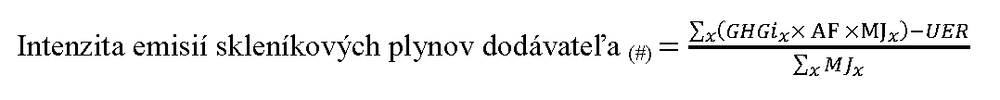

Príloha č. 4 k vyhláške č. 271/2011 Z. z.

- METODIKA VÝPOČTU A PREDKLADANIA SPRÁV

  - Časť 1

    - Výpočet intenzity emisií skleníkových plynov počas životného cyklu na jednotku energie z pohonnej látky a dodávanej energie:

    - 1. Skleníkové plyny zohľadnené pri výpočte intenzity emisií skleníkových plynov z pohonných látok iných ako biopalivo a elektriny sú oxid uhličitý (CO2), oxid dusný (N2O) a metán (CH4). Na účely výpočtu ekvivalentu CO2 majú emisie týchto plynov vzhľadom na ekvivalentné emisie CO2 túto hodnotu:

    - CO2: 1; | CH4: 25; | N2O: 298.

    - 2. Emisie z výroby strojov a zariadení používaných pri ťažbe, výrobe, rafinovaní a spotrebe pohonných látok sa pri výpočte emisií skleníkových plynov nezohľadňujú.

    - 3. Intenzita emisií skleníkových plynov zo všetkých pohonných látok a dodávanej energie [g CO2eq/MJ] uvedených na trh jednou právnickou alebo fyzickou osobou počas životného cyklu pohonných látok a dodávanej energie sa vypočíta podľa vzorca:

      - ,

    - kde:

      - a) „#“ je identifikácia právnickej osoby alebo fyzickej osoby, ktorá plní povinnosť podľa § 10 ods. 1. Požadované identifikačné údaje sú špecifikované v § 10 ods. 6.

      - b) „x“ sú druhy pohonných látok podľa § 2 písm. a) a elektrina pre cestné vozidlá;

      - c) „MJx“ je celková energia uvedená na trh v pohonných látkach a elektrine [MJ]. Vypočíta sa takto:

        - 1. Celková energia každého druhu pohonnej látky

          - Množstvá pohonných látok uvedených na trh sa prevedú na svoj energetický obsah (dolnú výhrevnosť) podľa energetického obsahu stanoveného v prílohe č. 1 ako súčin množstva každého druhu pohonnej látky v litroch alebo kilogramoch a jeho energetického obsahu na jednotku objemu alebo hmotnosti. Množstvá pohonných látok neuvedených v prílohe č. 1 sa prevedú na energetický obsah (dolnú výhrevnosť) podľa usmernenia, ktoré ministerstvo zverejní na svojom webovom sídle. Pri zmiešavaní viacerých biopalív s pohonnou látkou inou ako biopalivo sa pri výpočtoch zohľadňujú množstvá a druhy všetkých biopalív.

          - Množstvo biopalív, ktoré nie sú v súlade s kritériami trvalej udržateľnosti podľa § 3, sa započítava ako pohonná látka iná ako biopalivo, do ktorej sú primiešané alebo ktorú nahrádzajú.

        - 2. Celková energia pri súčasnom (kombinovanom) spracovaní pohonných látok iných ako biopalivo a biopalív

          - Súčasné spracovanie je definované ako úprava počas životného cyklu pohonnej látky alebo energie, ktorá spôsobuje zmeny v molekulárnej štruktúre produktu. Pridanie denaturačnej látky nepatrí do tohto spracovania. Množstvo biopalív spracúvaných súčasne s pohonnými látkami inými ako biopalivo odráža stav biopaliva po spracovaní. Množstvo súčasne spracúvaného biopaliva sa určuje v súlade s energetickou bilanciou a účinnosťou procesu spoločného spracovania, ako sa uvádza v prílohe č. 2 časť C 16. a 17. bode.

        - 3. Celková energia z dodanej elektriny je množstvo elektriny spotrebovanej v cestných vozidlách, motocykloch alebo elektrických bicykloch, pričom sa toto množstvo určuje takto:

          - 3.1 spotrebovaná elektrina je súčinom prejdenej vzdialenosti cestnými vozidlami [km] a účinnosti spotreby elektrickej energie [MJ/km], ak sú požadované údaje k dispozícii alebo

          - 3.2 namerané množstvo elektriny spotrebovanej v cestných vozidlách.

      - d) „UER“ – zníženie emisií v predvýrobnej fáze

        - UER je zníženie emisií skleníkových plynov v predvýrobnej fáze [g CO2eq], ak je kvantifikované a oznámené v súlade s požiadavkami podľa § 9a.

      - e) „GHGix“ je intenzita emisií skleníkových plynov z pohonnej látky alebo dodávanej energie [g CO2eq/MJ]. Intenzita emisií skleníkových plynov z pohonnej látky alebo dodávanej energie sa určí alebo vypočíta takto:

        - 1. pre pohonné látky iné ako biopalivo sa použije vážená intenzita emisií skleníkových plynov počas životného cyklu podľa druhu pohonnej látky uvedená v poslednom stĺpci tabuľky v časti 2 šiestom bode,

        - 2. pre elektrickú energiu je hodnota intenzity emisií skleníkových plynov výroby elektriny v Slovenskej republike zverejňovaná podľa časti 2 siedmy bod,

        - 3. pre biopalivo, ktoré spĺňa kritériá trvalej udržateľnosti podľa § 3, sa vypočíta v súlade s § 5. Ak sa údaje o emisiách skleníkových plynov počas životného cyklu biopaliva získajú v súlade s § 14c ods. 13 zákona, tieto údaje sa použijú aj na stanovenie intenzity emisií skleníkových plynov z biopaliva. Intenzita emisií skleníkových plynov z biopaliva, ktoré nespĺňa kritériá trvalej udržateľnosti uvedené v § 3, sa rovná intenzite emisií skleníkových plynov z príslušnej pohonnej látky inej ako biopalivo, do ktorej je primiešané alebo ktorú nahrádza,

        - 4. pri súčasnom kombinovanom spracovaní pohonných látok iných ako biopalivo a biopalív musí intenzita emisií skleníkových plynov z biopalív odrážať stav biopaliva po spracovaní.

      - f) „AF“ sú korekčné faktory podľa účinnosti pohonu:

      - Prevládajúca konverzná technológia | Faktor účinnosti

      - Spaľovací motor | 1

      - Elektrická hnacia sústava s batériou | 0,4

      - Elektrická hnacia sústava s vodíkovými palivovými článkami | 0,4

  - Časť 2 Predkladanie správ podľa § 10 ods. 1

    - 1. Obsah správy

      - Za každú pohonnú látku a dodanú energiu sa oznamujú tieto súhrnné údaje:

        - a) Druh pohonnej látky alebo dodanej energie

        - Uvádza sa každý druh pohonnej látky a dodanej energie, ktorý bol uvedený na trh Slovenskej republiky v roku, za ktorý sa podáva správa.

        - b) Objem alebo množstvo pohonnej látky alebo elektrickej energie

        - Údaje sa uvádzajú súhrnne za pohonné látky a dodanú energiu, ktoré majú rovnaký pôvod, miesto nákupu a pri biopalivách aj rovnaké vlastnosti trvalej udržateľnosti (zhodná východisková surovina, krajina vypestovania a rovnaké emisie skleníkových plynov za životný cyklus biopaliva). Údaje za pohonné látky sa uvádzajú osobitne za pohonné látky iné ako biopalivo a za biopalivo bez ohľadu na to, či boli uvedené na trh v zmesi alebo samostatne. Samostatne sa uvádza doplnkový údaj o tom, koľko z uvedených pohonných látok bolo uvedené na trh ako zmes motorového benzínu a etanolu E85.

        - c) Intenzita emisií skleníkových plynov

        - Uvádza sa určená alebo vypočítaná hodnota podľa časti 1 tretí bod písm. e).

        - d) Znižovanie emisií v predvýrobnej fáze (UER)

        - Uvádzajú sa údaje podľa druhého bodu.

        - e) Pôvod

        - Uvádzajú sa údaje podľa tretieho bodu.

        - f) Miesto nákupu

        - Uvádzajú sa údaje podľa štvrtého bodu.

    - 2. UER týkajúce sa pohonných látok iných ako biopalivo

      - Aby UER boli oprávnené na účely metodiky výpočtu a podávania správ, je potrebné oznámiť tieto údaje:

        - a) dátum začatia projektu,

        - b) ročné zníženia emisií [g CO2eq],

        - c) trvanie oznamovaného zníženia,

        - d) miesto projektu nachádzajúce sa najbližšie k zdroju emisií určené zemepisnou šírkou a zemepisnou dĺžkou v stupňoch na štyri desatinné miesta,

        - e) základné ročné emisie vyrobených surovín pred zavedením opatrení na ich zníženie a ročné emisie po zavedení opatrení na ich zníženie [g CO2eq/MJ],

        - f) neprenosné číslo dokladu (certifikátu), ktoré jedinečným spôsobom identifikuje vykázané zníženie emisií skleníkových plynov; v prípade UER podľa § 9a ods. 5, písm. b) číslo prideľuje ministerstvo, ak nebolo organizáciou podľa § 14c ods. 12 zákona, ktorá vykonáva overenie podľa § 9a ods. 4,

        - g) neprenosné číslo, ktoré jedinečným spôsobom identifikuje metodiku výpočtu a príslušnú schému, ak bolo pridelené; číslo prideľuje alebo oznamuje organizácia podľa § 14c ods. 12 zákona, ktorá vykonáva overenie podľa § 9a ods. 4,

        - h) ak sa projekt týka ťažby ropy, pomer medzi plynom a ropou (Gas-to-oil ratio – GOR) v roztoku ako priemerná ročná historická hodnota a hodnota za sledovaný rok, tlak v nádrži, hĺbka a výnosnosť pri ťažbe surovej ropy podľa vrtov.

    - 3. Pôvod

      - „Pôvod“ je krajina, kde bola východisková surovina na výrobu pohonnej látky vyťažená, získaná alebo vypestovaná a jej obchodný názov, ak existuje.

      - Pri pohonných látkach iných ako biopalivo je pôvod uvedený v časti 2 ôsmom bode. Údaj sa uvádza, ak je právnická osoba alebo fyzická osoba držiteľom potrebných informácií na základe

        - a) skutočnosti, že je právnickou osobou alebo fyzickou osobou, ktorá dováža ropu z krajiny mimo Európsku úniu alebo prijíma dodávky ropy z iného členského štátu podľa osobitného predpisu9), alebo

        - b) dohody o poskytnutí informácií inou právnickou osobou alebo fyzickou osobou, ktorá je zapojená do životného cyklu výroby pohonnej látky podľa § 14c ods. 11 zákona.

      - Vo všetkých ostatných prípadoch sa za pôvod považuje údaj, či východisková surovina pochádza z členského štátu alebo z krajiny mimo Európskej únie.

      - Pri použití viacerých východiskových surovín v jednom spracovateľskom zariadení počas roka, za ktorý sa podáva správa, oznamuje právnická osoba alebo fyzická osoba údaje o množstve pohonnej látky inej ako biopalivo uvedenej na trh podľa jednotlivých krajín pôvodu, druhov východiskových surovín a ich obchodných názvov.

      - Pri biopalivách je pôvodom reťazec výroby biopalív uvedený v prílohe č. 2, napríklad etanol z kukurice, bionafta z repky olejnej a krajina vypestovania východiskovej suroviny.

    - 4. Miesto nákupu

      - „Miesto nákupu“ je krajina a názov spracovateľského zariadenia alebo rafinérie, v ktorej pohonná látka alebo dodávaná energia prešli posledným podstatným spracovaním, pričom týmto označením sa uvádza pôvod pohonnej látky alebo dodávanej energie v súlade s osobitným predpisom.10) Ak právnická osoba a fyzická osoba preukáže, že sa jej ani s vynaložením všetkého úsilia nepodarilo miesto nákupu zistiť, uvedie sa, či pohonná látka a dodávaná energia pochádza z členského štátu alebo z krajiny mimo Európsku úniu.

    - 5. Zjednodušená metodika podávania správy

      - Právnická osoba alebo fyzická osoba podľa § 14c ods. 5 zákona môže pri pohonných látkach iných ako biopalivo uviesť namiesto údajov v druhom a treťom bode 3 informáciu, či východisková surovina a pohonná látka iná ako biopalivo pochádza z členského štátu alebo z krajiny mimo Európskej únie bez ohľadu na to, či dováža ropu alebo dodáva pohonné látky z ropy alebo získané z bitúmenových materiálov.

    - 6. Priemerné určené hodnoty intenzity emisií skleníkových plynov z pohonných látok iných ako biopalív a elektrickej energie počas ich životného cyklu

    - Zdroj surovín a proces | Pohonné látky uvádzané na trh | Intenzita emisií skleníkových plynov počas životného cyklu [g CO2eq/MJ] | Vážená intenzita emisií skleníkových plynov počas životného cyklu [g CO2eq/MJ]

    - Konvenčná ropa | benzín | 93,2 | 93,3

    - Skvapalnený zemný plyn | | 94,3 |

    - Skvapalnené uhlie | | 172 |

    - Prírodný bitúmen | | 107 |

    - Roponosná bridlica | | 131,3 |

    - Konvenčná ropa | motorová nafta alebo plynový olej | 95 | 95,1

    - Skvapalnený zemný plyn | | 94,3 |

    - Skvapalnené uhlie | | 172 |

    - Prírodný bitúmen | | 108,5 |

    - Roponosná bridlica | | 133,7 |

    - Akékoľvek fosílne zdroje | skvapalnený ropný plyn (LPG) v zážihovom motore | 73,6 | 73,6

    - Zemný plyn, EÚ mix | stlačený zemný plyn v zážihovom motore | 69,3 | 69,3

    - Zemný plyn, EÚ mix | skvapalnený zemný plyn v zážihovom motore | 74,5 | 74,5

    - Sabatierova reakcia elektrolýzou vodíka z nebiologického obnoviteľného zdroja energie | stlačený syntetický metán v zážihovom motore | 3,3 | 3,3

    - Zemný plyn využívajúci parnú reformáciu | stlačený vodík v palivovom článku | 104,3 | 104,3

    - Elektrolýza plne napájaná z nebiologického obnoviteľného zdroja energie | stlačený vodík v palivovom článku | 9,1 | 9,1

    - Uhlie | stlačený vodík v palivovom článku | 234,4 | 234,4

    - Uhlie so zachytávaním a ukladaním uhlíka z emisií vzniknutých počas spracovania | stlačený vodík v palivovom článku | 52,7 | 52,7

    - Odpadové plasty pochádzajúce z fosílnych surovín | benzín, motorová nafta alebo plynový olej | 86 | 86

  - 7. Elektrická energia

    - Na predkladanie správ o dodanej elektrine, ktorú spotrebúvajú elektrické vozidlá, motocykle alebo elektrické bicykle, ministerstvo zverejní na svojom webovom sídle vnútroštátnu priemernú určenú hodnotu intenzity emisií skleníkových plynov za životný cyklus elektriny. Ministerstvo zverejňuje zmenu určenej hodnoty, ak nastane významná zmena energetického mixu výroby elektriny.

  - 8. Obchodný názov východiskovej suroviny

  - [tabuľka](../assets/c57c29a1a5a7fb28ce61b1b99f0f0b02d796d4c27cc12893c0443fbedafa9960.pdf)
