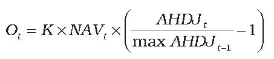

# Čl. I

Zákon č. 43/2004 Z. z. o starobnom dôchodkovom sporení a o zmene a doplnení niektorých zákonov v znení zákona č. 186/2004 Z. z., zákona č. 439/2004 Z. z., zákona č. 721/2004 Z. z., zákona č. 747/2004 Z. z., zákona č. 310/2006 Z. z., zákona č. 644/2006 Z. z., zákona č. 677/2006 Z. z., zákona č. 209/2007 Z. z., zákona č. 519/2007 Z. z., zákona č. 555/2007 Z. z., zákona č. 659/2007 Z. z., zákona č. 62/2008 Z. z., zákona č. 434/2008 Z. z., zákona č. 449/2008 Z. z., zákona č. 137/2009 Z. z., zákona č. 572/2009 Z. z., zákona č. 105/2010 Z. z., nálezu Ústavného súdu Slovenskej republiky č. 355/2010 Z. z. a zákona č. 543/2010 Z. z. sa mení a dopĺňa takto:

- 1. Slová „konzervatívny dôchodkový fond“ vo všetkých tvaroch sa v celom texte zákona nahrádzajú slovami „dlhopisový dôchodkový fond“ v príslušnom tvare.

- 2. Slová „vyvážený dôchodkový fond“ vo všetkých tvaroch sa v celom texte zákona nahrádzajú slovami „zmiešaný dôchodkový fond“ v príslušnom tvare a slová „vo vyváženom dôchodkovom fonde“ sa nahrádzajú slovami „v zmiešanom dôchodkovom fonde“.

- 3. Slová „rastový dôchodkový fond“ vo všetkých tvaroch sa v celom texte zákona nahrádzajú slovami „akciový dôchodkový fond“ v príslušnom tvare.

- 4. Slovo „derivát“ vo všetkých tvaroch sa v celom texte zákona nahrádza slovami „finančný derivát“ v príslušnom tvare.

- 5. Slová „internetová stránka“ vo všetkých tvaroch sa v celom texte zákona nahrádzajú slovami „webové sídlo“ v príslušnom tvare.

- 6. V § 1 ods. 2 sa za slovom „silách2)“ vypúšťa čiarka a slová „a vojakov, ktorí sa počas výkonu vojenskej služby v ozbrojených silách štúdiom alebo výcvikom pripravovali na výkon profesionálnej služby v ozbrojených silách2)“.

- 7. V poznámke pod čiarou k odkazu 2 sa citácia „Zákon č. 370/1997 Z. z. o vojenskej službe v znení neskorších predpisov“ nahrádza slovami „Zákon č. 346/2005 Z. z. o štátnej službe profesionálnych vojakov ozbrojených síl Slovenskej republiky a o zmene a doplnení niektorých zákonov v znení neskorších predpisov.“.

- 8. § 2 vrátane nadpisu znie:

- 㤠2

- Starobné dôchodkové sporenie

- Starobné dôchodkové sporenie je sporenie podľa tohto zákona, ktorého účelom je spolu so starobným poistením podľa osobitného predpisu3) zabezpečiť príjem sporiteľovi v starobe a pozostalým pre prípad smrti.“.

- 9. § 6 vrátane nadpisu znie:

- 㤠6

- Sporiteľ

- Sporiteľ podľa tohto zákona je fyzická osoba, ktorej vznikla prvá účasť na starobnom dôchodkovom sporení podľa tohto zákona. Sporiteľ podľa tohto zákona je aj poberateľ starobného dôchodku alebo predčasného starobného dôchodku ako disponibilného prebytku podľa § 32.“.

- 10. V poznámke pod čiarou k odkazu 8 sa citácia „Zákon č. 95/2002 Z. z. o poisťovníctve a o zmene a doplnení niektorých zákonov v znení zákona č. 430/2003 Z. z.“ nahrádza citáciou „Zákon č. 8/2008 Z. z. o poisťovníctve a o zmene a doplnení niektorých zákonov v znení neskorších predpisov.“.

- 11. § 14 a 15 vrátane nadpisov znejú:

- 㤠14

- Osoba zúčastnená na starobnom dôchodkovom sporení

- (1)

- Osoba zúčastnená na starobnom dôchodkovom sporení je fyzická osoba narodená po 31. decembri 1970, ktorej po 31. marci 2012 vzniklo prvé dôchodkové poistenie ako zamestnancovi, povinne dôchodkovo poistenej samostatne zárobkovo činnej osobe alebo dobrovoľne dôchodkovo poistenej osobe podľa osobitného predpisu,3) fyzickej osobe riadne sa starajúcej o dieťa do šiestich rokov jeho veku podľa osobitného predpisu,3) fyzickej osobe riadne sa starajúcej o dieťa s dlhodobo nepriaznivým zdravotným stavom po dovŕšení šiestich rokov veku podľa osobitného predpisu,3) fyzickej osobe poberajúcej peňažný príspevok na opatrovanie alebo ako fyzickej osobe vykonávajúcej osobnú asistenciu fyzickej osobe s ťažkým zdravotným postihnutím podľa osobitného predpisu.3)

- (2)

- Osoba zúčastnená na starobnom dôchodkovom sporení je aj fyzická osoba, ktorá pred 1. januárom 2005 bola dôchodkovo poistená podľa osobitného predpisu,3) v období od 1. januára 2005 do 30. júna 2006 bola zaradená do evidencie uchádzačov o zamestnanie alebo sa sústavne pripravovala na povolanie štúdiom na strednej škole alebo na vysokej škole po dovŕšení 16 rokov veku a počas tohto zaradenia alebo tejto sústavnej prípravy a po ich skončení až do 31. marca 2012 nebola dôchodkovo poistená ako zamestnanec, povinne dôchodkovo poistená samostatne zárobkovo činná osoba alebo dobrovoľne dôchodkovo poistená osoba podľa osobitného predpisu,3) ak jej po 31. marci 2012 vzniklo prvé dôchodkové poistenie ako zamestnancovi, povinne dôchodkovo poistenej samostatne zárobkovo činnej osobe, dobrovoľne dôchodkovo poistenej osobe podľa osobitného predpisu,3) fyzickej osobe riadne sa starajúcej o dieťa do šiestich rokov jeho veku podľa osobitného predpisu,3) fyzickej osobe riadne sa starajúcej o dieťa s dlhodobo nepriaznivým zdravotným stavom po dovŕšení šiestich rokov veku podľa osobitného predpisu,3) fyzickej osobe poberajúcej peňažný príspevok na opatrovanie alebo ako fyzickej osobe vykonávajúcej osobnú asistenciu fyzickej osobe s ťažkým zdravotným postihnutím podľa osobitného predpisu.3)

- (3)

- Osoba zúčastnená na starobnom dôchodkovom sporení je aj fyzická osoba, ktorej sa vypláca úrazová renta podľa osobitného predpisu,3) a za ktorú Sociálna poisťovňa platí poistné na starobné poistenie, ak bola sporiteľ pred vznikom nároku na úrazovú rentu.

- § 15

- Vznik a zánik prvej účasti na starobnom dôchodkovom sporení

- (1)

- Fyzickej osobe uvedenej v § 14 ods. 1 a 2 vzniká prvá účasť na starobnom dôchodkovom sporení odo dňa prvého dôchodkového poistenia podľa osobitného predpisu3) vzniknutého po 31. marci 2012 a zaniká dňom zániku tohto dôchodkového poistenia podľa osobitného predpisu.3)

- (2)

- Sociálna poisťovňa je povinná do 60 dní od vzniku prvej účasti na starobnom dôchodkovom sporení písomne informovať sporiteľa o jeho právach a povinnostiach počas 730 dní od vzniku prvej účasti na starobnom dôchodkovom sporení.“.

- Poznámky pod čiarou k odkazom 11, 12, 12a, 12b a 14 sa vypúšťajú.

- 12. V nadpise § 16 sa vypúšťa slovo „povinnej“ a v texte sa slová „Povinná účasť“ nahrádzajú slovom „Účasť“.

- 13. § 17 sa vypúšťa.

- 14. § 17a vrátane nadpisu znie:

- 㤠17a

- Zánik právneho postavenia sporiteľa

- (1)

- Sporiteľovi, ktorý požiada o prevod dôchodkových práv získaných v dôchodkovom systéme Slovenskej republiky do dôchodkového systému Európskej únie alebo jej inštitúcie a súhlasí s týmto prevodom, zaniká právne postavenie sporiteľa v deň, v ktorom bolo Sociálnej poisťovni doručené oznámenie Európskej únie alebo jej inštitúcie o tomto súhlase, a to spätne odo dňa vzniku jeho prvej účasti na starobnom dôchodkovom sporení.

- (2)

- Sporiteľovi uvedenému v § 14, ktorému vznikla prvá účasť na starobnom dôchodkovom sporení po 31. marci 2012 a ktorý pred uplynutím 730 dní odo dňa vzniku jeho prvej účasti na starobnom dôchodkovom sporení doručí Sociálnej poisťovni písomné oznámenie s úradne osvedčeným podpisom, alebo oznámenie podpísané pred zamestnancom Sociálnej poisťovne, ktoré obsahuje prejav vôle nebyť zúčastnený na starobnom dôchodkovom sporení, zaniká právne postavenie sporiteľa v deň, v ktorom bolo doručené Sociálnej poisťovni toto oznámenie, a to spätne odo dňa vzniku jeho prvej účasti na starobnom dôchodkovom sporení. Prejav vôle podľa prvej vety nemožno vziať späť.“.

- 15. § 19 vrátane nadpisu znie:

- 㤠19

- Prerušenie účasti na starobnom dôchodkovom sporení

- (1)

- Zamestnancovi a samostatne zárobkovo činnej osobe povinne dôchodkovo poistenej podľa osobitného predpisu3) zúčastneným na starobnom dôchodkovom sporení sa prerušuje účasť na starobnom dôchodkovom sporení v období, v ktorom sa im prerušuje povinné dôchodkové poistenie podľa osobitného predpisu.19)

- (2)

- Vznik prerušenia účasti na starobnom dôchodkovom sporení sa posudzuje rovnako ako zánik tejto účasti a skončenie prerušenia účasti na starobnom dôchodkovom sporení sa posudzuje rovnako ako vznik tejto účasti.“.

- 16. V § 20 ods. 1 písm. b) sa za slovo „povinne“ vkladajú slová „dôchodkovo poistená podľa osobitného predpisu3)“.

- 17. V § 20 ods. 1 písm. c) sa vypúšťa slovo „povinne“.

- 18. V § 20 odseky 2 a 3 znejú:

- „(2)

- Štát platí príspevky za sporiteľa počas obdobia riadnej starostlivosti o dieťa do šiestich rokov jeho veku podľa osobitného predpisu3) alebo počas riadnej starostlivosti o dieťa s dlhodobo nepriaznivým zdravotným stavom po dovŕšení šiestich rokov jeho veku podľa osobitného predpisu,3) počas obdobia poberania peňažného príspevku na opatrovanie podľa osobitného predpisu3) alebo počas obdobia výkonu osobnej asistencie fyzickej osobe s ťažkým zdravotným postihnutím podľa osobitného predpisu3) a za sporiteľa, za ktorého ako za zamestnanca alebo samostatne zárobkovo činnú osobu platí poistné na dôchodkové poistenie štát počas poskytovania materského podľa osobitného predpisu.3)

- (3)

- Sociálna poisťovňa platí príspevky za sporiteľa podľa § 14 ods. 3.“.

- 19. V § 22 písm. b) sa za slovo „povinne“ vkladajú slová „dôchodkovo poistenú podľa osobitného predpisu3)“.

- 20. V § 22 písm. c) sa vypúšťa slovo „povinne“.

- 21. V § 23 ods. 2 sa slová „povinne zúčastnenej“ nahrádzajú slovami „povinne dôchodkovo poistenej podľa osobitného predpisu3) zúčastnenej“.

- 22. V § 23 ods. 3 sa vypúšťa slovo „povinne“.

- 23. Poznámka pod čiarou k odkazu 22 sa vypúšťa.

- 24. V § 23 ods. 5 sa slová „osoby povinne zúčastnenej“ nahrádzajú slovami „osoby povinne dôchodkovo poistenej podľa osobitného predpisu3) zúčastnenej“ a slová „predpisu3) povinne zúčastnenej“ sa nahrádzajú slovami „predpisu3) zúčastnenej“.

- 25. V § 23 ods. 6 sa vypúšťa slovo „povinne“.

- 26. V § 24 sa slová „povinne zúčastnenej“ nahrádzajú slovami „povinne dôchodkovo poistenej podľa osobitného predpisu3) zúčastnenej“.

- 27. V § 25 ods. 1 sa slová „povinne zúčastnená“ nahrádzajú slovami „povinne dôchodkovo poistená podľa osobitného predpisu3) zúčastnená“.

- 28. V § 25 ods. 2 sa vypúšťa slovo „povinne“.

- 29. Nadpis § 27 znie: „Platenie príspevkov a postupovanie príspevkov“ a odsek 2 znie:

- „(2)

- Sociálna poisťovňa postupuje príspevky a penále na bežný účet pre nepriradené platby dôchodkovej správcovskej spoločnosti, ktorá vedie sporiteľovi jeden osobný dôchodkový účet alebo dva osobné dôchodkové účty. Ak Sociálna poisťovňa prvýkrát postupuje príspevky za sporiteľa, ktorému vznikla prvá účasť na starobnom dôchodkovom sporení po 31. marci 2012, postupuje príspevky odo dňa vzniku starobného dôchodkového sporenia na bežný účet pre nepriradené platby dôchodkovej správcovskej spoločnosti, ktorá vedie sporiteľovi jeden osobný dôchodkový účet alebo dva osobné dôchodkové účty.“.

- 30. V § 27 ods. 6 sa za slovo „povinne“ vkladajú slová „dôchodkovo poistená podľa osobitného predpisu3)“ a vypúšťajú sa slová „povinne dôchodkovo poistená samostatne zárobkovo činná osoba“.

- 31. V § 27 ods. 7 sa vypúšťa slovo „povinne“.

- 32. § 28a vrátane nadpisu znie:

- 㤠28a

- Vrátenie príspevkov a penále

- (1)

- Ak Sociálna poisťovňa postúpila dôchodkovej správcovskej spoločnosti príspevky vo vyššej sume, ako mala postúpiť, zúčtuje sumu zodpovedajúcu rozdielu medzi postúpenou sumou príspevkov a správnou sumou príspevkov so sumou príspevkov, ktoré postúpi po zistení tejto skutočnosti.

- (2)

- Ak sporiteľovi do jedného roka od zániku jeho účasti na starobnom dôchodkovom sporení nevznikne nová účasť na starobnom dôchodkovom sporení a nemožno uplatniť postup podľa odseku 1, Sociálna poisťovňa je povinná vyžiadať elektronickými prostriedkami od dôchodkovej správcovskej spoločnosti vrátenie príspevkov, ktoré boli za sporiteľa postúpené bez právneho dôvodu.

- (3)

- Dôchodková správcovská spoločnosť je povinná do piatich pracovných dní odo dňa, v ktorom sa dozvedela o smrti sporiteľa, oznámiť elektronickými prostriedkami túto skutočnosť Sociálnej poisťovni. Sociálna poisťovňa je povinná do 90 dní odo dňa, v ktorom sa dozvedela o smrti sporiteľa, elektronickými prostriedkami vyžiadať od dôchodkovej správcovskej spoločnosti vrátenie príspevkov, ktoré boli za zomretého sporiteľa postúpené bez právneho dôvodu, oznámiť dôchodkovej správcovskej spoločnosti, že postúpi príspevky alebo že neeviduje príspevky postúpené bez právneho dôvodu.

- (4)

- Dôchodková správcovská spoločnosť je povinná bezodkladne od doručenia žiadosti Sociálnej poisťovne podľa odseku 2 alebo žiadosti o vrátenie príspevkov postúpených bez právneho dôvodu podľa odseku 3 druhej vety previesť z bežného účtu dôchodkového fondu alebo z bežných účtov dôchodkových fondov na účet Sociálnej poisťovne v Štátnej pokladnici sumu rovnajúcu sa súčinu počtu dôchodkových jednotiek pripísaných na osobný dôchodkový účet sporiteľa z príspevkov postúpených bez právneho dôvodu a aktuálnej hodnoty dôchodkovej jednotky zo dňa, ktorý predchádza dňu prevodu. Ak je na osobnom dôchodkovom účte sporiteľa počet dôchodkových jednotiek nižší ako počet dôchodkových jednotiek pripísaných z príspevkov postúpených bez právneho dôvodu, dôchodková správcovská spoločnosť je povinná bezodkladne od doručenia žiadosti Sociálnej poisťovne podľa odseku 2 alebo odseku 3 druhej vety previesť z bežného účtu dôchodkového fondu alebo z bežných účtov dôchodkových fondov na účet Sociálnej poisťovne v Štátnej pokladnici sumu zodpovedajúcu aktuálnej hodnote osobného dôchodkového účtu zo dňa, ktorý predchádza dňu prevodu.

- (5)

- Po uplynutí 90 dní odo dňa, v ktorom sa Sociálna poisťovňa dozvedela o smrti sporiteľa, nemôže žiadať od dôchodkovej správcovskej spoločnosti vrátenie príspevkov postúpených bez právneho dôvodu.

- (6)

- Ak Sociálna poisťovňa postúpi dôchodkovej správcovskej spoločnosti príspevky po zrušení osobného dôchodkového účtu z dôvodu smrti sporiteľa, dôchodková správcovská spoločnosť je povinná tieto príspevky bez zbytočného odkladu previesť z účtu nepriradených platieb na účet Sociálnej poisťovne v Štátnej pokladnici.

- (7)

- Na vrátenie penále podľa osobitného predpisu36a) odseky 1 až 6 platia rovnako.“.

- Poznámka pod čiarou k odkazu 36a znie:

- „36a)

- § 241a ods. 1 zákona č. 461/2003 Z. z. v znení zákona č. 555/2007 Z. z.“.

- 33. V § 30 písm. b) sa slová „15 rokov“ nahrádzajú slovami „10 rokov“.

- 34. V § 40 ods. 4 sa za slovo „zomretého“ vkladajú slová „v inom ako dlhopisovom dôchodkovom fonde“ a za slovo „sporiteľom“ sa vkladá slovo „výlučne“.

- 35. V § 40 ods. 6 a 7 sa slová „vyžiadania alebo oznámenia podľa § 28a ods. 2 druhej vety“ nahrádzajú slovami „oznámenia Sociálnej poisťovne, že neeviduje príspevky postúpené bez právneho dôvodu, odo dňa vrátenia príspevkov postúpených bez právneho dôvodu alebo odo dňa pripísania postúpených príspevkov“.

- 36. V § 41 sa slová „Samostatne zárobkovo činnej osobe povinne zúčastnenej na starobnom dôchodkovom sporení a dobrovoľne dôchodkovo poistenej osobe povinne“ nahrádzajú slovami „Samostatne zárobkovo činnej osobe povinne dôchodkovo poistenej podľa osobitného predpisu3) zúčastnenej na starobnom dôchodkovom sporení a dobrovoľne dôchodkovo poistenej osobe podľa osobitného predpisu3)“.

- 37. V § 47 ods. 2 písm. b) druhý bod znie:

- „2.

- vedenie účtu nepriradených platieb,“.

- 38. V § 48 odsek 9 znie:

- „(9)

- Národná banka Slovenska ustanoví opatrením, ktorého úplné znenie vyhlási uverejnením v Zbierke zákonov Slovenskej republiky, spôsob preukazovania splnenia podmienok podľa odseku 2.“.

- 39. V § 48 ods. 10 druhá veta znie: „Dôchodková správcovská spoločnosť je povinná zabezpečiť v organizačnej štruktúre najmenej dvoch zamestnancov zodpovedných za riadenie investícií ako zamestnancov zodpovedných za odborné činnosti podľa tohto zákona.“.

- 40. V § 48 ods. 12 sa slovo „odpisom“ nahrádza slovom „výpisom“.

- 41. V § 52 ods. 5 druhej vete sa slová „15 dní“ nahrádzajú slovami „30 dní“.

- 42. V § 53 ods. 3 sa slová „všeobecne záväzným právnym predpisom“ nahrádzajú slovami „opatrením, ktorého úplné znenie vyhlási uverejnením v Zbierke zákonov Slovenskej republiky,“.

- 43. V § 55 ods. 7 druhá veta znie: „Národná banka Slovenska môže ustanoviť opatrením, ktorého úplné znenie vyhlási uverejnením v Zbierke zákonov Slovenskej republiky, štruktúru a obsah správy podľa prvej vety.“.

- 44. Za § 55 sa vkladá § 55a, ktorý vrátane nadpisu znie:

- 㤠55a

- Riadenie rizík a meranie rizík

- (1)

- Dôchodková správcovská spoločnosť je povinná

- a)

- zaviesť systém riadenia rizík, ktorým sa rozumie prijatie primeraných a účinných postupov, nástrojov a opatrení na včasnú a primeranú identifikáciu, priebežné meranie a riadenie významných rizík, ktorým je vystavený alebo ktorým by mohol byť vystavený majetok v dôchodkovom fonde, ktorý dôchodková správcovská spoločnosť spravuje,

- b)

- upraviť systém riadenia rizík a spôsob jeho aktualizácie vnútorným predpisom,

- c)

- zabezpečiť dodržiavanie limitov celkového rizika a rizika protistrany v majetku v indexovom dôchodkovom fonde.

- (2)

- Na účely odseku 1 je dôchodková správcovská spoločnosť povinná

- a)

- zaviesť opatrenia a postupy na meranie rizík, ktoré sú nevyhnutné na zabezpečenie toho, aby riziká spojené s pozíciami portfólia a ich vplyv na jeho celkový rizikový profil boli presne merané na základe riadnych a spoľahlivých údajov a opatrenia a postupy na meranie rizík boli náležitým spôsobom zdokumentované,

- b)

- vykonávať spätné testovanie s cieľom preskúmať funkčnosť opatrení na meranie rizík, ktoré zahŕňa predpovede a odhady založené na príslušných modeloch, ak dôchodková správcovská spoločnosť používa prístup hodnoty v riziku,

- c)

- vykonávať pravidelné stresové testy a analýzy scenárov s cieľom zohľadniť riziká vyplývajúce z potenciálnych zmien trhových podmienok, ktoré by mohli mať nepriaznivý vplyv na spravovaný dôchodkový fond, ak dôchodková správcovská spoločnosť používa prístup hodnoty v riziku,

- d)

- zaviesť a uplatňovať zdokumentovaný systém vnútorných limitov týkajúci sa opatrení používaných na riadenie a kontrolu príslušných rizík pre každý dôchodkový fond, zohľadňujúci všetky riziká, ktoré môžu byť významné pre príslušný dôchodkový fond, a zabezpečujúci súlad s rizikovým profilom príslušného dôchodkového fondu,

- e)

- zabezpečiť, aby aktuálna úroveň rizík zodpovedala systému vnútorných rizikových limitov podľa písmena d) príslušného dôchodkového fondu,

- f)

- zaviesť a uplatňovať primerané postupy, ktoré pri skutočnom alebo predpokladanom porušení systému vnútorných rizikových limitov podľa písmena d) zabezpečia včasné nápravné opatrenia v záujme sporiteľov dôchodkových fondov a poberateľov dôchodkov starobného dôchodkového sporenia.

- (3)

- Na účely odsekov 1 a 2 sa za významné riziká, ktoré môžu byť očakávané s rozumnou mierou istoty, že sa dotknú záujmov sporiteľov alebo poberateľov starobného dôchodku, považujú

- a)

- kreditné riziko, ktorým je riziko straty pre dôchodkový fond vyplývajúce z toho, že dlžník alebo iná zmluvná strana si nesplní svoje záväzky; kreditné riziko zahŕňa aj riziko protistrany, ktoré znamená riziko straty pre dôchodkový fond vyplývajúce zo skutočnosti, že protistrana v rámci uzatvoreného obchodu nesplní svoje záväzky pred konečným vyrovnaním peňažných tokov v rámci obchodu,

- b)

- trhové riziko, ktorým je riziko straty pre dôchodkový fond vyplývajúce zo zmeny trhovej hodnoty pozícií v majetku v dôchodkovom fonde spôsobenej zmenami v premenlivých trhových faktoroch, ako sú úrokové sadzby, devízové kurzy a ceny akcií,

- c)

- operačné riziko, ktorým je riziko straty pre dôchodkový fond vyplývajúce z neprimeraných vnútorných postupov a zlyhaní v súvislosti s osobami a systémami dôchodkovej správcovskej spoločnosti alebo vonkajších udalostí a zahŕňa právne a dokumentačné riziko a riziko vyplývajúce z postupov obchodovania, vysporiadania a oceňovania v rámci správy majetku v dôchodkovom fonde.

- (4)

- Na účely odseku 1 je dôchodková správcovská spoločnosť povinná určiť osobu zodpovednú za riadenie rizík vykonávaných nezávisle a oddelene od iných činností dôchodkovej správcovskej spoločnosti.

- (5)

- Osoba zodpovedná za riadenie rizík zabezpečuje najmä

- a)

- vykonávanie politiky a postupov riadenia rizík,

- b)

- sledovanie súladu medzi aktuálnymi úrovňami rizík a systémom vnútorných limitov podľa odseku 2 písm. d) a s limitmi celkového rizika podľa § 83b ods. 2 a rizika protistrany podľa § 83a ods. 2,

- c)

- predkladanie pravidelných správ predstavenstvu dôchodkovej správcovskej spoločnosti

- 1.

- o súlade medzi aktuálnymi úrovňami rizík, ktorým je vystavený majetok v každom spravovanom dôchodkovom fonde, a rizikovým profilom príslušného dôchodkového fondu,

- 2.

- o dodržiavaní limitov obmedzenia a rozloženia rizika každého spravovaného dôchodkového fondu,

- 3.

- o primeranosti a účinnosti postupu riadenia rizík, najmä o prijatí náležitých nápravných opatrení pri zistených nedostatkoch,

- d)

- poskytovanie pravidelných správ predstavenstvu dôchodkovej správcovskej spoločnosti o každom skutočnom alebo predvídateľnom porušení limitov obmedzenia a rozloženia rizika, s cieľom zabezpečiť prijatie včasných a primeraných opatrení,

- e)

- preskúmavanie a podporu opatrení a postupov na oceňovanie finančných derivátov uzatvorených mimo regulovaného trhu.

- (6)

- Národná banka Slovenska môže ustanoviť opatrením, ktorého úplné znenie vyhlási uverejnením v Zbierke zákonov Slovenskej republiky,

- a)

- podrobnosti o systéme riadenia rizík,

- b)

- podrobnosti o osobe zodpovednej za riadenie rizík,

- c)

- ďalšie riziká, ktoré sa rozlišujú na účely riadenia rizík,

- d)

- dodatočné náležitosti informačného prospektu dôchodkového fondu a ročnej správy o hospodárení s majetkom v dôchodkovom fonde týkajúce sa merania a riadenia rizík v dôchodkovom fonde,

- e)

- podrobnosti

- 1.

- o vykonávaní spätného testovania podľa odseku 2 písm. b),

- 2.

- o vykonávaní stresového testovania podľa odseku 2 písm. c) alebo

- f)

- kvalitatívne a kvantitatívne požiadavky na stresové testovanie.“.

- 45. V poznámke pod čiarou k odkazu 58c sa citácia „Napríklad zákon č. 367/2000 Z. z. o ochrane pred legalizáciou príjmov z trestnej činnosti a o zmene a doplnení niektorých zákonov v znení neskorších predpisov.“ nahrádza citáciou „Zákon č. 297/2008 Z. z. o ochrane pred legalizáciou príjmov z trestnej činnosti a o ochrane pred financovaním terorizmu a o zmene a doplnení niektorých zákonov v znení neskorších predpisov.“.

- 46. V § 58 ods. 8 úvodnej vete sa za slovom „rady“ vypúšťa čiarka a slová „členom predstavenstva a vedúcim zamestnancom v priamej riadiacej pôsobnosti predstavenstva zodpovedným za odborné činnosti“ a vypúšťajú sa písmená c) až e).

- 47. V § 60 odsek 3 znie:

- „(3)

- Národná banka Slovenska ustanoví opatrením, ktorého úplné znenie vyhlási uverejnením v Zbierke zákonov Slovenskej republiky, vymedzenie vlastných zdrojov, ktoré je dôchodková správcovská spoločnosť povinná dodržiavať, spôsob výpočtu sumy vlastných zdrojov, vymedzenie všeobecných prevádzkových výdavkov, likvidných aktív, záväzkov a pohľadávok, spôsob výpočtu sumy likvidných aktív a spôsob preukazovania splnenia podmienky o primeranosti vlastných zdrojov podľa odseku 2.“.

- 48. V § 61 ods. 2 sa vypúšťa písmeno d).

- Doterajšie písmená e) až g) sa označujú ako písmená d) až f).

- 49. V § 61 sa vypúšťa odsek 3.

- Doterajšie odseky 4 až 11 sa označujú ako odseky 3 až 10.

- 50. V § 61 ods. 6 sa slová „všeobecne záväzným právnym predpisom“ nahrádzajú slovami „opatrením, ktorého úplné znenie vyhlási uverejnením v Zbierke zákonov Slovenskej republiky,“ a slová „1 až 4“ sa nahrádzajú slovami „1 až 3“.

- 51. V § 61 ods. 9 sa slová „odseku 8“ nahrádzajú slovami „odseku 7“.

- 52. § 63 a 63a až 63c vrátane nadpisov znejú:

- 㤠63

- Odplata dôchodkovej správcovskej spoločnosti

- (1)

- Dôchodková správcovská spoločnosť má za podmienok ustanovených týmto zákonom právo na

- a)

- odplatu za správu dôchodkového fondu,

- b)

- odplatu za vedenie osobného dôchodkového účtu,

- c)

- odplatu za zhodnotenie majetku v dôchodkovom fonde.

- (2)

- Výšku odplaty dôchodkovej správcovskej spoločnosti podľa odseku 1 a jej zmenu určuje dôchodková správcovská spoločnosť; zmena odplaty dôchodkovej správcovskej spoločnosti je zvýšenie odplaty dôchodkovej správcovskej spoločnosti alebo zníženie odplaty dôchodkovej správcovskej spoločnosti.

- (3)

- Dôchodková správcovská spoločnosť je povinná informovať o zmene odplaty dôchodkovej správcovskej spoločnosti podľa odseku 1 v periodickej tlači s celoštátnou pôsobnosťou a na svojom webovom sídle najneskôr 30 dní predo dňom nadobudnutia účinnosti tejto zmeny. Informáciu podľa prvej vety je dôchodková správcovská spoločnosť povinná mať zverejnenú na svojom webovom sídle nepretržite najmenej 60 dní od jej uverejnenia.

- (4)

- Pri výpočte a zúčtovaní odplaty za správu dôchodkového fondu a odplaty za zhodnotenie majetku v dôchodkovom fonde nemožno znížiť počet dôchodkových jednotiek v dôchodkovom fonde. Odplatu za správu dôchodkového fondu a odplatu za zhodnotenie majetku v dôchodkovom fonde možno vypočítať a zúčtovať len znížením čistej hodnoty majetku v dôchodkovom fonde. Odplatu za vedenie osobného dôchodkového účtu možno vypočítať a zúčtovať len na účte nepriradených platieb.

- § 63a

- Odplata za správu dôchodkového fondu

- (1)

- Odplata za správu dôchodkového fondu zahŕňa náklady dôchodkovej správcovskej spoločnosti spojené so správou majetku v dôchodkovom fonde okrem

- a)

- daní vzťahujúcich sa na majetok v dôchodkovom fonde,

- b)

- poplatkov subjektu zabezpečujúcemu vyrovnanie obchodov s finančnými nástrojmi,

- c)

- poplatkov za vedenie bežných účtov a vkladových účtov,

- d)

- poplatkov obchodníkovi s cennými papiermi alebo zahraničnému obchodníkovi s cennými papiermi,

- e)

- poplatkov centrálnemu depozitárovi cenných papierov alebo členovi centrálneho depozitára súvisiacich so správou cenných papierov, alebo osobe s obdobným predmetom činnosti mimo územia Slovenskej republiky a

- f)

- pomernej časti odplaty za výkon činnosti depozitára zodpovedajúcej podielu majetku v tomto dôchodkovom fonde k celkovému majetku spravovanému dôchodkovou správcovskou spoločnosťou.

- (2)

- Náklady podľa odseku 1 písm. a) až f) sa uhrádzajú z majetku dôchodkového fondu.

- (3)

- Odplata za správu dôchodkového fondu za jeden kalendárny rok správy dôchodkového fondu určená v štatúte dôchodkového fondu nesmie presiahnuť

- a)

- 0,3 % priemernej ročnej predbežnej čistej hodnoty majetku v dlhopisovom dôchodkovom fonde,

- b)

- 0,3 % priemernej ročnej predbežnej čistej hodnoty majetku v zmiešanom dôchodkovom fonde,

- c)

- 0,3 % priemernej ročnej predbežnej čistej hodnoty majetku v akciovom dôchodkovom fonde a

- d)

- 0,2 % priemernej ročnej predbežnej čistej hodnoty majetku v indexovom dôchodkovom fonde.

- (4)

- Na výpočet odplaty za správu dôchodkového fondu sa použije údaj o čistej predbežnej hodnote majetku v dôchodkovom fonde vypočítaný podľa § 75 ods. 4.

- (5)

- Dôchodková správcovská spoločnosť je povinná každý pracovný deň určiť pomernú časť odplaty za správu dôchodkového fondu. V ten istý pracovný deň sa zníži o sumu tejto pomernej časti odplaty za správu dôchodkového fondu hodnota majetku v dôchodkovom fonde.

- (6)

- Odplata za správu v indexovom dôchodkovom fonde môže byť znížená podľa § 88a ods. 3.

- § 63b

- Odplata za vedenie osobného dôchodkového účtu

- Odplata za vedenie osobného dôchodkového účtu nesmie presiahnuť 1 % zo sumy príspevku pripísaného na účet nepriradených platieb pred pripísaním dôchodkových jednotiek na osobný dôchodkový účet sporiteľa.

- § 63c

- Odplata za zhodnotenie majetku v dôchodkovom fonde

- (1)

- Odplata za zhodnotenie majetku v dôchodkovom fonde sa určuje každý pracovný deň podľa vzorca uvedeného v prílohe č. 3. Dôchodková správcovská spoločnosť nemá právo na odplatu za zhodnotenie majetku v dôchodkovom fonde, ak suma vypočítaná podľa predchádzajúcej vety má zápornú hodnotu. Dôchodková správcovská spoločnosť nemá právo na odplatu za zhodnotenie majetku v dlhopisovom dôchodkovom fonde a na odplatu za zhodnotenie majetku v indexovom dôchodkovom fonde.

- (2)

- Dôchodková správcovská spoločnosť v deň určenia odplaty podľa odseku 1 zníži hodnotu majetku v príslušnom dôchodkovom fonde o sumu odplaty za zhodnotenie majetku v dôchodkovom fonde určenú podľa odseku 1.“.

- 53. Za § 63c sa vkladajú § 63d a 63e, ktoré vrátane nadpisov znejú:

- 㤠63d

- Povinnosť dôchodkovej správcovskej spoločnosti doplniť majetok do dlhopisového dôchodkového fondu

- (1)

- Ak v dlhopisovom dôchodkovom fonde v sledovanom období poklesne hodnota dôchodkovej jednotky, dôchodková správcovská spoločnosť je povinná v prvý pracovný deň bezprostredne nasledujúci po poslednom dni sledovaného obdobia doplniť hodnotu majetku v dlhopisovom dôchodkovom fonde z vlastného majetku vo výške absolútnej hodnoty súčinu poklesu hodnoty dôchodkovej jednotky a priemernej čistej hodnoty majetku v dlhopisovom dôchodkovom fonde za sledované obdobie. Záväzok dôchodkovej správcovskej spoločnosti doplniť majetok podľa prvej vety zodpovedá pohľadávke v majetku v príslušnom dôchodkovom fonde voči dôchodkovej správcovskej spoločnosti, ktorú je dôchodková správcovská spoločnosť povinná splatiť do troch pracovných dní od skončenia sledovaného obdobia.

- (2)

- Pokles hodnoty dôchodkovej jednotky v dlhopisovom dôchodkovom fonde v sledovanom období podľa odseku 1 je záporný výsledok pomeru aritmetického priemeru aktuálnych hodnôt dôchodkových jednotiek za posledný kalendárny mesiac sledovaného obdobia a aritmetického priemeru aktuálnych hodnôt dôchodkových jednotiek za prvý kalendárny mesiac sledovaného obdobia znížený o hodnotu 1.

- (3)

- Sledované obdobie podľa odsekov 1 a 2 je posledných päť po sebe nasledujúcich kalendárnych rokov. Sledované obdobie začína plynúť vždy 1. januára kalendárneho roka.

- § 63e

- Výdavky dôchodkovej správcovskej spoločnosti a výdavky, ktoré vynaložili fyzické osoby a právnické osoby v prospech dôchodkovej správcovskej spoločnosti

- (1)

- Výdavky dôchodkovej správcovskej spoločnosti a výdavky, ktoré vynaložili fyzické osoby a právnické osoby v prospech dôchodkovej správcovskej spoločnosti na uzatvorenie jednej zmluvy o starobnom dôchodkovom sporení a na činnosti s tým súvisiace, nesmú presiahnuť 6 % priemernej mesačnej mzdy v hospodárstve Slovenskej republiky vykázanej Štatistickým úradom Slovenskej republiky za kalendárny rok, ktorý dva roky predchádza kalendárnemu roku, v ktorom sa uzatvorila zmluva o starobnom dôchodkovom sporení.

- (2)

- Výdavky dôchodkovej správcovskej spoločnosti a výdavky, ktoré vynaložili fyzické osoby a právnické osoby v prospech dôchodkovej správcovskej spoločnosti na propagáciu a reklamu podľa § 47 ods. 2 písm. c) a § 112 ods. 1 a 3 za kalendárny rok, sú najviac vo výške 1000-násobku priemernej mesačnej mzdy v hospodárstve Slovenskej republiky vykázanej Štatistickým úradom Slovenskej republiky za kalendárny rok, ktorý dva roky predchádza kalendárnemu roku, v ktorom sa tieto výdavky vynaložili.“.

- 54. V § 64 odsek 1 znie:

- „(1)

- Zmluvu o starobnom dôchodkovom sporení uzatvára dôchodková správcovská spoločnosť so sporiteľom.“.

- 55. V § 64 ods. 3 druhej vete sa za slová „registra zmlúv“ vkladajú slová „o starobnom dôchodkovom sporení (ďalej len „register zmlúv“)“.

- 56. V § 64 sa za odsek 3 vkladá nový odsek 4, ktorý znie:

- „(4)

- Sporiteľ môže uzatvoriť zmluvu o starobnom dôchodkovom sporení do 180 dní odo dňa vzniku jeho prvej účasti na starobnom dôchodkovom sporení.“.

- Doterajšie odseky 4 až 7 sa označujú ako odseky 5 až 8.

- 57. V § 64 ods. 6 písmená c) a d) znejú:

- „c)

- názov dôchodkového fondu alebo dôchodkových fondov, ktorých dôchodkové jednotky budú evidované na jednom osobnom dôchodkovom účte alebo na dvoch osobných dôchodkových účtoch sporiteľa, ako aj pomer sporenia v jednotlivých dôchodkových fondoch, ak sporiteľ sporí vo viacerých dôchodkových fondoch súčasne,

- d)

- záväzok dôchodkovej správcovskej spoločnosti viesť jeden osobný dôchodkový účet alebo dva osobné dôchodkové účty sporiteľa a vykonávať správu dôchodkových fondov podľa písmena c),“.

- 58. V § 64 ods. 6 sa za písmeno d) vkladá nové písmeno e), ktoré znie:

- „e)

- informáciu, že v zmiešanom dôchodkovom fonde, v akciovom dôchodkovom fonde a v indexovom dôchodkovom fonde nie je dôchodková správcovská spoločnosť povinná dopĺňať majetok v prípade poklesu hodnoty dôchodkovej jednotky,“.

- Doterajšie písmená e) až g) sa označujú ako písmená f) až h).

- 59. V § 64 ods. 6 písm. g) sa slová „odseku 4“ nahrádzajú slovami „odseku 5“.

- 60. V § 64 sa za odsek 6 vkladajú nové odseky 7 a 8, ktoré znejú:

- „(7)

- Informácia podľa odseku 6 písm. e) musí byť uvedená na rovnakej strane zmluvy o starobnom dôchodkovom sporení, ako je podpis sporiteľa, a musí byť uvedená rovnakým typom a veľkosťou písma ako jej ostatné predtlačené ustanovenia.

- (8)

- Ak percentuálny pomer sporenia v jednotlivých dôchodkových fondoch dohodnutý v zmluve o starobnom dôchodkovom sporení nezodpovedá ustanoveniu § 92 ods. 1, je zmluva o starobnom dôchodkovom sporení v tejto časti neplatná a pre pomer sporenia v jednotlivých dôchodkových fondoch platia ustanovenia tohto zákona.“.

- Doterajšie odseky 7 a 8 sa označujú ako odseky 9 a 10.

- 61. V § 64 odsek 10 znie:

- „(10)

- Od zmluvy o starobnom dôchodkovom sporení nemožno odstúpiť, vypovedať ju ani zrušiť dohodou zmluvných strán. Zmluva o starobnom dôchodkovom sporení zaniká dňom úmrtia sporiteľa, dňom prestupu sporiteľa z dôchodkovej správcovskej spoločnosti do inej dôchodkovej správcovskej spoločnosti podľa § 64b alebo dňom zániku právneho postavenia sporiteľa podľa § 17a.“.

- 62. V § 64a ods. 3 písm. b) sa slová „poistencom podľa osobitného predpisu3)“ nahrádzajú slovom „sporiteľ“.

- 63. V § 64a sa odsek 3 dopĺňa písmenom d), ktoré znie:

- „d)

- ide o prvú zmluvu o starobnom dôchodkovom sporení, ktorá bola uzatvorená po uplynutí lehoty podľa § 64 ods. 4 alebo pri ktorej nebola dodržaná lehota podľa § 65 ods. 3; to neplatí, ak ide o prestup sporiteľa do inej dôchodkovej správcovskej spoločnosti.“.

- 64. V § 64a ods. 6 sa slová „§ 65 ods. 4“ nahrádzajú slovami „§ 65 ods. 3“.

- 65. V § 64a ods. 9 a 10 sa za slovo „príspevkov“ vkladajú slová „a penále“.

- 66. V § 64a odsek 11 znie:

- „(11)

- Ak Sociálna poisťovňa postúpila dôchodkovej správcovskej spoločnosti príspevky za fyzickú osobu, ktorej zmluva o starobnom dôchodkovom sporení bola vymazaná z registra zmlúv, alebo zaplatila penále podľa osobitného predpisu36a) z týchto príspevkov, je povinná elektronickými prostriedkami vyžiadať od dôchodkovej správcovskej spoločnosti vrátenie týchto príspevkov alebo penále.“.

- 67. § 64a sa dopĺňa odsekom 12, ktorý znie:

- „(12)

- Ak zmluva o starobnom dôchodkovom sporení zanikla dňom zániku právneho postavenia sporiteľa podľa § 17a, je dôchodková správcovská spoločnosť povinná do piatich pracovných dní odo dňa oznámenia Sociálnej poisťovne o výmaze zmluvy o starobnom dôchodkovom sporení z registra zmlúv podľa odseku 8 druhej vety previesť z bežného účtu dôchodkového fondu alebo z bežných účtov dôchodkových fondov na účet Sociálnej poisťovne v Štátnej pokladnici sumu zodpovedajúcu aktuálnej hodnote osobného dôchodkového účtu dotknutého sporiteľa ku dňu, ktorý predchádza dňu prevodu.“.

- 68. Za § 64a sa vkladá § 64aa, ktorý vrátane nadpisu znie:

- 㤠64aa

- Určenie dôchodkovej správcovskej spoločnosti Sociálnou poisťovňou

- (1)

- Ak sporiteľ neuzatvorí zmluvu o starobnom dôchodkovom sporení v lehote podľa § 64 ods. 4 a nedoručí v tejto lehote Sociálnej poisťovni oznámenie podľa § 17a ods. 2, Sociálna poisťovňa určí sporiteľovi v období medzi šestnástym a tridsiatym dňom od uplynutia tejto lehoty dôchodkovú správcovskú spoločnosť. Sociálna poisťovňa určuje sporiteľom dôchodkové správcovské spoločnosti postupne podľa zoznamu dôchodkových správcovských spoločností zoradených v abecednom poradí. Sporiteľ, ktorému Sociálna poisťovňa určila dôchodkovú správcovskú spoločnosť, je sporiteľ v zmiešanom dôchodkovom fonde.

- (2)

- Sociálna poisťovňa je povinná do ôsmich dní od určenia dôchodkovej správcovskej spoločnosti podľa odseku 1 do vlastných rúk zaslať sporiteľovi oznámenie o určení dôchodkovej správcovskej spoločnosti podľa odseku 1; súčasťou tohto oznámenia je názov dôchodkovej správcovskej spoločnosti a poučenie o oprávnení sporiteľa doručiť písomné oznámenie podľa § 17a ods. 2.

- (3)

- Sociálna poisťovňa je povinná previesť príspevky od vzniku prvej účasti na starobnom dôchodkovom sporení sporiteľa, ktorému určila dôchodkovú správcovskú spoločnosť, na bežný účet pre nepriradené platby príslušnej dôchodkovej správcovskej spoločnosti do troch dní odo dňa určenia dôchodkovej správcovskej spoločnosti podľa odseku 1.“.

- 69. V § 64b ods. 2 druhá veta znie: „Ak ku dňu vydania akceptačného listu uplynuli viac ako dva roky odo dňa vzniku prvého dôchodkového poistenia podľa osobitného predpisu3) a ak odo dňa posledného prestupu do dôchodkovej správcovskej spoločnosti, z ktorej sporiteľ prestupuje, neuplynul najmenej jeden rok, zaplatí sporiteľ Sociálnej poisťovni poplatok za vydanie akceptačného listu v sume 16 eur.“.

- 70. V § 65 odsek 1 znie:

- „(1)

- Fyzická osoba je povinná bez zbytočného odkladu oznámiť svojmu zamestnávateľovi, že jej zaniklo právne postavenie sporiteľa podľa § 17a.“.

- 71. V § 65 sa vypúšťa odsek 3.

- Doterajšie odseky 4 a 5 sa označujú ako odseky 3 a 4.

- 72. V § 65 ods. 4 sa za slovo „fondu“ vkladajú slová „alebo z bežných účtov dôchodkových fondov“.

- 73. Poznámka pod čiarou k odkazu 68a znie:

- „68a)

- § 226 ods. 1 písm. k) zákona č. 461/2003 Z. z. v znení neskorších predpisov.“.

- 74. V § 67 ods. 1 sa slová „dvanástom, pätnástom a šestnástom“ nahrádzajú slovami „dvanástom a pätnástom“ a na konci druhej vety sa bodka nahrádza bodkočiarkou a pripájajú sa tieto slová: „depozitár môže na základe písomného plnomocenstva vykonávať činnosť podľa § 47 ods. 2 písm. b) jedenásteho bodu“.

- 75. V § 72 ods. 1 prvej vete sa slová „§ 63c ods. 3“ nahrádzajú slovami „§ 63d“ a druhá veta znie: „Národná banka Slovenska ustanoví opatrením, ktorého úplné znenie vyhlási uverejnením v Zbierke zákonov Slovenskej republiky, metódy a postupy určenia hodnoty majetku v dôchodkovom fonde.“.

- 76. V § 72 ods. 4 sa vkladá nové písmeno a), ktoré znie:

- „a)

- jeden indexový dôchodkový fond,“.

- Doterajšie písmená a) až c) sa označujú ako písmená b) až d).

- 77. V § 72 ods. 5 sa vypúšťa druhá veta.

- 78. V § 72 ods. 6 prvá veta až tretia veta znejú: „Súčasťou názvu dôchodkového fondu musí byť aj obchodné meno dôchodkovej správcovskej spoločnosti spravujúcej tento dôchodkový fond a názov dôchodkového fondu spolu s uvedením slov „indexový dôchodkový fond“, „akciový dôchodkový fond“, „zmiešaný dôchodkový fond“ alebo „dlhopisový dôchodkový fond“. Slovo „indexový“ možno nahradiť skratkou „i.“, slovo „akciový“ možno nahradiť skratkou „a.“, slovo „zmiešaný“ možno nahradiť skratkou „z.“, slovo „dlhopisový“ možno nahradiť skratkou „d.“ a slová „dôchodkový fond“ možno nahradiť skratkou „d. f.“. Názov dôchodkového fondu ani označenie s ním zameniteľné v slovenskom jazyku alebo v cudzom jazyku nesmie na svoje označenie alebo na opis svojej činnosti používať iná fyzická osoba ani právnická osoba; to neplatí, ak osobitný predpis71a) ustanovuje inak.“.

- Poznámka pod čiarou k odkazu 71a znie:

- „71a)

- Zákon č. 650/2004 Z. z. o doplnkovom dôchodkovom sporení a o zmene a doplnení niektorých zákonov v znení neskorších predpisov.“.

- 79. V § 74 ods. 1 tretej vete sa vypúšťajú slová „a podiel garančného účtu dôchodkového fondu na tomto majetku“.

- 80. Za § 74 sa vkladá § 74a, ktorý vrátane nadpisu znie:

- 㤠74a

- Účet nepriradených platieb a bežný účet pre nepriradené platby

- (1)

- Majetok evidovaný na účte nepriradených platieb nie je súčasťou majetku dôchodkovej správcovskej spoločnosti.

- (2)

- Peňažné prostriedky evidované na účte nepriradených platieb sú uložené na bežnom účte pre nepriradené platby vedenom u depozitára.

- (3)

- Majetok evidovaný na účte nepriradených platieb je majetkom sporiteľov v príslušných dôchodkových fondoch v rozsahu, v akom sú na účte nepriradených platieb zastúpené identifikované príspevky, penále alebo iné peňažné prostriedky vzťahujúce sa k príslušnému dôchodkovému fondu, ak tento zákon neustanovuje inak. Majetok evidovaný na účte nepriradených platieb presahujúci súčet súm identifikovaných príspevkov, penále alebo iných peňažných prostriedkov vzťahujúcich sa k jednotlivým dôchodkovým fondom, je majetkom jeho vlastníkov alebo je pohľadávkou príslušného fondu Sociálnej poisťovne a dôchodková správcovská spoločnosť je povinná s ním nakladať podľa zákona.

- (4)

- Poplatky depozitárovi za vedenie bežného účtu pre nepriradené platby a poplatky za poskytovanie platobných služieb v súvislosti s bežným účtom podľa odseku 2 znáša dôchodková správcovská spoločnosť.

- (5)

- Výnosy plynúce z finančných prostriedkov uložených na bežnom účte pre nepriradené platby sú príjmom dôchodkovej správcovskej spoločnosti.

- (6)

- Všetky prevody majetku v prospech majetku v dôchodkových fondoch podľa tohto zákona realizuje dôchodková správcovská spoločnosť prostredníctvom účtu nepriradených platieb.

- (7)

- Pri prestupe sporiteľa do inej dôchodkovej správcovskej spoločnosti poukazuje dôchodková správcovská spoločnosť sumu zodpovedajúcu aktuálnej hodnote osobného dôchodkového účtu sporiteľa zo dňa predchádzajúceho dňu prestupu sporiteľa podľa § 97 na účet nepriradených platieb dôchodkovej správcovskej spoločnosti, do ktorej sporiteľ prestupuje.

- (8)

- Majetok evidovaný na účte nepriradených platieb okrem výnosov podľa odseku 5 nie je súčasťou konkurznej podstaty dôchodkovej správcovskej spoločnosti ani nesmie byť použitý na vyrovnanie s veriteľmi dôchodkovej správcovskej spoločnosti podľa osobitného predpisu.49)

- (9)

- Dôchodková správcovská spoločnosť vedie účet nepriradených platieb; týmto účtom musia prechádzať všetky platby postúpené Sociálnou poisťovňou a všetky platby od iných dôchodkových správcovských spoločností. Tieto účty sú určené na prijímanie platieb od Sociálnej poisťovne a od iných dôchodkových správcovských spoločností a na ich postupovanie na bežný účet alebo bežné účty vedené pre ten dôchodkový fond alebo dôchodkové fondy, ktoré si sporiteľ zvolil pri uzatvorení alebo pri zmene zmluvy o starobnom dôchodkovom sporení alebo ktorý sporiteľovi určila Sociálna poisťovňa, ako aj na zúčtovanie odplaty za vedenie osobného dôchodkového účtu.“.

- 81. V § 75 ods. 4 sa na konci pripájajú tieto vety: „Na účely určenia odplaty podľa § 63a sa v deň, za ktorý sa odplata určuje, vypočíta aj predbežná čistá hodnota majetku v dôchodkovom fonde, ktorá nie je znížená o odplatu podľa § 63a a 63c. Na účely určenia odplaty podľa § 63c sa v deň, za ktorý sa odplata určuje, vypočíta aj druhá predbežná čistá hodnota majetku v dôchodkovom fonde, ktorá nie je znížená o odplatu podľa 63c.“.

- 82. V § 75 ods. 5 sa vypúšťajú slová „a na garančnom účte dôchodkového fondu“.

- 83. V § 75 sa za odsek 5 vkladá nový odsek 6, ktorý znie:

- „(6)

- Na účel výpočtu odplaty podľa § 63c sa v deň, za ktorý sa odplata určuje, vypočíta predbežná aktuálna hodnota dôchodkovej jednotky. Predbežná aktuálna hodnota dôchodkovej jednotky je podiel druhej predbežnej čistej hodnoty majetku v dôchodkovom fonde a počtu všetkých dôchodkových jednotiek evidovaných na osobných dôchodkových účtoch všetkých sporiteľov dôchodkového fondu.“.

- Doterajší odsek 6 sa označuje ako odsek 7.

- 84. V § 77 ods. 2 druhá veta znie: „Zmeny štatútu sú účinné 15. dňom od ich uverejnenia na webovom sídle dôchodkovej správcovskej spoločnosti, ak nie je ustanovený neskorší dátum účinnosti.“.

- 85. V § 77 ods. 4 písmeno h) znie:

- „h)

- referenčnú hodnotu zmiešaného dôchodkového fondu, akciového dôchodkového fondu a indexového dôchodkového fondu podľa § 91,“.

- 86. V poznámke pod čiarou k odkazu 73 sa citácia „Zákon č. 594/2003 Z. z. o kolektívnom investovaní a o zmene a doplnení niektorých zákonov v znení neskorších predpisov.“ nahrádza citáciou „Zákon č. 203/2011 Z. z. o kolektívnom investovaní.“.

- 87. V § 79 odsek 3 znie:

- „(3)

- Zakazuje sa

- a)

- zlúčenie indexového dôchodkového fondu s iným ako indexovým dôchodkovým fondom,

- b)

- zlúčenie akciového dôchodkového fondu s iným ako akciovým dôchodkovým fondom,

- c)

- zlúčenie zmiešaného dôchodkového fondu s iným ako zmiešaným dôchodkovým fondom,

- d)

- zlúčenie dlhopisového dôchodkového fondu s iným ako dlhopisovým dôchodkovým fondom.“.

- 88. V poznámke pod čiarou k odkazu 74 sa citácia „zákon č. 95/2002 Z. z. v znení neskorších predpisov“ nahrádza citáciou „zákon č. 8/2008 Z. z. v znení neskorších predpisov“.

- 89. V § 81 ods. 1 úvodnej vete sa za slovo „môžu“ vkladajú slová „za podmienok ustanovených týmto zákonom“.

- 90. V § 81 ods.1 písmeno g) znie:

- „g)

- pohľadávky a záväzky vznikajúce pri obchodoch určených výlučne na obmedzenie úrokového rizika, menového rizika alebo iného rizika súvisiaceho s majetkom v dôchodkovom fonde, ak tieto obchody slúžia na zabezpečenie majetku voči trhovému riziku alebo na zmierňovanie trhového rizika a na udržanie hodnoty podkladového aktíva v majetku v dôchodkovom fonde; dôchodková správcovská spoločnosť musí byť spôsobilá preukázať, že ide výlučne o zabezpečovací obchod.“.

- 91. V § 81 odsek 2 znie:

- „(2)

- Dôchodková správcovská spoločnosť je povinná priebežne kontrolovať, či otvorený podielový fond, zahraničný subjekt kolektívneho investovania a iný zahraničný subjekt kolektívneho investovania dodržiava zameranie a ciele investičnej stratégie uvedené v štatúte otvoreného podielového fondu, zahraničného subjektu kolektívneho investovania a iného zahraničného subjektu kolektívneho investovania alebo v inom obdobnom dokumente. Cenné papiere nadobúdané do majetku v dôchodkovom fonde podľa odseku 1 písm. c) a d), ktorých hodnota je naviazaná na hodnotu finančných indexov alebo iných finančných indexov uvedených v odseku 3 písm. a), sa na účely tohto zákona považujú za cenné papiere podľa odseku 3 písm. b).“.

- 92. V § 81 ods. 3 písmená a) a b) znejú:

- „a)

- kapitálové cenné papiere,76) ktoré sú súčasťou finančného indexu burzy cenných papierov alebo zahraničnej burzy cenných papierov so sídlom v členskom štáte alebo ktoré sú súčasťou iného finančného indexu podľa § 81 ods. 7, ak je názov takéhoto iného finančného indexu uvedený v štatúte spolu s jeho skráteným označením a obchodným menom tvorcu iného finančného indexu,

- b)

- cenné papiere, ktorých hodnota je naviazaná na hodnotu finančného indexu burzy cenných papierov alebo zahraničnej burzy cenných papierov so sídlom v členskom štáte, alebo iného finančného indexu uvedeného v písmene a) a ktoré zároveň sú podielovým listom otvoreného podielového fondu alebo cenným papierom zahraničného subjektu kolektívneho investovania alebo cenným papierom iného zahraničného subjektu kolektívneho investovania,“.

- 93. V § 81 ods. 5 písm. g) sa slová „vydaním, vyplatením a správou“ nahrádzajú slovami „vydaním a vyplatením“.

- 94. V § 81 ods. 5 sa vypúšťa písmeno h).

- 95. V § 81 odseky 7 a 8 znejú:

- „(7)

- Iný finančný index na účely tohto zákona je index, ktorý

- a)

- je zložený z dostatočného počtu akcií alebo dlhopisov a ich emitentov,

- b)

- s dostatočnou presnosťou vyjadruje celkové cenové pohyby na trhu, na ktorý sa vzťahuje,

- c)

- je zverejňovaný spôsobom, akým sú uverejňované kurzy akcií alebo dlhopisov tvoriacich index.

- (8)

- Národná banka Slovenska môže ustanoviť opatrením, ktorého úplné znenie vyhlási uverejnením v Zbierke zákonov Slovenskej republiky, čo sa rozumie podmienkami rovnocennými podmienkam pre regulované trhy v rámci Európskeho hospodárskeho priestoru, podrobnosti o postupe, spôsobe a priebežnom sledovaní zverejňovaných informácií a o spôsobe hodnotenia a preverovania týchto informácií pri nadobúdaní cenných papierov podľa odseku 1 písm. c) a d) a odseku 3 písm. b) do majetku v dôchodkovom fonde a čo sa rozumie referenčnými úrokovými sadzbami na finančnom trhu.“.

- 96. § 81 sa dopĺňa odsekom 9, ktorý znie:

- „(9)

- Národná banka Slovenska ustanoví opatrením, ktorého úplné znenie vyhlási uverejnením v Zbierke zákonov Slovenskej republiky, postup pri výpočte poplatkov uvedených v odseku 5 písm. g), ako aj spôsob ich úhrady.“.

- 97. V § 82 odsek 1 znie:

- „(1)

- Hodnota cenných papierov alebo nástrojov peňažného trhu podľa § 81 ods. 1 písm. a) až e) vydaných rovnakým emitentom nesmie tvoriť viac ako 3 % čistej hodnoty majetku v inom ako indexovom dôchodkovom fonde. Hodnota prevoditeľných cenných papierov podľa § 81 ods. 3 písm. b) vydaných rovnakým emitentom nesmie tvoriť viac ako 10 % čistej hodnoty majetku v inom ako indexovom dôchodkovom fonde; obmedzenie podľa prvej vety sa nepoužije. Na účely obmedzení podľa prvej vety a druhej vety sa otvorený podielový fond, zahraničný subjekt kolektívneho investovania a iný zahraničný subjekt kolektívneho investovania považujú za emitenta.“.

- 98. V § 82 odsek 3 znie:

- „(3)

- Súčet investícií do prevoditeľných cenných papierov, nástrojov peňažného trhu, podielových listov otvorených podielových fondov, cenných papierov zahraničných subjektov kolektívneho investovania a iných zahraničných subjektov kolektívneho investovania vydaných jednou skupinou právnických osôb, vkladov u tej istej skupiny právnických osôb a majetkovej angažovanosti voči tej istej skupine právnických osôb pri obchodoch s finančnými derivátmi alebo na zabezpečenie rizika nesmie tvoriť viac ako 20 % čistej hodnoty majetku v dôchodkovom fonde. Skupinou právnických osôb podľa prvej vety sa rozumejú právnické osoby patriace do skupiny, za ktorú sa zostavuje jedna konsolidovaná účtovná závierka podľa osobitného predpisu77a) alebo podľa medzinárodných účtovných štandardov.“.

- 99. V § 82 ods. 4 sa za slovo „štátom“ vkladajú slová „alebo Európskou centrálnou bankou, Európskou úniou, Európskou investičnou bankou, Svetovou bankou, Európskou bankou pre obnovu a rozvoj alebo Medzinárodným menovým fondom“.

- 100. V § 82 sa vypúšťa odsek 7.

- Doterajšie odseky 8 až 12 sa označujú ako odseky 7 až 11.

- 101. V § 82 odsek 9 znie:

- „(9)

- Hodnota cenných papierov uvedených v § 81 ods. 1 písm. c) a d) nesmie tvoriť viac ako 20 % čistej hodnoty majetku v dôchodkovom fonde.“.

- 102. V § 82 sa za odsek 9 vkladá nový odsek 10, ktorý znie:

- „(10)

- Hodnota cenných papierov uvedených v § 81 ods. 3 písm. b) nesmie tvoriť viac ako 30 % čistej hodnoty majetku v inom ako indexovom dôchodkovom fonde. Hodnota cenných papierov uvedených v § 81 ods. 3 písm. b) môže tvoriť v indexovom dôchodkovom fonde až 100 % čistej hodnoty majetku.“.

- Doterajšie odseky 10 a 11 sa označujú ako odseky 11 a 12.

- 103. § 82 sa dopĺňa odsekom 13, ktorý znie:

- „(13)

- Odseky 1 až 11 sa nevzťahujú na podielové listy otvorených podielových fondov, cenné papiere zahraničných subjektov kolektívneho investovania a iných zahraničných subjektov kolektívneho investovania a na cenné papiere podľa § 81 ods. 3 písm. b) v majetku v indexovom dôchodkovom fonde.“.

- 104. Za § 82 sa vkladajú § 82a až 82e, ktoré vrátane nadpisov znejú:

- 㤠82a

- Investovanie majetku v zmiešanom dôchodkovom fonde a v akciovom dôchodkovom fonde

- (1)

- Majetok v zmiešanom dôchodkovom fonde a v akciovom dôchodkovom fonde môžu tvoriť aj

- a)

- cenné papiere, ktorých hodnota je naviazaná výlučne na hodnotu drahého kovu alebo indexu drahých kovov a ktoré sú zároveň podielovým listom otvoreného podielového fondu alebo cenným papierom zahraničného subjektu kolektívneho investovania alebo cenným papierom iného zahraničného subjektu kolektívneho investovania,

- b)

- certifikáty, ktoré zastupujú výlučne drahé kovy.

- (2)

- Súčet investícií do cenných papierov a certifikátov podľa odseku 1 a do derivátov podľa § 82b ods. 1, ktorých podkladovým nástrojom je rovnaký druh drahého kovu, nesmie tvoriť viac ako 10 % čistej hodnoty majetku v zmiešanom dôchodkovom fonde a viac ako 10 % čistej hodnoty majetku v akciovom dôchodkovom fonde, súčet investícií do cenných papierov a certifikátov podľa odseku 1 a do derivátov podľa § 82b ods. 1, ktorých podkladovým nástrojom je akýkoľvek drahý kov, nesmie tvoriť viac ako 20 % čistej hodnoty majetku v zmiešanom dôchodkovom fonde a viac ako 20 % čistej hodnoty majetku v akciovom dôchodkovom fonde.

- (3)

- Hodnota cenných papierov podľa odseku 1 vydaných rovnakým emitentom nesmie tvoriť viac ako 10 % čistej hodnoty majetku v zmiešanom dôchodkovom fonde a viac ako 10 % čistej hodnoty majetku v akciovom dôchodkovom fonde. V majetku v zmiešanom dôchodkovom fonde sa nesmie nachádzať viac ako 10 % hodnoty jednej emisie cenných papierov alebo nástrojov podľa odseku 1 a v majetku v akciovom dôchodkovom fonde sa nesmie nachádzať viac ako 10 % hodnoty jednej emisie cenných papierov alebo nástrojov podľa odseku 1.

- (4)

- Drahými kovmi sa na účely tohto zákona rozumejú zlato, striebro, platina a paládium.

- § 82b

- (1)

- V súlade so zameraniami a cieľmi investičnej stratégie uvedenými v štatúte dôchodkového fondu môže majetok v zmiešanom dôchodkovom fonde a v akciovom dôchodkovom fonde bez ohľadu na obmedzenie podľa § 81 ods. 1 písm. g), ods. 5 písm. c), d) a f) a ods. 6 tvoriť aj derivát, ktorého podkladovým nástrojom je výlučne drahý kov, alebo derivát, ktorého podkladovým nástrojom je výlučne index drahých kovov (ďalej len „derivát drahého kovu alebo derivát indexu drahých kovov“), s ktorými je spojené právo na finančné vyrovnanie a ktoré sú obchodované na regulovanom trhu uvedenom v § 81 ods. 1 písm. a), na komoditnej burze podľa osobitného predpisu79a) alebo na inom regulovanom komoditnom trhu so sídlom v členskom štáte.

- (2)

- Investície do derivátov drahého kovu alebo do derivátov indexu drahých kovov môžu pri dodržaní limitov podľa tohto zákona tvoriť súčasť investičnej stratégie dôchodkovej správcovskej spoločnosti v zmiešanom dôchodkovom fonde a v akciovom dôchodkovom fonde. Pri investovaní do derivátov drahého kovu alebo do derivátov indexu drahých kovov sa na účely výpočtu limitov podľa § 82a započítavajú aj hodnoty podkladových nástrojov týchto derivátov.

- (3)

- Ak prevoditeľný cenný papier, ktorý sa nachádza v majetku v zmiešanom dôchodkovom fonde a v akciovom dôchodkovom fonde, obsahuje derivát drahého kovu alebo derivát indexu drahých kovov, tento derivát sa musí zohľadniť pri dodržiavaní obmedzení podľa tohto zákona.

- (4)

- Do majetku v zmiešanom dôchodkovom fonde a v akciovom dôchodkovom fonde nemožno nadobúdať derivát drahého kovu alebo derivát indexu drahých kovov, ktorý vyžaduje dodanie podkladového nástroja tohto derivátu, alebo ak protistrana má právo žiadať dodanie tohto podkladového nástroja.

- (5)

- Dôchodková správcovská spoločnosť pri správe majetku v zmiešanom dôchodkovom fonde a v akciovom dôchodkovom fonde nesmie uzatvárať obchody s derivátmi drahého kovu alebo s derivátmi indexu drahých kovov, pri ktorých by sa vyžadovalo krytie vo forme aktív, ktoré nie je možné nadobúdať do majetku v zmiešanom dôchodkovom fonde a v akciovom dôchodkovom fonde.

- (6)

- Národná banka Slovenska môže ustanoviť opatrením, ktorého úplné znenie vyhlási uverejnením v Zbierke zákonov Slovenskej republiky, podrobnosti o spôsobe krytia záväzkov súvisiacich s derivátmi drahého kovu alebo s derivátmi indexu drahých kovov v majetku v zmiešanom dôchodkovom fonde a v akciovom dôchodkovom fonde.

- § 82c

- Celkové riziko derivátov drahého kovu alebo derivátov indexu drahých kovov a jeho výpočet

- (1)

- Celkové riziko derivátov drahého kovu alebo derivátov indexu drahých kovov, ktorému je majetok v zmiešanom dôchodkovom fonde a v akciovom dôchodkovom fonde vystavený, nesmie prekročiť 15 % čistej hodnoty majetku v zmiešanom dôchodkovom fonde a 15 % čistej hodnoty majetku v akciovom dôchodkovom fonde.

- (2)

- Dôchodková správcovská spoločnosť je povinná vypočítavať celkové riziko derivátov drahého kovu alebo derivátov indexu drahých kovov v zmiešanom dôchodkovom fonde a v akciovom dôchodkovom fonde ako

- a)

- dodatočné riziko a pákový efekt, ktoré sú generované používaním derivátov drahého kovu alebo derivátov indexu drahých kovov, a to vrátane cenných papierov obsahujúcich derivát drahého kovu alebo derivát indexu drahých kovov podľa § 82b ods. 3, ktoré nesmú presiahnuť určené percentuálne podiely podľa odseku 1, alebo

- b)

- trhové riziko majetku v zmiešanom dôchodkovom fonde a v akciovom dôchodkovom fonde.

- (3)

- Ak dôchodková správcovská spoločnosť vypočítava celkové riziko derivátov drahého kovu alebo derivátov indexu drahých kovov v zmiešanom dôchodkovom fonde a v akciovom dôchodkovom fonde ako riziko podľa odseku 2 písm. a), je povinná toto celkové riziko vypočítavať záväzkovým prístupom. Ak dôchodková správcovská spoločnosť vypočítava celkové riziko derivátov drahého kovu alebo derivátov indexu drahých kovov v zmiešanom dôchodkovom fonde a v akciovom dôchodkovom fonde ako riziko podľa odseku 2 písm. b), je povinná toto celkové riziko vypočítavať prístupom hodnoty v riziku; hodnotou v riziku sa rozumie ukazovateľ maximálnej očakávanej straty na danej úrovni spoľahlivosti v konkrétnom časovom období.

- (4)

- Dôchodková správcovská spoločnosť je povinná zabezpečiť, aby metóda zvolená na meranie celkového rizika derivátov drahého kovu alebo derivátov indexu drahých kovov v zmiešanom dôchodkovom fonde a v akciovom dôchodkovom fonde bola vhodná pre daný druh dôchodkového fondu, pričom je povinná zohľadniť investičnú stratégiu daného dôchodkového fondu, druhy a zložitosť derivátov drahého kovu alebo derivátov indexu drahých kovov v majetku v zmiešanom dôchodkovom fonde a v akciovom dôchodkovom fonde, ako aj ich podiel na majetku v týchto fondoch.

- (5)

- Dôchodková správcovská spoločnosť je oprávnená pri správe majetku v zmiešanom dôchodkovom fonde a v akciovom dôchodkovom fonde používať postupy a nástroje zahŕňajúce repo obchody alebo pôžičky cenných papierov, a to len na účely efektívneho riadenia investícií v majetku v týchto dôchodkových fondoch a za podmienok a dodržania limitov uvedených v štatúte príslušného dôchodkového fondu; ustanovenie § 84 ods. 5 sa nepoužije. Ak dôchodková správcovská spoločnosť pri správe majetku v zmiešanom dôchodkovom fonde a v akciovom dôchodkovom fonde používa postupy a nástroje podľa prvej vety, ktorých cieľom je zvýšenie pákového efektu alebo úrovne trhového rizika majetku v dôchodkovom fonde, dôchodková správcovská spoločnosť je povinná zohľadniť tieto operácie pri výpočte celkového rizika derivátov drahého kovu alebo derivátov indexu drahých kovov.

- § 82d

- Záväzkový prístup

- (1)

- Ak dôchodková správcovská spoločnosť používa na výpočet celkového rizika derivátov drahého kovu alebo derivátov indexu drahých kovov v zmiešanom dôchodkovom fonde a v akciovom dôchodkovom fonde záväzkový prístup, je povinná tento prístup uplatniť na všetky pozície v derivátoch drahého kovu alebo v derivátoch indexu drahých kovov vrátane cenných papierov obsahujúcich derivát drahého kovu alebo derivát indexu drahých kovov, a to bez ohľadu na to, či sú použité ako súčasť investičnej stratégie daného dôchodkového fondu na účely zníženia rizika alebo na účely efektívneho riadenia investícií majetku v zmiešanom dôchodkovom fonde a v akciovom dôchodkovom fonde.

- (2)

- Pri výpočte celkového rizika derivátov drahého kovu alebo derivátov indexu drahých kovov v zmiešanom dôchodkovom fonde a v akciovom dôchodkovom fonde záväzkovým prístupom je dôchodková správcovská spoločnosť povinná každú pozíciu v deriváte drahého kovu alebo v deriváte indexu drahých kovov konvertovať na trhovú hodnotu ekvivalentnej pozície v podkladovom nástroji tohto derivátu drahých kovov alebo derivátu indexu drahých kovov.

- (3)

- Ak použitie derivátov drahého kovu alebo derivátov indexu drahých kovov nevytvára dodatočné zvýšenie úrovne rizika v majetku v zmiešanom dôchodkovom fonde a v akciovom dôchodkovom fonde, dôchodková správcovská spoločnosť nemusí pozíciu v podkladovom nástroji takéhoto derivátu drahého kovu alebo derivátu indexu drahých kovov zahrnúť do záväzkov.

- (4)

- Dôchodková správcovská spoločnosť môže pri výpočte celkového rizika derivátov drahého kovu alebo derivátov indexu drahých kovov v zmiešanom dôchodkovom fonde a v akciovom dôchodkovom fonde zohľadniť opatrenia na zabezpečenie pred rizikom straty a opatrenia na vzájomné započítanie, len ak tieto opatrenia prihliadajú na zjavné a významné riziká a vedú k jasnému zníženiu úrovne rizika.

- (5)

- Ak možno v prospech majetku alebo na ťarchu majetku v zmiešanom dôchodkovom fonde a v akciovom dôchodkovom fonde podľa štatútu týchto dôchodkových fondov používať postupy a nástroje podľa § 82c ods. 5 vzťahujúce sa na prevoditeľné cenné papiere a nástroje peňažného trhu na účel efektívneho riadenia investícií majetku v zmiešanom dôchodkovom fonde a v akciovom dôchodkovom fonde a použitie týchto postupov a nástrojov vytvára ďalšie pákové efekty prostredníctvom reinvestovania zábezpeky, použitie týchto postupov a nástrojov je dôchodková správcovská spoločnosť povinná zohľadniť pri výpočte celkového rizika derivátov drahého kovu alebo derivátov indexu drahých kovov v zmiešanom dôchodkovom fonde a v akciovom dôchodkovom fonde záväzkovým prístupom.

- (6)

- Národná banka Slovenska môže ustanoviť opatrením, ktorého úplné znenie vyhlási v Zbierke zákonov Slovenskej republiky,

- a)

- metódy konverzie pozícií v derivátoch drahého kovu alebo v derivátoch indexu drahých kovov podľa odseku 2 pre jednotlivé druhy derivátov drahého kovu alebo derivátov indexu drahých kovov,

- b)

- kritériá na určenie derivátov drahého kovu alebo derivátov indexu drahých kovov, ktoré nevytvárajú dodatočné zvýšenie úrovne rizika v majetku v zmiešanom dôchodkovom fonde a v akciovom dôchodkovom fonde podľa odseku 3,

- c)

- spôsoby zohľadnenia opatrení na zabezpečenie pred rizikom straty a opatrení na vzájomné započítanie podľa odseku 4 pri výpočte celkového rizika derivátov drahého kovu alebo derivátov indexu drahých kovov v zmiešanom dôchodkovom fonde a v akciovom dôchodkovom fonde záväzkovým prístupom,

- d)

- spôsoby zohľadnenia postupov a nástrojov podľa odseku 5 pri výpočte celkového rizika derivátov drahého kovu alebo derivátov indexu drahých kovov v zmiešanom dôchodkovom fonde a v akciovom dôchodkovom fonde záväzkovým prístupom,

- e)

- iné podrobnosti o výpočte celkového rizika derivátov drahého kovu alebo derivátov indexu drahých kovov v zmiešanom dôchodkovom fonde a v akciovom dôchodkovom fonde záväzkovým prístupom.

- § 82e

- Prístup hodnoty v riziku

- (1)

- Ak dôchodková správcovská spoločnosť používa na výpočet celkového rizika derivátov drahého kovu alebo derivátov indexu drahých kovov v zmiešanom dôchodkovom fonde a v akciovom dôchodkovom fonde prístup hodnoty v riziku, je povinná tento prístup uplatniť na všetky pozície v majetku v zmiešanom dôchodkovom fonde a v akciovom dôchodkovom fonde.

- (2)

- Dôchodková správcovská spoločnosť je povinná pri používaní prístupu hodnoty v riziku určovať podľa § 55a ods. 2 písm. d) limit maximálnej hodnoty v riziku v súlade s definovaným rizikovým profilom zmiešaného dôchodkového fondu a akciového dôchodkového fondu.

- (3)

- Pri používaní prístupu hodnoty v riziku je dôchodková správcovská spoločnosť povinná primerane k rizikovému profilu a k investičnej stratégii príslušného dôchodkového fondu použiť na výpočet celkového rizika derivátov drahého kovu alebo derivátov indexu drahých kovov v zmiešanom dôchodkovom fonde a v akciovom dôchodkovom fonde metódu relatívnej hodnoty v riziku alebo metódu absolútnej hodnoty v riziku. Na účely tohto zákona sa relatívnou hodnotou v riziku rozumie pomer medzi hodnotou v riziku majetku v zmiešanom dôchodkovom fonde a v akciovom dôchodkovom fonde a hodnotou v riziku referenčného ukazovateľa alebo referenčného portfólia. Na účely tohto zákona sa absolútnou hodnotou v riziku rozumie hodnota v riziku v majetku v zmiešanom dôchodkovom fonde a v akciovom dôchodkovom fonde určená ako percento čistej hodnoty majetku v tomto dôchodkovom fonde.

- (4)

- Na žiadosť Národnej banky Slovenska je dôchodková správcovská spoločnosť povinná preukázať, že metóda zvolená podľa odseku 3 je pre daný druh dôchodkového fondu primeraná. Rozhodnutie dôchodkovej správcovskej spoločnosti o používaní príslušnej metódy a jeho podkladové predpoklady a zdôvodnenie musia byť riadne zdokumentované.

- (5)

- Metóda zvolená podľa odseku 3 musí byť používaná nepretržite.

- (6)

- Národná banka Slovenska môže ustanoviť opatrením, ktorého úplné znenie vyhlási v Zbierke zákonov Slovenskej republiky,

- a)

- spôsob výpočtu celkového rizika derivátov drahého kovu alebo derivátov indexu drahých kovov v zmiešanom dôchodkovom fonde a v akciovom dôchodkovom fonde metódou relatívnej hodnoty v riziku,

- b)

- spôsob výpočtu celkového rizika derivátov drahého kovu alebo derivátov indexu drahých kovov v zmiešanom dôchodkovom fonde a v akciovom dôchodkovom fonde metódou absolútnej hodnoty v riziku,

- c)

- kvantitatívne a kvalitatívne požiadavky pre prístup hodnoty v riziku,

- d)

- maximálny limit, ktorý nemožno prekročiť pri používaní metódy absolútnej hodnoty v riziku,

- e)

- iné podrobnosti o výpočte celkového rizika derivátov drahého kovu alebo derivátov indexu drahých kovov v zmiešanom dôchodkovom fonde a v akciovom dôchodkovom fonde prístupom hodnoty v riziku.“.

- Poznámka pod čiarou k odkazu 79a znie:

- „79a)

- Zákon č. 92/2008 Z. z. o komoditnej burze a o doplnení zákona Národnej rady Slovenskej republiky č. 145/1995 Z. z. o správnych poplatkoch v znení neskorších predpisov v znení zákona č. 397/2008 Z. z.“.

- Doterajší odkaz 79a sa označuje ako odkaz 79b.

- 105. Za § 83 sa vkladajú § 83a až 83f, ktoré vrátane nadpisov znejú:

- 㤠83a

- Investovanie majetku v indexovom dôchodkovom fonde

- (1)

- Majetok v indexovom dôchodkovom fonde môžu bez ohľadu na obmedzenie podľa § 81 ods. 1 písm. g), ods. 5 písm. c), d) a f) a ods. 6 tvoriť aj finančné deriváty, s ktorými je spojené právo na finančné vyrovnanie a ktoré sú obchodované na regulovanom trhu uvedenom v § 81 ods. 1 písm. a), alebo finančné deriváty uzatvorené mimo regulovaného trhu, ak

- a)

- podkladovým nástrojom týchto finančných derivátov sú nástroje uvedené v § 81 ods. 1 a 3, finančné indexy, úrokové miery, výmenné kurzy mien a meny, v ktorých môže byť investovaný majetok v indexovom dôchodkovom fonde v súlade so zameraniami a cieľmi investičnej stratégie uvedenými v jeho štatúte,

- b)

- protistrana pri obchodoch s finančnými derivátmi uzatvorenými mimo regulovaného trhu je finančná inštitúcia, ktorá podlieha dohľadu nad obozretným podnikaním; v štatúte indexového dôchodkového fondu musia byť uvedené kategórie finančných inštitúcií, ktoré môžu byť protistranou pri obchodoch s finančnými derivátmi uzatvorenými mimo regulovaného trhu,

- c)

- finančné deriváty uzatvorené mimo regulovaného trhu sú denne oceňované a toto ocenenie je overované spôsobmi podľa § 83f a tieto finančné deriváty možno kedykoľvek predať, speňažiť alebo uzatvoriť prostredníctvom iného obchodu za ich reálnu hodnotu.

- (2)

- Riziko protistrany, ktorému je vystavený majetok v indexovom dôchodkovom fonde pri obchodoch s finančnými derivátmi uzatvorenými mimo regulovaného trhu, nesmie prekročiť

- a)

- 10 % hodnoty majetku v indexovom dôchodkovom fonde, ak je protistranou banka so sídlom na území Slovenskej republiky alebo zahraničná banka so sídlom v členskom štáte alebo v nečlenskom štáte, ak tento nečlenský štát vyžaduje dodržiavanie pravidiel obozretného podnikania bánk, ktoré Národná banka Slovenska považuje za rovnocenné s pravidlami podľa osobitného predpisu79a) alebo s pravidlami obozretného podnikania bánk členského štátu,

- b)

- 5 % hodnoty majetku v indexovom dôchodkovom fonde, ak je protistranou iná osoba ako banka podľa písmena a).

- (3)

- Investície do finančných derivátov môžu pri dodržaní limitov podľa tohto zákona tvoriť časť investičnej stratégie dôchodkovej správcovskej spoločnosti s majetkom v indexovom dôchodkovom fonde. Pri investovaní do finančných derivátov sa na účely výpočtu limitov podľa § 82 započítavajú aj hodnoty podkladových nástrojov týchto finančných derivátov; to neplatí pre investície do finančných derivátov, ktorých podkladovým nástrojom sú indexy spĺňajúce podmienky podľa § 81 ods. 7.

- (4)

- Ak prevoditeľný cenný papier alebo nástroj peňažného trhu, ktorý sa nachádza v majetku v indexovom dôchodkovom fonde, obsahuje finančný derivát, tento finančný derivát sa musí zohľadniť pri dodržiavaní obmedzení podľa tohto zákona.

- (5)

- Ak je v majetku indexového dôchodkového fondu finančný derivát, ktorý vyžaduje dodanie podkladového finančného nástroja tohto finančného derivátu, alebo protistrana má právo žiadať dodanie tohto podkladového nástroja, dôchodková správcovská spoločnosť je povinná zabezpečiť v majetku v indexovom dôchodkovom fonde krytie, ktorým sa rozumie dostatočný počet podkladových finančných nástrojov príslušného finančného derivátu alebo dostatok peňažných prostriedkov, ktoré možno použiť na kúpu dodávaného podkladového finančného nástroja, ak je zabezpečené, že takúto kúpu možno vykonať k požadovanému dátumu dodania podkladového nástroja.

- (6)

- Dôchodková správcovská spoločnosť pri správe majetku v indexovom dôchodkovom fonde nesmie uzatvárať obchody s finančnými derivátmi, pri ktorých by sa podľa odseku 5 vyžadovalo krytie vo forme aktív, ktoré nie je možné nadobúdať do majetku v indexovom dôchodkovom fonde.

- (7)

- Národná banka Slovenska môže ustanoviť opatrením, ktorého úplné znenie vyhlási uverejnením v Zbierke zákonov Slovenskej republiky, podrobnosti o spôsobe krytia záväzkov súvisiacich s finančnými derivátmi v majetku v indexovom dôchodkovom fonde.

- § 83b

- Celkové riziko finančných derivátov indexového dôchodkového fondu a jeho výpočet

- (1)

- Celkové riziko finančných derivátov, ktorému je majetok v indexovom dôchodkovom fonde vystavený, nesmie prekročiť 50 % čistej hodnoty majetku v indexovom dôchodkovom fonde.

- (2)

- Dôchodková správcovská spoločnosť je povinná vypočítavať celkové riziko finančných derivátov indexového dôchodkového fondu ako

- a)

- dodatočné riziko a pákový efekt, ktoré sú generované používaním finančných derivátov, a to vrátane cenných papierov obsahujúcich finančný derivát podľa § 83a ods. 4, ktoré podľa odseku 1 nesmú presiahnuť 50 % čistej hodnoty majetku v indexovom dôchodkovom fonde, alebo

- b)

- trhové riziko majetku v indexovom dôchodkovom fonde.

- (3)

- Ak dôchodková správcovská spoločnosť vypočítava celkové riziko finančných derivátov indexového dôchodkového fondu ako riziko podľa odseku 2 písm. a), je povinná vypočítavať celkové riziko finančných derivátov indexového dôchodkového fondu záväzkovým prístupom. Ak dôchodková správcovská spoločnosť vypočítava celkové riziko finančných derivátov indexového dôchodkového fondu ako riziko podľa odseku 2 písm. b), je povinná vypočítavať celkové riziko finančných derivátov indexového dôchodkového fondu prístupom hodnoty v riziku; hodnotou v riziku sa rozumie ukazovateľ maximálnej očakávanej straty na danej úrovni spoľahlivosti v konkrétnom časovom období.

- (4)

- Dôchodková správcovská spoločnosť je povinná zabezpečiť, aby metóda zvolená na meranie celkového rizika finančných derivátov indexového dôchodkového fondu bola vhodná pre indexový dôchodkový fond, pričom je povinná zohľadniť investičnú stratégiu indexového dôchodkového fondu, druhy a zložitosť finančných derivátov v majetku v indexovom dôchodkovom fonde a ich podiel na majetku v tomto fonde.

- (5)

- Dôchodková správcovská spoločnosť je oprávnená pri správe majetku v indexovom dôchodkovom fonde používať postupy a nástroje zahŕňajúce repo obchody alebo pôžičky cenných papierov, a to len na účely efektívneho riadenia investícií v majetku v indexovom dôchodkovom fonde a za podmienok a dodržania limitov uvedených v štatúte indexového dôchodkového fondu; ustanovenie § 84 ods. 5 sa nepoužije. Ak dôchodková správcovská spoločnosť pri správe indexového dôchodkového fondu používa postupy a nástroje podľa prvej vety, ktorých cieľom je zvýšenie pákového efektu alebo úrovne trhového rizika, dôchodková správcovská spoločnosť je povinná zohľadniť tieto operácie pri výpočte celkového rizika finančných derivátov indexového dôchodkového fondu.

- § 83c

- Záväzkový prístup

- (1)

- Ak dôchodková správcovská spoločnosť používa na výpočet celkového rizika finančných derivátov indexového dôchodkového fondu záväzkový prístup, je povinná tento prístup uplatniť na všetky pozície vo finančných derivátoch vrátane cenných papierov obsahujúcich finančný derivát podľa § 83a ods. 4, a to bez ohľadu na to, či sú použité ako súčasť investičnej stratégie indexového dôchodkového fondu na účely zníženia rizika alebo na účely efektívneho riadenia investícií majetku v indexovom dôchodkovom fonde podľa § 83a ods. 4.

- (2)

- Pri výpočte celkového rizika finančných derivátov indexového dôchodkového fondu záväzkovým prístupom je dôchodková správcovská spoločnosť povinná každú pozíciu vo finančnom deriváte konvertovať na trhovú hodnotu ekvivalentnej pozície v podkladovom nástroji tohto finančného derivátu.

- (3)

- Ak použitie finančných derivátov nevytvára dodatočné zvýšenie úrovne rizika v majetku v indexovom dôchodkovom fonde, dôchodková správcovská spoločnosť nemusí pozíciu v podkladovom nástroji takéhoto finančného derivátu zahrnúť do záväzkov.

- (4)

- Dôchodková správcovská spoločnosť môže pri výpočte celkového rizika finančných derivátov indexového dôchodkového fondu zohľadniť opatrenia na zabezpečenie pred rizikom straty a opatrenia na vzájomné započítanie, len ak tieto opatrenia prihliadajú k zjavným a významným rizikám a vedú k jasnému zníženiu úrovne rizika.

- (5)

- Ak možno podľa štatútu indexového dôchodkového fondu v prospech majetku alebo na ťarchu majetku v indexovom dôchodkovom fonde používať postupy a nástroje podľa § 83b ods. 5 vzťahujúce sa na prevoditeľné cenné papiere a nástroje peňažného trhu na účel efektívneho riadenia investícií majetku v indexovom dôchodkovom fonde a použitie týchto postupov a nástrojov vytvára ďalšie pákové efekty prostredníctvom reinvestovania zábezpeky, použitie týchto postupov a nástrojov je dôchodková správcovská spoločnosť povinná zohľadniť pri výpočte celkového rizika finančných derivátov indexového dôchodkového fondu záväzkovým prístupom.

- (6)

- Národná banka Slovenska môže ustanoviť opatrením, ktorého úplné znenie vyhlási uverejnením v Zbierke zákonov Slovenskej republiky,

- a)

- čo sa rozumie repo obchodom,

- b)

- metódy konverzie pozícií vo finančných derivátoch podľa odseku 2 pre jednotlivé druhy finančných derivátov,

- c)

- kritériá na určenie finančných derivátov, ktoré nevytvárajú dodatočné zvýšenie úrovne rizika v majetku v indexovom dôchodkovom fonde podľa odseku 3,

- d)

- spôsoby zohľadnenia opatrení na zabezpečenie pred rizikom straty a opatrení na vzájomné započítanie podľa odseku 4 pri výpočte celkového rizika finančných derivátov indexového dôchodkového fondu záväzkovým prístupom,

- e)

- spôsoby zohľadnenia postupov a nástrojov podľa odseku 5 pri výpočte celkového rizika finančných derivátov indexového dôchodkového fondu záväzkovým prístupom,

- f)

- iné podrobnosti o výpočte celkového rizika finančných derivátov indexového dôchodkového fondu záväzkovým prístupom.

- § 83d

- Prístup hodnoty v riziku

- (1)

- Ak dôchodková správcovská spoločnosť používa na výpočet celkového rizika finančných derivátov indexového dôchodkového fondu prístup hodnoty v riziku, je povinná tento prístup uplatniť na všetky pozície v majetku v indexovom dôchodkovom fonde.

- (2)

- Dôchodková správcovská spoločnosť je povinná pri používaní prístupu hodnoty v riziku určovať podľa § 55a ods. 2 písm. d) limit maximálnej hodnoty v riziku v súlade s jeho definovaným rizikovým profilom okrem indexového dôchodkového fondu.

- (3)

- Pri používaní prístupu hodnoty v riziku je dôchodková správcovská spoločnosť povinná primerane k rizikovému profilu a investičnej stratégii indexového dôchodkového fondu použiť na výpočet celkového rizika finančných derivátov indexového dôchodkového fondu metódu relatívnej hodnoty v riziku alebo metódu absolútnej hodnoty v riziku. Na účely tohto zákona sa relatívnou hodnotou v riziku rozumie pomer medzi hodnotou v riziku majetku v indexovom dôchodkovom fonde a hodnotou v riziku referenčného ukazovateľa alebo referenčného portfólia. Na účely tohto zákona sa absolútnou hodnotou v riziku rozumie hodnota v riziku v majetku v indexovom dôchodkovom fonde určená ako percento čistej hodnoty majetku v indexovom dôchodkovom fonde.

- (4)

- Na žiadosť Národnej banky Slovenska je dôchodková správcovská spoločnosť povinná preukázať, že metóda zvolená podľa odseku 3 je pre indexový dôchodkový fond primeraná. Rozhodnutie dôchodkovej správcovskej spoločnosti o používaní príslušnej metódy a jeho podkladové predpoklady a zdôvodnenie musia byť riadne zdokumentované.

- (5)

- Metóda zvolená podľa odseku 3 musí byť používaná nepretržite.

- (6)

- Národná banka Slovenska môže ustanoviť opatrením, ktorého úplné znenie vyhlási uverejnením v Zbierke zákonov Slovenskej republiky,

- a)

- spôsob výpočtu celkového rizika finančných derivátov indexového dôchodkového fondu metódou relatívnej hodnoty v riziku,

- b)

- spôsob výpočtu celkového rizika finančných derivátov indexového dôchodkového fondu metódou absolútnej hodnoty v riziku,

- c)

- kvantitatívne a kvalitatívne požiadavky pre prístup hodnoty v riziku,

- d)

- maximálny limit, ktorý sa nemôže prekročiť pri používaní metódy absolútnej hodnoty v riziku,

- e)

- iné podrobnosti o výpočte celkového rizika finančných derivátov indexového dôchodkového fondu prístupom hodnoty v riziku.

- § 83e

- Riziko protistrany

- (1)

- Dôchodková správcovská spoločnosť je povinná zabezpečiť, aby riziko protistrany vyplývajúce z finančných derivátov uzatvorených mimo regulovaného trhu nepresiahlo limity podľa § 83a.

- (2)

- Pri výpočte rizika príslušnej protistrany podľa § 83a ods. 2 je dôchodková správcovská spoločnosť povinná použiť kladné trhové ocenenie finančného derivátu uzatvoreného mimo regulovaného trhu s príslušnou protistranou.

- (3)

- Dôchodková správcovská spoločnosť môže vzájomne započítať pozície vo finančných derivátoch v majetku v indexovom dôchodkovom fonde s rovnakou protistranou len vtedy, ak je schopná právne vymôcť dohody na vzájomné započítanie uzatvorené s protistranou v mene indexového dôchodkového fondu. Vzájomné započítanie je možné iba vo vzťahu k finančným derivátom uzatvoreným mimo regulovaného trhu s rovnakou protistranou a nie je možné vo vzťahu k iným pozíciám v majetku v indexovom dôchodkovom fonde s rovnakou protistranou.

- (4)

- Dôchodková správcovská spoločnosť môže znížiť riziko protistrany podľa § 83a ods. 2 prostredníctvom prijatia zábezpeky. Prijatá zábezpeka musí byť dostatočne likvidná, aby mohla byť bezodkladne predaná za cenu, ktorá sa blíži k jej oceneniu pred predajom.

- (5)

- Dôchodková správcovská spoločnosť je povinná pri výpočte rizika protistrany podľa § 83a ods. 2 zohľadniť zábezpeku, ak dôchodková správcovská spoločnosť poskytuje v mene indexového dôchodkového fondu zábezpeku protistrane v rámci finančného derivátu uzatvoreného mimo regulovaného trhu. Poskytnutú zábezpeku môže dôchodková správcovská spoločnosť zohľadniť v čistej výške, len ak je dôchodková správcovská spoločnosť schopná právne vymáhať dohody na vzájomné započítanie uzatvorené s touto protistranou v mene indexového dôchodkového fondu.

- (6)

- Dôchodková správcovská spoločnosť je povinná vypočítavať limity podľa § 83a výlučne podľa záväzkového prístupu na základe pozícií v podkladových nástrojoch vyplývajúcich z použitia finančných derivátov.

- (7)

- Dôchodková správcovská spoločnosť je povinná zahrnúť do výpočtu limitu každú pozíciu voči riziku protistrany, ktorému je vystavený majetok v indexovom dôchodkovom fonde pri obchodoch s finančnými derivátmi uzatvorenými mimo regulovaného trhu.

- (8)

- Národná banka Slovenska môže ustanoviť opatrením, ktorého úplné znenie vyhlási uverejnením v Zbierke zákonov Slovenskej republiky,

- a)

- požiadavky na zábezpeku, prostredníctvom ktorej dôchodková správcovská spoločnosť môže znížiť riziko protistrany,

- b)

- pravidlá na výpočet limitov podľa § 83a.

- § 83f

- Postupy na oceňovanie finančných derivátov uzatvorených mimo regulovaného trhu

- (1)

- Dôchodková správcovská spoločnosť je povinná pri správe majetku v indexovom dôchodkovom fonde používať postupy na presné a objektívne ocenenie finančných derivátov uzatvorených mimo regulovaného trhu.

- (2)

- Dôchodková správcovská spoločnosť je povinná zabezpečiť overenie ocenenia pozícií vo finančných derivátoch uzatvorených mimo regulovaného trhu v majetku v indexovom dôchodkovom fonde; tým nie je dotknuté ustanovenie § 83a ods. 1 písm. b). Predmetom tohto overenia je zistenie, či sú pozície vo finančných derivátoch ocenené reálnou hodnotou, ktorá sa nezakladá iba na trhových kotáciách protistrán vo finančných derivátoch uzatvorených mimo regulovaného trhu.

- (3)

- Ocenenie finančného derivátu musí spĺňať tieto požiadavky:

- a)

- základ ocenenia je aktuálna trhová hodnota nástroja, alebo ak takáto hodnota nie je k dispozícii, model ocenenia s využitím uznávanej metodológie,

- b)

- overovanie ocenenia podľa odseku 1 vykonáva

- 1.

- osoba, ktorá je nezávislá od protistrany finančného derivátu uzatvoreného mimo regulovaného trhu v primeraných časových intervaloch a spôsobom, aby toto overenie mohla dôchodková správcovská spoločnosť skontrolovať, alebo

- 2.

- osoba uvedená v § 55a ods. 4, ktorá je nezávislá od organizačného útvaru zodpovedného za riadenie investícií.

- (4)

- Na účely odseku 1 je dôchodková správcovská spoločnosť povinná zaviesť, uplatňovať a zachovávať opatrenia a postupy, ktoré zabezpečia vhodné, transparentné a reálne ocenenie pozícií vo finančných derivátoch uzatvorených mimo regulovaného trhu v majetku v indexovom dôchodkovom fonde.

- (5)

- Dôchodková správcovská spoločnosť je povinná zabezpečiť primerané, presné a nezávislé zistenie reálnej hodnoty finančných derivátov uzatvorených mimo regulovaného trhu.

- (6)

- Opatrenia a postupy podľa odseku 3 musia byť primerané a proporčné vzhľadom na povahu a zložitosť príslušných finančných derivátov uzatvorených mimo regulovaného trhu.

- (7)

- Dôchodková správcovská spoločnosť je povinná na účely zabezpečenia povinností podľa odsekov 1 až 5 vymedziť osobe zodpovednej za riadenie rizík konkrétne úlohy a zodpovednosti k týmto povinnostiam.

- (8)

- Dôchodková správcovská spoločnosť je povinná opatrenia a postupy podľa odseku 4 riadne zdokumentovať.“.

- 106. V § 86 odsek 2 znie:

- „(2)

- Majetok v dlhopisovom dôchodkovom fonde, ktorý nie je zabezpečený voči devízovému riziku, môže tvoriť najviac 5 % čistej hodnoty majetku v dlhopisovom dôchodkovom fonde.“.

- 107. V § 86 sa vypúšťa odsek 3.

- 108. V § 88 ods.1 sa na konci pripája táto veta: „Hodnota dlhopisových a peňažných investícií môže spolu tvoriť najviac 80 % čistej hodnoty majetku v akciovom dôchodkovom fonde.“.

- 109. Za § 88 sa vkladajú § 88a a 88b, ktoré vrátane nadpisu znejú:

- 㤠88a

- Indexový dôchodkový fond

- (1)

- Indexový dôchodkový fond je dôchodkový fond, v ktorom výkonnosť dôchodkovej jednotky približne zodpovedá výkonnosti referenčnej hodnoty podľa § 91. Najvyššia prípustná miera odchýlky výkonnosti hodnoty dôchodkovej jednotky od výkonnosti referenčnej hodnoty dôchodkového fondu je 10 % a spôsob jej výpočtu môže určiť Národná banka Slovenska opatrením, ktorého úplné znenie vyhlási uverejnením v Zbierke zákonov Slovenskej republiky.

- (2)

- Dôchodková správcovská spoločnosť je povinná preukázať splnenie podmienky podľa odseku 1 najneskôr do troch pracovných dní kalendárneho mesiaca nasledujúceho po kalendárnom mesiaci, za ktorý sa preukazuje.

- (3)

- V prípade nedodržania najvyššej prípustnej miery odchýlky podľa odseku 1 dôchodkovej správcovskej spoločnosti patrí v nasledujúcom kalendárnom mesiaci odplata za správu indexového dôchodkového fondu znížená o 50 %.

- § 88b

- (1)

- Hodnota majetku v indexovom dôchodkovom fonde sa určuje len metódou reálnej hodnoty. V dlhopisovom dôchodkovom fonde, zmiešanom dôchodkovom fonde a akciovom dôchodkovom fonde sa hodnota majetku určuje metódou reálnej hodnoty alebo metódou umorovanej hodnoty.

- (2)

- Metódu umorovanej hodnoty môže dôchodková správcovská spoločnosť použiť len na určenie hodnoty dlhopisov, iných dlhových cenných papierov a nástrojov peňažného trhu, ak

- a)

- boli vydané alebo zaručené štátom, centrálnou bankou štátu, Európskou úniou, Európskou centrálnou bankou, Svetovou bankou, Medzinárodným menovým fondom, Európskou investičnou bankou alebo Európskou bankou pre obnovu a rozvoj,

- b)

- rating emitenta, emisie alebo emisného programu v čase nadobudnutia do dôchodkového fondu je najmenej na úrovni ratingového hodnotenia Slovenskej republiky,

- c)

- boli denominované v rovnakej mene, v akej sa vyjadruje hodnota dôchodkovej jednotky,

- d)

- ich výnos je určený pevnou sumou, pevnou úrokovou sadzbou, pohyblivou úrokovou sadzbou v závislosti od pohybu referenčných úrokových sadzieb na finančnom trhu alebo rozdielom medzi menovitou hodnotou cenného papiera a nižším emisným kurzom.

- (3)

- Dôchodková správcovská spoločnosť je povinná rozhodnúť o metóde, ktorou bude určovať hodnotu finančného nástroja podľa odseku 2 v čase jeho nadobudnutia do dôchodkového fondu, a toto rozhodnutie je pre ňu záväzné a nemenné.

- (4)

- Dôchodková správcovská spoločnosť nesmie predať finančný nástroj, ktorého hodnota sa určuje metódou umorovanej hodnoty; to neplatí, ak

- a)

- tento finančný nástroj predáva najviac 30 dní pred dňom jeho splatnosti alebo

- b)

- dôchodková správcovská spoločnosť identifikovala udalosti alebo zmeny ekonomických podmienok, na základe ktorých by mohlo dôjsť k významnému zníženiu úverovej spôsobilosti emitenta alebo ručiteľa, ktoré by mohlo poškodiť záujmy sporiteľov a poberateľov dôchodku starobného dôchodkového sporenia.

- (5)

- Dôchodková správcovská spoločnosť je povinná bezodkladne informovať Národnú banku Slovenska o predaji finančného nástroja podľa odseku 4 a hodnoverne preukázať vznik skutočností, ktoré boli dôvodom na jeho predaj.“.

- 110. V § 89 sa slová „až 88“ nahrádzajú slovami „až 88a“.

- 111. V § 90 ods. 3 sa vypúšťa písmeno c).

- Doterajšie písmeno d) sa označuje ako písmeno c).

- 112. V § 90 sa vypúšťajú odseky 4 a 5.

- Doterajšie odseky 6 až 13 sa označujú ako odseky 4 až 11.

- 113. V § 90 ods. 4 sa slovo „vestníku“ nahrádza slovami „Vestníku Národnej banky Slovenska“.

- 114. V poznámke pod čiarou k odkazu 79b sa citácia „§ 6 ods. 16 písm. e) zákona č. 483/2001 Z. z.“ nahrádza citáciou „Zákon č. 483/2001 Z. z. v znení neskorších predpisov.“.

- 115. V § 90 sa vypúšťa odsek 8.

- Doterajšie odseky 9 až 11 sa označujú ako odseky 8 až 10.

- 116. V § 90 ods. 10 sa bodka na konci druhej vety nahrádza bodkočiarkou a pripájajú sa tieto slová: „to neplatí pre finančné nástroje, ktorých hodnota sa určuje metódou umorovanej hodnoty.“.

- 117. § 91 vrátane nadpisu znie:

- 㤠91

- Referenčná hodnota zmiešaného dôchodkového fondu, akciového dôchodkového fondu a indexového dôchodkového fondu

- (1)

- Dôchodková správcovská spoločnosť je povinná denne sledovať výkonnosť ňou spravovaného indexového dôchodkového fondu.

- (2)

- Dôchodková správcovská spoločnosť je povinná priebežne sledovať výkonnosť ňou spravovaného zmiešaného dôchodkového fondu a akciového dôchodkového fondu a výkonnosť referenčnej hodnoty daného dôchodkového fondu.

- (3)

- Referenčnú hodnotu pre zmiešaný dôchodkový fond a pre akciový dôchodkový fond si určuje dôchodková správcovská spoločnosť, pričom sa môže skladať z finančného indexu burzy cenných papierov alebo zahraničnej burzy cenných papierov so sídlom v členskom štáte podľa § 81 ods. 3 písm. a), alebo ktoré sú súčasťou iného finančného indexu upraveného v § 81 ods. 7, z indexu drahých kovov na komoditnej burze podľa osobitného predpisu,79a) na regulovanom trhu uvedenom v § 81 ods. 1 písm. a) alebo na inom regulovanom komoditnom trhu so sídlom v členskom štáte, alebo medzibankových referenčných sadzieb. Referenčná hodnota pre indexový dôchodkový fond môže byť zložená len z jedného alebo viacerých akciových indexov spĺňajúcich podmienky § 81 ods. 3. písm. a). Určenú referenčnú hodnotu nemožno meniť tri roky od jej určenia a musí byť vyjadrená pevne stanoveným percentuálnym pomerom jej jednotlivých zložiek.

- (4)

- Ak sa referenčná hodnota dôchodkového fondu skladá z viacerých finančných indexov, z viacerých indexov drahých kovov alebo viacerých medzibankových referenčných sadzieb, jej celková výkonnosť sa určí ako vážený aritmetický priemer výkonností jej jednotlivých zložiek, pričom ich váhy sú pevne uvedené v štatúte dôchodkového fondu.

- (5)

- Výkonnosťou indexového dôchodkového fondu sa rozumie pomer aktuálnej hodnoty dôchodkovej jednotky dôchodkového fondu za predchádzajúci deň k aktuálnej hodnote dôchodkovej jednotky dôchodkového fondu platnou pre rovnaký deň kalendárneho mesiaca, ktorý predchádza kalendárnemu mesiacu, pre ktorý sa výkonnosť dôchodkového fondu počíta, znížený o hodnotu 1.

- (6)

- Výkonnosťou zmiešaného dôchodkového fondu a akciového dôchodkového fondu sa rozumie pomer aktuálnej hodnoty dôchodkovej jednotky dôchodkového fondu za posledný deň sledovaného obdobia k aktuálnej hodnote dôchodkovej jednotky dôchodkového fondu platnou pre prvý deň sledovaného obdobia. Sledované obdobie je obdobie posledného jedného mesiaca, posledných troch mesiacov, posledných šesť mesiacov, posledných dvanásť mesiacov, posledných dvadsaťštyri mesiacov, posledných tridsaťšesť mesiacov a posledných šesťdesiat mesiacov, ako aj obdobie od vzniku dôchodkového fondu, najskôr od určenia prvej referenčnej hodnoty v štatúte dôchodkového fondu.

- (7)

- Výkonnosťou referenčnej hodnoty indexového dôchodkového fondu sa rozumie pomer referenčnej hodnoty predchádzajúceho dňa k referenčnej hodnote dôchodkového fondu platnou pre rovnaký deň kalendárneho mesiaca, ktorý predchádza kalendárnemu mesiacu, pre ktorý sa výkonnosť dôchodkového fondu počíta, znížený o hodnotu 1.

- (8)

- Výkonnosťou referenčnej hodnoty zmiešaného dôchodkového fondu a akciového dôchodkového fondu sa rozumie pomer referenčnej hodnoty posledného dňa k referenčnej hodnote dôchodkového fondu platnou pre prvý deň sledovaného obdobia. Sledované obdobie je obdobie posledného jedného mesiaca, posledných troch mesiacov, posledných šesť mesiacov, posledných dvanásť mesiacov, posledných dvadsaťštyri mesiacov, posledných tridsaťšesť mesiacov a posledných šesťdesiat mesiacov, ako aj obdobie od vzniku dôchodkového fondu, najskôr od určenia prvej referenčnej hodnoty v štatúte dôchodkového fondu.

- (9)

- Ak aktuálna hodnota dôchodkovej jednotky alebo referenčná hodnota nie je známa, na účely výpočtu výkonnosti dôchodkového fondu a výkonnosti referenčnej hodnoty sa použije posledná známa hodnota.“.

- 118. § 91a sa vypúšťa.

- 119. § 92 znie:

- 㤠92

- (1)

- Sporiteľ musí mať v dlhopisovom dôchodkovom fonde

- a)

- v prvý deň kalendárneho mesiaca, v ktorom dovŕši 50 rokov veku, najmenej 10 % čistej hodnoty svojho majetku,

- b)

- v prvý deň kalendárneho mesiaca, v ktorom dovŕši 51 rokov veku, najmenej 20 % čistej hodnoty svojho majetku,

- c)

- v prvý deň kalendárneho mesiaca, v ktorom dovŕši 52 rokov veku, najmenej 30 % čistej hodnoty svojho majetku,

- d)

- v prvý deň kalendárneho mesiaca, v ktorom dovŕši 53 rokov veku, najmenej 40 % čistej hodnoty svojho majetku,

- e)

- v prvý deň kalendárneho mesiaca, v ktorom dovŕši 54 rokov veku, najmenej 50 % čistej hodnoty svojho majetku,

- f)

- v prvý deň kalendárneho mesiaca, v ktorom dovŕši 55 rokov veku, najmenej 60 % čistej hodnoty svojho majetku,

- g)

- v prvý deň kalendárneho mesiaca, v ktorom dovŕši 56 rokov veku, najmenej 70 % čistej hodnoty svojho majetku,

- h)

- v prvý deň kalendárneho mesiaca, v ktorom dovŕši 57 rokov veku, najmenej 80 % čistej hodnoty svojho majetku,

- i)

- v prvý deň kalendárneho mesiaca, v ktorom dovŕši 58 rokov veku, najmenej 90 % čistej hodnoty svojho majetku,

- j)

- v prvý deň kalendárneho mesiaca, v ktorom dovŕši 59 rokov veku, 100 % čistej hodnoty svojho majetku.

- (2)

- V rovnakom čase môže sporiteľ sporiť najviac v dvoch dôchodkových fondoch spravovaných príslušnou dôchodkovou správcovskou spoločnosťou. Ak sporiteľ sporí v dvoch dôchodkových fondoch, jeden z nich musí byť dlhopisový dôchodkový fond.

- (3)

- Požiadavka percentuálneho pomeru čistej hodnoty majetku sporiteľa v dlhopisovom dôchodkovom fonde podľa odseku 1 sa považuje za splnenú, ak je tento pomer zachovaný ku dňu prevodu podľa § 93 ods. 3; tento pomer nemôže byť neskôr zmenený v neprospech dlhopisového dôchodkového fondu inak ako v dôsledku zmeny hodnoty dôchodkovej jednotky po dni prevodu podľa § 93 ods. 3. To platí aj pri prestupe do inej dôchodkovej správcovskej spoločnosti.“.

- 120. V § 93 ods. 1 sa na konci pripája táto veta: „Ak sporiteľ žiada previesť časť čistej hodnoty majetku do dlhopisového dôchodkového fondu, prvá veta a druhá veta sa použijú primerane.“.

- 121. V § 93 odsek 3 znie:

- „(3)

- Ak percentuálny pomer čistej hodnoty majetku sporiteľa nezodpovedá § 92 ods. 1, je príslušná dôchodková správcovská spoločnosť povinná do 30 dní odo dňa, v ktorom dovŕši vek podľa § 92 ods. 1, previesť sporiteľovi najnižšiu zákonom ustanovenú časť čistej hodnoty majetku do dlhopisového dôchodkového fondu. Ak sporiteľ nemá osobný dôchodkový účet priradený k dlhopisovému dôchodkovému fondu, je dôchodková správcovská spoločnosť povinná mu tento účet zriadiť. Príspevky postúpené po tomto dni je dôchodková správcovská spoločnosť povinná pripisovať do dlhopisového dôchodkového fondu.“.

- 122. V § 93 sa vypúšťajú odseky 4 a 5.

- 123. V § 94 ods. 1 sa za slovom „sporiteľovi" vypúšťa čiarka a slová „s ktorým uzatvorí zmluvu o starobnom dôchodkovom sporení, jeho“.

- 124. V § 94 odsek 2 znie:

- „(2)

- Dôchodková správcovská spoločnosť zriadi sporiteľovi najviac dva osobné dôchodkové účty, ak to vyplýva zo zmluvy o starobnom dôchodkovom sporení alebo ak o to sporiteľ požiada. Sporiteľ môže mať dva osobné dôchodkové účty, len ak jeden z nich je vedený pre dlhopisový dôchodkový fond. Evidenciu počtu dôchodkových jednotiek dôchodkového fondu na osobnom dôchodkovom účte sporiteľa vedie dôchodková správcovská spoločnosť oddelene od ostatných osobných dôchodkových účtov iných sporiteľov.“.

- 125. V § 94 ods. 4 písmeno b) znie:

- „b)

- počet pripísaných dôchodkových jednotiek s uvedením obdobia, za ktoré boli pripísané,“.

- 126. V § 94 ods. 4 písmeno d) znie:

- „d)

- výšku aktuálnej hodnoty dôchodkovej jednotky zo dňa, ktorý predchádza dňu pripísania dôchodkových jednotiek na osobný dôchodkový účet sporiteľa,“.

- 127. V § 94 odsek 7 znie:

- „(7)

- Výpis z osobného dôchodkového účtu obsahuje najmä

- a)

- údaje podľa odseku 3 písm. a) až c),

- b)

- aktuálnu hodnotu osobného dôchodkového účtu k poslednému dňu predchádzajúceho kalendárneho roka vyjadrenú v peniazoch ako súčin aktuálnej hodnoty dôchodkovej jednotky ku dňu vyhotovenia výpisu a počtu dôchodkových jednotiek dôchodkového fondu evidovaných na osobnom dôchodkovom účte, ako aj aktuálnu hodnotu osobného dôchodkového účtu k poslednému dňu kalendárneho roka, ktorý predchádzal kalendárnemu roku, za ktorý sa vyhotovuje výpis, vyjadrenú rovnakým spôsobom,

- c)

- súčet príspevkov sporiteľa vyjadrený v peniazoch odo dňa vytvorenia osobného dôchodkového účtu a od prvého dňa predchádzajúceho kalendárneho roka v príslušnej dôchodkovej správcovskej spoločnosti k poslednému dňu predchádzajúceho kalendárneho roka alebo ku dňu prestupu,

- d)

- súčty jednotlivých odplát podľa § 63 ods. 1 vyjadrené v peniazoch, ktoré pripadajú na sporiteľa, ktoré boli z majetku dôchodkového fondu a z bežného účtu pre nepriradené platby uhradené od prvého dňa predchádzajúceho kalendárneho roka alebo odo dňa vytvorenia osobného dôchodkového účtu v príslušnej dôchodkovej správcovskej spoločnosti k poslednému dňu predchádzajúceho kalendárneho roka alebo ku dňu prestupu,

- e)

- výkonnosť dôchodkového fondu a výkonnosť referenčnej hodnoty dôchodkového fondu podľa § 91, okrem indexového dôchodkového fondu, za obdobie posledného jedného mesiaca, posledných troch mesiacov, posledných šesť mesiacov, posledných dvanásť mesiacov, posledných dvadsaťštyri mesiacov, posledných tridsaťšesť mesiacov a posledných šesťdesiat mesiacov, ako aj obdobie od vzniku dôchodkového fondu, najskôr od určenia prvej referenčnej hodnoty v štatúte dôchodkového fondu,

- f)

- odchýlku výkonnosti hodnoty dôchodkovej jednotky indexového dôchodkového fondu od výkonnosti referenčnej hodnoty indexového dôchodkového fondu za jednotlivé kalendárne mesiace predchádzajúceho kalendárneho roka podľa § 88a ods. 1 a skutočnosť, či v danom mesiaci bola znížená odplata za správu indexového dôchodkového fondu; to neplatí, ak sporiteľ nemal osobný dôchodkový účet vedený pre indexový dôchodkový fond,

- g)

- priebeh zápisov podľa odseku 4 vykonaných odo dňa, ku ktorému bol vyhotovený posledný výpis z osobného dôchodkového účtu,

- h)

- zloženie referenčnej hodnoty, a ak sa počas kalendárneho roka, za ktorý sa výpis vyhotovuje, zmení referenčná hodnota, dôchodková správcovská spoločnosť je povinná uviesť aj dátum tejto zmeny a nové zloženie referenčnej hodnoty.“.

- 128. V § 94 sa za odsek 7 vkladá nový odsek 8, ktorý znie:

- „(8)

- Dôchodková správcovská spoločnosť je povinná bezplatne poskytnúť raz ročne sporiteľovi písomné vysvetlenie k výpisu z osobného dôchodkového účtu, ak oň sporiteľ požiada.“.

- Doterajšie odseky 8 až 10 sa označujú ako odseky 9 až 11.

- 129. V § 94 ods. 11 sa slová „podľa odseku 8“ nahrádzajú slovami „podľa odseku 9“.

- 130. V § 95 odseky 1 a 2 znejú:

- „(1)

- V pracovný deň, ktorý nasleduje po dni, v ktorom bola platba pripísaná na bežný účet pre nepriradené platby vedený u depozitára identifikovaná, pripíše príslušná dôchodková správcovská spoločnosť sporiteľovi na jeho osobný dôchodkový účet taký počet dôchodkových jednotiek príslušného dôchodkového fondu, ktorý zodpovedá podielu hodnoty identifikovanej platby príspevku alebo penále a aktuálnej hodnoty dôchodkovej jednotky príslušného dôchodkového fondu z prvého pracovného dňa, ktorý predchádza dňu identifikácie platby, a príslušnú sumu bez zbytočného odkladu poukáže z bežného účtu pre nepriradené platby na bežný účet dôchodkového fondu. Za deň identifikácie platby sa považuje prvý pracovný deň, v ktorom sa stali dôchodkovej správcovskej spoločnosti známe všetky povinné náležitosti tejto platby. Dôchodková správcovská spoločnosť pritom dodržiava zvolený alebo povinne upravený pomer sporenia v jednotlivých dôchodkových fondoch. Ak sumu nie je možné rozdeliť bez zvyšku, suma sa rozdelí tak, že na celý eurocent nahor sa zaokrúhli suma, ktorá má byť poukázaná na bežný účet dlhopisového dôchodkového fondu, a na celý eurocent nadol sa zaokrúhli suma, ktorá má byť poukázaná na bežný účet iného ako dlhopisového dôchodkového fondu.

- (2)

- Ak si Sociálna poisťovňa vyžiadala od dôchodkovej správcovskej spoločnosti vrátenie príspevkov podľa § 28a ods. 2 alebo ods. 3, dôchodková správcovská spoločnosť v deň prevodu podľa § 28a ods. 4 odpíše z osobného dôchodkového účtu sporiteľa taký počet dôchodkových jednotiek, ktorý zodpovedá podielu sumy určenej podľa § 28a ods. 4 prvej vety alebo druhej vety a aktuálnej hodnoty dôchodkovej jednotky zo dňa, ktorý predchádza dňu prevodu a v aktuálnom pomere sporenia v jednotlivých dôchodkových fondoch a príslušnú sumu bezodkladne poukáže z bežného účtu dôchodkového fondu na účet Sociálnej poisťovne v Štátnej pokladnici. V prípade zrušenia osobného dôchodkového účtu dôchodková správcovská spoločnosť odpíše z osobného dôchodkového účtu pred jeho zrušením všetky dôchodkové jednotky; toto ustanovenie sa primerane použije aj pri prevode súm podľa § 64a ods. 9, 10 a 12 alebo § 65 ods. 4 Sociálnej poisťovni.“.

- 131. § 96 znie:

- 㤠96

- (1)

- V deň prestupu sporiteľa z dôchodkového fondu do iného dôchodkového fondu spravovaného tou istou dôchodkovou správcovskou spoločnosťou alebo v deň zmeny pomeru sporenia v jednotlivých dôchodkových fondoch spravovaných tou istou dôchodkovou správcovskou spoločnosťou, upraví dôchodková správcovská spoločnosť evidenciu zápisov na osobných dôchodkových účtoch sporiteľa, ktoré súvisia s dotknutými dôchodkovými fondmi. Každý dôchodkový fond, v ktorom sporiteľ pôvodne sporil, sa na tento účel nazýva výstupný dôchodkový fond a každý dôchodkový fond, do ktorého sporiteľ prestupuje alebo do ktorého má byť presunutá suma zodpovedajúca aktuálnej hodnote osobného dôchodkového účtu sporiteľa alebo jej časť, sa na tento účel nazýva vstupný dôchodkový fond.

- (2)

- Dôchodková správcovská spoločnosť je povinná do troch pracovných dní odo dňa prestupu sporiteľa alebo dňa zmeny pomeru sporenia v jednotlivých dôchodkových fondoch spravovaných tou istou dôchodkovou správcovskou spoločnosťou previesť príslušnú časť alebo celú sumu zodpovedajúcu aktuálnej hodnote osobného dôchodkového účtu sporiteľa, zo dňa prestupu alebo zo dňa zmeny pomeru sporenia v jednotlivých dôchodkových fondoch, na bežný účet vstupného dôchodkového fondu. Ak deň prestupu sporiteľa alebo zmeny pomeru sporenia v jednotlivých dôchodkových fondoch spravovaných tou istou dôchodkovou správcovskou spoločnosťou pripadne na sobotu alebo deň pracovného pokoja, za deň prestupu alebo deň zmeny pomeru sporenia v jednotlivých dôchodkových fondoch spravovaných tou istou dôchodkovou správcovskou spoločnosťou sa považuje nasledujúci prvý pracovný deň.

- (3)

- V deň prestupu sporiteľa alebo v deň zmeny pomeru sporenia v jednotlivých dôchodkových fondoch dôchodková správcovská spoločnosť odpíše z osobného dôchodkového účtu sporiteľa všetky dôchodkové jednotky výstupného dôchodkového fondu alebo ich príslušnú časť a pripíše taký počet dôchodkových jednotiek vstupného dôchodkového fondu, ktorý zodpovedá podielu prevádzanej sumy a aktuálnej hodnoty dôchodkovej jednotky vstupného dôchodkového fondu zo dňa, ktorý predchádza dňu prestupu sporiteľa.

- (4)

- Dôchodková správcovská spoločnosť pri postupe podľa odsekov 1 až 3 dodržiava zvolený alebo povinne upravený pomer sporenia v jednotlivých dôchodkových fondoch.“.

- 132. § 97 znie:

- 㤠97

- (1)

- V deň prestupu sporiteľa z dôchodkovej správcovskej spoločnosti do inej dôchodkovej správcovskej spoločnosti dôchodková správcovská spoločnosť, z ktorej sporiteľ prestupuje, zruší všetky osobné dôchodkové účty sporiteľa. Sporiteľ je v deň prestupu určenom podľa § 64b ods. 5 sporiteľom v dôchodkovej správcovskej spoločnosti, do ktorej prestupuje.

- (2)

- Dôchodková správcovská spoločnosť, z ktorej sporiteľ prestupuje, je povinná do troch pracovných dní odo dňa prestupu sporiteľa previesť sumu zodpovedajúcu aktuálnej hodnote osobného dôchodkového účtu sporiteľa zo dňa jeho prestupu z bežného účtu dôchodkového fondu alebo z bežných účtov dôchodkových fondov na bežný účet pre nepriradené platby dôchodkovej správcovskej spoločnosti, do ktorej sporiteľ prestupuje. Ak deň prestupu sporiteľa pripadne na sobotu alebo deň pracovného pokoja, za deň prestupu sa považuje nasledujúci prvý pracovný deň.

- (3)

- Pred zrušením osobného dôchodkového účtu sporiteľa podľa odseku 1 dôchodková správcovská spoločnosť, z ktorej sporiteľ prestupuje, odpíše z osobného dôchodkového účtu všetky dôchodkové jednotky sporiteľa. Dôchodková správcovská spoločnosť, do ktorej sporiteľ prestupuje, postupuje primerane podľa § 95 ods. 1.

- (4)

- Dôchodková správcovská spoločnosť, do ktorej sporiteľ prestupuje, pripíše na jeden alebo dva osobné dôchodkové účty sporiteľa dôchodkové jednotky v súlade s § 95 ods. 1.“.

- 133. § 98a sa vypúšťa.

- 134. V § 99 odsek 1 znie:

- „(1)

- Majetok v dôchodkovom fonde a na účte nepriradených platieb sa musí zveriť depozitárovi v súlade s týmto zákonom.“.

- 135. V § 101 ods. 1 sa na konci pripája táto veta: „Depozitár je povinný viesť pre dôchodkovú správcovskú spoločnosť jeden bežný účet pre nepriradené platby.“.

- 136. V § 101 odsek 3 znie:

- „(3)

- Dôchodková správcovská spoločnosť si nesmie otvoriť bežné účty v banke a v pobočke zahraničnej banky odlišnej od depozitára. Dôchodková správcovská spoločnosť si môže otvoriť vkladové účty86) aj v banke a v pobočke zahraničnej banky odlišnej od depozitára.“.

- 137. V § 104 sa za slová „Majetok v dôchodkových fondoch“ vkladajú slová „a majetok nachádzajúci sa na bežnom účte pre nepriradené platby podľa § 101 ods.1“.

- 138. V § 105 ods. 2 sa vypúšťajú slová „písm. a) a c)“.

- 139. V § 105 ods. 11 sa slová „všeobecne záväzným právnym predpisom“ nahrádzajú slovami „opatrením, ktorého úplné znenie vyhlási uverejnením v Zbierke zákonov Slovenskej republiky,“.

- 140. V § 107 ods. 1 písmeno i) znie:

- „i)

- referenčnú hodnotu dôchodkového fondu podľa § 91,“.

- 141. V § 107 sa odsek 1 dopĺňa písmenom j), ktoré znie :

- „j)

- grafické zobrazenie s farebným odlíšením vývoja výkonnosti aktuálnej hodnoty dôchodkovej jednotky v danom dôchodkovom fonde od 1. apríla 2012 a vývoja výkonnosti príslušnej referenčnej hodnoty od 1. apríla 2012, ktorá je určená v štatúte dôchodkového fondu.“.

- 142. V § 107 ods. 3 písmeno g) znie:

- „g)

- vyhodnotenie porovnania výkonnosti zmiešaného dôchodkového fondu s referenčnou hodnotou zmiešaného dôchodkového fondu, vyhodnotenie porovnania výkonnosti akciového dôchodkového fondu s referenčnou hodnotou akciového dôchodkového fondu a vyhodnotenie porovnania výkonnosti indexového dôchodkového fondu s referenčnou hodnotou indexového dôchodkového fondu,“.

- 143. V § 107 sa odsek 3 dopĺňa písmenom i), ktoré znie:

- „i)

- zloženie referenčnej hodnoty a pri zmene referenčnej hodnoty je dôchodková správcovská spoločnosť povinná uviesť aj dátum tejto zmeny a nové zloženie referenčnej hodnoty.“.

- 144. V § 110 ods. 2 sa vypúšťa písmeno c).

- Doterajšie písmeno d) sa označuje ako písmeno c).

- 145. V § 110 ods. 3 sa slová „všeobecne záväzným predpisom“ nahrádzajú slovami „opatrením, ktorého úplné znenie vyhlási uverejnením v Zbierke zákonov Slovenskej republiky“.

- 146. V § 112 ods. 2 druhá veta a nová tretia veta znejú : „Pri propagácii tovaru alebo služby, produktu alebo plnenia sa nesmie podmieňovať ponúkané plnenie alebo výhoda statusom sporiteľa. Národná banka Slovenska ustanoví opatrením, ktorého úplné znenie vyhlási uverejnením v Zbierke zákonov Slovenskej republiky, čo sa rozumie nepravdivou alebo zavádzajúcou informáciou, službou alebo plnením, ktoré nesúvisia so starobným dôchodkovým sporením.“.

- 147. V § 114 ods. 1 písm. i) sa slová „§ 63a ods. 1“ nahrádzajú slovami „§ 63e“.

- 148. V poznámke pod čiarou k odkazu 93a sa citácia „Napríklad zákon č. 367/2000 Z. z. v znení neskorších predpisov, zákon č. 659/2007 Z. z. o zavedení meny euro v Slovenskej republike a o zmene a doplnení niektorých zákonov.“ nahrádza citáciou „Napríklad zákon č. 297/2008 Z. z. v znení neskorších predpisov, zákon č. 659/2007 Z. z. v znení neskorších predpisov.“.

- 149. V § 115 ods. 3 sa slová „§ 63a“ nahrádzajú slovami „§ 63e“.

- 150. V § 118 ods. 3 písmeno d) znie:

- „d)

- dôchodková správcovská spoločnosť nedoplní majetok podľa § 63d v ustanovenej lehote,“.

- 151. Za § 123p sa vkladajú § 123q až 123ab, ktoré vrátane nadpisov znejú:

- „Prechodné ustanovenia k úpravám účinným od 1. novembra 2011

- § 123q

- (1)

- Dôchodková správcovská spoločnosť na základe písomnej žiadosti vyplatí fyzickej osobe, ktorej zanikla povinná účasť na starobnom dôchodkovom sporení z dôvodu podľa § 123g ods. 2 účinného od 1. januára 2008, sumu vyjadrenú v peniazoch rovnajúcu sa hodnote počtu dôchodkových jednotiek, ktorý mala na osobnom dôchodkovom účte k 31. decembru 2007 z dôvodu poberania invalidného dôchodku podľa osobitného predpisu3); tieto údaje poskytuje dôchodkovej správcovskej spoločnosti bezplatne Sociálna poisťovňa. Vyplácaná suma musí zodpovedať hodnote počtu dôchodkových jednotiek ku dňu, ktorý predchádza dňu výplaty. Vyplácaná suma podľa prvej vety sa môže znížiť najviac o odplaty, ktoré boli od 1. januára 2008 do 31. marca 2012 z osobného dôchodkového účtu preukázateľne uhradené; podrobnosti o výpočte výšky vyplácanej sumy a jej výplate môže ustanoviť všeobecne záväzný právny predpis, ktorý vydá ministerstvo.

- (2)

- Dôchodková správcovská spoločnosť nevyplatí sumu podľa odseku 1, ak fyzická osoba získala najmenej 10 rokov starobného dôchodkového sporenia.

- (3)

- Žiadosť podľa odseku 1 môže fyzická osoba podať po dovŕšení dôchodkového veku alebo po priznaní predčasného starobného dôchodku podľa osobitného predpisu;3) túto skutočnosť preukazuje žiadateľ. Dôchodková správcovská spoločnosť je sumu podľa odseku 1 povinná vyplatiť žiadateľovi do 60 dní od doručenia žiadosti.

- § 123r

- (1)

- Dôchodková správcovská spoločnosť je povinná do 15. januára 2012 zaslať sporiteľovi v inom ako konzervatívnom dôchodkovom fonde písomné oznámenie o zrušení povinnosti dopĺňať majetok podľa § 63d vo vyváženom dôchodkovom fonde a v rastovom dôchodkovom fonde, ako aj o zmene názvov týchto fondov od 1. apríla 2012 s poučením, že ak má sporiteľ záujem na zachovaní povinnosti dôchodkovej správcovskej spoločnosti dopĺňať majetok do dôchodkového fondu v prípade poklesu hodnoty dôchodkovej jednotky v starobnom dôchodkovom sporení, môže prestúpiť do konzervatívneho dôchodkového fondu; súčasťou listovej zásielky tohto oznámenia musí byť aj návratka na prestup sporiteľa do konzervatívneho dôchodkového fondu, ktorej obsahom je dodatok k zmluve o starobnom dôchodkovom sporení alebo žiadosť, ak ide o sporiteľa, ktorému určila dôchodkovú správcovskú spoločnosť Sociálna poisťovňa, s poučením, že túto návratku musí sporiteľ, ktorý má záujem na zachovaní povinnosti dôchodkovej správcovskej spoločnosti dopĺňať majetok do dôchodkového fondu v prípade poklesu hodnoty dôchodkovej jednotky, podpísať a zaslať na adresu dôchodkovej správcovskej spoločnosti ako doporučenú listovú zásielku. Dôchodková správcovská spoločnosť je povinná do 15. januára 2012 zaslať sporiteľovi písomné oznámenie obsahujúce informáciu o základných zmenách podľa tohto zákona.

- (2)

- Dôchodková správcovská spoločnosť je povinná zverejniť do 30. novembra 2011 na svojom webovom sídle informácie podľa odseku 1 vrátane vzoru návratky na prestup sporiteľa do konzervatívneho dôchodkového fondu s poučením, že návratku musí sporiteľ, ktorý má záujem na zachovaní povinnosti dôchodkovej správcovskej spoločnosti dopĺňať majetok do dôchodkového fondu v prípade poklesu hodnoty dôchodkovej jednotky, podpísať a zaslať na adresu dôchodkovej správcovskej spoločnosti ako doporučenú listovú zásielku.

- § 123s

- Fyzická osoba, ktorá uzatvorila zmluvu o starobnom dôchodkovom sporení v období od 1. januára 2005 do 30. júna 2006 a preukázanie splnenia podmienok zápisu tejto zmluvy do registra zmlúv je spojené s neprimeranými ťažkosťami, je sporiteľ a táto zmluva sa považuje za zmluvu uzatvorenú v súlade s týmto zákonom, ak na výzvu Sociálnej poisťovne nedoručí v lehote šiestich mesiacov od doručenia výzvy Sociálnej poisťovne písomné oznámenie, ktorého obsahom je prejav vôle nebyť zúčastnený na starobnom dôchodkovom sporení. Doručením písomného oznámenia podľa prvej vety fyzickej osobe zaniká účasť na starobnom dôchodkovom sporení odo dňa vzniku prvej účasti a zaniká zmluva o starobnom dôchodkovom sporení. Na výmaz zmluvy o starobnom dôchodkovom sporení z registra zmlúv a na prevod sumy zodpovedajúcej nominálnej hodnote zaplatených príspevkov po doručení písomného oznámenia podľa prvej vety sa použije § 64a ods. 8 až 10.

- Prechodné ustanovenia k úpravám účinným od 1. apríla 2012

- § 123t

- (1)

- Fyzická osoba, ktorá uzatvorila zmluvu o starobnom dôchodkovom sporení alebo ktorej dôchodkovú správcovskú spoločnosť určila Sociálna poisťovňa podľa zákona účinného do 31. marca 2012, je sporiteľ podľa zákona účinného od 1. apríla 2012; to neplatí, ak jej účasť na starobnom dôchodkovom sporení zanikla podľa § 17a, § 123f alebo podľa § 123m.

- (2)

- Dôchodkové poistenie podľa osobitného predpisu,3) ktoré fyzickej osobe uvedenej v § 14 ods. 1 a 3 účinnom do 31. marca 2012 vzniklo pred 1. aprílom 2012 a netrvalo nepretržite najmenej 150 dní, sa nepovažuje za prvé dôchodkové poistenie podľa zákona účinného od 1. apríla 2012, ak táto fyzická osoba sa do šiestich mesiacov od vzniku tohto prvého dôchodkového poistenia nerozhodla byť zúčastnená na starobnom dôchodkovom sporení podľa zákona účinného do 31. marca 2012.

- (3)

- Fyzická osoba uvedená v § 14 ods. 1 a 3 účinnom do 31. marca 2012, ktorej prvé dôchodkové poistenie podľa osobitného predpisu3) vzniknuté a zaniknuté pred 1. aprílom 2012 netrvalo nepretržite najmenej 150 dní a rozhodla sa byť zúčastnená na starobnom dôchodkovom sporení do šiestich mesiacov od vzniku tohto prvého dôchodkového poistenia, je sporiteľ podľa zákona účinného od 1. apríla 2012. Zmluva o starobnom dôchodkovom sporení, ktorú uzatvoril sporiteľ uvedený v prvej vete, sa považuje za zmluvu uzatvorenú v súlade s týmto zákonom.

- (4)

- Ak fyzickej osobe uvedenej v § 14 ods. 1 a 3 účinnom do 31. marca 2012 vzniklo dôchodkové poistenie podľa osobitného predpisu3) pred 1. aprílom 2012 a trvá aj po 31. marci 2012 a do 31. marca 2012 neuplynula šesťmesačná lehota na rozhodnutie byť zúčastnený na starobnom dôchodkovom sporení, táto lehota plynie aj po 31. marci 2012; na zápis zmluvy o starobnom dôchodkovom sporení uzatvorenej týmto sporiteľom do registra zmlúv a na právne účinky tohto zápisu sa vzťahuje zákon účinný do 31. marci 2012. Podmienka nepretržitého trvania dôchodkového poistenia podľa zákona účinného do 31. marca 2012 sa nevyžaduje. Fyzická osoba podľa prvej vety je sporiteľ podľa tohto zákona.

- § 123u

- Dôchodková správcovská spoločnosť k 31. marcu 2012 odpočíta odplatu za zhodnotenie majetku v dôchodkovom fonde z garančného účtu alebo doplní majetok v dôchodkovom fonde podľa zákona účinného do 31. marca 2012; polovicu zostatku na garančnom účte pripíše na bežný účet príslušného dôchodkového fondu a polovicu zostatku pripíše na bežný účet dôchodkovej správcovskej spoločnosti.

- § 123v

- (1)

- Dôchodková správcovská spoločnosť je povinná zosúladiť štatúty dôchodkových fondov so zákonom účinným od 1. apríla 2012 najneskôr do 30. septembra 2012.

- (2)

- Dôchodková správcovská spoločnosť je povinná zosúladiť zloženie majetku v dôchodkovom fonde so zákonom účinným od 1. apríla 2012 najneskôr do 31. decembra 2012; iné povinnosti ustanovené zákonom účinným od 1. apríla 2012 je dôchodková správcovská spoločnosť povinná dodržiavať bez ohľadu na znenie štatútu dôchodkového fondu.

- (3)

- Na základe písomnej žiadosti dôchodkovej správcovskej spoločnosti môže Národná banka Slovenska predĺžiť lehotu podľa odseku 2 na zosúladenie majetku v dôchodkovom fonde podľa § 88 ods. 1 druhej vety najviac o 12 mesiacov.

- § 123w

- (1)

- Odplata za správu dôchodkového fondu a odplata za zhodnotenie majetku v dôchodkovom fonde za mesiac marec 2012 sa vypočítajú k 31. marcu 2012 a zúčtujú sa 31. marca 2012 spôsobom podľa zákona účinného do 31. marca 2012, pričom sa dodrží postup podľa odsekov 2 a 3.

- (2)

- Na účely výpočtu odplaty za správu dôchodkového fondu sa k 31. marcu 2012 vypočíta predbežná čistá hodnota majetku v dôchodkovom fonde, ktorá nie je znížená o odplatu za správu dôchodkového fondu a odplatu za zhodnotenie majetku v dôchodkovom fonde. Na účely výpočtu odplaty za zhodnotenie majetku v dôchodkovom fonde sa k 31. marcu 2012 vypočíta aj druhá predbežná čistá hodnota majetku v dôchodkovom fonde, ktorá nie je znížená o odplatu za zhodnotenie majetku v dôchodkovom fonde.

- (3)

- Na účely výpočtu odplaty za zhodnotenie majetku v dôchodkovom fonde sa k 31. marcu 2012 vypočíta predbežná aktuálna hodnota dôchodkovej jednotky. Predbežná aktuálna hodnota dôchodkovej jednotky je podiel druhej predbežnej čistej hodnoty majetku v dôchodkovom fonde a počtu všetkých dôchodkových jednotiek evidovaných na osobných dôchodkových účtoch všetkých sporiteľov dôchodkového fondu.

- § 123x

- Na účely § 63d prvým sledovaným obdobím je obdobie od 1. apríla 2012 do 31. decembra 2012, druhým sledovaným obdobím je obdobie od 1. januára 2013 do 31. decembra 2013, tretím sledovaným obdobím je obdobie od 1. januára 2013 do 31. decembra 2014, štvrtým sledovaným obdobím je obdobie od 1. januára 2013 do 31. decembra 2015 a piatym sledovaným obdobím je obdobie od 1. januára 2013 do 31. decembra 2016.

- § 123y

- Ustanovenie § 92 ods. 1 účinné od 1. apríla 2012 musí byť prvý raz splnené k 1. júlu 2012. Sporiteľ starší ako 54 rokov nemôže v období od 1. apríla 2012 do 30. júna 2012 presunúť čistú hodnotu majetku ani jej časť do zmiešaného dôchodkového fondu, do akciového dôchodkového fondu ani do indexového dôchodkového fondu.

- § 123z

- (1)

- Konzervatívny dôchodkový fond podľa zákona účinného do 31. marca 2012 je od 1. apríla 2012 dlhopisový dôchodkový fond.

- (2)

- Štatút konzervatívneho dôchodkového fondu schválený podľa zákona účinného do 31. marca 2012 sa považuje od 1. apríla 2012 za štatút dlhopisového dôchodkového fondu.

- (3)

- Dôchodková správcovská spoločnosť je povinná od 1. apríla 2012 vo vzťahu k sporiteľom a k tretím osobám používať výlučne označenie dlhopisový dôchodkový fond. Zmenu názvu konzervatívneho dôchodkového fondu na dlhopisový dôchodkový fond je dôchodková správcovská spoločnosť povinná zverejniť na svojom webovom sídle do 10. apríla 2012.

- (4)

- Vyvážený dôchodkový fond podľa zákona účinného do 31. marca 2012 je od 1. apríla 2012 zmiešaný dôchodkový fond; odseky 2 a 3 platia primerane.

- (5)

- Rastový dôchodkový fond podľa zákona účinného do 31. marca 2012 je od 1. apríla 2012 akciový dôchodkový fond; odseky 2 a 3 platia primerane.

- § 123aa

- Ustanovenie § 88a sa do 31. marca 2013 neuplatňuje.

- § 123ab

- Výpis z osobného dôchodkového účtu za rok 2011 musí spĺňať ustanovenia zákona účinného do 31. marca 2012.“.

- 152. Za § 125 sa vkladá § 126, ktorý vrátane nadpisu znie:

- 㤠126

- Zrušovacie ustanovenia účinné od 1. apríla 2012

- Zrušujú sa:

- 1.

- vyhláška Ministerstva práce, sociálnych vecí a rodiny Slovenskej republiky č. 87/2005 Z. z., ktorou sa ustanovuje postup pri výpočte a zúčtovaní odplaty za správu dôchodkového fondu a odplaty za vedenie osobného dôchodkového účtu,

- 2.

- vyhláška Národnej banky Slovenska č. 267/2009 Z. z. o referenčnej hodnote konzervatívneho dôchodkového fondu a o zložení referenčnej hodnoty vyváženého dôchodkového fondu a rastového dôchodkového fondu.“.

- 153. Príloha č. 3 vrátane nadpisu znie:

- “Príloha č. 3 k zákonu č. 43/2004 Z. z. v znení zákona č. 334/2011 Z. z.

  - VZOREC NA VÝPOČET VÝŠKY ODPLATY ZA ZHODNOTENIE MAJETKU V ZMIEŠANOM DÔCHODKOVOM FONDE A V AKCIOVOM DÔCHODKOVOM FONDE Vzorec na výpočet výšky odplaty za zhodnotenie majetku v zmiešanom dôchodkovom fonde a v akciovom dôchodkovom fonde:

  - 

  - Pri výpočte odplaty za zhodnotenie majetku v zmiešanom dôchodkovom fonde a v akciovom dôchodkovom fonde sa použijú tieto veličiny, funkcie a ich označenia:

  - Ot | výška odplaty za zhodnotenie majetku v dôchodkovom fonde pre deň t

  - NAVt | druhá predbežná čistá hodnota majetku v dôchodkovom fonde platná pre deň t

  - AHDJt | predbežná aktuálna hodnota dôchodkovej jednotky platná pre deň t

  - maxAHDJt-1 | maximálna aktuálna hodnota dôchodkovej jednotky dosiahnutá v deň t-1 od 1. apríla 2012

  - K | koeficient na určenie výšky odplaty za zhodnotenie majetku v zmiešanom dôchodkovom fonde a v akciovom dôchodkovom fonde, ktorý môže byť maximálne vo výške 0,056

  - t | pracovný deň bezprostredne predchádzajúci dňu výpočtu odplaty za zhodnotenie majetku v dôchodkovom fonde.“.
