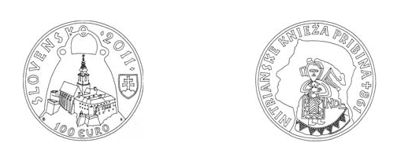

## 339

OZNÁMENIE

Národnej banky Slovenska

z 27. septembra 2011

o vydaní zlatých zberateľských euromincí v nominálnej hodnote 100 eur na pripomenutie nitrianskeho kniežaťa Pribinu pri príležitosti 1 150. výročia jeho úmrtia

1. Úvodné ustanovenia

a) Národná banka Slovenska podľa § 17h ods. 1 zákona Národnej rady Slovenskej republiky č. 566/1992 Zb. o Národnej banke Slovenska v znení neskorších predpisov a podľa § 1 ods. 2 písm. d) zákona Národnej rady Slovenskej republiky č. 1/1993 Z. z. o Zbierke zákonov Slovenskej republiky v znení zákona č. 275/2002 Z. z. oznamuje, že na pripomenutie nitrianskeho kniežaťa Pribinu vydáva do obehu pri príležitosti 1 150. výročia jeho úmrtia zlaté zberateľské euromince v nominálnej hodnote 100 eur (ďalej len „zberateľská eurominca“).

b) Zberateľská eurominca má štatút zákonného platidla len v Slovenskej republike.

c) Zberateľská eurominca sa razí zo zliatiny obsahujúcej 900 dielov zlata, 75 dielov striebra a 25 dielov medi; jej hmotnosť je 9,5 g a priemer 26 mm. Pri razbe euromince je povolená horná a dolná odchýlka v priemere 0,1 mm; povolená horná odchýlka v hmotnosti je 0,08 g a v obsahu zlata 10/1000.

2. Vzhľad zberateľskej euromince

a) Na líci zberateľskej euromince je vyobrazená silueta bronzového zvona z obdobia Nitrianskeho kniežatstva pochádzajúceho z archeologického náleziska v Bojnej. V strede zvona je vyobrazený Nitriansky hrad v súčasnej podobe. Pri ľavom okraji zberateľskej euromince je v opise zľava doprava názov štátu „SLOVENSKO“, za ktorým je letopočet „2011“ umiestnený medzi dvoma grafickými značkami. Pri pravom okraji zberateľskej euromince je štátny znak Slovenskej republiky. V spodnej časti mincového poľa je označenie nominálnej hodnoty „100 EURO“. Značka Mincovne Kremnica, štátny podnik, ktorú tvorí skratka „MK“ umiestnená medzi dvoma razidlami, je vľavo od nominálnej hodnoty zberateľskej euromince a štylizované iniciálky mena a priezviska autora výtvarného návrhu akad. soch. Ivana Řeháka „IŘ“ sú vpravo od nej.

b) Na rube zberateľskej euromince je vyobrazená silueta fiktívneho portrétu nitrianskeho kniežaťa Pribinu. V strede portrétu je vyobrazený motív fragmentu pozlátenej plakety z prenosného oltára z obdobia Nitrianskeho kniežatstva pochádzajúceho z archeologického náleziska v Bojnej. V opise zľava doprava je umiestnený nápis „NITRIANSKE KNIEŽA PRIBINA“ a za ním rok Pribinovho úmrtia „†861“.

c) Hrana zberateľskej euromince je vrúbkovaná.

Štát vydania: Slovenská republika

Začiatok vydávania: december 2011

Jozef Makúch v. r.
