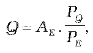

# § 1

(1) Ročná výroba tepla pre zariadenie výrobcu elektriny, ktoré vyrába elektrinu spaľovaním bioplynu získaného anaeróbnou fermentáciou (ďalej len „zariadenie“), sa na účely posúdenia percentuálneho podielu dodávky využiteľného tepla vypočíta podľa vzorca:

pričom

Q – výroba tepla v megawatthodinách za rok,

AE – výroba elektriny v megawatthodinách za rok meraná na svorkách generátora zariadenia,

PQ – projektovaný inštalovaný tepelný výkon zariadenia v megawattoch; pri spaľovacom motore uvedený ako súčet využiteľného tepelného výkonu meraného na výstupe chladiacej kvapaliny motora a na výstupe výfukových plynov z motora,

PE – projektovaný inštalovaný elektrický výkon zariadenia v megawattoch.

(2) Do percentuálneho posúdenia podielu dodávky využiteľného tepla z ročnej výroby tepla sa započítava technologická spotreba tepla, najviac však do 25 % z ročnej výroby tepla.

(3) Ak nie je technologická spotreba tepla zariadenia meraná, vypočíta sa podľa vzorca:

QTS = 0,15.Q,

pričom

QTS – technologická spotreba tepla zariadenia v megawatthodinách za rok.

(4) Technologickou spotrebou tepla je množstvo tepla, ktoré je vyrobené v zariadení a spotrebované na výrobu bioplynu alebo uskladnenie bioplynu.

(5) Do percentuálneho posúdenia podielu dodávky využiteľného tepla z ročnej výroby tepla sa nezapočítava teplo využité pri výrobe elektriny.
