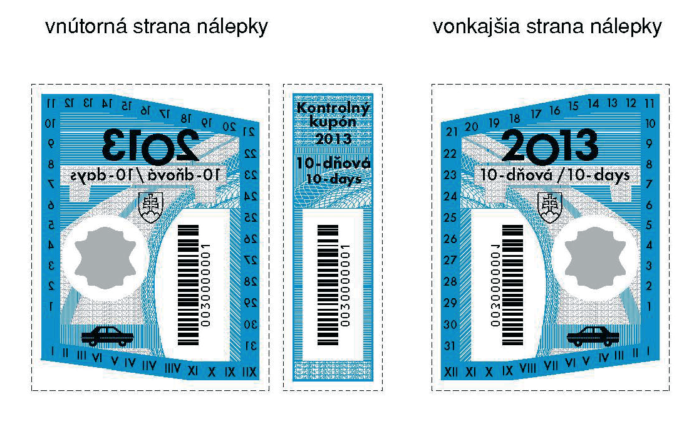
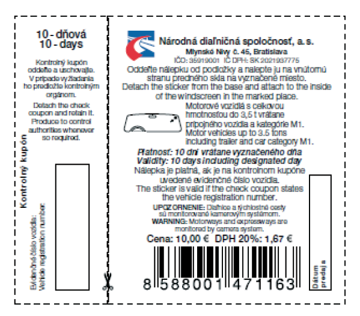

Príloha č. 3 k vyhláške č. 410/2011 Z. z.

- VZOR NÁLEPKY

- s 10-dňovou dobou platnosti pre dvojstopové motorové vozidlá a jazdné súpravy do 3,5 t a dvojstopové motorové vozidlá kategórie M1 bez ohľadu na ich celkovú hmotnosť

- VZOR TEXTU NA PAPIEROVEJ PODLOŽKE NÁLEPKY

- s 10-dňovou dobou platnosti pre dvojstopové motorové vozidlá a jazdné súpravy do 3,5 t a dvojstopové motorové vozidlá kategórie M1 bez ohľadu na ich celkovú hmotnosť

