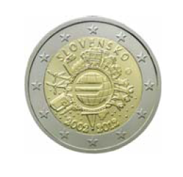

## 414

OZNÁMENIE

Národnej banky Slovenska

z 25. októbra 2011

## o vydaní pamätných euromincí v nominálnej hodnote 2 eurá pri príležitosti 10. výročia zavedenia hotovostnej meny euro

1. Úvodné ustanovenia

a) Národná banka Slovenska podľa § 17h ods. 1 zákona Národnej rady Slovenskej republiky č. 566/1992 Zb. o Národnej banke Slovenska v znení neskorších predpisov a podľa § 1 ods. 2 písm. d) zákona Národnej rady Slovenskej republiky č. 1/1993 Z. z. o Zbierke zákonov Slovenskej republiky v znení zákona č. 275/2002 Z. z. oznamuje, že pri príležitosti 10. výročia zavedenia hotovostnej meny euro vydáva do obehu pamätné euromince v nominálnej hodnote 2 eurá (ďalej len „pamätná eurominca“).

b) Pamätná eurominca má rovnaké technické parametre ako obehové euromince1) a na jej národnej strane bude použitý pamätný motív [bod 2 písm. b)].

c) Pamätná eurominca má v celej eurozóne štatút zákonného platidla.

2. Vzhľad pamätnej euromince

a) Pamätná eurominca sa vydáva s novou spoločnou európskou stranou.2)

b) Na národnej strane pamätnej euromince je v strede mincového poľa kompozícia glóbusu so znakom eura „€“ symbolizujúca postavenie meny euro ako celosvetovo používanej a akceptovanej meny. Po obvode glóbusu sú umelecky vyobrazené súčasti niektorých oblastí každodenného života, v ktorých zohráva mena euro význam – v živote ľudí, ktorých symbolizuje mávajúca rodina a skupina obytných budov a stromov, oblasť obchodu symbolizuje loď, oblasť bankovníctva budova Európskej centrálnej banky so znakom eura „€“, oblasť energetiky dve veterné elektrárne a priemyselná budova. V hornej časti pamätnej euromince je v opise vnútorného kruhu zľava doprava nápis „SLOVENSKO“ a v spodnej časti sú letopočty „2002 – 2012“. Značka Mincovne Kremnica, štátny podnik, ktorú tvorí skratka „MK“ umiestnená medzi dvoma razidlami, je v pravej časti pamätnej euromince a iniciálky autora výtvarného návrhu národnej strany pamätnej euromince Helmuta Andexlingera „A.H.“ sú v ľavej spodnej časti kompozície medzi budovou Európskej centrálnej banky a loďou. Pri okraji pamätnej euromince je dvanásť do kruhu umiestnených hviezd Európskej únie.

c) Na hrane pamätnej euromince je nápis „SLOVENSKÁ REPUBLIKA“. Začiatok a koniec nápisu je oddelený dvoma hviezdami, medzi ktorými je lipový list.

Štát vydania: Slovenská republika

Začiatok vydávania: január 2012

Jozef Makúch v. r.
