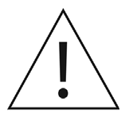

# Čl. I

Nariadenie vlády Slovenskej republiky č. 658/2005 Z. z., ktorým sa ustanovujú požiadavky na kozmetické výrobky v znení nariadenia vlády Slovenskej republiky č. 538/2006 Z. z., nariadenia vlády Slovenskej republiky č. 108/2007 Z. z., nariadenia vlády Slovenskej republiky č. 418/2007 Z. z., nariadenia vlády Slovenskej republiky č. 124/2008 Z. z., nariadenia vlády Slovenskej republiky č. 374/2008 Z. z., nariadenia vlády Slovenskej republiky č. 141/2009 Z. z., nariadenia vlády Slovenskej republiky č. 522/2009 Z. z., nariadenia vlády Slovenskej republiky č. 81/2010 Z. z. a nariadenia vlády Slovenskej republiky č. 287/2010 Z. z. sa mení a dopĺňa takto:

- 1. Za § 17i sa vkladá § 17j, ktorý vrátane nadpisu znie:

- 㤠17j

- Prechodné ustanovenie k úpravám účinným od 3. januára 2012

- Kozmetické výrobky, ktoré obsahujú látky uvedené v prílohe č. 3 časti 2 pod referenčnými číslami 10 a 50 umiestnené na trh do 2. januára 2012, sa považujú za kozmetické výrobky podľa tohto nariadenia vlády v znení účinnom do 2. januára 2012.“.

- 2. Príloha č. 2 sa dopĺňa referenčným číslom 1372, ktoré znie:

- „1372 2-aminofenol (o-Aminophenol **, CI 76520) a jeho soli (CAS 95-55-6 / 67845-79-8 / 51-19-4, EINECS 202-431-1 / 267-335-4)“.

- 3. V prílohe č. 3 časti 1 referenčné číslo 201 znie:

- „

- Ref. číslo | Látka | O b m e d z e n i a | | | Podmienky použitia a upozornenia, ktoré musia byť uvedené na obale kozmetického výrobku

- | | Oblasť aplikácie/použitia | Najvyššia prípustná koncentrácia v kozmetickom výrobku v hmotnostných percentách | Ďalšie obmedzenia a požiadavky |

- a | b | c | d | e | f

- 201 | 2-chlór-6-(etylamín)- 4-nitrofenol 2-Chloro-6-ethylamino-4-nitrophenol ** CAS 131657-78-8 EINECS 411-440-1 | a) Látka na farbenie vlasov v oxidačných výrobkoch na farbenie vlasov b) Látka na farbenie vlasov v neoxidačných výrobkoch na farbenie vlasov | b) 3,0 % | a) Po zmiešaní v oxidačných podmienkach najvyššia prípustná koncentrácia aplikovaná na vlasy nesmie presiahnuť 1,5 % hm. a) a b): – Nepoužívajte s nitrozačnými činidlami. – Maximálny obsah nitrozamínov: 50 μg/kg. – Skladujte v nádobách neobsahujúcich dusitany. | a) Zmiešavací pomer musí byť uvedený na obale.

- “.

- 4. V prílohe č. 3 časti 1 sa dopĺňajú referenčné čísla 215 až 218, 222, 223, 225, 227, 230, 232, 234, 237 až 239, 241 až 246, 248 až 252, ktoré znejú:

- „

- Ref. číslo | Látka | O b m e d z e n i a | | | Podmienky použitia a upozornenia, ktoré musia byť uvedené na obale kozmetického výrobku

- | | Oblasť aplikácie/použitia | Najvyššia prípustná koncentrácia v kozmetickom výrobku v hmotnostných percentách | Ďalšie obmedzenia a požiadavky |

- a | b | c | d | e | f

- 215 | 4-amino-3-nitrofenol 4-amino-3-nitrophenol ** CAS 610-81-1 EINECS 210-236-8 | a) Látka na farbenie vlasov v oxidačných výrobkoch na farbenie vlasov b) Látka na farbenie vlasov v neoxidačných výrobkoch na farbenie vlasov | b) 1,0 % hm. | a) Po zmiešaní v oxidačných podmienkach najvyššia prípustná koncentrácia aplikovaná na vlasy nesmie presiahnuť 1,5 % hm. | a) Zmiešavací pomer musí byť uvedený na obale. b)  Farby na vlasy môžu vyvolať vážne alergické reakcie. Prečítajte si pokyny a dodržiavajte ich. Tento výrobok nie je určený pre osoby mladšie ako 16 rokov. Dočasné tetovanie čiernou henou môže zvýšiť riziko alergie. Nefarbite si vlasy, ak: – máte na tvári vyrážky alebo máte citlivú, podráždenú alebo poškodenú pokožku hlavy, – ste v minulosti zaznamenali reakciu po farbení vlasov, – ste v minulosti zaznamenali reakciu na dočasné tetovanie čiernou henou.

- 216 | Naftalén-2,7-diol 2,7-Naphthalenediol ** CAS 582-17-2 EINECS 209-478-7 | a) Látka na farbenie vlasov v oxidačných výrobkoch na farbenie vlasov b) Látka na farbenie vlasov v neoxidačných výrobkoch na farbenie vlasov | b) 1,0 % hm. | a) Po zmiešaní v oxidačných podmienkach najvyššia prípustná koncentrácia aplikovaná na vlasy nesmie presiahnuť 1,0 % hm. | a) Zmiešavací pomer musí byť uvedený na obale.

- 217 | 3-aminofenol m-Aminophenol ** CAS 591-27-5 EINECS 209-711-2 a jeho soli 3-hydroxyanilínium-chlorid m-Aminophenol HCl ** CAS 51-81-0 EINECS 200-125-2 | Látka na farbenie vlasov v oxidačných výrobkoch na farbenie vlasov | | Po zmiešaní v oxidačných podmienkach najvyššia prípustná koncentrácia aplikovaná na vlasy nesmie presiahnuť 1,2 % hm. | Zmiešavací pomer musí byť uvedený na obale.

- | Bis(3- hydroxyfenylamónium)sulfát m-Aminophenol sulfate ** CAS 68239-81-6 EINECS 269-475-1 Sodium m-Aminophenol ** CAS 38171-54-9 | | | |

- 218 | 6-hydroxy-3,4-dimetyl-2-pyridón 2,6-Dihydroxy-3,4- dimethylpyridine ** CAS 84540-47-6 EINECS 283-141-2 | Látka na farbenie vlasov v oxidačných výrobkoch na farbenie vlasov | | Po zmiešaní v oxidačných podmienkach najvyššia prípustná koncentrácia aplikovaná na vlasy nesmie presiahnuť 1,0 % hm. | Zmiešavací pomer musí byť uvedený na obale.

- 222 | 2-(2-hydroxy-3,5- dinitroanilín)etanol 2-Hydroxyethyl picramic acid ** CAS 99610-72-7 EINECS 412-520-9 | a) Látka na farbenie vlasov v oxidačných výrobkoch na farbenie vlasov b) Látka na farbenie vlasov v neoxidačných výrobkoch na farbenie vlasov | b) 2,0 % hm. | a) Po zmiešaní v oxidačných podmienkach najvyššia prípustná koncentrácia aplikovaná na vlasy nesmie presiahnuť 1,5 % hm. a) a b): – Nepoužívajte s nitrozačnými činidlami. – Najvyššie prípustný obsah nitrozamínov 50 μg/kg. – Skladujte v nádobách neobsahujúcich dusitany. | a) Zmiešavací pomer musí byť uvedený na obale.

- 223 | (4-metylamino)fenol p-Methylaminophenol ** CAS 150-75-4 EINECS 205-768-2 a jeho sulfát bis(4-hydroxy-N- metylanilínium)sulfát / 4-(metalamino) fenol, soľ s kyselinou sírovou p-Methylaminophenol sulfate ** CAS 55-55-0/1936-57-8 EINECS 200-237-1 / 217-706-1 | Látka na farbenie vlasov v oxidačných výrobkoch na farbenie vlasov | | Po zmiešaní v oxidačných podmienkach najvyššia prípustná koncentrácia aplikovaná na vlasy nesmie presiahnuť 0,68 % hm. vyjadrených v prepoete na sulfát. – Nepoužívajte s nitrozačnými činidlami. – Maximálny obsah nitrozamínov 50 μ/kg. – Skladujte v nádobách neobsahujúcich dusitany. | Zmiešavací pomer musí byť uvedený na obale.

- 225 | Etanol, 2-[4-[etyl[(2- hydroxyetyl)amino]- 2-nitrofenyl]amino]- CAS 104516- 93-0 a jeho hydrochlorid 4[N-etyl-N-(2- hydroxyetyl)amín]-1-(2-hydroxyetyl)amín-2-nitrobenzén monohydrochlorid HC Blue No 12 ** CAS 132885-85-9 EINECS 407-020-2 | a) Látka na farbenie vlasov v oxidačných výrobkoch na farbenie vlasov b) Látka na farbenie vlasov v neoxidačných výrobkoch na farbenie vlasov | b) 1,5 % hm. vyjadreného v prepočte na hydrochlorid | a) Po zmiešaní v oxidačných podmienkach najvyššia prípustná koncentrácia aplikovaná na vlasy nesmie presiahnuť 0,75 % hm. vyjadreného v prepočte na hydrochlorid. | a) Zmiešavací pomer musí byť uvedený na obale.

- | | | | a) a b): – Nepoužívajte s nitrozačnými činidlami. – Najvyššie prípustný obsah nitrozamínov 50 μg/kg. – Skladujte v nádobách neobsahujúcich dusitany. |

- 227 | 3-amino-2,4- dichlórfenol 3-Amino-2,4- dichlorophenol ** CAS 61693-42-3 EINECS 262-909-0 a jeho hydrochlorid 3-Amino-2,4- dichlorophenol HCl ** CAS 61693-43-4 | a) Látka na farbenie vlasov v oxidačných výrobkoch na farbenie vlasov b) Látka na farbenie vlasov v neoxidačných výrobkoch na farbenie vlasov | b) 1,5 % hm. vyjadreného v prepočte na hydrochlorid | a) Po zmiešaní v oxidačných podmienkach najvyššia prípustná koncentrácia aplikovaná na vlasy nesmie presiahnuť 1,5 % hm. vyjadreného v prepočte na hydrochlorid. | a) Zmiešavací pomer musí byť uvedený na obale.

- 230 | 1-fenyl-3-metylpyrazol-5-ón Phenyl methyl pyrazolone ** CAS 89-25-8 EINECS 201-891-0 | Látka na farbenie vlasov v oxidačných výrobkoch na farbenie vlasov | | Po zmiešaní v oxidačných podmienkach najvyššia prípustná koncentrácia aplikovaná na vlasy nesmie presiahnuť 0,25 % hm. | Zmiešavací pomer musí byť uvedený na obale.

- 232 | 5-[(2-hydroxyetyl) amino]-2-metylfenol 2-Methyl-5- hydroxyethylaminophenol ** CAS 55302-96-0 EINECS 259-583-7 | Látka na farbenie vlasov v oxidačných výrobkoch na farbenie vlasov | | Po zmiešaní v oxidačných podmienkach maximálna koncentrácia aplikovaná na vlasy nesmie presiahnuť 1,5 % hm. – Nepoužívajte s nitrozačnými činidlami. – Najvyššie prípustný obsah nitrozamínov 50 μg/kg. – Skladujte v nádobách neobsahujúcich dusitany. | Zmiešavací pomer musí byť uvedený na obale.

- 234 | 3,4-dihydro-2H-1,4- benzoxazín-6-ol Hydroxybenzomorpholine ** CAS 26021-57-8 EINECS 247-415-5 | Látka na farbenie vlasov v oxidačných výrobkoch na farbenie vlasov | | Po zmiešaní v oxidačných podmienkach najvyššia prípustná koncentrácia aplikovaná na vlasy nesmie presiahnuť 1,0 % hm. – Nepoužívajte s nitrozačnými činidlami. – Najvyššie prípustný obsah nitrozamínov 50 μg/kg. – Skladujte v nádobách neobsahujúcich dusitany. | Zmiešavací pomer musí byť uvedený na obale.

- 237 | 2,2’-[(4-amino-3- nitrofenyl) imino]bisetanol 2,2’-[(4-Amino-3- nitrofenyl)imino] bisetanol ** CAS 29705-39-3 a jeho hydrochlorid 2,2’-[(4-amino-3- nitrofenyl)imino] bisetanol, hydrochlorid HC Red No 13 ** CAS 94158-13-1 EINECS 303-083-4 | a) Látka na farbenie vlasov v oxidačných výrobkoch na farbenie vlasov b) Látka na farbenie vlasov v neoxidačných výrobkoch na farbenie vlasov | b) 2,5 % hm. vyjadreného v prepočte na hydrochlorid | Po zmiešaní v oxidačných podmienkach najvyššia prípustná koncentrácia aplikovaná na vlasy nesmie presiahnuť 1,25 % hm. vyjadreného v prepočte na hydrochlorid. | a) Zmiešavací pomer musí byť uvedený na obale.

- 238 | 2,6-dimetoxy-3,5- pyridíndiamín 2,6-Dimethoxy-3,5- pyridinediamine ** CAS 85679-78-3 (voľná báza) a jeho hydrochlorid 3,5-diamino-2,6- dimetoxypyridín, dihydrochlorid 2,6-Dimethoxy-3,5- pyridinediamine HCl ** CAS 56216-28-5 EINECS 260-062-1 | Látka na farbenie vlasov v oxidačných výrobkoch na farbenie vlasov | | Po zmiešaní v oxidačných podmienkach najvyššia prípustná koncentrácia aplikovaná na vlasy nesmie presiahnuť 0,25 % hm. vyjadreného v prepočte na hydrochlorid. | Zmiešavací pomer musí byť uvedený na obale.

- 239 | HC Violet No 1 ** CAS 82576-75-8 EINECS 417-600-7 | a) Látka na farbenie vlasov v oxidačných výrobkoch na farbenie vlasov b) Látka na farbenie vlasov v neoxidačných výrobkoch na farbenie vlasov | b) 0,28 % hm. | a) Po zmiešaní v oxidačných podmienkach najvyššia prípustná koncentrácia aplikovaná na vlasy nesmie presiahnuť 0,25 % hm. a) a b): – Nepoužívajte s nitrozačnými činidlami. – Najvyššie prípustný obsah nitrozamínov 50 μg/kg. – Skladujte v nádobách neobsahujúcich dusitany. | a) Zmiešavací pomer musí byť uvedený na obale. b)  Farby na vlasy môžu vyvolať vážne alergické reakcie. Prečítajte si pokyny a dodržiavajte ich. Tento výrobok nie je určený pre osoby mladšie ako 16 rokov. Dočasné tetovanie čiernou henou môže zvýšiť riziko alergie. Nefarbite si vlasy, ak: – máte na tvári vyrážky alebo máte citlivú, podráždenú alebo poškodenú pokožku hlavy, – ste v minulosti zaznamenali reakciu po farbení vlasov, – ste v minulosti zaznamenali reakciu na dočasné tetovanie čiernou henou.

- 241 | Naftalén-1,5-diol 1,5-Naphthalenediol ** CAS 83-56-7 EINECS 201-487-4 | a) Látka na farbenie vlasov v oxidačných výrobkoch na farbenie vlasov b) Látka na farbenie vlasov v neoxidačných výrobkoch na farbenie vlasov | b) 1,0 % hm. | a) Po zmiešaní v oxidačných podmienkach najvyššia prípustná koncentrácia aplikovaná na vlasy nesmie presiahnuť 1,0 % hm. | a) Zmiešavací pomer musí byť uvedený na obale.

- 242 | Hydroxypropyl bis(N-hydroxyetyl-p- fenyléndiamín) Hydroxypropyl bis(N-hydroxyethyl-p-phenylenediamine ** CAS 128729-30-6 a jeho tetrahydrochlorid Hydroxypropyl bis(N-hydroxyethyl-p-phenylenediamine) HCl ** CAS 128729-28-2 EINECS 416-320-2 | Látka na farbenie vlasov v oxidačných výrobkoch na farbenie vlasov | | Po zmiešaní v oxidačných podmienkach najvyššia prípustná koncentrácia aplikovaná na vlasy nesmie presiahnuť 0,4 % hm. vyjadreného v prepočte na tetrahydrochlorid. | Zmiešavací pomer musí byť uvedený na obale.

- 243 | 5-amino-2-metylfenol 4-Amino-2- hydroxytoluene ** CAS 2835-95-2 EINECS 220-618-6 | Látka na farbenie vlasov v oxidačných výrobkoch na farbenie vlasov | | Po zmiešaní v oxidačných podmienkach najvyššia prípustná koncentrácia aplikovaná na vlasy nesmie presiahnuť 1,5 % hm. | Zmiešavací pomer musí byť uvedený na obale.

- 244 | 2,4- diaminofenoxyetanol 2,4- Diaminophenoxyethanol ** CAS 70643-19-5 a jeho hydrochlorid a jeho sulfát 2,4- diaminofenoxyetanol, dihydrochlorid 2,4- Diaminophenoxyethanol HCl ** CAS 66422-95-5 EINECS 266-357-1 [4-(2hydroxyetoxy)- 1,3-fenylén]diamónium -sulfát 2,4- Diaminophenoxyethanol sulfate ** CAS 70643-20-8 EINECS 274-713-2 | Látka na farbenie vlasov v oxidačných výrobkoch na farbenie vlasov | | Po zmiešaní v oxidačných podmienkach najvyššia prípustná koncentrácia aplikovaná na vlasy nesmie presiahnuť 2,0 % hm. vyjadreného v prepočte na hydrochlorid. | Zmiešavací pomer musí byť uvedený na obale.

- 245 | 2-metylbenzén-1,3- diol 2-Methylresorcinol ** CAS 608-25-3 EINECS 210-155-8 | a) Látka na farbenie vlasov v oxidačných výrobkoch na farbenie vlasov b) Látka na farbenie vlasov v neoxidačných výrobkoch na farbenie vlasov | b) 1,8 % hm. | a) Po zmiešaní v oxidačných podmienkach najvyššia prípustná koncentrácia aplikovaná na vlasy nesmie presiahnuť 1,8 % hm. | a) Zmiešavací pomer musí byť uvedený na obale.

- 246 | 4-amino-3-metylfenol 4-Amino-m-cresol ** CAS 2835-99-6 EINECS 220-621-2 | Látka na farbenie vlasov v oxidačných výrobkoch na farbenie vlasov | | Po zmiešaní v oxidačných podmienkach najvyššia prípustná koncentrácia aplikovaná na vlasy nesmie presiahnuť 1,5 % hm. | Zmiešavací pomer musí byť uvedený na obale.

- 248 | 2-[3-amino-4- metoxyfenyl) amino]etanol 2-Amino-4- hydroxyethylaminoanisole ** CAS 83763-47-7 EINECS 280-733-2 a jeho sulfát (3-amónio-4- metoxyfenyl)(2- hydroxyetyl)amónium-sulfát 2-Amino-4- hydroxyethylaminoanisole sulfate ** CAS 83763-48-8 EINECS 280-734-8 | Látka na farbenie vlasov v oxidačných výrobkoch na farbenie vlasov | | Po zmiešaní v oxidačných podmienkach najvyššia prípustná koncentrácia aplikovaná na vlasy nesmie presiahnuť 1,5 % hm. vyjadreného v prepočte na sulfát. – Nepoužívajte s nitrozačnými činidlami. – Najvyššie prípustný obsah nitrozamínov 50 μg/kg. – Skladujte v nádobách neobsahujúcich dusitany. | Zmiešavací pomer musí byť uvedený na obale.

- 249 | Hydroxyetyl-3,4- metyléndioxyanilín a jeho hydrochlorid Hydroxyethyl-3,4- methylenedioxyaniline HCl ** CAS 94158-14-2 EINECS 303-085-5 | Látka na farbenie vlasov v oxidačných výrobkoch na farbenie vlasov | | Po zmiešaní v oxidačných podmienkach najvyššia prípustná koncentrácia aplikovaná na vlasy nesmie presiahnuť 1,5 % hm. – Nepoužívajte s nitrozačnými činidlami. – Najvyššie prípustný obsah nitrozamínov 50 μg/kg. – Skladujte v nádobách neobsahujúcich dusitany. | Zmiešavací pomer musí byť uvedený na obale.

- 250 | 4-[(2-hydroxyetyl) amino]-3-nitofenol 3-Nitro-p- hydroxyethylaminophenol ** CAS 65235-31-6 EINECS 265-648-0 | a) Látka na farbenie vlasov v oxidačných výrobkoch na farbenie vlasov b) Látka na farbenie vlasov v neoxidačných výrobkoch na farbenie vlasov | b) 1,85 % hm. | a) Po zmiešaní v oxidačných podmienkach najvyššia prípustná koncentrácia aplikovaná na vlasy nesmie presiahnuť 3,0 % hm. a) a b): – Nepoužívajte s nitrozačnými systémami. – Najvyššie prípustný obsah nitrozamínov 50 μg/kg. – Skladujte v nádobách neobsahujúcich dusitany. | a) Zmiešavací pomer musí byť uvedený na obale. b) Farby na vlasy môžu vyvolať vážne alergické reakcie. Prečítajte si pokyny a dodržiavajte ich. Tento výrobok nie je určený pre osoby mladšie ako 16 rokov. Dočasné tetovanie čiernou henou môže zvýšiť riziko alergie. Nefarbite si vlasy, ak: – máte na tvári vyrážky alebo máte citlivú, podráždenú alebo poškodenú pokožku hlavy, – ste v minulosti zaznamenali reakciu po farbení vlasov, – ste v minulosti zaznamenali reakciu na dočasné tetovanie čiernou henou.

- 51 | [2-[(4-nitrofenyl) amin]etyl]močovina 4-Nitrophenyl aminoethylurea ** CAS 27080-42-8 EINECS 410-700-1 | a) Látka na farbenie vlasov v oxidačných výrobkoch na farbenie vlasov b) Látka na farbenie vlasov v neoxidačných výrobkoch na farbenie vlasov | b) 0,5 % hm. | a) Po zmiešaní v oxidačných podmienkach najvyššia prípustná koncentrácia aplikovaná na vlasy nesmie presiahnuť 0,25 % hm. a) a b): – Nepoužívajte s nitrozačnými činidlami. – Najvyššie prípustný obsah nitrozamínov 50 μg/kg. – Skladujte v nádobách neobsahujúcich dusitany. | a) Zmiešavací pomer musí byť uvedený na obale.

- 252 | 2-amino-4-chlór-6- nitrofenol 2-Amino-6-chloro-4- nitrophenol ** CAS 6358-09-4 EINECS 228-762-1 | a) Látka na farbenie vlasov v oxidačných výrobkoch na farbenie vlasov b) Látka na farbenie vlasov v neoxidačných výrobkoch na farbenie vlasov | b) 2,0 % hm. | a) Po zmiešaní v oxidačných podmienkach najvyššia prípustná koncentrácia aplikovaná na vlasy nesmie presiahnuť 2,0 % hm. | a) Zmiešavací pomer musí byť uvedený na obale. b) Farby na vlasy môžu vyvolať vážne alergické reakcie. Prečítajte si pokyny a dodržiavajte ich. Tento výrobok nie je určený pre osoby mladšie ako 16 rokov. Dočasné tetovanie čiernou henou môže zvýšiť riziko alergie. Nefarbite si vlasy, ak: – máte na tvári vyrážky alebo máte citlivú, podráždenú alebo poškodenú pokožku hlavy, – ste v minulosti zaznamenali reakciu po farbení vlasov, – ste v minulosti zaznamenali reakciu na dočasné tetovanie čiernou henou.

- “.

- 5. V prílohe č. 3 časti 2 sa vypúšťajú referenčné čísla 3 až 6, 11, 12, 16, 19 až 22, 25, 27, 31 až 39, 44, 48, 49, 55 a 56.

- 6. V prílohe č. 3 časti 2 stĺpci g pre referenčné čísla 10 a 50 sa slová „31. 12. 2010“ nahrádzajú slovami „31. 12. 2011“.

- 7. Príloha č. 17 sa dopĺňa bodom 73, ktorý znie:

- „73. Smernica Komisie 2011/59/EÚ z 13. mája 2011, ktorou sa mení a dopĺňa smernica Rady 76/768/EHS týkajúca sa kozmetických výrobkov s cieľom prispôsobiť jej prílohy II a III technickému pokroku (Ú. v. EÚ L 125, 14. 5. 2011).“.
