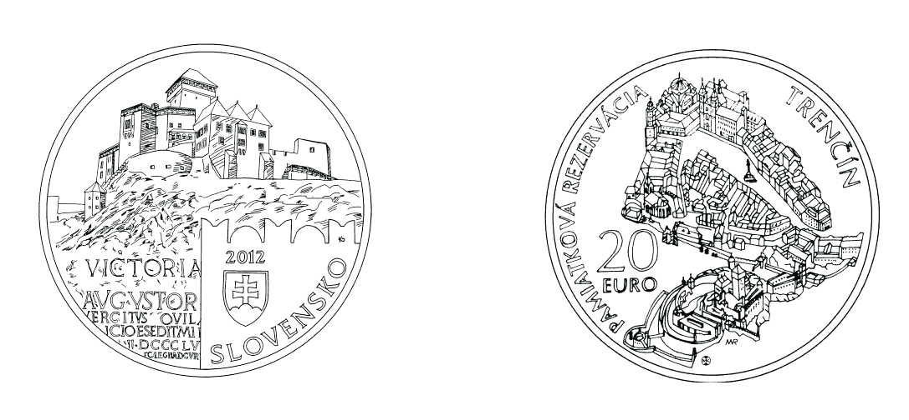

465

OZNÁMENIE

Národnej banky Slovenska

z 29. novembra 2011

## o vydaní strieborných zberateľských euromincí v nominálnej hodnote 20 eur s tematikou pamiatkovej rezervácie Trenčín

1. Úvodné ustanovenia

a) Národná banka Slovenska podľa § 17h ods. 1 zákona Národnej rady Slovenskej republiky č. 566/1992 Zb. o Národnej banke Slovenska v znení neskorších predpisov a podľa § 1 ods. 2 písm. d) zákona Národnej rady Slovenskej republiky č. 1/1993 Z. z. o Zbierke zákonov Slovenskej republiky v znení zákona č. 275/2002 Z. z. oznamuje, že vydáva do obehu strieborné zberateľské euromince v nominálnej hodnote 20 eur s tematikou pamiatkovej rezervácie Trenčín (ďalej len „zberateľská eurominca“).

b) Zberateľská eurominca má štatút zákonného platidla len v Slovenskej republike.

c) Zberateľská eurominca sa razí zo zliatiny obsahujúcej 925 dielov striebra a 75 dielov medi; jej hmotnosť je 33,63 g a priemer 40 mm. Pri razbe zberateľskej euromince je povolená horná a dolná odchýlka v priemere 0,1 mm; povolená horná odchýlka v hmotnosti je 0,4 g a v obsahu striebra 10/1000.

2. Vzhľad zberateľskej euromince

a) Na líci zberateľskej euromince je vyobrazený Trenčiansky hrad doplnený fragmentom rímskeho nápisu zachovaného na trenčianskej hradnej skale a siluetou hradieb. V spodnej časti mincového poľa je umiestnený štátny znak Slovenskej republiky, nad ktorým je letopočet „2012“. Názov štátu „SLOVENSKO“ je v opise zľava doprava pod štátnym znakom. Štylizované iniciálky mena a priezviska autora výtvarného návrhu lícnej strany zberateľskej euromince Karola Lička „KL“ sú pri jej pravom okraji.

b) Na rube zberateľskej euromince je vyobrazená pamiatková rezervácia Trenčín. Pri ľavom okraji zberateľskej euromince je v opise zľava doprava nápis „PAMIATKOVÁ REZERVÁCIA“ a pri jej pravom okraji je nápis „TRENČÍN“. Označenie nominálnej hodnoty zberateľskej euromince „20 EURO“ je v ľavej spodnej časti mincového poľa. Značka Mincovne Kremnica, štátny podnik, ktorú tvorí skratka „MK“ umiestnená medzi dvoma razidlami, a štylizované iniciálky mena a priezviska autora výtvarného návrhu rubovej strany zberateľskej euromince Miroslava Rónaia „MR“ sú v spodnej časti mincového poľa.

c) Na hrane mince je reliéfny nápis „NAJKRAJŠIE HISTORICKÉ MESTÁ“. Začiatok a koniec textu je oddelený vyobrazením štylizovaného kľúča.

Štát vydania: Slovenská republika

Začiatok vydávania: marec 2012

Jozef Makúch v. r.
