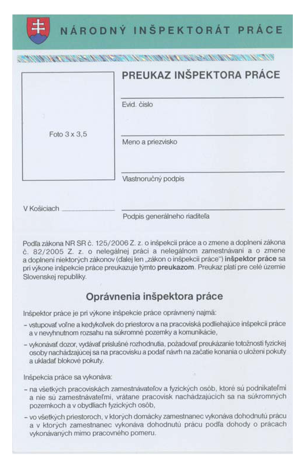

# Čl. I

Zákon č. 125/2006 Z. z. o inšpekcii práce a o zmene a doplnení zákona č. 82/2005 Z. z. o nelegálnej práci a nelegálnom zamestnávaní a o zmene a doplnení niektorých zákonov v znení zákona č. 309/2007 Z. z., zákona č. 462/2007 Z. z., zákona č. 555/2007 Z. z., zákona č. 400/2009 Z. z., zákona č. 52/2010 Z. z., zákona č. 67/2010 Z. z., zákona č. 182/2011 Z. z., zákona č. 223/2011 Z. z., zákona č. 254/2011 Z. z. a zákona č. 257/2011 Z. z. sa mení a dopĺňa takto:

- 1. V § 1 písm. b) sa na konci pripájajú tieto slová: „(ďalej len „dohľad“)“.

- 2. V § 2 ods. 1 písm. a) šiestom bode sa slová „práce, ktoré sú na základe rozhodnutia orgánu na ochranu zdravia zaradené do kategórie 3 alebo 4,“ nahrádzajú slovami „práce zaradené orgánom štátnej správy na úseku verejného zdravotníctva do tretej kategórie alebo štvrtej kategórie podľa osobitného predpisu,3b)“.

- Poznámka pod čiarou k odkazu 3b znie:

- „3b)

- § 31 zákona č. 355/2007 Z. z. o ochrane, podpore a rozvoji verejného zdravia a o zmene a doplnení niektorých zákonov.“.

- 3. V § 2 sa za odsek 2 vkladá nový odsek 3, ktorý znie:

- „(3)

- Zamestnávateľom na účely výkonu inšpekcie práce podľa odseku 1 písm. a) štvrtého bodu je aj fyzická osoba alebo právnická osoba, ktoré nelegálne zamestnávajú fyzickú osobu.“.

- Doterajšie odseky 3 až 5 sa označujú ako odseky 4 až 6.

- 4. V § 2 ods. 4 sa slová „Zboru väzenskej a justičnej stráže Slovenskej republiky“ nahrádzajú slovami „Zboru väzenskej a justičnej stráže“.

- 5. V § 3 sa slová „ods. 3“ nahrádzajú slovami „ods. 4“.

- 6. Poznámka pod čiarou k odkazu 10 znie:

- „10)

- Napríklad zákon č. 124/2006 Z. z. o bezpečnosti a ochrane zdravia pri práci a o zmene a doplnení niektorých zákonov v znení neskorších predpisov, nariadenie vlády Slovenskej republiky č. 392/2006 Z. z. o minimálnych bezpečnostných a zdravotných požiadavkách pri používaní pracovných prostriedkov, nariadenie vlády Slovenskej republiky č. 395/2006 Z. z. o minimálnych požiadavkách na poskytovanie a používanie osobných ochranných pracovných prostriedkov, nariadenie vlády Slovenskej republiky č. 396/2006 Z. z. o minimálnych bezpečnostných a zdravotných požiadavkách na stavenisko.“.

- 7. V § 6 ods. 1 písm. i) sa na konci pripájajú tieto slová: „ktorého vzor je uvedený v prílohe č. 1,“.

- 8. V § 6 ods. 2 sa slová „vo veci odoberania oprávnení a podľa odseku 1 písm. e)“ nahrádzajú slovami „a e)“.

- 9. V § 7 ods. 1 sa na konci pripája táto veta: „Generálny riaditeľ môže písomne určiť inšpektorát práce, ktorý vykoná úlohy podľa odseku 3, aj v územnom obvode iného inšpektorátu práce v rozsahu jeho písomného poverenia; v tomto rozsahu úlohy podľa odseku 3 nevykoná inšpektorát práce, v ktorého územnom obvode ich vykoná inšpektorát práce určený v písomnom poverení.“.

- 10. V § 7 ods. 3 písm. a) sa vypúšťajú slová „podľa osobitného predpisu1)“.

- 11. V § 7 ods. 3 písm. b) sa slová „profesionálnej otravy,“ nahrádzajú slovom „vzniku“.

- 12. V § 7 ods. 3 písm. m) sa za slová „v protokole o výsledku inšpekcie práce“ vkladajú slová „(ďalej len „protokol“)“.

- 13. V § 7 ods. 3 sa za písmeno n) vkladajú nové písmená o) a p), ktoré znejú:

- „o)

- vydáva na požiadanie zamestnávateľa alebo fyzickej osoby, ktorá je podnikateľom a nie je zamestnávateľom, potvrdenie o tom, že u nich vznikla udalosť uvedená v písmene b), ak vyšetroval príčiny vzniku tejto udalosti,

- p)

- vydáva na požiadanie zamestnávateľa alebo fyzickej osoby, ktorá je podnikateľom a nie je zamestnávateľom, kópiu dokladu, ktorý poskytli inšpektorátu práce pri vyšetrovaní príčin vzniku udalosti uvedenej v písmene b), ktorá u nich vznikla,“.

- Doterajšie písmená o) až s) sa označujú ako písmená q) až u).

- 14. V § 7 ods. 3 písmeno u) znie:

- „u)

- plní ďalšie úlohy podľa osobitného predpisu.18ad)“.

- Poznámka pod čiarou k odkazu 18ad znie:

- „18ad)

- § 5a a 7c zákona č. 82/2005 Z. z. v znení zákona č. 223/2011 Z. z.

- § 5 až 7 zákona č. 293/2007 Z. z. o uznávaní odborných kvalifikácií.“.

- 15. Za § 7 sa vkladá § 7a, ktorý vrátane nadpisu znie:

- 㤠7a

- Výkon dohľadu

- (1)

- Inšpektoráty práce vykonávajú dohľad nad určenými výrobkami uvedenými na trh a do prevádzky,18f) ktoré zamestnávateľ alebo fyzická osoba, ktorá je podnikateľom a nie je zamestnávateľom, používa pri výkone práce a u ktorých požiadavky na ich vlastnosti sú upravené osobitnými predpismi;18g) dohľadom sa vykonáva aj kontrola vlastností určených výrobkov prostredníctvom kontroly dokumentácie, fyzickej kontroly a podľa potreby aj prostredníctvom fyzikálnych a laboratórnych skúšok. Náklady súvisiace s vykonaním fyzikálnych a laboratórnych skúšok uhrádza ten, kto uvádza určený výrobok na trh, ak tieto skúšky preukážu, že určený výrobok nevyhovuje požiadavkám na jeho vlastnosti upraveným osobitnými predpismi.

- (2)

- Inšpektoráty práce pri výkone dohľadu zohľadňujú protokoly o skúškach a osvedčenia potvrdzujúce zhodu, ktoré vystavili akreditované orgány posudzovania zhody.18h)

- (3)

- Inšpektoráty práce v nevyhnutnom rozsahu vykonávajú dohľad aj u výrobcu, splnomocneného zástupcu, dovozcu a distribútora,18i) a ak ide o určený výrobok uvedený na trh, aj u vystavovateľa na výstavách a veľtrhoch.“.

- Poznámky pod čiarou k odkazom 18f až 18i znejú:

- „18f)

- § 2 ods. 1 písm. g) a h) zákona č. 264/1999 Z. z. v znení neskorších predpisov.

- 18g)

- Napríklad zákon č. 529/2010 Z. z. o environmentálnom navrhovaní a používaní výrobkov (zákon o ekodizajne), nariadenie vlády Slovenskej republiky č. 117/2001 Z. z., ktorým sa ustanovujú podrobnosti o technických požiadavkách a postupoch posudzovania zhody zariadení a ochranných systémov určených na použitie v prostredí s nebezpečenstvom výbuchu v znení nariadenia vlády Slovenskej republiky č. 296/2002 Z. z., nariadenie vlády Slovenskej republiky č. 571/2001 Z. z., ktorým sa ustanovujú podrobnosti o technických požiadavkách a postupoch posudzovania zhody na výťahy v znení neskorších predpisov, nariadenie vlády Slovenskej republiky č. 576/2002 Z. z., ktorým sa ustanovujú podrobnosti o technických požiadavkách a postupoch posudzovania zhody na tlakové zariadenie a ktorým sa mení a dopĺňa nariadenie vlády Slovenskej republiky č. 400/1999 Z. z., ktorým sa ustanovujú podrobnosti o technických požiadavkách na ostatné určené výrobky v znení neskorších predpisov v znení nariadenia vlády Slovenskej republiky č. 329/2003 Z. z., nariadenie vlády Slovenskej republiky č. 308/2004 Z. z., ktorým sa ustanovujú podrobnosti o technických požiadavkách a postupoch posudzovania zhody pre elektrické zariadenia, ktoré sa používajú v určitom rozsahu napätia v znení nariadenia vlády Slovenskej republiky č. 449/2007 Z. z., nariadenie vlády Slovenskej republiky č. 35/2008 Z. z., ktorým sa ustanovujú podrobnosti o technických požiadavkách a postupoch posudzovania zhody na osobné ochranné prostriedky, nariadenie vlády Slovenskej republiky č. 436/2008 Z. z., ktorým sa ustanovujú podrobnosti o technických požiadavkách a postupoch posudzovania zhody na strojové zariadenia.

- 18h)

- Napríklad zákon č. 505/2009 Z. z. o akreditácii orgánov posudzovania zhody a o zmene a doplnení niektorých zákonov, kapitola II nariadenia Európskeho parlamentu a Rady (ES) č. 765/2008 z 9. júla 2008, ktorým sa stanovujú požiadavky akreditácie a dohľadu nad trhom v súvislosti s uvádzaním výrobkov na trh a ktorým sa zrušuje nariadenie (EHS) č. 339/1993 (Ú. v. EÚ L 218, 13. 8. 2008).

- 18i)

- Napríklad § 2 ods. 1 písm. b) až e) zákona č. 264/1999 Z. z. v znení neskorších predpisov, čl. 2 body 3 až 6 nariadenia (ES) č. 765/2008.“.

- 16. V § 10 odseky 3 a 4 znejú:

- „(3)

- Inšpektor práce sa pri výkone inšpekcie práce preukazuje preukazom inšpektora práce, ktorý nesmie vydať z rúk; na požiadanie umožní do neho nahliadnuť. Inšpektor práce je pri výkone inšpekcie práce povinný postupovať tak, aby neboli dotknuté práva a právom chránené záujmy subjektu, v ktorom sa vykonáva inšpekcia práce.

- (4)

- Inšpektor práce sa pri výkone cestnej kontroly podľa osobitného predpisu15) preukazuje aj služobnou rovnošatou, ktorú mu poskytuje inšpektorát práce. Služobná rovnošata je odev, ktorý má špecifické znaky a vyjadruje príslušnosť k inšpektorátu práce. Podrobnosti o služobnej rovnošate a jej vyobrazenie ustanoví všeobecne záväzný právny predpis, ktorý vydá ministerstvo.“.

- 17. V § 12 sa za odsek 2 vkladajú nové odseky 3 a 4, ktoré znejú:

- „(3)

- Inšpektor práce určí primeranú lehotu na vykonanie opatrenia podľa odseku 2 písm. a), d) až f), h) a i).

- (4)

- Opatrenie podľa odseku 2 písm. c) a g) môže inšpektor práce oznámiť ústne; toto ústne oznámenie sa uvedie v protokole.“.

- Doterajší odsek 3 sa označuje ako odsek 5.

- 18. V § 13 ods. 1 písm. a) sa za slovo „alebo“ vkladá slovo „kontrolovanej“.

- 19. V § 13 ods. 1 sa za písmeno a) vkladá nové písmeno b), ktoré znie:

- „b)

- zaoberať sa pripomienkami a návrhmi zástupcov zamestnancov pre bezpečnosť a ochranu zdravia pri práci, ktoré mu predložili počas výkonu inšpekcie práce u kontrolovaného zamestnávateľa,“.

- Doterajšie písmeno b) sa označuje ako písmeno c).

- 20. V § 13 ods. 2 prvej vete sa za slová „kontrolovaného zamestnávateľa alebo“ vkladá slovo „kontrolovanej“ a vypúšťajú sa slová „o výsledku inšpekcie práce“.

- 21. V § 13 ods. 2 druhá veta znie: „Inšpektor práce je povinný pri vypracúvaní protokolu prihliadať na vyjadrenia a doklady uplatnené alebo predložené kontrolovaným zamestnávateľom alebo kontrolovanou fyzickou osobou, ktorá je podnikateľom a nie je zamestnávateľom, počas výkonu inšpekcie práce do prerokovania protokolu.“.

- 22. § 13 sa dopĺňa odsekom 3, ktorý znie:

- „(3)

- Inšpektor práce vypracuje záznam o výsledku inšpekcie práce, ak pri inšpekcii práce u kontrolovaného zamestnávateľa alebo kontrolovanej fyzickej osoby, ktorá je podnikateľom a nie je zamestnávateľom, nezistil porušenie povinností vyplývajúcich z tohto zákona, z predpisov uvedených v § 2 ods. 1 písm. a) alebo porušenie záväzkov vyplývajúcich z kolektívnych zmlúv. Inšpektor práce vypracuje záznam o výsledku inšpekcie práce aj vtedy, ak mu nebol umožnený výkon inšpekcie práce.“.

- 23. § 14 vrátane nadpisu znie:

- 㤠14

- Protokol a záznam o výsledku inšpekcie práce

- (1)

- Protokol obsahuje označenie príslušného inšpektorátu práce, meno a priezvisko inšpektora práce, ktorý vykonal inšpekciu práce, označenie kontrolovaného zamestnávateľa alebo kontrolovanej fyzickej osoby, ktorá je podnikateľom a nie je zamestnávateľom, miesto a čas vykonania inšpekcie práce, predmet inšpekcie práce, zistené porušenia predpisov a záväzkov vyplývajúcich z kolektívnych zmlúv, podpis a vyjadrenie zamestnávateľa alebo ním povereného zamestnanca, alebo fyzickej osoby, ktorá je podnikateľom a nie je zamestnávateľom, k zisteným porušeniam predpisov a záväzkov vyplývajúcich z kolektívnych zmlúv a k ďalším skutočnostiam uvedeným v protokole, stanovisko inšpektora práce k tomuto vyjadreniu, dátum vypracovania a dátum prerokovania protokolu, podpis inšpektora práce a odtlačok pečiatky. Protokol obsahuje aj vyjadrenie právnickej osoby alebo fyzickej osoby ku skutočnostiam uvedeným v protokole, ktoré sa jej týkajú, ak ide o vyšetrovanie udalosti uvedenej v § 7 ods. 3 písm. b). Ak bolo zistené porušenie zákazu nelegálnej práce alebo nelegálneho zamestnávania, protokol obsahuje aj čas, keď bolo porušenie zákazu nelegálnej práce alebo nelegálneho zamestnávania zistené, a ak boli preukázané, aj dohodnutú mzdu a dobu trvania nelegálnej práce a nelegálneho zamestnávania.

- (2)

- V protokole inšpektor práce navrhne opatrenia podľa § 12 ods. 2 písm. a), uloží opatrenia podľa § 12 ods. 2 písm. b), c), g), h) a i) a uloží povinnosť kontrolovanému zamestnávateľovi alebo kontrolovanej fyzickej osobe, ktorá je podnikateľom a nie je zamestnávateľom,

- a)

- prijať opatrenia na odstránenie zistených porušení predpisov a záväzkov vyplývajúcich z kolektívnych zmlúv a ich príčin,

- b)

- doručiť inšpektorátu práce v určenej lehote písomnú správu o splnení opatrení na odstránenie zistených porušení predpisov a záväzkov vyplývajúcich z kolektívnych zmlúv a ich príčin.

- (3)

- Inšpektor práce

- a)

- po posúdení písomného vyjadrenia kontrolovaného zamestnávateľa alebo kontrolovanej fyzickej osoby, ktorá je podnikateľom a nie je zamestnávateľom, doručeného v lehote určenej inšpektorom práce, vyhotoví dodatok k protokolu, v ktorom uvedie toto vyjadrenie a svoje stanovisko k nemu; dodatok k protokolu je súčasťou protokolu,

- b)

- aj bez návrhu opraví v protokole chyby v písaní, počítaní a iné zrejmé nesprávnosti; o oprave upovedomí kontrolovaného zamestnávateľa alebo kontrolovanú fyzickú osobu, ktorá je podnikateľom a nie je zamestnávateľom.

- (4)

- Protokol sa považuje za prerokovaný aj vtedy, ak sa zamestnávateľ alebo ním poverený zamestnanec, alebo fyzická osoba, ktorá je podnikateľom a nie je zamestnávateľom, odmietne oboznámiť s protokolom, písomne sa k nemu vyjadriť alebo ho podpísať; táto skutočnosť musí byť uvedená v protokole.

- (5)

- Jedno vyhotovenie protokolu inšpektorát práce doručí kontrolovanému zamestnávateľovi alebo kontrolovanej fyzickej osobe, ktorá je podnikateľom a nie je zamestnávateľom. Jedno vyhotovenie protokolu z vyšetrenia príčiny vzniku pracovného úrazu, ktorým bola spôsobená smrť alebo ťažká ujma na zdraví, choroby z povolania alebo ohrozenia chorobou z povolania, inšpektorát práce doručí aj zamestnancovi, ktorý utrpel tento pracovný úraz, u ktorého vznikla choroba z povolania alebo ktorý je ohrozený chorobou z povolania; ak zamestnanec v dôsledku pracovného úrazu zomrel, jedno vyhotovenie protokolu z vyšetrenia príčiny vzniku pracovného úrazu inšpektorát práce doručí blízkej osobe21a) tohto zamestnanca, ak o to požiada.

- (6)

- Na vypracovanie záznamu o výsledku inšpekcie práce sa primerane použije odsek 1. Jedno vyhotovenie záznamu o výsledku inšpekcie práce inšpektorát práce doručí kontrolovanému zamestnávateľovi alebo kontrolovanej fyzickej osobe, ktorá je podnikateľom a nie je zamestnávateľom.“.

- Poznámka pod čiarou k odkazu 21a znie:

- „21a)

- § 116 Občianskeho zákonníka.“.

- 24. V § 16 sa vypúšťa odsek 3.

- Doterajšie odseky 4 až 6 sa označujú ako odseky 3 až 5.

- Poznámka pod čiarou k odkazu 22a sa vypúšťa.

- 25. V § 18 ods. 4 sa na konci pripája táto veta: „Orgány štátnej správy, obce a verejnoprávne inštitúcie poskytujú na požiadanie orgánov štátnej správy v oblasti inšpekcie práce podklady a informácie potrebné na výkon ich činnosti.“.

- 26. V § 19 ods. 1 sa na konci uvádzacej vety vkladá čiarka a pripájajú sa tieto slová: „ak tento zákon neustanovuje inak,“.

- 27. V § 19 ods. 1 písmeno a) znie:

- „a)

- zamestnávateľovi za porušenie povinností vyplývajúcich z tohto zákona, z predpisov uvedených v § 2 ods. 1 písm. a) prvom bode až treťom bode a šiestom bode alebo za porušenie záväzkov vyplývajúcich z kolektívnych zmlúv až do 100 000 eur, a ak v dôsledku tohto porušenia vznikol pracovný úraz, ktorým bola spôsobená smrť alebo ťažká ujma na zdraví, najmenej 33 000 eur,“.

- 28. V § 19 ods. 1 písm. c) sa slová „vo výške trojnásobku až dvanásťnásobku“ nahrádzajú slovami „až do štvornásobku“.

- 29. V § 19 ods. 1 sa vypúšťa písmeno d).

- 30. V § 19 odsek 2 znie:

- „(2)

- Inšpektorát práce uloží pokutu

- a)

- zamestnávateľovi alebo fyzickej osobe za

- 1.

- porušenie zákazu nelegálneho zamestnávania od 2 000 eur do 200 000 eur,

- 2.

- vykonávanie činnosti bez oprávnenia, osvedčenia, preukazu alebo povolenia, ak na vykonávanie činnosti je potrebné oprávnenie, osvedčenie, preukaz alebo povolenie, ktoré vydáva Národný inšpektorát práce, inšpektorát práce, fyzická osoba alebo právnická osoba podľa osobitného predpisu,25a) od 300 eur do 33 000 eur,

- b)

- zamestnávateľovi alebo fyzickej osobe, ktorá je podnikateľom a nie je zamestnávateľom, za

- 1.

- závažné porušenie povinností vyplývajúcich z predpisov uvedených v § 2 ods. 1 písm. a) od 1 000 eur do 200 000 eur,

- 2.

- nesplnenie povinnosti uloženej opatrením podľa § 12 ods. 2 písm. b) až i) od 300 eur do 100 000 eur.“.

- Poznámka pod čiarou k odkazu 25a znie:

- „25a)

- Zákon č. 124/2006 Z. z. v znení neskorších predpisov.“.

- 31. V § 19 sa za odsek 2 vkladá nový odsek 3, ktorý znie:

- „(3)

- Závažné porušenie povinností vyplývajúcich z predpisov uvedených v § 2 ods. 1 písm. a) je

- a)

- nedodržanie podmienok ustanovených pre pracovný čas a dobu odpočinku pri výkone prác zaradených orgánom štátnej správy na úseku verejného zdravotníctva do tretej kategórie alebo štvrtej kategórie podľa osobitného predpisu,3b)

- b)

- nedodržanie podmienok ustanovených pre prácu tehotných žien, matiek do konca deviateho mesiaca po pôrode, dojčiacich žien, mladistvých zamestnancov a zamestnancov so zdravotným postihnutím,

- c)

- nezabezpečenie ochranného zariadenia alebo bezpečnostného zariadenia na zaistenie bezpečnosti a ochrany zdravia pri práci alebo nezabezpečenie fungovania tohto ochranného zariadenia alebo bezpečnostného zariadenia,

- d)

- neprijatie opatrení v priestoroch podľa osobitného predpisu18b) na vylúčenie ohrozenia života a zdravia zamestnancov, nevykonanie nevyhnutných opatrení v týchto priestoroch na obmedzenie možných následkov ohrozenia života a zdravia zamestnancov alebo umožnenie prístupu do týchto priestorov zamestnancom, ktorí nie sú riadne a preukázateľne oboznámení, nemajú výcvik a vybavenie podľa právnych predpisov a ostatných predpisov na zaistenie bezpečnosti a ochrany zdravia pri práci,

- e)

- neposkytnutie potrebných účinných osobných ochranných pracovných prostriedkov alebo ich neudržiavanie vo funkčnom stave.“.

- Doterajšie odseky 3 až 6 sa označujú ako odseky 4 až 7.

- 32. V § 19 ods. 4 sa vypúšťajú slová „o výsledku inšpekcie práce“.

- 33. § 19 sa dopĺňa odsekom 8, ktorý znie:

- „(8)

- Výnos pokút je príjmom štátneho rozpočtu.“.

- 34. V § 20 ods. 1 sa slová „závažného pracovného úrazu, bezprostrednej hrozby závažnej priemyselnej havárie, závažnej priemyselnej havárie, choroby z povolania a ohrozenia chorobou z povolania podľa osobitného predpisu24)“ nahrádzajú slovami „pracovného úrazu, ktorým bola spôsobená smrť alebo ťažká ujma na zdraví, bezprostrednej hrozby závažnej priemyselnej havárie a závažnej priemyselnej havárie podľa osobitného predpisu24)“.

- 35. § 20 sa dopĺňa odsekom 3, ktorý znie:

- „(3)

- Výnos poriadkových pokút je príjmom štátneho rozpočtu.“.

- 36. V § 21 sa za odsek 1 vkladá nový odsek 2, ktorý znie:

- „(2)

- Písomnosti dôležité na výkon inšpekcie práce sa zamestnávateľovi alebo fyzickej osobe, ktorá je podnikateľom a nie je zamestnávateľom, doručujú do vlastných rúk. Na doručovanie do vlastných rúk sa vzťahujú všeobecné predpisy o správnom konaní.26)“.

- Doterajšie odseky 2 až 4 sa označujú ako odseky 3 až 5.

- 37. V § 21 ods. 3 sa slová „písm. d), e), i) a q)“ nahrádzajú slovami „písm. d), e), i) a t)“ a slová „§ 12 ods. 2 písm. c) až g)“ sa nahrádzajú slovami „§ 12 ods. 2 písm. d) až f)“.

- 38. V § 21 ods. 4 sa slová „alebo nariadenie podľa § 12 ods. 2 písm. c) až g)“ nahrádzajú slovami „podľa § 12 ods. 2 písm. d) až f)“ a vypúšťajú sa slová „a nariadení“.

- 39. Za § 22a sa vkladá § 22b, ktorý vrátane nadpisu znie:

- 㤠22b

- Prechodné ustanovenie účinné od 1. januára 2012

- Konania začaté pred 1. januárom 2012, ktoré neboli právoplatne ukončené, sa dokončia podľa predpisov účinných do 31. decembra 2011.“.

- 40. V § 23 sa slová „v prílohe“ nahrádzajú slovami „v prílohe č. 2“.

- 41. Pred prílohu sa vkladá príloha č. 1, ktorá znie:

- „Príloha č. 1 k zákonu č. 125/2006 Z. z.

- VZOR PREUKAZU INŠPEKTORA PRÁCE“.

- 

- Doterajšia príloha sa označuje ako príloha č. 2.

- 42. V prílohe č. 2 prvý bod a druhý bod znejú:

- „1.

- Smernica Európskeho parlamentu a Rady 96/71/ES zo 16. decembra 1996 o vysielaní pracovníkov v rámci poskytovania služieb (Mimoriadne vydanie Ú. v. EÚ, kap. 5/zv. 2; Ú. v. ES L 18, 21. 1. 1997).

- 2.

- Smernica Rady 89/391/EHS z 12. júna 1989 o zavádzaní opatrení na podporu zlepšenia bezpečnosti a ochrany zdravia pracovníkov pri práci (Mimoriadne vydanie Ú. v. EÚ, kap. 5/zv. 1; Ú. v. ES L 183, 29. 6. 1989) v znení smernice Európskeho parlamentu a Rady 2007/30/ES z 20. júna 2007 (Ú. v. EÚ L 165, 27. 6. 2007).“.
