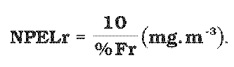
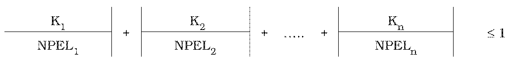
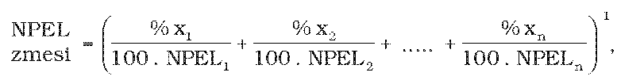
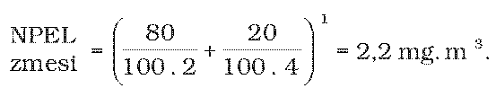

# Čl. I

Nariadenie vlády Slovenskej republiky č. 355/2006 Z. z. o ochrane zamestnancov pred rizikami súvisiacimi s expozíciou chemickým faktorom pri práci v znení nariadenia vlády Slovenskej republiky č. 300/2007 Z. z. sa mení a dopĺňa takto:

- 1. V § 2 písm. b) prvom a druhom bode sa slová „nebezpečný chemický prípravok“ nahrádzajú slovami „nebezpečná chemická zmes“.

- 2. V poznámke pod čiarou k odkazu 3 sa citácia „Zákon č. 163/2001 Z. z. o chemických látkach a chemických prípravkoch v znení neskorších predpisov.“ nahrádza citáciou „Zákon č. 67/2010 Z. z. o podmienkach uvedenia chemických látok a chemických zmesí na trh a o zmene a doplnení niektorých zákonov (chemický zákon) v znení neskorších predpisov.“.

- 3. V poznámke pod čiarou k odkazu 4 sa citácia „§ 27 zákona č. 163/2001 Z. z. v znení neskorších predpisov.“ nahrádza citáciou „§ 6 zákona č. 67/2010 Z. z.“.

- 4. § 8 vrátane nadpisu znie:

- 㤠8

- Špecifické ochranné a preventívne opatrenia pri skladovaní veľmi toxických látok a zmesí a toxických látok a zmesí

- (1)

- Miestnosť, v ktorej sa skladujú toxické látky a zmesi alebo veľmi toxické látky a zmesi,13) musí byť uzamknutá, zabezpečená proti vlámaniu a nesmú sa v nej skladovať

- a)

- humánne lieky, veterinárne lieky a liečivá,15)

- b)

- omamné látky, psychotropné látky a prípravky,16)

- c)

- potraviny,17)

- d)

- krmivá,18)

- e)

- výbušniny19) a

- f)

- horľavé látky.19)

- (2)

- Veľmi toxické látky a zmesi možno skladovať v jednej miestnosti s inými látkami a zmesami, ktoré nie sú toxické, okrem látok uvedených v odseku 1 písm. a) až f), len za predpokladu, že sú uložené v uzamknutej schránke určenej výhradne na skladovanie veľmi toxických látok a zmesí. S toxickými látkami a zmesami sa môžu veľmi toxické látky a zmesi skladovať v jednej miestnosti, prípadne v jednej schránke, ak sú uložené oddelene a je vylúčené ich vzájomné škodlivé pôsobenie alebo zámena, ak taký spôsob skladovania schválil príslušný úrad verejného zdravotníctva.21)

- (3)

- Toxické látky a zmesi možno skladovať v jednej miestnosti, prípadne v jednej schránke s látkami alebo zmesami, ktoré nie sú toxické, okrem látok uvedených v odseku 1 písm. a) až f), ak sú uložené oddelene a je vylúčené ich vzájomné škodlivé pôsobenie alebo zámena.

- (4)

- Toxické látky a zmesi a veľmi toxické látky a zmesi umiestnené v cisternách, v obdobných veľkokapacitných kontajneroch alebo v obaloch možno skladovať v uzavretých priestoroch zabezpečených proti nepriaznivým klimatickým podmienkam, proti škodlivému pôsobeniu týchto látok a zmesí na okolie a proti vniknutiu nepovolaných osôb do týchto priestorov.

- (5)

- Veľmi toxické látky a zmesi možno vydávať zo skladu len na žiadanku podpísanú zamestnancom, ktorý riadi práce s veľmi toxickými látkami a zmesami. Nepoužité veľmi toxické látky a zmesi sa musia po ukončení pracovnej zmeny vrátiť do skladu. Množstvo veľmi toxických látok a zmesí sa musí evidovať spôsobom, ktorý zaručí spoľahlivú evidenciu záznamov o každom príjme a výdaji týchto látok a zmesí.“.

- Poznámky pod čiarou k odkazom 13, 19 a 21 znejú:

- „13)

- Nariadenie Európskeho parlamentu a Rady (ES) č. 1272/2008 zo 16. decembra 2008 o klasifikácii, označovaní a balení látok a zmesí, o zmene, doplnení a zrušení smerníc 67/548/EHS a 1999/45/ES a o zmene a doplnení nariadenia (ES) č. 1907/2006 (Ú. v. EÚ L 353, 31. 12. 2008) v platnom znení.

- 19)

- Výnos Ministerstva hospodárstva Slovenskej republiky z 15. apríla 2010 č. 3/2010, ktorým sa ustanovujú podrobnosti o všeobecných požiadavkách na klasifikáciu, označovanie a balenie nebezpečných látok a zmesí (oznámenie č. 177/2010 Z. z.).

- 21)

- § 13 ods. 4 písm. i) zákona č. 355/2007 Z. z. o ochrane, podpore a rozvoji verejného zdravia a o zmene a doplnení niektorých zákonov.“.

- Poznámky pod čiarou k odkazom 14 a 20 sa vypúšťajú.

- 5. V § 10 ods. 1 písm. c) sa slová „chemických prípravkov“ nahrádzajú slovom „zmesí“.

- 6. V poznámke pod čiarou k odkazu 25 sa citácia:

- „Zákon č. 163/2001 Z. z. v znení neskorších predpisov.

- Nariadenie vlády Slovenskej republiky č. 444/2001 Z. z. o požiadavkách na používanie označenia, symbolov a signálov na zaistenie bezpečnosti a ochrany zdravia pri práci.“ nahrádza citáciou:

- „Zákon č. 67/2010 Z. z.

- Nariadenie vlády Slovenskej republiky č. 387/2006 Z. z. o požiadavkách na zaistenie bezpečnostného a zdravotného označenia pri práci.“.

- 7. V § 11 uvádzacia veta znie:

- „Zamestnávateľ vypracuje prevádzkový poriadok, ktorý podlieha schvaľovaniu podľa osobitných predpisov25a) a ktorý obsahuje“.

- Poznámka pod čiarou k odkazu 25a znie:

- „25a)

- § 13 ods. 4 písm. b) zákona č. 355/2007 Z. z.“.

- 8. V § 12 ods. 1 sa za slovo „dohľad“ vkladajú slová „podľa osobitného predpisu25b)“ a na konci sa pripájajú tieto slová: „vo vzťahu k práci.25c)“.

- Poznámky pod čiarou k odkazom 25b a 25c znejú:

- „25b)

- § 26 zákona č. 124/2006 Z. z. o bezpečnosti a ochrane zdravia pri práci a o zmene a doplnení niektorých zákonov v znení neskorších predpisov.

- 25c)

- § 30 zákona č. 355/2007 Z. z.“.

- 9. V § 12 ods. 10 sa za slová „lekárskej preventívnej prehliadke“ vkladajú slová „vo vzťahu k práci“.

- 10. V § 14 sa slová „akty Európskych spoločenstiev“ nahrádzajú slovami „záväzné akty Európskej únie“.

- 11. Príloha č. 1 znie:

- „Príloha č. 1 k nariadeniu vlády č. 355/2006 Z. z.

- NAJVYŠŠIE PRÍPUSTNÉ EXPOZIČNÉ LIMITY CHEMICKÝCH FAKTOROV V PRACOVNOM OVZDUŠÍ

- 1. Najvyššie prípustné expozičné limity plynov, pár a aerosólov v pracovnom ovzduší (NPEL)

- Tabuľka č. 1

- Por. číslo | Chemická látka | CAS | NPEL | | | | Poznámka

- | | | priemerný | | krátkodobý | |

- | | | ppm | mg.m-3 | ppm | mg.m-3 |

- 1. | Acetaldehyd (etanál) | 75-07-0 | 50 | 91 | – | – | –

- 2. | Acetanhydrid (anhydrid kyseliny octovej) | 108-24-7 | 5 | 21 | – | – | –

- 3. | Acetón (propanón) | 67-64-1 | 500 | 1 210 | – | – | –

- 4. | Acetonitril (etánnitril, nitril kyseliny etánovej, metylkyanid) | 75-05-8 | 40 | 70 | – | – | K

- 5. | Akroleín (propenál) | 107-02-8 | 0,1 | 0,23 | – | – | –

- 6. | Aldrin | 309-00-2 | – | 0,25 | – | – | K

- 7. | Alylalkohol (prop-2-én-1-ol) | 107-18-6 | 2 | 4,8 | 5 | 12,1 | K

- 8. | 2-Aminoetanol | 141-43-5 | 1 | 2,5 | 3 | 7,6 | K

- 9. | 2-Aminopyridín | 504-29-0 | 0,5 | 2 | – | – | –

- 10. | Amoniak | 7664-41-7 | 20 | 14 | 50 | 36 | –

- 11. | Amylalkohol (pentanol) – izoméry | 30899-19-5 | 20 | 73 | 80 | 292 | –

- 12. | Anilín | 62-53-3 | 2 | 7,7 | – | – | K

- 13. | Antimón a jeho anorganické zlúčeniny ako Sb | 7440-36-0 | – | 0,5 | – | – | –

- 14. | Antimonovodík | 7803-52-3 | 0,05 | 0,3 | – | – | –

- 15. | ANTU (a-naftyltiourea) | 86-88-4 | – | 0,3 | – | – | –

- 16. | Azid sodný | 26628-22-8 | – | 0,1 | – | 0,3 | K

- 17. | Bárium zlúčeniny rozpustné ako Ba | 7440-39-3 | – | 0,5 | – | – | –

- 18. | 1,4-Benzochinón (chinón, p-benzochinón) | 106-51-4 | 0,1 | 0,4 | – | – | S

- 19. | Bifenyl | 92-52-4 | 0,16 | 1 | – | – | K

- 20. | Bisfenol A (inhalovateľná frakcia) | 80-05-7 | – | 10,0 | – | – | –

- 21. | Bróm | 7726-95-6 | 0,1 | 0,7 | – | – | –

- 22. | Brómetán (etylbromid) | 74-96-4 | – | 890 | – | – | –

- 23. | Brómmetán (metylbromid) | 74-83-9 | 1 | 4 | – | – | K

- 24. | Brómchlórmetán | 74-97-5 | 200 | 1 100 | – | – | K

- 25. | Bromovodík | 10035-10-6 | – | – | 2 | 6,7 | –

- 26. | Butanón (etylmetylketón) | 78-93-3 | 200 | 600 | 300 | 900 | –

- 27. | Butántiol | 109-79-5 | 0,5 | 1,9 | 1 | 3,8 | –

- 28. | 2-Butoxyetanol (butylglykol) | 111-76-2 | 20 | 98 | 50 | 246 | K

- 29. | 2-Butoxyetyl acetát (butylglykol acetát) | 112-07-2 | 20 | 133 | 50 | 333 | K

- 30. | Butylacetáty | | | | | |

- | n-Butylacetát | 123-86-4 | 100 | 500 | 150 | 700 | –

- | sek-Butylacetát | 105-46-4 | 100 | 500 | 150 | 700 | –

- | izo-Butylacetát | 110-19-0 | 100 | 500 | 150 | 700 | –

- | terc-Butylacetát | 540-88-5 | 100 | 500 | 150 | 700 | –

- 31. | n-Butylakrylát | 141-32-3 | 2 | 11 | 10 | 53 | S

- 32. | Butylalkoholy (butanoly) | | | | | |

- | n-Butanol | 71-36-3 | 100 | 310 | – | – | –

- | sek-Butanol | 78-92-2 | 100 | 310 | – | – | –

- | izo-Butanol | 78-83-1 | 100 | 310 | – | – | –

- | terc-Butanol | 75-65-0 | 20 | 62 | 80 | 250 | –

- 33. | Butyldiglykol 2-(2-butoxyetoxy)etanol | 112-34-5 | 10 | 67,5 | 15 | 101,2 | –

- 34. | p-terc-Butylfenol (ptBP) | 98-54-4 | 0,08 | 0,5 | – | – | –

- 35. | terc-Butyl-metyl-éter | 1634-04-4 | 50 | 183,5 | 100 | 367 | –

- 36. | 4-terc-Butyltoluén (p-terc-butyltoluén) | 98-51-1 | 10 | 60 | – | – | –

- 37. | Cín zlúčeniny anorganické (ako Sn) | 7440-31-5 | – | 2 | – | 4 | –

- 38. | Cín zlúčeniny organické (ako Sn) | 7440-31-5 | – | 0,1 | – | 0,2 | K

- 39. | Cyklohexán | 110-82-7 | 200 | 700 | – | – | –

- 40. | Cyklohexanol | 108-93-0 | 50 | 210 | – | – | K

- 41. | Cyklohexanón | 108-94-1 | 10 | 41 | 20 | 82 | K

- 42. | Cyklohexén | 110-83-8 | 300 | 1 000 | – | – | –

- 43. | Cyklohexylamín (cyklohexánamín) | 108-91-8 | 5 | 20 | 10 | 40 | –

- 44. | DDT (dichlórdifenyltrichlór etán) | 50-29-3 | – | 1 | – | 8 | K

- 45. | Desflurán | 57041-67-5 | 10 | 70 | 20 | 140 | –

- 46. | Dibenzoyldioxidán (dibenzoylperoxid) | 94-36-0 | – | 5 | – | – | –

- 47. | Diborán | 19287-45-7 | 0,1 | 0,1 | – | – | –

- 48. | Dibutylftalát | 84-74-2 | – | 3 | – | 5 | –

- 49. | Dieldrin | 60-57-1 | – | 0,25 | – | – | K

- 50. | Dietylamín | 109-89-7 | 5 | 15 | 10 | 30 | –

- 51. | 2-Dietylamínoetanol | 100-37-8 | 5 | 24 | – | – | K

- 52. | Dietylénglykol (2,2´-oxydietanol) | 111-46-6 | 10 | 44 | 20 | 90 | –

- 53. | Dietylénglykoldimetyléter | 111-96-6 | 5 | 28 | 10 | 56 | K

- 54. | Dietyléter | 60-29-7 | 100 | 308 | 200 | 616 | –

- 55. | Di-(2-etylhexyl)ftalát (DEHP) | 117-81-7 | – | 3 | – | 5 | –

- 56. | Difenyléter | 101-84-8 | 1 | 7,1 | – | – | –

- 57. | 1,2-Dichlórbenzén (o-dichlórbenzén) | 95-50-1 | 20 | 122 | 50 | 306 | K

- 58. | 1,4-Dichlórbenzén (p-dichlórbenzén) | 106-46-7 | 20 | 122 | 50 | 306 | –

- 59. | Dichlórdietyléter | 111-44-4 | 10 | 59 | – | – | K

- 60. | 1,1-Dichlóretán | 75-34-3 | 100 | 412 | – | – | K

- 61. | 1,1-Dichlóretén (dichlóretylén) | 75-35-4 | 5 | 20 | 10 | 40 | –

- 62. | 1,2-Dichlóretén (1,2-dichlóretylén) | 540-59-0 | 200 | 800 | 250 | 1 010 | –

- 63. | Dichlórmetán (metylénchlorid) | 75-09-2 | 100 | 350 | – | – | –

- 64. | Dichlórvos (2,2-dichlórvinyl dimetyl fosfát) | 62-73-7 | 0,11 | 1 | – | – | K

- 65. | N,N-Dimetylacetamid | 127-19-5 | 10 | 36 | 20 | 72 | K

- 66. | Dimetylamín | 124-40-3 | 2 | 3,8 | 5 | 9,4 | –

- 67. | N,N-Dimetylanilín | 121-69-7 | 5 | 25 | 10 | 50 | K

- 68. | 1,3-Dimetylbutylacetát | 108-84-9 | 50 | 300 | – | – | –

- 69. | Dimetyléter | 115-10-6 | 1 000 | 1 920 | – | – | –

- 70. | N,N-Dimetylformamid | 68-12-2 | 5 | 15 | 10 | 30 | K

- 71. | 2,2-Dimetylpropán (neopentán) | 463-82-1 | 1 000 | 3 000 | – | – | –

- 72. | Dinitrobenzén (všetky izoméry) | 25154-54-5 | 0,15 | 1 | – | – | K

- 73. | 1,4-Dioxán | 123-91-1 | 20 | 73 | – | – | –

- 74. | Endrin | 72-20-8 | – | 0,1 | – | – | K

- 75. | Enflurán | 13838-16-9 | 10 | 80 | 20 | 150 | –

- 76. | Etántiol (etylmerkaptán) | 75-08-1 | 0,5 | 1,3 | 1,0 | 2,6 | –

- 77. | 2-Etoxyetanol (etylglykol) | 110-80-5 | 2 | 8 | – | – | K

- 78. | 2-Etoxyetyl acetát (etylglykol acetát) | 111-15-9 | 2 | 11 | – | – | K

- 79. | Etylacetát (octan etylový) | 141-78-6 | 150 | 500 | 300 | 1 100 | –

- 80. | Etylakrylát | 140-88-5 | 5 | 21 | 10 | 42 | S

- 81. | Etylalkohol (etanol) | 64-17-5 | 500 | 960 | 1 000 | 1 920 | –

- 82. | Etylamín (etánamín) | 75-04-7 | 5 | 9,4 | – | – | –

- 83. | Etylbenzén | 100-41-4 | 100 | 442 | 200 | 884 | K

- 84. | Etyléndiamín (etán-1,2-diamín) | 107-15-3 | 10 | 25 | – | – | S

- 85. | Etylénglykol (etán-1,2-diol) | 107-21-1 | 20 | 52 | 40 | 104 | K

- 86. | Etylénglykol dinitrát (nitroglykol dinitrát etylénglykolu) | 628-96-6 | 0,05 | 0,32 | 0,1 | 0,6 | K

- 87. | Etylénchlórhydrín (2-chlóretanol) | 107-07-3 | 1 | 3,3 | – | – | K

- 88. | Etylformiát (mravčan etylový) | 109-94-4 | 100 | 310 | – | – | K

- 89. | Fenol | 108-95-2 | 2 | 8 | 4 | 16 | K

- 90. | p-Fenyléndiamín (benzén-1,2-diamín) | 106-50-3 | – | 0,1 | – | – | S

- 91. | Fluór | 7782-41-4 | 1,0 | 1,58 | 2 | 3,16 | –

- 92. | 2-Fenylpropén | 98-83-9 | 50 | 246 | 100 | 492 | –

- 93. | Fluorid sírový | 2551-62-4 | 1 000 | 6 100 | – | – | –

- 94. | Fluoridy – anorganické (ako F) | | – | 2,5 | – | – | –

- 95. | Fluórovodík, kyselina fluorovodíková (ako F) | 7664-39-3 | 1,8 | 1,5 | 3 | 2,5 | –

- 96. | Formaldehyd (metanál) | 50-00-0 | 0,3 | 0,37 | 0,6 | 0,74 | S

- 97. | Fosfor – žltý, biely | 12185-10-3 | – | 0,05 | – | 0,1 | –

- 98. | Fosforovodík (fosfín) | 7803-51-2 | 0,1 | 0,14 | 0,2 | 0,28 | –

- 99. | Fosgén (chlorid karbonylu) | 75-44-5 | 0,02 | 0,08 | 0,1 | 0,4 | –

- 100. | Freóny | | | | | |

- | Trichlórfluormetán (freón 11) | 75-69-4 | 500 | 3 000 | 750 | 4 500 | –

- | Dichlórdifluórmetán (freón 12) | 75-71-8 | 1 000 | 4 100 | 1 250 | 5 100 | –

- | Trifluórbrómmetán (freón 13B1) | 75-63-8 | 1 000 | 6 200 | – | – | –

- | Dichlórfluórmetán (freón 21) | 75-43-4 | 10 | 43 | 20 | 86 | –

- | Monochlórdifluórmetán (chlórdifluórmetán, freón 22) | 75-45-6 | 1 000 | 3 600 | – | – | –

- | 1,2-Dichlór-1,1,2,2-tetrafluóretán (freón 114) | 76-14-2 | 1 000 | 7 100 | 1 250 | 8 890 | –

- | 1,1,1,2-Tetrachlór-2,2-difluóretán (freón 112a) | 76-11-9 | 200 | 1 700 | 400 | 3 400 | –

- | 1,1,2,2-Tetrachlór-1,2-difluóretán (freón 112) | 76-12-0 | 200 | 1 700 | 400 | 3 400 | –

- 101. | Ftalanhydrid (anhydrid kyseliny ftalovej) | 85-44-9 | – | 1 | – | – | S

- 102. | Furfural (furán-2-karbaldehyd) | 98-01-1 | 2 | 7,9 | – | – | K

- 103. | Furfurylalkohol (furán-2-ylmetanol) | 98-00-0 | 10 | 41 | – | – | K

- 104. | Gáfor (bornán-2-ón) | 76-22-2 | 2 | 13 | 4 | 26 | –

- 105. | Glutaraldehyd (pentándiál) | 111-30-8 | 0,05 | 0,2 | 0,05 | 0,2 | S

- 106. | Glycerín | 56-81-5 | – | 10 | – | – | –

- 107. | Guma, komponenty: | 9006-04-6 | | | | |

- | Ditiokarbamáty (dietylditiokarbamát) | 148-18-5 | – | 2,0 | – | – | S

- | p-Fenylendiamínové zlúčeniny (PPD) | 106-50-3 | – | 0,1 | – | – | S

- | Tiazoly (merkaptobenztiazol) | 49-30-4 | – | 4,0 | – | – | S

- | Tiuramy (tetrametyltiuram disulfid) | 137-26-8 | – | 1,0 | – | – | S

- 108. | Halotan (2-bróm-2-chlór-1,1,1-trifluóretán) | 151-67-7 | 5 | 40 | 10 | 80 | –

- 109. | Heptachlór | 76-44-8 | – | 0,05 | – | 0,4 | K

- 110. | n-Heptán | 142-82-5 | 500 | 2085 | – | – | –

- 111. | Heptán-2-ón (metylpentylketón) | 110-43-0 | 50 | 238 | 100 | 475 | K

- 112. | Heptán-3-ón (etylbutylketón) | 106-35-4 | 20 | 95 | – | – | –

- 113. | Hexachlór-1,3-butadién | 87-68-3 | 0,02 | 0,21 | – | – | K

- 114. | Hexachlóretán | 67-72-1 | 1 | 9,8 | 2 | 19,6 | K

- 115. | Hexachlórcyklohexán, HCH (izoméry a a b) | 319-84-6 319-85-7 | – | 0,5 | – | 4 | K

- 116. | Hexán všetky izoméry okrem n-hexánu | | 500 | 1 800 | 1 000 | 3 600 | –

- 117. | n-Hexán | 110-54-3 | 20 | 72 | 40 | 140 | –

- 118. | 2-Hexanón (metyl-n-butylketón) | 591-78-6 | 5 | 21 | – | – | –

- 119. | Hexón (izobutylmetylketón) | 108-10-1 | 20 | 83 | 40 | 166 | K

- 120. | Hliník kovový, oxid hlinitý, hydroxid hlinitý inhalovateľná frakcia – prach respirabilná frakcia – prach | 7429-90-5 1344-28-1 21645-51-2 | – – | 4 1,5 | – – | – – | –

- 121. | Hliník, alkylzlúčeniny | | – | 2 | – | – | –

- 122. | Hliník, rozpustné soli | | – | 2 | – | – | –

- 123. | Hydrid lítny | 7580-67-8 | – | 0,025 | – | – | –

- 124. | Hydrochinón (benzén-1,4-diol) | 123-31-9 | – | 2 | – | – | K

- 125. | Hydroxid sodný | 1310-73-2 | – | 2 | – | – | –

- 126. | Hydroxid vápenatý | 1305-62-0 | – | 5 | – | – | –

- 127. | Chlór | 7782-50-5 | – | – | 0,5 | 1,5 | –

- 128. | Chlóracetaldehyd | 107-20-0 | 1 | 3 | – | – | K

- 129. | Chlórbenzén | 108-90-7 | 5 | 23 | 15 | 70 | –

- 130. | Chloroprén (2-chlórbuta-1,3-dién) | 126-99-8 | 5 | 18 | – | – | K

- 131. | Chlóretán | 75-00-3 | 100 | 268 | – | – | –

- 132. | Chlorid fosforečný | 10026-13-8 | – | 1 | – | – | –

- 133. | Chloroform (trichlórmetán) | 67-66-3 | 2 | 10 | – | – | K

- 134. | 3-Chlórpropén (alylchlorid) | 107-05-1 | 1 | 3 | – | – | K

- 135. | Chlorovodík | 7647-01-0 | 5 | 8 | 10 | 15 | –

- 136. | Chróm anorg. zlúč. chrómu (II) a (III) – nerozpustné (ako Cr) | 7440-47-3 | – | 2 | – | – | –

- 137. | Izoflurán | 26675-46-7 | 10 | 80 | 20 | 150 | –

- 138. | Izokyanáty | | | | | |

- | Hexametylén-1,6-diizokyanát (HDI) | 822-06-0 | 0,005 | 0,035 | – | – | S

- | 4,4’-Metyléndifenylizokyanát (MDI) | 101-68-8 | 0,002 | 0,03 | – | – | S

- | Metylizokyanát (MIC) | 624-83-9 | – | – | 0,02 | – | –

- | Toluén-2,4-diizokyanát (TDI) | 584-84-9 | 0,002 | 0,014 | – | – | S

- | Trimetylhexametylén diizokyanát | 28679-16-5 | 0,002 | 0,017 | – | – | S

- 139. | Izopropylalkohol (propán-2-ol) | 67-63-0 | 200 | 500 | 400 | 1 000 | –

- 140. | Izopropylamín (propán-2-amín) | 75-31-0 | 5 | 12 | 10 | 24 | –

- 141. | Izopropylbenzén (kumén) | 98-82-8 | 20 | 100 | 50 | 250 | K

- 142. | Jód | 7553-56-2 | 0,1 | 1,1 | 0,1 | 1,1 | –

- 143. | Kaprolaktám (prach, pary) | 105-60-2 | – | 10 | – | 40 | –

- 144. | Karbid kremíka (bez obsahu vlákien) respirabilná frakcia inhalovateľná frakcia | 409-21-2 | – – | 1,5 4 | – – | – – | –

- 145. | Ketén | 463-51-4 | 0,5 | 0,9 | – | – | –

- 146. | Kobalt a jeho zlúčeniny (ako Co) | 7440-48-4 | – | 0,05 | – | – | S

- 147. | Krezol (metylfenoly) o-Krezol m-Krezol p-Krezol | 1319-77-3 95-48-7 108-39-4 106-44-5 | 5 | 22 | – | – | K

- 148. | Kyánamid (karbamonitril) | 420-04-2 | 0,58 | 1 | – | – | K

- 149. | Kyanidy (ako CN) (inhalovateľná frakcia) | | – | 5 | – | – | K

- 150. | Kyanovodík (kyselina kyanovodíková) | 74-90-8 | 1,9 | 2,1 | 3,8 | 4,2 | K

- 151. | Kyselina dusičná | 7697-37-2 | – | – | 1 | 2,6 | –

- 152. | Kyselina mravčia (kyselina metánová) | 64-18-6 | 5 | 9 | – | – | –

- 153. | Kyselina octová (kyselina etánová) | 64-19-7 | 10 | 25 | – | – | –

- 154. | Kyselina fosforečná | 7664-38-2 | – | 1 | – | 2 | –

- 155. | Kyselina pikrová (2,4,6-trinitrofenol) | 88-89-1 | – | 0,1 | – | – | K, S

- 156. | Kyselina propánová (kyselina propiónová) | 79-09-4 | 10 | 31 | 20 | 62 | –

- 157. | Kyselina sírová (hmla) | 7664-93-9 | – | 0,05 | – | – | –

- 158. | Kyselina šťaveľová (kyselina etándiová) | 144-62-7 | – | 1 | – | – | –

- 159. | Lakový benzín1) | | 50 | 300 | 100 | 600 | –

- 160. | Lindán (hexachlórcyklohexán izomér) | 58-89-9 | – | 0,1 | – | – | K

- 161. | Maleínanhydrid (anhydrid kyseliny maleínovej) | 108-31-6 | 0,1 | 0,41 | – | – | S

- 162. | Mangán a jeho anorganické zlúčeniny | 7439-96-5 | – | 0,5 | – | – | –

- 163. | Meď a jej anorganické zlúčeniny (ako Cu) inhalovateľná frakcia respirabilná frakcia a dymy | 7440-50-8 | – – | 1 0,2 | – – | – – | –

- 164. | 2-Metoxyetanol (metylglykol) | 109-86-4 | 1 | – | – | – | K

- 165. | 2-(2-metoxyetoxy) etanol | 111-77-3 | 10 | 50,1 | – | – | K

- 166. | 2-Metoxyetylacetát (metylglykol acetát) | 110-49-6 | 1 | – | – | – | K

- 167. | 2-Metoxymetyl-etoxypropanol (dipropylén glykol mono-metyléter) | 34590-94-8 | 50 | 308 | – | – | K

- 168. | 1-Metoxypropán-2-ol (propylénglykolmonometyléter) | 107-98-2 | 100 | 375 | 150 | 568 | K

- 169. | 2-Metoxypropán-1-ol (propylénkglykol 2-metyléter) | 1589-47-5 | 5 | 19 | – | – | K

- 170. | 2-Metoxypropán-2-yl acetát (propylénglykol 1-metyléter 2-acetát) | 108-65-6 | 50 | 275 | 100 | 550 | K

- 171. | 2-Metoxypropylacetát (propylénglykol 2-metyléter-1-acetát) | 70657-70-4 | 20 | 110 | 40 | 220 | K

- 172. | Metylacetát (octan metylový) | 79-20-9 | 100 | 310 | 250 | 770 | –

- 173. | Metylalkohol (metanol) | 67-56-1 | 200 | 260 | – | – | K

- 174. | Metylacetylén (metyletín) | 74-99-7 | 1 000 | 1 650 | – | – | –

- 175. | Metylakrylát | 96-33-3 | 5 | 18 | 10 | 36 | –

- 176. | Metylamín (metánamín) | 74-89-5 | 10 | 13 | – | – | –

- 177. | N-metylanilín | 100-61-8 | 0,5 | 2,2 | 1 | 4,4 | K

- 178. | Metylbután (izopentán) | 78-78-4 | 1 000 | 3 000 | – | – | –

- 179. | 1-Metylbutylacetát (amylacetát) | 626-38-0 | 50 | 270 | 100 | 540 | –

- 180. | Metylcyklohexán | 108-87-2 | 200 | 810 | 400 | 1 620 | –

- 181. | Metylcyklohexanol (všetky izoméry) | 25639-42-3 | 50 | 235 | – | – | –

- 182. | 2-Metyl-4,6-dinitro-fenol (DNOC) | 534-52-1 | – | 0,2 | – | – | K

- 183. | Metylester kyseliny mravčej | 107-31-3 | 50 | 120 | – | – | –

- 184. | 5-Metylhexán-2-ón (metylizoamylketón) | 110-12-3 | 20 | 95 | – | – | –

- 185. | Metylchlorid (chlórmetán) | 74-87-3 | 50 | 100 | 100 | 200 | K

- 186. | 5-Metyl-3-heptanón | 541-85-5 | 10 | 53 | 20 | 107 | –

- 187. | Metyljodid (jódmetán) | 74-88-4 | 0,3 | 2 | – | – | –

- 188. | Metyl-merkaptán (metántiol) | 74-93-1 | 0,5 | 1 | 1 | – | –

- 189. | Metylmetakrylát (metyl 2-etylpropenoát) | 80-62-6 | 50 | – | 100 | – | S

- 190. | 4-Metylpentán-2-ón (izobutylmetylketón, hexón) | 108-10-1 | 20 | 83 | 50 | 208 | –

- 191. | N-Metyl-2-pyrolidon | 872-50-4 | 10 | 40 | 20 | 80 | K

- 192. | Metylstyrén (vinyltoluén) – všetky izoméry | 25013-15-4 | 100 | 490 | 200 | 980 | –

- 193. | Mevinfos (metyl 3­(dimetoxyfosfonyloxy)-but-2-enoát) | 7786-34-7 | 0,01 | 0,093 | – | – | K

- 194. | Molybdén a jeho zlúčeniny rozpustné (ako Mo) | 7439-98-7 | – | 5 | – | – | –

- 195. | Molybdén a jeho zlúčeniny nerozpustné (ako Mo) inhalovateľná frakcia respirabilná frakcia | 7439-98-7 | – – | 10 5 | – – | – – | –

- 196. | Morfolín | 110-91-8 | 10 | 36 | 20 | 72 | –

- 197. | Naftalén | 91-20-3 | 10 | 50 | 15 | 80 | K

- 198. | Nikotín | 54-11-5 | – | 0,5 | – | 1,5 | K

- 199. | Nitrobenzén | 98-95-3 | 0,2 | 1,0 | – | – | K

- 200. | Nitroglycerín (glyceroltrinitrát) | 55-63-0 | 0,03 | 0,3 | 0,1 | 0,9 | K

- 201. | Nitrotoluén 2-Nitrotoluén 3-Nitrotoluén 4-Nitrotoluén | 1321-12-6 88-72-2 99-08-1 99-99-0 | 1 | 6 | 2 | 11 | K

- 202. | Nonány | | 150 | 800 | 200 | 1 100 | –

- 203. | Oktány | | 200 | 900 | 300 | 1 400 | –

- 204. | Oleje minerálne2) kvapalný aerosól, dymy | | 5 | 1 | 15 | 3 | –

- 205. | Olovo a jeho anorganické zlúčeniny (ako Pb)3)respirabilná frakcia inhalovateľná frakcia | 7439-92-1 | – – | 0,15 0,5 | – – | – – | –

- 206. | Olovo a jeho organické zlúčeniny | | – | 0,05 | – | – | –

- | Tetraetylolovo (ako Pb) | 78-00-2 | – | 0,05 | – | 0,2 | K

- | Tetrametylolovo (ako Pb) | 75-74-1 | – | 0,05 | – | 0,2 | K

- 207. | Ortuť a bivalentné anorganické zlúčeniny vrátane oxidu ortuťnatého a chloridu ortuťnatého4) (ako Hg) | 7439-97-6 | – | 0,1 | – | – | –

- 208. | Ortuť – organické zlúčeniny (ako Hg) | | – | 0,01 | – | – | K, S

- 209. | Oxid dusičitý (NO2) | 10102-44-0 | 2 | 4 | – | – | –

- 210. | Oxid dusnatý (NO) | 10102-43-9 | 25 | 30 | – | – | –

- 211. | Oxid dusný (N2O) | 10024-97-2 | 100 | 183 | – | – | –

- 212. | Oxid fosforečný | 1314-56-3 | – | 1 | – | 5 | –

- 213. | Oxid horečnatý respirabilná frakcia inhalovateľná frakcia | 1309-48-4 | – – | 4 10 | – – | – – | –

- 214. | Oxid chloričitý (chlórdioxid) | 10049-04-4 | 0,1 | 0,3 | – | – | –

- 215. | Oxid osmičelý | 20816-12-0 | 0,0002 | 0,0021 | – | – | –

- 216. | Oxid sírový | 7446-11-9 | – | 1 | – | – | –

- 217. | Oxid siričitý | 7446-09-5 | 0,5 | 1,3 | 1 | 2,7 | –

- 218. | Oxid titaničitý | 13463-67-7 | – | 5 | – | – | –

- 219. | Oxid uhličitý | 124-38-9 | 5 000 | 9 000 | – | – | –

- 220. | Oxid uhoľnatý | 630-08-0 | 30 | 35 | 60 | 70 | –

- 221. | Oxid vanadičný inhalovateľná frakcia respirabilná frakcia | 1314-62-1 | – – | 0,2 0,05 | – – | – – | –

- 222. | Oxid vápenatý | 1305-78-8 | – | 2 | – | – | –

- 223. | Oxid zinočnatý, dymy respirabilná frakcia | 1314-13-2 | – | 1 | – | 1 | –

- 224. | Oxidy železa, dymy (ako Fe) respirabilná frakcia inhalovateľná frakcia | 1345-25-1 1309-37-1 | – – | 1,5 4 | – – | – – | –

- 225. | Ozón | 10028-15-6 | 0,1 | 0,2 | 0,2 | 0,4 | –

- 226. | Paraquatdichlorid (paraquat) | 1910-42-5 | – | 0,1 | – | – | K

- 227. | Parafín, dymy | 8002-74-2 | – | 2 | – | 6 | –

- 228. | Paratión (O,O-dietyl-O-4-nitrofenyl tiofosfát) | 56-38-2 | – | 0,1 | – | – | K

- 229. | Pentaboran | 19624-22-7 | 0,005 | 0,013 | 0,015 | 0,039 | –

- 230. | Pentakarbonyl železa | 13463-40-6 | 0,1 | 0,81 | – | – | –

- 231. | Pentán | 109-66-0 | 1 000 | 3 000 | – | – | –

- 232. | Pentylacetát (všetky izoméry) | 628-63-7 625-16-1 620-11-1 123-92-2 | 50 50 50 50 | 270 270 270 270 | 100 100 100 100 | 540 540 540 540 | –

- 233. | Peroxid vodíka | 7722-84-1 | 1 | 1,4 | 2 | 2,8 | –

- 234. | Piperazín | 110-85-0 | – | 0,1 | – | 0,3 | –

- 235. | Platina – kovová | 7440-06-4 | – | 1 | – | – | –

- 236. | Platina – zlúčeniny rozpustné (ako Pt) | | – | 0,001 | – | 0,002 | S

- 237. | Polyetylénglykol | 25322-68-3 | – | 1 000 | – | – | –

- 238. | Polychlórované bifenyly (PCB) | | – | 0,1 | – | – | K

- 239. | Propylacetát (octan propylový) | 109-60-4 | 100 | 400 | 200 | 800 | –

- 240. | Pyretrum (vyčistený od citlivých laktónov) | 8003-34-7 | – | 1 | – | – | –

- 241. | Pyridín | 110-86-1 | 5 | 15 | – | – | –

- 242. | Rezorcinol (benzén-1,3-diol) | 108-46-3 | 10 | 45 | – | – | K

- 243. | Selén a jeho anorganické zlúčeniny (ako Se) | 7782-49-2 | – | 0,1 | – | – | –

- 244. | Selenovodík | 7783-07-5 | 0,02 | 0,07 | 0,05 | 0,17 | –

- 245. | Sevoflurán | 28523-86-6 | 10 | 80 | 20 | 170 | –

- 246. | Silikón inhalovateľná frakcia respirabilná frakcia | 7440-21-3 | – – | 10 4 | – – | – – | –

- 247. | Síran (sulfát) bárnatý inhalovateľná frakcia respirabilná frakcia | 7727-43-7 | – – | 4 1,5 | – – | – – | –

- 248. | Síran vápenatý inhalovateľná frakcia respirabilná frakcia (anhydrid dihydrát sádra) | 7778-18-9 7778-18-9 10101-41-4 13397-24-5 | – – | 4 1,5 | – – | – – | –

- 249. | Sírovodík (sulfán) | 7783-06-4 | 5 | 7 | 10 | 14 | –

- 250. | Striebro kovové rozpustné zlúčeniny (ako Ag) | 7440-22-4 | – – | 0,1 0,01 | – – | – – | –

- 251. | Styrén | 100-42-5 | 20 | 90 | 50 | 200 | –

- 252. | Sulfid (sírnik) fosforečný | 1314-80-3 | – | 1 | – | – | –

- 253. | Sulfid uhličitý (sírouhlík) | 75-15-0 | 5 | 15 | – | – | K

- 254. | Sulfidy (suma dimetyldisulfid, dimetylsulfid, metylmerkaptán) | | 1 | – | – | – | –

- 255. | Sulfotep | 3689-24-5 | – | 0,1 | – | 0,2 | K

- 256. | Tálium a jeho rozpustné zlúčeniny (ako Tl) | 7440-28-0 | – | 0,1 | – | – | –

- 257. | Tantal inhalovateľná frakcia respirabilná frakcia | 7440-25-7 | – – | 4 1,5 | – – | – – | –

- 258. | Telúr a jeho zlúčeniny (ako Te) | 13494-80-9 | – | 0,1 | – | – | –

- 259. | Terpentín (terpentínový olej) | 8006-64-2 | 100 | 560 | 150 | 850 | S

- 260. | Tetrahydrofurán | 109-99-9 | 50 | 150 | 100 | 300 | K

- 261. | 1,1,2,2-Tetrachlóretán | 79-34-5 | 1 | 7 | 2 | 14 | K

- 262. | Tetrachlóretylén (tetrachlóretén, perchlóretylén) | 127-18-4 | 25 | 172 | 100 | 690 | K

- 263. | Tetrachlórmetán (chlorid uhličitý) | 56-23-5 | 0,5 | 3,2 | 1 | 6,8 | K

- 264. | Tetrakarbonyl niklu | 13463-39-3 | 0,05 | 0,12 | 0,1 | 0,24 | K

- 265. | Tetranitrometán | 509-14-8 | – | 10 | – | – | –

- 266. | Toluén | 108-88-3 | 50 | 192 | 100 | 384 | K

- 267. | Trietylamín | 121-44-8 | 2 | 8,4 | 3 | 12,6 | K

- 268. | 1,2,4-Trichlórbenzén | 120-82-1 | 2 | 15 | 5 | 38 | K

- 269. | 1,1,1-Trichlóretán (metylchloroform) | 71-55-6 | 100 | 555 | 200 | 1 100 | –

- 270. | 1,1,2-Trichlóretán | 79-00-5 | 10 | 55 | 20 | 110 | K

- 271. | Trichlorid-oxid fosforečný (chlorid fosforylu) | 10025-87-3 | 0,2 | 1,3 | – | – | –

- 272. | Triglycidyl-izokyanuarát | | – | 0,1 | – | – | –

- 273. | Trimellitan hydrid | 552-30-7 | – | 0,04 | – | – | S

- 274. | Trimetylbenzén (mezitylén) všetky izoméry | 526-73-8 95-63-6 108-67-8 | 20 | 100 | – | – | –

- 275. | 2,4,6-Trinitrotoluén TNT (a izoméry v technických zmesiach) | 118-96-7 | 0,011 | 0,1 | 0,022 | 0,2 | K

- 276. | Vinylacetát (octan vinylový) | 108-05-4 | 5 | 17,6 | 10 | 35,2 | –

- 277. | Vinylidénchlorid (1,1-dichlóretén, dichlóretylén) | 75-35-4 | 5 | 20 | 10 | 40 | –

- 278. | Výfukové plyny5)akoCOako NO2 | 630-08-0 10102-44-0 | 20 1 | 25 2 | – – | – – | –

- 279. | Wolfrám nerozpustné zlúčeniny rozpustné zlúčeniny | 7440-33-7 | – – | 5 1 | – – | – – | –

- 280. | Xylén, zmiešané izoméry | 1330-20-7 | 50 | 221 | 100 | 442 | K

- 281. | o-Xylén | 95-47-6 | 50 | 221 | 100 | 442 | K

- 282. | m-Xylén | 108-38-3 | 50 | 221 | 100 | 442 | K

- 283. | p-Xylén | 106-42-3 | 50 | 221 | 100 | 442 | K

- 284. | Zinok a jeho anorganické zlúčeniny respirabilná frakcia inhalovateľná frakcia | 7440-66-6 | – – | 0,1 2 | – – | – – | –

- 285. | Zirkón a jeho zlúčeniny (ako Zr) | 7440 | – | 1 | – | – | –

- Poznámky:

- 1. Najvyššie prípustné expozičné limity chemických faktorov vychádzajú zo záväzných a indikatívnych limitných hodnôt stanovených a revidovaných na úrovni legislatívy EÚ, ktoré zohľadňujú, ale ich neprekračujú (príloha č. 4). Ďalšie limity vychádzajú z národných limitov členských štátov, najmä nemeckých, anglických a švédskych. Sú odvodené z najnovších vedeckých údajov so zreteľom na ochranu zdravia a odporúčaných kritérií Vedeckého výboru pre expozičné limity pri Európskej Komisii (SCOEL), pričom berú do úvahy dostupnosť meracích techník a faktory dosiahnuteľnosti.

- 2. Najvyššie prípustný expozičný limit (NPEL) pre chemické faktory je definovaný ako najvyššie prípustná koncentrácia chemického faktora (plynu, pary alebo hmotnostných častíc) v pracovnom ovzduší, ktorá vo všeobecnosti nemá škodlivé účinky na zdravie zamestnancov ani nespôsobí neodôvodnené obťažovanie, napríklad nepríjemným zápachom, a to aj pri opakovanej krátkodobej alebo dlhodobej expozícii denne počas pracovného života.

- NPEL pre chemické faktory sú stanovené priemernou hodnotou a krátkodobou hodnotou.

- 3. NPEL priemerný predstavuje časovo-vážený priemer koncentrácií nameraných v dýchacej zóne za osemhodinovú pracovnú zmenu a 40-hodinový pracovný týždeň.

- 4. NPEL krátkodobý je stanovený na predchádzanie škodlivým zdravotným účinkom alebo iným neočakávaným účinkom (napr. dráždivým, žieravým, narkotickým, obťažujúcim, ovplyvňujúcim činnosť srdca a schopnosť sebazáchovy) spôsobeným krátkodobými opakovanými vrcholovými expozíciami, ktoré nie sú dostatočne kontrolované uplatňovaním osemhodinového priemerného limitu.

- 5. NPEL krátkodobý predstavuje časovo-vážený priemer koncentrácií nameraných počas 15-minútového referenčného času, ktorému môžu byť zamestnanci exponovaní kedykoľvek v priebehu pracovnej zmeny (maximálne 4-krát za zmenu a len pri látkach so systémovým účinkom).

- NPEL krátkodobý nie je stropný limit ani nezávislý limit, je komplementárnou súčasťou osemhodinového priemerného limitu. Pre chemické faktory, pre ktoré je stanovený priemerný aj krátkodobý limit, musia byť dodržané obidve hodnoty. Pre chemické faktory s výraznými akútnymi dráždivými účinkami je stanovený len krátkodobý NPEL, aby boli zohľadnené zdravotné účinky vznikajúce z krátkodobej expozície.

- 6. Najvyššie prípustné expozičné limity plynov, pár a aerosólov s toxickým účinkom sú stanovené nezávisle od teploty a tlaku v ppm (parts per milion – objem vyjadrený počtom objemových častíc plynu v milióne objemových častíc vzduchu) a závisle od týchto premenných v mg.m-3 pri teplote 20 °C a tlaku 101,3 kPa.

- Prepočet mg.m-3 na ppm:

- koncentrácia v mg.m-3v ovzduší = | molekulová hmotnosť v g | (koncentrácia v ppm),

- | ----------------------------------- |

- | 24,1 |

- kde 24,1 = molekulový objem vyjadrený v litroch pri teplote 20 °C a 101,3 kPa.

- 7. Najvyššie prípustné expozičné limity pevných aerosólov sú uvedené v mg.m-3.

- Najvyššie prípustné expozičné limity pre vláknitý aerosól sú uvedené počtom vlákien na cm3 (vl.cm-3) alebo v mg.m-3.

- 8. CAS číslo: medzinárodne stanovené číslo priradené danému chemickému faktoru na účel presnej identifikácie chemickej látky za predpokladu, že údaje boli publikované v odbornej literatúre.

- 9. K – znamená, že faktor môže byť ľahko absorbovaný kožou.

- Niektoré faktory, ktoré ľahko prenikajú cez kožu, môžu spôsobovať až smrteľné otravy často bez varovných príznakov (napríklad anilín, nitrobenzén, nitroglykol, fenoly a pod.). Pri látkach s významným prienikom cez kožu, či už v podobe kvapalín, alebo pár, je osobitne dôležité zabrániť kožnému kontaktu. Túto cestu vstupu do organizmu je potrebné brať do úvahy pri biologickom monitorovaní.

- 10. S – znamená, že faktor môže spôsobiť senzibilizáciu.

- Senzibilizujúce účinky majú faktory, ktoré spôsobujú vyšší výskyt precitlivenosti alergického typu. Pri práci s nimi je potrebná osobitná opatrnosť. Dodržiavanie najvyššie prípustných expozičných limitov nezabezpečí, že u vnímavých osôb nevzniknú alergické reakcie.

- 11. Respirabilná frakcia aerosólu znamená, že expozícia je meraná ako respirabilná zložka aerosólu, ktorá môže preniknúť až do pľúcnych alveol a pre ktorú je stanovený limit.

- 12. Inhalovateľná frakcia znamená, že expozícia je meraná ako inhalovateľná zložka aerosólu (celková koncentrácia), ktorá môže byť vdýchnutá do dýchacích ciest a pre ktorú je stanovený limit.

- Vysvetlivky:

- 1) Lakový benzín

- Toxicita (karcinogenita) závisí od obsahu aromatických uhľovodíkov (benzén, toluén, xylén, etylbenzén, kumén). Limit je stanovený pre lakový benzín, ktorého obsah karcinogénneho benzénu nie je vyšší ako 0,2 obj. % (0,1 hmot. %).

- 2) Oleje minerálne

- Limit sa vzťahuje na hydraulické a obrábacie kvapaliny a mazivá. Niektoré oleje môžu obsahovať polycyklické aromatické uhľovodíky a pri zahrievaní ich môžu uvoľňovať. Treba to brať do úvahy pri meraní a hodnotení rizika.

- 3) Olovo je látka s kumulatívnymi a systémovými účinkami. Preto sa musí monitorovanie ovzdušia doplniť zdravotným dohľadom vrátane biologického monitorovania podľa § 12 a prílohy č. 2.

- 4) Ortuť je látka s vážnymi kumulatívnymi účinkami, preto treba doplniť monitorovanie ovzdušia zdravotným dohľadom podľa § 12 a prílohy č. 2.

- 5) Osobitný limit je určený pre oxid uhoľnatý (CO) a oxid dusičitý (NO2), ktoré sa vyskytujú vo výfukových plynoch, na hodnotenie kombinovaných účinkov vrátane karcinogénnych. Tieto chemické faktory potom slúžia ako indikátory expozície, pričom za akceptovateľnú expozíciu sa považuje dodržanie oboch limitov.

- 2. Najvyššie prípustné expozičné limity pre pevné aerosóly

- Tabuľka č. 2

- Pevné aerosóly s prevažne fibrogénnym účinkom1)

- FAKTOR | NPELr – pre respirabilnú frakciu3) (mg.m-3) | NPELc – pre celkovú koncentráciu2) (mg.m-3)

- | Fr = 100 %4) |

- 1. kremeň5) | 0,1 (TSH)11) |

- 2. kristobalit5) | 0,1 – |

- 3. tridymit5) | 0,1 – |

- 4. gama-oxid hlinitý5) | 0,1 – |

- | Fr 5 % Fr > 5 %6) |

- 5. dinas | 2 10:Fr | 10

- 6. grafit | 2 10:Fr | 10

- 7. čierne uhlie | 2 10:Fr | 10

- 8. koks | 2 10:Fr | 10

- 9. sľuda | 2 10:Fr | 10

- 10. talok bez obsahu respirabilných vlákien | 2 10:Fr | 10

- 11. kaolín | 2 10:Fr | 10

- 12. ostatné kremičitany (okrem azbestu) | 2 10:Fr | 10

- 13. šamot | 2 10:Fr | 10

- 14. zlievarenské pevné aerosóly | 2 10:Fr | 10

- 15. horninové pevné aerosóly | 2 10:Fr | 10

- Tabuľka č. 3

- Pevné aerosóly s možným fibrogénnym účinkom

- Faktor | NPELc (mg.m-3)

- 1. oxid kremičitý, amorfný (tepelné a mokré procesy, nevypálená infuzóriová hlinka, kremelina) | 4

- 2. oxid kremičitý, amorfný (kremenné sklo, roztavený kremeň, dymy, vypálená infuzóriová hlinka) | 0,3 (NPELr)

- 3. zváračské pevné aerosóly7) | 5

- 4. bentonit | 6

- Tabuľka č. 4

- Pevné aerosóly s prevažne nešpecifickým účinkom

- Faktor | NPELc (mg.m-3)

- 1. hnedé uhlie a lignit6) | 10

- 2. vápenec, mramor6) | 10

- 3. baryt6) | 10

- 4. siderit6) | 10

- 5. pevné aerosóly z umelého brusiva6)(karborundum, elektrit) | 10

- 6. železo a jeho zliatiny8) | 6

- 7. čadič tavený | 10

- 8. pôdne pevné aerosóly | 10

- 9. vysokopecná troska | 10

- 10. oceliarska troska | 10

- 11. popolček | 10

- 12. škvara | 10

- 13. magnezit | 10

- 14. dolomit | 10

- 15. kovové dentálne zliatiny | 10

- 16. sadze (karcinogén kategórie 1) | 2 (TSH)11)

- 17. cement | 10

- 18. inertný prach (častice nerozpustné vo vode, inde nezaradené) | 10

- Tabuľka č. 5

- Pevné aerosóly s prevažne dráždivým účinkom

- Faktor | NPELc (mg.m-3)

- 1. Textilný pevný aerosól |

- bavlna | 2

- ľan | 2

- konope | 2

- hodváb | 2

- syntetické vlákna textilné | 4

- sisal | 6

- juta | 6

- kapok | 6

- 2. Živočíšny pevný aerosól |

- perie | 4

- vlna | 6

- srsť | 6

- ostatný živočíšny pevný aerosól | 6

- 3. Rastlinný pevný aerosól9) |

- múka | 4

- cukor | 6

- tabak | 4

- čaj | 4

- káva zelená | 2

- korenie | 2

- pevný aerosól obilný | 6

- pevný aerosól z dreva |

- a) exotické dreviny | 1

- b) ostatné dreviny | 8

- c) dub, buk (karcinogén kategórie 1) | 5 (TSH)11)

- ostatný rastlinný pevný aerosól | 6

- 4. Iný pevný aerosól s dráždivým účinkom |

- z brúsenia a opracovania |

- a) fenolformaldehydových živíc | 5

- b) PVC | 5

- c) pneumatík | 3

- d) sklolaminátov | 5

- e) polyakrylátových živíc | 5

- f) epoxidových živíc | 2

- g) polyesterových živíc | 5

- h) polyetylénu | 5

- i) polypropylénu | 5

- j) polymérnych materiálov | 5

- k) polystyrénu | 5

- l) papiera | 6

- m) škrobu | 4

- Tabuľka č. 6

- Minerálne vláknité pevné aerosóly

- Faktor | NPELc |

- | početná koncentrácia počet respirabilných vlákien10) . cm-3 | hmotnostná koncentrácia mg.m-3

- azbest (karcinogén kategórie 1) | 0,1 (TSH)11) | –

- umelé minerálne vlákna (napríklad čadičové, sklenené, troskové)12) | 2 | 4

- Vysvetlivky pre pevné aerosóly:

- Na hodnotenie expozície pevným aerosólom platia podobné zásady ako zásady uvedené v poznámkach v časti 1 tejto prílohy pre chemické faktory s toxickým účinkom s týmito doplnkami:

- 1) Za fibrogénny sa považuje nerozpustný pevný aerosól, vrátane kvapiek aerosólu, ktorý obsahuje viac ako 1 % fibrogénnej zložky a v pokuse na zvierati vykazuje zreteľnú fibrogénnu reakciu pľúcneho tkaniva. Ak je v aerosóle obsiahnutá fibrogénna zložka, musí sa stanoviť vždy jeho respirabilná frakcia a koncentrácia fibrogénnej zložky.

- V prípade, že aerosól obsahuje menej než 1 % SiO2 a neobsahuje azbest, považuje sa za aerosól s prevažne nešpecifickým účinkom.

- 2) NPEL pre pevné aerosóly (prach) sa stanovuje ako celozmenová priemerná hodnota expozície celkovej (inhalovateľnej) koncentrácii pevného aerosólu (NPELc) alebo jeho respirabilnej frakcii (NPELr). Ako vyhovujúcu možno hodnotiť expozíciu len v prípade, ak sú dodržané obidve hodnoty NPEL pre daný pevný aerosól. V prípade zmesi musí byť zároveň dodržaný NPEL pre jednotlivé zložky zmesi.

- 3) Respirabilná frakcia je váhový podiel častíc pevného aerosólu 5 m odobraného vo vzorke ovzdušia v dýchacej zóne zamestnanca. Spôsob a techniku odberu, stanovenie koncentrácie polietavého prachu v respirabilnej a inhalovateľnej frakcii v pracovnom ovzduší podľa prijatej Johanesburgskej konvencie upravuje STN EN 481. Stratégiu merania, výber vhodného postupu a spracovanie výsledkov upravuje STN EN 482 a STN EN 689.

- 4) Fr je obsah fibrogénnej zložky v percentách v respirabilnej frakcii. Fibrogénna zložka – kremeň, kristobalit, tridymit, gama – oxid hlinitý.

- 5) Pri faktoroch v položkách 1 až 4 je 100 % fibrogénnej zložky.

- 6) V prípade obsahu fibrogénnej zložky > 1 % v respirabilnej frakcii prachu sa vypočíta NPELr pre respirabilnú frakciu prachu podľa vzorca:

- 

- 7) Platí pre pevné častice aerosólu. Zloženie zváracích dymov závisí najmä od zváraného materiálu, druhu a zloženia elektród, techniky zvárania atď. Tieto okolnosti sa musia brať do úvahy pri hodnotení expozície zváračským dymom.

- 8) Pokiaľ zliatiny železa obsahujú vyšší podiel kovov, pre ktoré sú stanovené NPEL, posudzuje sa prašnosť podľa NPEL týchto kovov. NPEL je dodržaný, ak sú dodržané NPEL pre všetky kovy a NPEL pre zliatiny železa.

- 9) NPEL pre pevné aerosóly neprihliada na možné alergické účinky a na obsah mikroorganizmov v prachu.

- 10) Za respirabilné vlákno sa považuje častica, ktorá vyhovuje súčasne všetkým nasledujúcim podmienkam:

- hrúbka vlákna < 3 µm

- dĺžka vlákna ≥ 5 µm

- pomer (dĺžka : hrúbka) 3:1

- 11) Pre pevné aerosóly, ktoré sú zároveň klasifikované ako karcinogény alebo mutagény kategórie 1 a kategórie 2, sa stanovujú technické smerné hodnoty (TSH). Definíciu TSH upravuje nariadenie vlády Slovenskej republiky č. 356/2006 Z. z. o ochrane zamestnancov pred rizikami súvisiacimi s expozíciou karcinogénnym a mutagénnym faktorom pri práci v znení nariadenia vlády Slovenskej republiky č. 301/2007 Z. z. Požiadavky na meranie a hodnotenie azbestu upravuje nariadenie vlády Slovenskej republiky č. 253/2006 Z. z. o ochrane zamestnancov pred rizikami súvisiacimi s expozíciou azbestu pri práci.

- 12) Pre umelé minerálne vlákna musia byť súčasne dodržané prípustné hodnoty početnej aj hmotnostnej koncentrácie.

- A. Výpočet NPEL pre zmesi chemických látok

- Ak je v ovzduší prítomných niekoľko látok, ktoré pôsobia na ten istý orgánový systém, predpokladá sa, že pôsobia aditívne (účinok sa sčíta).

- Na hodnotenie výsledkov merania sa používa vzorec:

- 

- K1 až Kn sú namerané koncentrácie jednotlivých chemických látok v zmesi

- NPEL1 až NPELn sú ich najvyššie prípustné expozičné limity

- NPEL pre zmes chemických látok je dodržaný, ak výsledok je menší alebo sa rovná 1.

- NPEL pre zmes chemických látok, ktorých účinky sa vzájomne potencujú (majú synergický účinok), nemožno odvodiť z hodnôt NPEL pre jednotlivé látky (synergické pôsobenie látok pri rôznych cestách vstupu, napríklad alkohol s narkotickými látkami).

- B. Výpočet NPEL zmesi aerosólov (prachov)

- Stanoví sa výpočtom z NPEL jednotlivých aerosólov podľa vzorca:

- , kde

- % x1 až xn = hmotnostný podiel chemických látok 1 až n v percentách.

- Príklad:

- Zmes obsahuje 80 % bavlneného prachu s NPEL = 2 mg . m-3 a 20 % textilných syntetických vlákien NPEL = 4 mg . m-3,

- potom

- .

- Ak sa hmotnostné koncentrácie nedajú spoľahlivo určiť, NPEL sa stanoví podľa hodnoty platnej pre chemickú látku s najnižšou NPEL.“.

- 12. Príloha č. 2 znie:

- „Príloha č. 2 k nariadeniu vlády č. 355/2006 Z. z.

- BIOLOGICKÉ MEDZNÉ HODNOTY

- Por. číslo | Faktor v pracovnom ovzduší CAS | Zisťovaný faktor | Biologická medzná hodnota BMH | | | | Vyšetrovaný materiál | Čas odberu vzorky

- 1. | Acetón (67-64-1) | Acetón | 80 mg.l-1 | 1 378 μmol.l-1 | 53,36 mg.g-1 kreat. | 103,9 μmol.mmol-1kreat. | M | b

- 2. | Anilín (62-53-3) | Anilín (voľný) | 1 mg.l-1 | 11,2 μmol.l-1 | 0,70 mg.g-1kreat. | 0,85 μmol.mmol-1kreat. | M | b, c

- | | Anilín uvoľnený z väzby na hemoglobín | 100 μg.l-1 | 1079 nmol. l-1 | – | – | K | b, c

- 3. | n-Butylalkohol (71-36-3) | n-butyl alkohol | – | – | 2,0 mg.g-1kreat. | 3,13 μmol.mmol-1kreat. | M | d

- | | | – | – | 10,0 mg.g-1kreat. | 15,34 μmol.mmol-1kreat. | M | b

- 4. | p-terc-Butylfenol (ptBF) (98-54-4) | ptBF | 2 mg.l-1 | 13,6 μmol.l-1 | 1,36 mg.g-1kreat. | 1,03 μmol.mmol-1kreat. | M | b

- 5. | Dichlórmetán (75-09-2) | CO-Hb | 5% | – | – | – | K | b

- | | Dichlórmetán | 1 mg.l-1 | 12,3 μmol.l-1 | – | – | K | b

- 6. | N,N-Dimetylfor-mamid (68-12-2) | N-Metylformamid | 35 mg.l-1 | 593 μmol.l-1 | 23,36 mg.g-1 kreat. | 44,74 μmol.mmol-1kreat. | M | b

- 7. | 2-Etoxyetanol (110-80-5) | Kyselina etoxyoctová | 50 mg.l-1 | 480,7 μmol.l-1 | 33,36 mg.g-1kreat. | 36,25 μmol.mmol-1kreat. | M | c, b

- 8. | 2-Etoxyetyl acetát (111-15-9) | Kyselina etoxyoctová | 50 mg.l-1 | 480,7 μmol.l-1 | 33,36 mg.g-1kreat. | 36,25 μmol.mmol-1kreat. | M | c, b

- 9. | Etylbenzén (100-41-4) | 2 - a 4 -Etylfenol | 12 mg.l-1 | 98,6 μmol.l-1 | 8,03 mg.g-1kreat. | 7,44 μmol.mmol-1kreat. | M | b, c

- | | Kyselina mandľová a kyselina fenylglyoxylová | 1 600 mg.l-1 | 10 590 μmol.l-1 | 1 067 mg.g-1kreat. | 799 μmol.mmol-1kreat. | M | b, c

- 10. | Etylén (74-85-1) | Hydroxyetylvalín | 180 μg.l-1 | 1 120 nmol.l-1 | – | – | E | a

- 11. | Fenol (108-95-2) | Fenol | 200 mg.l-1 | 2 130 μmol.l-1 | 133,7 mg.g-1kreat. | 160,7 μmol.mmol-1kreat. | M | b

- 12. | Fluorovodík (7664-39-3) a anorganické zlúčeniny fluóru (fluoridy) | Fluoridy | – | – | 7 mg.g-1 kreat. | 42,0 μmol.mmol-1kreat. | M | b

- | | | – | – | 4 mg.g-1 kreat. | 24,1 μmol.mmol-1kreat. | M | d

- 13. | Halotan (151-67-7) | Kyselina trifluóroctová | 2,5 mg.l-1 | 22,3 μmol.l-1 | – | – | K | b, c

- 14. | n-Hexán (110-54-3) | 2,5–Hexándion a 4,5-dihydroxy-2-hexanón | 5 mg.l-1 | 20 μmol.l-1 | 3 mg.g-1kreat. | 1,4 μmol.mmol-1kreat. | M | b

- 15. | 2 - Hexanón (metylbutyketón) (591-78-6) | 2,5 - Hexándion a 4,5-dihydroxy-2-hexanón | 5 mg.l-1 | 20 μmol.l-1 | 3 mg.g-1kreat. | 1,4 μmol.mmol-1kreat. | M | b

- 16. | Hexón (izobutyl-metyl- ketón (108-10-1) | Hexón | 3,5 mg.l-1 | 35,4 μmol.l-1 | 2,36 mg.g-1kreat. | 2,67 μmol.mmol-1kreat. | M | b

- 17. | Hliník (7429-90-5) | Hliník | – | – | 60 μg.g-1 kreat. | 251,8 nmol.mmol-1kreat. | M | a

- 18. | Chlórbenzén (108-90-7) | Celkový 4 – Chlórkatechol | – | – | 25 mg.g-1kreat. | 19,57 μmol.mmol-1kreat. | M | d

- | | Celkový 4 – Chlórkatechol | – | – | 150 mg.g-1kreat. | 117,4 μmol.mmol-1kreat. | M | b

- 19. | Inhibítory cholínesterázy a acetylcholín- esterázy | aktivita cholínesterázy a acetylcholín- esterázy | pokles aktivity na 70 % individuálnej základnej hodnoty | – | – | – | E | b, c

- 20. | Kadmium2) (7440-43-9) Karcinogén kategórie 2 | Kadmium | 7 μg.l-1 | 62,7 nmol.l-1 | 4,70 μg.g-1 kreat. | 4,73 nmol.mmol-1kreat. | M | a

- 21. | Kobalt a jeho zlúčeniny2) (7440-48-4) | Kobalt | 30 μg.l-1 | 509,8 nmol.l-1 | 20,03 μg.g-1 kreat. | 38,45 nmol.mmol-1kreat. | M | a

- 22. | Lindan (HCH) (58-89-9) | Lindán | 25 μg.l-1 | 86,1 nmol.l-1 | – | – | P/S | b

- 23. | Metanol (67-56-1) | Metanol | 30 mg.l-1 | 938 μmol.l-1 | 20 mg.g-1kreat. | 70,7 μmol.mmol-1kreat. | M | c, b

- 24. | Nitrobenzén (98-95-3) | Anilín (uvoľnený z väzby na Hb) | 100 μg.l-1 | 1 079 nmol.l-1 | – | – | K | c

- 25. | Olovo a jeho zlúčeniny1) (okrem chrómanu olovnatého, chrómanu arzenitého a alkylovaných zlúčenín) (7439-92-1) | Olovo | 400 μg.l-1 | 1 933 nmol.l-1 | – | – | K | a

- | | | 100 μg.l-1(ženy < 45 r.)2) | 485,0 nmol.l-1 | – | – | K | a

- | | -Aminolevulová kyselina | 15 mg.l-1 | 114,7 μmol.l-1 | 10,03 mg.g-1kreat. | 8,65 μmol.mmol-1kreat. | M | a

- | | | 6 mg.l-1 (ženy < 45 r.)2) | 46,1 μmol.l-1 | 4,03 mg.g-1kreat. | 3,48 μmol.mmol-1kreat. | - | -

- | | Koproporfyrín | 0,30 mg.l-1 | 0,45 μmol.l-1 | 0,2 mg.g-1kreat. | 43 nmol.mmol-1kreat. | M | a

- 26. | Ortuť (7439-97-6) a anorganické zlúčeniny ortuti3) | Ortuť | 37,5 μg.l-1 15 µg.l-1 | 187,0 nμmol.l-1 75,0 nmol.l-1 | 25 g.g-1kreat. | 14,10 nμmol.mmol-1kreat. | M K | a c

- 27. | Oxid uhoľnatý (630-08-0) | CO-Hb | 5 % | – | – | – | K | b

- 28. | Oxid vanadičný (1314-62-1) | Vanád | – | – | 50 μg.g-1kreat. | 111,1 nmol.mmol-1kreat. | M | c, b

- 29. | Paratión (56-38-2) | p-Nitrofenol | 0,5 mg.l-1 | 3,9 μmol.l-1 | 0,36 mg.g-1kreat. | 0,30 μmol.mmol-1kreat. | M | C

- | | Acetylcholinesteráza | pokles aktivity na 70 % individuálnej základnej hodnoty | – | – | – | E | c

- 30. | Pentachlórfenol (87-86-5) | Pentachlórfenol | 5 mg.l-1 | 18,9 μmol.l-1 | – | – | P/S | b

- | | | – | – | 2 mg.g-1kreat. | 0,87 μmol.mmol-1 kreat. | M | c, d

- 31. | Polycyklické aromatické uhľovodíky2) Karcinogén kategórie 2 | 1-Hydroxypyrén | 5,66 μg.l-1 | 25,9 nmol.l-1 | 3,77 μg.g-1kreat. | 1,95 μmol.mol-1 kreat. | M | b

- 32. | Sírouhlík (75-15-0) | 2-Tio-tiazolidín-4- karboxylová kyselina (TTCA) | – | – | 2 mg.g-1kreat. | 1,42 μmol.mmol-1 kreat. | M | b

- 33. | Styrén (100-42-5) | Kyselina mandľová a kyselina fenylglyoxylová | 901 mg.l-1 | 5 960 μmol.l-1 | 600 mg.g-1kreat. | 449 μmol.mmol-1kreat. | M | c,b

- 34. | Tetraetylolovo (78-00-2) | Dietylolovo | 25 μg.l-1 (Pb) | 120,9 nmol.l-1 | 16,70 μg.g-1kreat. | 9,12 nmol.mmol-1kreat. | M | b

- | | Celkové olovo (možno aplikovať na zmes tetraetylolova s tetrametylolovom) | 50 μg.l-1 | 241,5 nmol.l-1 | 33,36 μg.g-1kreat. | 18,21 nmol.mmol-1kreat. | M | b

- 35. | Tetrahydrofurán (109-99-9) | Tetrahydrofurán | 2 mg.l-1 | 28,4 μmol.l-1 | 1,36 mg.g-1kreat. | 2,14 μmol.mmol-1kreat. | M | b

- 36. | Tetrachlóretylén (perchlótetylén) (127-18-4) | Tetrachlóretylén | 0,5 mg.l-1 | 3,3 μmol.l-1 | – | – | K | d

- | | Kyselina trichlóroctová | 3,5 mg.l-1 | 21,7 μmol.l-1 | 2,36 mg.g-1kreat. | 1,64 μmol.mmol-1kreat. | M | b

- 37. | Tetrametylolovo (75-74-1) | Olovo | 50 μg.l-1 | 241,5 nmol.l-1 | 33,36 μg.g-1kreat. | 18,21 nμmol.mmol-1kreat. | M | b

- 38. | Tetrachlórmetán (56-23-5) | Tetrachlórmetán | 3,5 μg.l-1 | 23,0 nmol.l-1 | – | – | K | c, b

- 39. | Toluén (108-88-3) | Toluén | 600 μg.l-1 | 6517 nmol.l-1 | – | – | K | b

- | | O-krezol | 1,5 mg.l-1 | 14,3 μmol.l-1 | 1,03 mg.g-1kreat. | 1,08 μmol.mmol-1kreat. | M | c, b

- | | Kyselina hippurová | 2 401 mg.l-1 | 13 399 μmol.l-1 | 1 600 mg.g-1kreat. | 1 010 μmol.mmol-1kreat. | M | b

- 40. | 1,1,1- Trichlóretán (metyl-chlóroform) (71-55-6) | 1,1,1- Trichlóretán | 550 μg.l-1 | 4 127 nmol.l-1 | – | – | K | c, d

- 41. | Xylén (všetky izoméry) (1330-20-7) | Xylén | 1,5 mg.l-1 | 14,6 μmol.l-1 | – | – | K | b

- | | Suma kyselín 2,3,4-metylhippurových | 2 000 mg.l-1 | 10 355 μmol.l-1 | 1 334 mg.g-1kreat. | 781 μmol.mmol-1kreat. | M | b

- Poznámky:

- 1. Biologické monitorovanie expozície zahŕňa meranie množstva chemických faktorov a ich metabolitov v biologickom materiáli a meranie biologických účinkov vyvolaných týmito faktormi. Biologický monitoring expozície je komplementárnou metódou k monitoringu ovzdušia v pracovnom prostredí, ak samotný odber ovzdušia nemôže dať spoľahlivé údaje o expozícii, najmä v prípadoch, ak je vstup látky do organizmu iný, než len inhalačnou cestou (cez pokožku alebo zažívací trakt).

- 2. Biologické medzné hodnoty (BMH) reprezentujú referenčné hodnoty pre hodnotenie potenciálnych zdravotných rizík pri práci a slúžia ako indikátory pre následné preventívne opatrenia.

- 3. BMH, rovnako ako aj najvyššie prípustné expozičné limity (NPEL) vychádzajú z prípustných hodnôt členských štátov, najmä nemeckých (BAT – Biologischer Arbeitsstoff-Toleranz-Wert, BLW – Biologischer-Leit Wert). Sú odvodené z dostupných toxikologických a medicínskych vedeckých poznatkov a odporúčaných metód Vedeckého výboru pre expozičné limity pri Európskej komisii (SCOEL). Indikujú, že pri týchto koncentráciách nebude poškodené zdravie osôb exponovaných najviac 8 hodín denne a 40 hodín týždenne na úrovni príslušných NPEL pri inhalačnej expozícii.

- 4. NPEL aj BMH sú stanovené na podobných množstvách externej a internej expozície, to znamená, že v týchto prípadoch sa BMH vzťahujú na skupinové priemery hodnotenia expozície. Pre zdravého jednotlivca BMH predstavujú stropné hodnoty.

- Vysvetlivky:

- 1) BMH pre olovo a jeho iónové zlúčeniny korešponduje so záväznou biologickou limitnou hodnotou stanovenou na úrovni Európskej únie (príloha č. 4), ktorá je: 700 g Pb . l-1 krvi (3,4 mol. l-1 krvi).

- Biologické monitorovanie zahŕňa meranie hladiny olova v krvi používajúc metódu absorbčnej spektrometrie alebo metódu, ktorá má ekvivalentné výsledky.

- Zdravotný dohľad sa vykoná, ak

- – expozícia koncentráciám olova v pracovnom ovzduší je vyššia ako 0,075 mg.m-3vypočítaná ako časovo-vážený priemer v priebehu 40-hodinového týždňa alebo

- – hladina olova v krvi nameraná u jednotlivých zamestnancov je vyššia ako 400 g Pb. l-1 krvi.

- Biologické monitorovanie Pb zahŕňa aj vykonanie ďalších odporúčaných indikátorov expozície, ako je kyselina delta-amínolevulová (D-ALA) v moči, dehydratáza kyseliny amínolevulovej a zinkprotoporfyrín (ZPP) v moči.

- 2) V tejto prílohe sú uvedené aj niektoré chemické faktory s karcinogénnym účinkom (kategória 1 a 2). Pre tieto chemické faktory platí, že dodržanie BMH nevylučuje riziko škodlivých zdravotných účinkov, preto sú určené ako základ pre biomonitoring exponovaných osôb a zdravotný dohľad vykonávaný lekárom pracovnej zdravotnej služby podľa § 13 a prílohy č. 4 nariadenia vlády Slovenskej republiky č. 356/2006 Z. z. o ochrane zdravia zamestnancov pred rizikami súvisiacimi s expozíciou karcinogénnym a mutagénnym faktorom pri práci v znení nariadenia vlády Slovenskej republiky č. 301/2007 Z. z.

- 1), 3) Zdravotný dohľad musí byť zabezpečený v súlade s § 12 a osobitnými predpismi (§ 30 zákona č. 355/2007 Z. z. o ochrane, podpore a rozvoji verejného zdravia a o zmene a doplnení niektorých zákonov v znení neskorších predpisov; vyhláška Ministerstva zdravotníctva Slovenskej republiky č. 292/2008 Z. z. o podrobnostiach o rozsahu a náplni výkonu pracovnej zdravotnej služby, o zložení tímu odborníkov, ktorí ju vykonávajú, a o požiadavkách na ich odbornú spôsobilosť v znení vyhlášky Ministerstva zdravotníctva Slovenskej republiky č. 135/2010 Z. z.; odborné usmernenie Ministerstva zdravotníctva Slovenskej republiky č. 10525/2010-OL z 22. 2. 2010 o náplni lekárskych preventívnych prehliadok vo vzťahu k práci).

- Biologické medzné hodnoty sa zisťujú v krvi alebo v moči. Čas odberu vzoriek vyšetrovaného materiálu berie do úvahy podmienky expozície a vlastnosti chemickej látky.

- BMH je vyjadrená

- – v mg (g, mol, nmol) zisťovaného faktora na 1 liter moču štandardnej hustoty 1,024 g/cm3 pri teplote 20 °C,

- – v mg (g, mol, nmol) zisťovaného faktora na 1 liter krvi,

- – v g (mol, mmol) kreatinínu v moči prepočítaný na obsah kreatinínu 1,50 g.l-1 moču, resp. 13,26 mmol.l-1 moču. Fyziologický rozsah hodnôt kreatinínu je 0,848 – 2,092 g.l-1 moču (resp. 7 – 18 mmol.l-1) pri 24-hodinových vzorkách moču. Pri profesionálnej expozícii a odberoch močov po skončení zmeny (kratšie ako 24-hodinové vzorky močov) sú odporúčané hodnoty kreatinínu v moči 0,5 – 2,5 g.l-1moču (resp. 4,86 – 22,54 mmol.l-1moču) (Deutsche Forschungsgemeinschaft List of MAK and BAT Values 2009, Commision for the Investigation of Health Hazards of Chemical Compounds in the Work Area Report No. 45, p. 201).

- 1. | Vyšetrovaný materiál: | 2. | Čas odberu vzorky: |

- | M – moč | | a) | žiadne obmedzenie

- | K – krv | | b) | koniec expozície alebo pracovnej zmeny

- | E – červené krvinky | | c) | pri dlhodobej expozícii; po viacerých pracovných zmenách

- | P/S – krvná plazma/sérum | | d) | pred nasledujúcou pracovnou zmenou“.

- “.

- 13. Príloha č. 3 znie:

- „Príloha č. 3 k nariadeniu vlády č. 355/2006 Z. z.

- VYBRANÉ CHEMICKÉ FAKTORY A ÚČELY ICH VYUŽITIA, KTORÉ SÚ ZAKÁZANÉ

- Opis faktorov (CAS) | Účel, na ktorý sú uvedené faktory zakázané

- 1. 2-Naftylamín (91-59-8) a jeho soli Benzidín (92-87-5) a jeho soli 4-Aminobifenyl (92-67-1) a jeho soli 4-Nitrobifenyl (92-93-3) | Výroba a používanie chemických faktorov pri práci a činnosti, ktoré sa týkajú uvedených chemických faktorov, sú zakázané. Zákaz neplatí, ak sa chemický faktor vyskytuje v inom chemickom faktore alebo je súčasťou odpadu, za predpokladu, že jeho individuálna koncentrácia je tam menšia ako 0,1 % hmotnosti.

- 2. Piesok alebo zmesi obsahujúce voľný oxid kremičitý | Používanie na povrchovú úpravu predmetov v akejkoľvek aparatúre pomocou piesku pod tlakom spojené s expozíciou zamestnancov.

- 3. Sírouhlík (75-15-0) | Používanie v procese vulkanizácie za studena pri impregnácii gumeného oblečenia.

- 4. Prach alebo prášok ohňovzdorného materiálu obsahujúceho viac ako 80 % SiO2iného ako prírodného piesku | Používanie na striekanie foriem na výrobu kremičitých tehál alebo iných výrobkov zložených z ohňovzdorného materiálu a obsahujúcich viac ako 80 % oxidu kremičitého.

- 5. Kyanovodík (74-90-8)x | Používanie pri plynovaní na ničenie epidemiologicky závažných a obťažujúcich článkonožcov, hlodavcov a ďalších živočíchov (dezinsekcia a deratizácia) okrem týchto prípadov a) uvoľňovanie z inertného materiálu, v ktorom je absorbovaný kyanovodík, b) uvoľňovanie z tzv. plynového prášku, čo je chemická zlúčenina, ktorá reaguje s atmosférickou vlhkosťou a vytvára kyanovodík, alebo c) používanie z valca cez vhodné potrubie s aplikátorom v otvorenom priestore na iné účely, ako je ničenie škodlivého hmyzu alebo živočíchov plynovaním.

- “.

- 14. Názov prílohy č. 4 znie: „Zoznam preberaných právne záväzných aktov Európskej únie“.

- 15. Príloha č. 4 sa dopĺňa piatym bodom, ktorý znie:

- „5. Smernica Komisie 2009/161/EÚ zo 17. decembra 2009, ktorou sa ustanovuje tretí zoznam smerných najvyšších prípustných hodnôt vystavenia pri práci na vykonanie smernice Rady 98/24/ES a ktorou sa mení a dopĺňa smernica Komisie 2000/39/ES (Ú. v. EÚ L 338, 19. 12. 2009).“.
