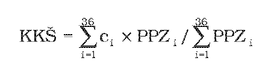

# Čl. I

Nariadenie vlády Slovenskej republiky č. 630/2008 Z. z., ktorým sa ustanovujú podrobnosti rozpisu finančných prostriedkov zo štátneho rozpočtu pre školy a školské zariadenia v znení nariadenia vlády Slovenskej republiky č. 29/2009 Z. z., nariadenia vlády Slovenskej republiky č. 598/2009 Z. z. a nariadenia vlády Slovenskej republiky č. 517/2010 Z. z. sa mení a dopĺňa takto:

- 1. V § 2 ods. 1 sa vypúšťajú písmená s) až ae).

- Doterajšie písmená af) až aj) sa označujú ako písmená s) až w).

- 2. V § 2 odsek 3 znie:

- „(3)

- Kategórie škôl s jednotným normatívom na prevádzku okrem tepla podľa § 3 ods. 7 sú:

- a)

- školy so štandardnou prevádzkovou náročnosťou podľa odseku 1 písm. a), b), e), f) a s),

- b)

- školy s mierne zvýšenou prevádzkovou náročnosťou podľa odseku 1 písm. m),

- c)

- školy so zvýšenou prevádzkovou náročnosťou podľa odseku 1 písm. h), j), l), n), o), u) až w),

- d)

- školy s veľmi zvýšenou prevádzkovou náročnosťou podľa odseku 1 písm. i) a q),

- e)

- školy s vysokou prevádzkovou náročnosťou podľa odseku 1 písm. c), d), k), p), g), r) a t).“.

- 3. V § 2 ods. 5 sa slová „e) až ae)“ nahrádzajú slovami „e) až r)“.

- 4. V § 3 odsek 1 znie:

- „(1)

- Z finančných prostriedkov na bežné výdavky rozpočtovaných na kalendárny rok v kapitole Ministerstva školstva, vedy, výskumu a športu Slovenskej republiky (ďalej len „ministerstvo“) podľa § 3 ods. 2 písm. a) a c) zákona sa odpočítajú finančné prostriedky na bežné výdavky

- a)

- pre materské školy pre deti so špeciálnymi výchovno-vzdelávacími potrebami (ďalej len „špeciálne materské školy“),

- b)

- pre špeciálne výchovné zariadenia a centrá špeciálnopedagogického poradenstva (ďalej len „špeciálne školské zariadenia“),

- c)

- pre ostatné školské zariadenia,

- d)

- pre školy na skvalitnenie podmienok na výchovu a vzdelávanie žiakov zo sociálne znevýhodneného prostredia podľa osobitného predpisu,4)

- e)

- na úhradu špecifík podľa § 4a zákona, na poskytovanie finančných prostriedkov za mimoriadne výsledky žiakov podľa § 4b zákona, na riešenie havarijných situácií podľa § 4c zákona, na financovanie rozvojových projektov podľa § 4d zákona, na úhradu nákladov na žiakov zo sociálne znevýhodneného prostredia podľa § 4e zákona a na rezervu určenú na dohodovacie konanie podľa § 8c zákona pri dodržaní limitu podľa § 7 ods. 7 zákona,

- f)

- na úhradu príspevku na výchovu a vzdelávanie detí materských škôl a špeciálnych materských škôl, ktoré majú jeden rok pred plnením povinnej školskej dochádzky, podľa § 6b zákona,

- g)

- na úhradu nákladov na záujmové vzdelávanie podľa § 7 ods. 8 zákona,

- h)

- na úhradu nákladov podľa § 7 ods. 16 zákona.“.

- 5. V § 3 ods. 4 písm. b) sa za slová „platovej triedy“ vkladá čiarka a slová „pracovnej triedy“.

- 6. V § 4 ods. 3 písmená a) a b) znejú:

- „a)

- v odboroch vzdelávania zaradených do kategórie škôl podľa § 2 ods. 1 písm. e), f), h) až r) je 60 % normatívu na žiaka tejto kategórie školy, alebo

- b)

- v odboroch vzdelávania zaradených do kategórie škôl podľa § 2 ods. 1 písm. g) je 80 % normatívu na žiaka tejto kategórie školy.“.

- 7. V § 4 ods. 5 písm. h) prvý bod a druhý bod znejú:

- „1.

- v odboroch vzdelávania zaradených do kategórie škôl podľa § 2 ods. 1 písm. e), f), h) až r) započítava s koeficientom 0,6,

- 2.

- v odboroch vzdelávania zaradených do kategórie škôl podľa § 2 ods. 1 písm. g) započítava s koeficientom 0,8.“.

- 8. § 4 sa dopĺňa odsekom 12, ktorý znie:

- „(12)

- Normatív na žiaka športového gymnázia, ktorý nenavštevuje športovú prípravu, sa určí rovnako ako na žiaka gymnázia.“.

- 9. § 6 sa dopĺňa odsekom 8, ktorý znie:

- „(8)

- Normatív na dieťa špeciálnej materskej školy bez zdravotného znevýhodnenia alebo bez všeobecného intelektového nadania je 40 % normatívu na dieťa špeciálnej materskej školy. Pri výpočte tohto normatívu sa dieťa započítava s koeficientom 0,4.“.

- 10. V § 7 odsek 13 znie:

- „(13)

- Žiak školy alebo žiak internátnej školy, ktorý nie je ubytovaný v školskom internáte, sa započítava s koeficientom 1. Žiak školy alebo žiak internátnej školy, ktorý je ubytovaný v školskom internáte, sa započítava s koeficientom 3. Dieťa špeciálnej materskej školy alebo dieťa špeciálnej materskej školy internátnej, ktoré nie je ubytované v školskom internáte, sa započítava s koeficientom 1,5. Dieťa špeciálnej materskej školy alebo dieťa špeciálnej materskej školy internátnej, ktoré je ubytované v školskom internáte, sa započítava s koeficientom 3.“.

- 11. V § 7 ods. 17 sa slovo „šiestich“ nahrádza slovom „piatich“.

- 12. V § 7 ods. 18 sa slovo „štyroch“ nahrádza slovom „piatich“.

- 13. V § 8 ods. 7 sa slovo „šiestich“ nahrádza slovom „piatich“.

- 14. V § 8 ods. 8 sa slovo „štyroch“ nahrádza slovom „piatich“.

- 15. Prílohy č. 1 a 2 znejú:

- „Príloha č. 1 k nariadeniu vlády č. 630/2008 Z. z.

- Kategórie škôl s jednotným mzdovým normatívom podľa § 2 ods. 1 písm. e) až r) podľa číselných kódov študijných odborov a učebných odborov stredných odborných škôl

- Názov kategórie školy s jednotným mzdovým normatívom podľa § 2 ods. 1 písm. e) až r) | Číselný kód študijného odboru alebo učebného odboru

- Stredná odborná škola – 1. kategória | 6308 6, 6310 7, 6314 6, 6314 7, 6317 6, 6318 7, 6324 6, 6325 6, 6326 6, 6328 6, 6329 6, 6332 7, 6334 7, 6335 7, 6336 6, 6337 6, 6338 7, 6341 6, 6343 6, 6352 6, 6353 3, 6354 6, 6355 6, 6360 6, 6362 6,

- Stredná odborná škola – 2. kategória | 1140 6, 2141 6, 2156 7, 2241 6, 2381 7, 2399 6, 2665 7, 2675 7, 2695 7, 2699 6, 2720 6, 2840 6, 2841 6, 2847 6, 2848 6, 2849 6, 2885 6, 2940 6, 2940 7, 2949 6, 2951 6, 3125 6, 3126 6, 3135 7, 3155 6, 3158 6, 3231 6, 3336 6, 3337 6, 3383 6, 3383 7, 3431 6, 3432 6, 3650 6, 3699 6, 3739 6, 3760 6, 3764 7, 3765 6, 3767 6, 3794 6, 3916 6, 3917 6, 3918 6, 3919 7, 3957 6, 3964 6, 3965 6, 5371 3, 6292 6, 6851 6, 6851 7, 6857 6, 7218 6, 7235 6, 7237 6, 7518 7, 7646 6, 7647 3, 7661 6, 7662 6, 7663 6, 7667 6, 7669 6, 9245 6,

- Stredná odborná škola – 3. kategória | 2147 6, 2157 6, 2234 6, 2235 6, 2381 6, 2387 6, 2675 6, 2694 6, 3692 6, 3779 6, 3968 6, 4210 6, 4210 7, 4211 6, 4211 7, 4215 6, 4219 6, 4220 7, 4221 7, 4223 7, 4225 7, 4227 6, 4228 6, 4236 6, 4238 6, 4239 6, 4243 6, 4246 6, 4330 6, 4336 6, 4336 7, 6323 6, 7649 6,

- Stredná odborná škola – 4. kategória | 2153 4, 2398 6, 2414 4, 2415 4, 2417 4, 2489 4, 2675 4, 2676 4, 2737 4, 2859 4, 2890 4, 2952 4, 2958 4, 2960 4, 2982 4, 3125 4, 3137 4, 3138 4, 3139 4, 3243 4, 3244 4, 3247 4, 3248 4, 3341 4, 3347 4, 3454 4, 3656 4, 3659 4, 3660 4, 3756 4, 3757 4, 3758 4, 3759 4, 3778 4, 3792 4, 4508 4, 4511 4, 4512 4, 4521 4, 4526 4, 6357 6, 6358 6, 6403 4, 6405 4, 6411 4, 6421 4, 6425 4, 6426 4, 6428 2, 6432 4, 6441 4, 6442 4, 6443 4, 6476 4, 8501 4,

- Stredná odborná škola – 5. kategória | 2262 4, 2411 4, 2413 4, 2418 4, 2419 4, 2426 4, 2447 4, 2490 4, 2497 4, 2499 4, 2682 4, 2684 4, 2697 4, 2698 4, 2860 4, 2880 4, 2888 4, 3446 4, 3447 4, 3776 4, 4553 4, 4556 4, 4558 4,

- Stredná odborná škola – 6. kategória | 2412 4, 3658 4, 3693 4, 6444 4, 6445 4,

- Stredná odborná škola – 7. kategória | 2679 4,

- Stredná odborná škola – 8. kategória | 2965 2, 3178 2, 6456 2,

- Stredná odborná škola – 9. kategória | 2866 2, 3143 2, 3148 2, 3151 2, 3356 2, 4567 2, 4572 2, 6423 4,6460 2,

- Stredná odborná škola – 10. kategória | 2398 4, 2401 2, 2423 2, 2430 2, 2431 2, 2432 2, 2433 2, 2435 2, 2436 2, 2439 2, 2458 2, 2464 2, 2466 2, 2468 2, 2487 2, 2488 2, 2499 2, 2683 2, 2698 2, 2738 2, 2873 2, 2877 2, 2878 2, 2889 2, 2954 2, 2955 2, 2956 2, 2962 2, 2963 2, 2964 2, 2977 2, 2978 2, 3146 2, 3152 2, 3185 2, 3250 2, 3251 2, 3272 2, 3274 2, 3355 2, 3370 2, 3661 2, 3663 2, 3664 2, 3668 2, 3672 2, 3673 2, 3675 2, 3679 2, 3688 2, 3762 2, 3763 2, 3766 2, 4524 2, 4529 2, 4561 2, 4562 2, 4569 2, 4571 2, 4574 2, 4575 2, 4580 2, 4582 2, 6422 4, 6446 4, 6451 2, 6452 2, 6475 2, 8545 2, 8551 2, 8564 2, 8573 2, 8576 2,

- Stredná odborná škola – 11. kategória | 5304 6, 5308 6, 5310 6, 5311 6,5312 6, 5314 6, 5315 6, 5317 7, 5325 7, 5328 7, 5333 7, 5335 7, 5356 6, 5358 6, 5370 6, 5376 6,

- Stredná odborná škola – 12. kategória | 3434 4, 3453 4, 3471 4, 8218 6, 8218 7, 8221 6, 8222 6, 8223 6, 8230 6, 8231 6, 8233 6, 8234 6, 8235 6, 8235 7, 8236 6, 8237 7, 8238 6, 8238 7, 8240 6, 8244 6, 8245 6, 8248 6, 8249 6, 8257 7, 8258 7, 8259 6, 8259 7, 8260 6, 8261 6, 8262 6, 8263 7, 8264 6, 8267 6, 8269 6, 8270 6, 8273 6, 8274 6, 8276 7, 8278 6, 8279 6, 8280 6, 8283 6, 8284 6, 8276 7, 8288 6, 8289 6, 8290 6, 8291 7, 8293 7, 8294 6, 8295 6, 8296 6, 8297 6, 8298 6, 8299 6, 8503 4, 8504 4, 8506 4, 8507 4, 8508 4, 8513 4,

- Stredná odborná škola – 13. kategória | 2275 2, 2463 2, 2485 2, 3665 2, 3676 2, 3178 0, 3678 2, 3680 2, 3684 2, 4578 2, 4579 0, 6424 2, 6444 2, 6445 2, 6453 2, 6489 2,

- Stredná odborná škola – 14. kategória | 2176 2, 2477 0, 2478 0, 2752 0, 2982 0, 3161 0, 3179 0, 3282 0, 3283 0, 3284 0, 3383 0, 3473 2, 3686 0, 4572 0, 6449 0, 8541 2, 8555 2, 8557 2, 8559 2, 8571 2, 8572 2, 8582 2.

- Príloha č. 2 k nariadeniu vlády č. 630/2008 Z. z.

- Koeficienty personálnej, ekonomickej a prevádzkovej náročnosti pre kategórie škôl, v ktorých sa žiaci pripravujú na povolanie

- Číslo kategórie | Kategória škôl s jednotným mzdovým normatívom a s jednotným normatívom na vzdelávací proces | Počet žiakov na pedagogického zamestnanca | Počet nepedagogických zamestnancov na pedagogického zamestnanca | Časť platu pedagogického zamestnanca pripadajúca na jedného žiaka | Časť platu nepedagogického zamestnanca pripadajúca na jedného žiaka | Prepočet platu nepedagogického zamestnanca na pedagogického zamestnanca | Príspevok na mzdy pripadajúci na jedného žiaka vyjadrený ako časť platu pedagogického zamestnanca | Koeficient personálnej náročnosti (KPN) | Koeficient ekonomickej náročnosti výchovno-vzdelávacieho procesu (KENVP) | Koeficient prevádzkovej náročnosti (KPRN)

- | | A | B | C=1/A | D=B/A | E=K*D | F=C+E | G = normalizácia na najmenšiu hodnotu v stĺpci F | H = 0,5*(G+1) |

- 1. | Základné školy | 12,3 | 0,29 | 0,0813 | 0,0236 | 0,0157 | 0,0970 | 1,580 | 1,290 | 1,000

- 2. | Gymnáziá | 10,5 | 0,26 | 0,0952 | 0,0248 | 0,0165 | 0,1117 | 1,820 | 1,410 | 1,000

- 3. | Športové gymnáziá | 5,5 | 0,24 | 0,1818 | 0,0436 | 0,0291 | 0,2109 | 3,435 | 2,217 | 2,000

- 4. | Konzervatóriá | 2,9 | 0,23 | 0,3448 | 0,0793 | 0,0529 | 0,3977 | 6,477 | 3,738 | 2,000

- 5. | Stredné odborné školy – 1. kategória | 9,4 | 0,30 | 0,1064 | 0,0319 | 0,0213 | 0,1277 | 2,079 | 1,540 | 1,000

- 6. | Stredné odborné školy – 2. kategória | 8,8 | 0,34 | 0,1136 | 0,0386 | 0,0258 | 0,1394 | 2,270 | 1,635 | 1,000

- 7. | Stredné odborné školy – 3. kategória | 8,8 | 0,36 | 0,1136 | 0,0409 | 0,0273 | 0,1409 | 2,295 | 1,647 | 2,000

- 8. | Stredné odborné školy – 4. kategória | 7,5 | 0,40 | 0,1333 | 0,0533 | 0,0356 | 0,1689 | 2,750 | 1,875 | 1,500

- 9. | Stredné odborné školy – 5. kategória | 7,2 | 0,39 | 0,1389 | 0,0542 | 0,0361 | 0,1750 | 2,850 | 1,925 | 1,750

- 10. | Stredné odborné školy – 6. kategória | 6,8 | 0,36 | 0,1471 | 0,0529 | 0,0353 | 0,1824 | 2,970 | 1,985 | 1,500

- 11. | Stredné odborné školy – 7. kategória | 6,8 | 0,44 | 0,1471 | 0,0647 | 0,0431 | 0,1902 | 3,097 | 2,049 | 2,000

- 12. | Stredné odborné školy – 8. kategória | 6,4 | 0,60 | 0,1563 | 0,0938 | 0,0625 | 0,2188 | 3,563 | 2,281 | 1,500

- 13. | Stredné odborné školy – 9. kategória | 6,0 | 0,30 | 0,1667 | 0,0500 | 0,0333 | 0,2000 | 3,257 | 2,129 | 1,250

- 14. | Stredné odborné školy – 10. kategória | 6,0 | 0,39 | 0,1667 | 0,0650 | 0,0433 | 0,2100 | 3,420 | 2,210 | 1,500

- 15. | Stredné odborné školy – 11. kategória | 6,0 | 0,32 | 0,1667 | 0,0533 | 0,0356 | 0,2022 | 3,293 | 2,147 | 1,500

- 16. | Stredné odborné školy – 12. kategória | 5,8 | 0,33 | 0,1724 | 0,0569 | 0,0379 | 0,2103 | 3,426 | 2,213 | 2,000

- 17. | Stredné odborné školy – 13. kategória | 5,4 | 0,36 | 0,1852 | 0,0667 | 0,0444 | 0,2296 | 3,740 | 2,370 | 1,750

- 18. | Stredné odborné školy – 14. kategória | 5 | 0,41 | 0,2000 | 0,0820 | 0,0547 | 0,2547 | 4,147 | 2,574 | 2,000

- 19. | Strediská praktického vyučovania | 19 | 0,25 | 0,0526 | 0,0132 | 0,0088 | 0,0614 | 1,000 | 1,000 | 1,000

- 20. | Špeciálne základné školy | 8 | 0,30 | 0,1250 | 0,0375 | 0,0250 | 0,1500 | 2,443 | 1,721 | 2,000

- 21. | Gymnáziá a konzervatóriá – špeciálne stredné školy | 5,3 | 0,26 | 0,1887 | 0,0491 | 0,0327 | 0,2214 | 3,605 | 2,303 | 1,500

- 22. | Stredné odborné školy – špeciálne stredné školy | 4,3 | 0,30 | 0,2326 | 0,0698 | 0,0465 | 0,2791 | 4,545 | 2,772 | 1,500

- 23. | Odborné učilištia a praktické školy | 3,9 | 0,30 | 0,2564 | 0,0769 | 0,0513 | 0,3077 | 5,011 | 3,005 | 1,500

- Pomer priemerného platu nepedagogických zamestnancov k priemernému platu pedagogických zamestnancov (K) | | | | | | | | | 0,67 |

16. Prílohy č. 11 a 12 znejú:

„Príloha č. 11 k nariadeniu vlády č. 630/2008 Z. z.

Zoznam výkonov a hodnoty koeficientov k jednotlivým výkonom na financovanie školských zariadení podľa § 8 ods. 1 písm. a)

Skupina | Zaradenie dieťaťa do skupiny podľa náročnosti individuálnej činnosti s dieťaťom podľa zdravotného znevýhodnenia | Koeficient

1. | Dieťa s narušenou komunikačnou schopnosťou – dyslália (§ 94 ods. 2 písm. e) zákona č. 245/2008 Z. z.) Dieťa s telesným postihnutím; zdravotný stav dieťaťa je stabilizovaný, chirurgická liečba je ukončená, intervencia má preventívny a monitorovací charakter, pričom nie sú pridružené ďalšie poškodenia (§ 94 ods. 2 písm. d) zákona č. 245/2008 Z. z.). | 30

2. | Dieťa s narušenou komunikačnou schopnosťou – zajakavosť, fonologické poruchy, poruchy rezonancie, oneskorený vývin reči, narušený vývin reči, verbálna dyspraxia, poruchy hlasu, mutizmus, brblavosť (§ 94 ods. 2 písm. e) zákona č. 245/2008 Z. z.) Dieťa slabozraké, dieťa so zvyškami zraku alebo dieťa s poruchou binokulárneho videnia (§ 3 ods. 2 písm. a), b) a d) vyhlášky č. 322/2008 Z. z. o špeciálnych školách) Dieťa so sluchovým postihnutím – nedoslýchavé, s kochleárnym implantátom (§ 3 ods.1 písm. a) a b) vyhlášky č. 322/2008 Z. z.) Dieťa s vývinovou poruchou učenia (§ 94 ods. 2 písm. i) zákona č. 245/2008 Z. z.) Dieťa s ľahkým stupňom mentálneho postihnutia a dieťa so stredným stupňom mentálneho postihnutia (§ 97 ods. 5 písm. a) a b) zákona č. 245/2008 Z. z.) Dieťa s telesným postihnutím, ktorého zdravotný stav ovplyvòuje jeho výkony vo vzdelávaní (§ 94 ods. 2 písm. d) zákona è. 245/2008 Z. z.) | 45

3. | Dieťa s telesným postihnutím s pridruženými narušeniami, poruchami a poškodeniami, ktorého zdravotný stav ovplyvňuje jeho výkony vo vzdelávaní (§ 94 ods. 2 písm. d) zákona č. 245/2008 Z. z.) Dieťa s ťažkým alebo s hlbokým stupňom mentálneho postihnutia (§ 97 ods. 5 písm. c) zákona č. 245/2008 Z. z.) Dieťa s narušenou komunikačnou schopnosťou – dysfázia, dyzartria, afázia (§ 94 ods. 2 písm. e) zákona č. 245/2008 Z. z.) Dieťa nehovoriace (§ 3 ods. 3 písm. a) vyhlášky č. 322/2008 Z. z.) Dieťa nevidiace (§ 3 ods. 2 písm. c) vyhlášky č. 322/2008 Z. z.) Dieťa nepočujúce (§ 3 ods. 1 písm. c) vyhlášky č. 322/2008 Z. z.) Dieťa hluchoslepé (§ 94 ods. 2 písm. h) zákona č. 245/2008 Z. z.) Dieťa nevidiace v kombinácii s mentálnym postihnutím, dieťa so zvyškami zraku v kombinácii s mentálnym postihnutím, nehovoriace dieťa v kombinácii s mentálnym postihnutím, telesne postihnuté dieťa v kombinácii s mentálnym postihnutím, dieťa so sluchovým postihnutím v kombinácii s mentálnym postihnutím (§ 3 ods. 5 vyhlášky č. 322/2008 Z. z.) Dieťa s autizmom alebo ďalšími pervazívnymi vývinovými poruchami (§ 94 ods. 2 písm. f) zákona č. 245/2008 Z. z.) Dieťa s poruchou aktivity a pozornosti (§ 94 ods. 2 písm. j) zákona č. 245/2008 Z. z.) Dieťa so symptomatickými poruchami reči – dieťa s iným druhom narušenej komunikačnej schopnosti než s poruchou výslovnosti v kombinácii so sluchovým postihnutím, dieťa s narušenou komunikačnou schopnosťou v kombinácii so zrakovým postihnutím, dieťa s narušenou komunikačnou schopnosťou v kombinácii s telesným postihnutím, dieťa s narušenou komunikačnou schopnosťou v kombinácii s poruchou aktivity a pozornosti, dieťa s narušenou komunikačnou schopnosťou v kombinácii s viacnásobným postihnutím (§ 94 ods. 3 zákona č. 245/2008 Z. z.) | 60

Metodologicko-odborná činnosť | | 1

Príloha č. 12 k nariadeniu vlády č. 630/2008 Z. z.

ČASŤ A

Vzorec na výpočet hodnoty koeficientu kvalifikačnej štruktúry pedagogických zamestnancov školy

Vysvetlivky:

i – pedagogický zamestnanec zaradený v platovej triede a pracovnej triede s príslušným kreditovým príplatkom

ci – koeficient na pedagogického zamestnanca pre príslušnú platovú triedu a pracovnú triedu s príslušným kreditovým príplatkom „i“

PPZi – prepočítaný počet pedagogických zamestnancov zaradených v platovej triede a pracovnej triede s príslušným kreditovým príplatkom

ČASŤ B

Koeficienty na výpočet hodnoty koeficientu kvalifikačnej štruktúry pedagogických zamestnancov školy podľa zaradenia pedagogického zamestnanca do platovej triedy a pracovnej triedy s príslušným kreditovým príplatkom

| Pedagogický zamestnanec podľa platovej triedy a výšky kreditového príplatku | Koeficient pre pracovnú triedu jedna | Koeficient pre pracovnú triedu dva

1. | 7. platová trieda bez kreditového príplatku | 0,74 | 0,79

2. | 7. platová trieda s kreditovým príplatkom 6 % | 0,78 | 0,84

3. | 7. platová trieda s kreditovým príplatkom 12 % | 0,83 | 0,89

4. | 8. platová trieda bez kreditového príplatku | 0,82 | 0,87

5. | 8. platová trieda s kreditovým príplatkom 6 % | 0,87 | 0,93

6. | 8. platová trieda s kreditovým príplatkom 12 % | 0,92 | 0,98

7. | 9. platová trieda bez kreditového príplatku | 0,92 | 0,98

8. | 9. platová trieda s kreditovým príplatkom 6 % | 0,97 | 1,04

9. | 9. platová trieda s kreditovým príplatkom 12 % | 1,03 | 1,10

10. | 10. platová trieda bez kreditového príplatku | 1,00 | 1,07

11. | 10. platová trieda s kreditovým príplatkom 6 % | 1,06 | 1,13

12. | 10. platová trieda s kreditovým príplatkom 12 % | 1,12 | 1,20

13. | 11. platová trieda bez kreditového príplatku | 1,12 | 1,20

14. | 11. platová trieda s kreditovým príplatkom 6 % | 1,19 | 1,27

15. | 11. platová trieda s kreditovým príplatkom 12 % | 1,26 | 1,34

16. | 12. platová trieda bez kreditového príplatku | 1,26 | 1,34

17. | 12. platová trieda s kreditovým príplatkom 6 % | 1,33 | 1,42

18. | 12. platová trieda s kreditovým príplatkom 12 % | 1,41 | 1,50

“.
