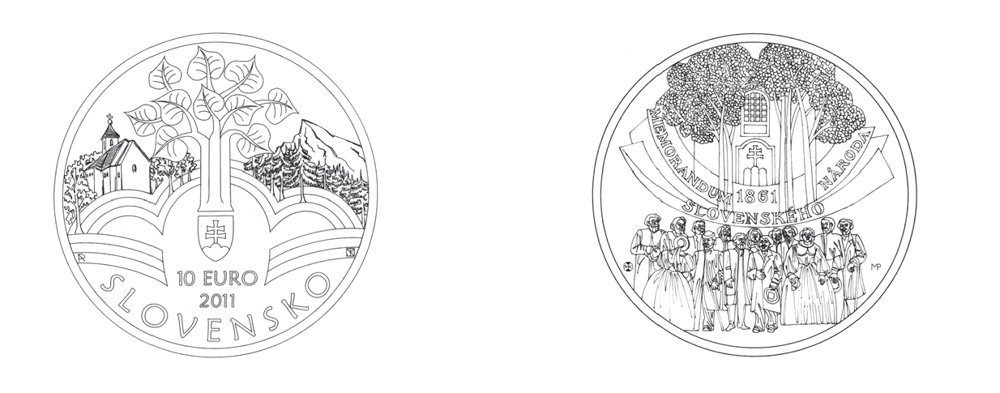

## 78

OZNÁMENIE

Národnej banky Slovenska

z 15. februára 2011

## o vydaní strieborných zberateľských euromincí v nominálnej hodnote 10 eur pri príležitosti 150. výročia prijatia Memoranda národa slovenského

1. Úvodné ustanovenia

a) Národná banka Slovenska podľa § 17h ods. 1 zákona Národnej rady Slovenskej republiky č. 566/1992 Zb. o Národnej banke Slovenska v znení neskorších predpisov a podľa § 1 ods. 2 písm. d) zákona Národnej rady Slovenskej republiky č. 1/1993 Z. z. o Zbierke zákonov Slovenskej republiky v znení zákona č. 275/2002 Z. z. oznamuje, že pri príležitosti 150. výročia prijatia Memoranda národa slovenského vydáva do obehu strieborné zberateľské euromince v nominálnej hodnote 10 eur (ďalej len „zberateľská eurominca“).

b) Zberateľská eurominca má štatút zákonného platidla len v Slovenskej republike.

c) Zberateľská eurominca sa razí zo zliatiny obsahujúcej 900 dielov striebra a 100 dielov medi; jej hmotnosť je 18 g a priemer 34 mm. Pri razbe zberateľskej euromince je povolená horná a dolná odchýlka v priemere 0,1 mm; povolená horná odchýlka v hmotnosti je 0,4 g a v obsahu striebra 10/1000.

2. Vzhľad zberateľskej euromince

a) Na líci zberateľskej euromince je v hornej časti mincového poľa vyobrazený štylizovaný strom lipy s trikolórou v tvare trojvršia. Nad trikolórou vľavo je vyobrazený kostol ako symbol kresťanstva a vpravo vrch Kriváň ako symbol ochrany slobody a svojbytnosti slovenského národa. Štátny znak Slovenskej republiky je umiestnený v strede mincového poľa. Pod ním je v dvoch riadkoch označenie nominálnej hodnoty zberateľskej euromince „10 EURO“ a letopočet „2011“. Názov štátu „SLOVENSKO“ je v opise zľava doprava pri spodnom okraji mincového poľa. Štylizované iniciálky mien a priezvisk spoluautorov výtvarného návrhu lícnej strany zberateľskej euromince Mgr. art. Andrey Rolkovej „AR“ a Pavla Károlyho „PK“ sú umiestnené pri ľavom a pravom okraji v spodnom pruhu trikolóry.

b) Na rube zberateľskej euromince je v spodnej časti mincového poľa vyobrazená skupina účastníkov Slovenského národného zhromaždenia v Turčianskom svätom Martine, ktoré prijalo Memorandum národa slovenského. V hornej časti mincového poľa je vyobrazená kompozícia priečelia evanjelického kostola s lipami, pri ktorých sa zhromaždenie konalo. Kostol je výtvarne doplnený dvojkrížom na trojvrší, ako symbolom Slovenska. Letopočet „1861“ a nápis „MEMORANDUM NÁRODA SLOVENSKÉHO“ sú umiestnené vnútri trikolóry. Značka Mincovne Kremnica, štátny podnik, ktorú tvorí skratka „MK“ umiestnená medzi dvoma razidlami, je vľavo od zhromaždenia a štylizované iniciálky mena a priezviska autorky výtvarného návrhu rubovej strany zberateľskej euromince Márie Poldaufovej „MP“ sú vpravo od neho.

c) Na hrane mince je nápis do hĺbky „ZA NÁRODNÚ SVOJBYTNOSŤ A ROVNOPRÁVNOSŤ“. Začiatok a koniec nápisu je oddelený lipovým listom.

Štát vydania: Slovenská republika

Začiatok vydávania: máj 2011

Jozef Makúch v. r.
