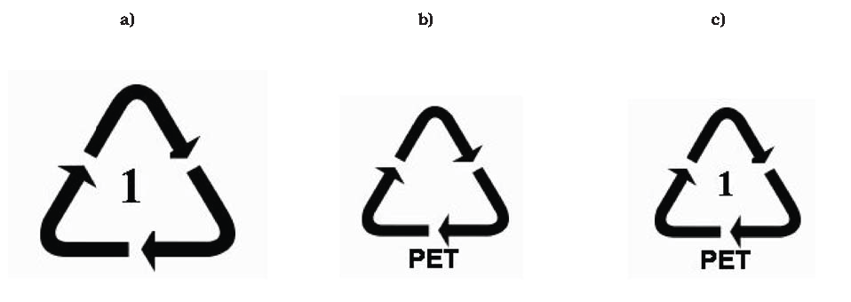

Príloha č. 5 k vyhláške č. 91/2011 Z. z.

- GRAFICKÉ ZNAČKY NA OZNAČOVANIE OBALOV

  - 1. Možnosti označenia obalu podľa materiálového zloženia v súlade s osobitným predpisom.4)

  - a) | b) | c)

  - 1 | PET | PET 1

  - 2. Ďalšie možnosti označenia obalu podľa materiálového zloženia.

  - 

  - 3. Značka, ktorá znamená, že obal po použití treba dať do zbernej nádoby.

  - 
