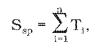
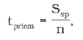
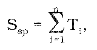
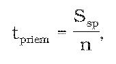
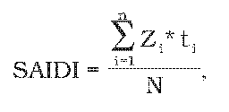
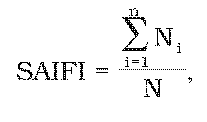

# Čl. I

Vyhláška Úradu pre reguláciu sieťových odvetví č. 328/2008 Z. z., ktorou sa ustanovujú štandardy kvality dodávaného plynu a poskytovaných služieb v plynárenstve sa mení a dopĺňa takto:

- 1. V § 1 písmeno a) znie:

- „a)

- poruchou odchýlka od normálneho prevádzkového stavu zásobníka, ktorá spôsobuje obmedzenie alebo prerušenie uskladňovania plynu v zásobníku, odchýlka od normálneho stavu prepravnej siete, ktorá spôsobuje obmedzenie alebo prerušenie prepravy plynu na časti prepravnej siete, alebo odchýlka od normálneho stavu distribučnej siete, ktorá spôsobuje obmedzenie alebo prerušenie distribúcie plynu v časti distribučnej siete, okrem odchýlok spôsobených z dôvodov podľa osobitného predpisu,1)“.

- Poznámka pod čiarou k odkazu 1 znie:

- „1)

- § 41 ods. 2, § 43 ods. 2 a § 46 ods. 2 zákona č. 656/2004 Z. z. o energetike a o zmene niektorých zákonov v znení neskorších predpisov.“.

- 2. § 1 sa dopĺňa písmenami c) až e), ktoré znejú:

- „c)

- udalosťou zaznamenaný stav týkajúci sa štandardu kvality dodávaného plynu a poskytovaných služieb v plynárenstve súvisiacich s uskladňovaním plynu, prepravou plynu, distribúciou plynu a dodávkou plynu, zaznamenaný regulovaným subjektom alebo dotknutým účastníkom trhu s plynom prostredníctvom písomného podania alebo iným spôsobom, napríklad telefaxom a elektronickými prostriedkami; také podanie je potrebné písomne doplniť najneskôr do troch dní,

- d)

- rokom t kalendárny rok, v ktorom regulovaný subjekt predkladá vyhodnotené štandardy kvality,

- e)

- rokom t-1 kalendárny rok predchádzajúci roku t, za ktorý sa vyhodnocujú štandardy kvality.“.

- 3. V § 2 písmeno e) znie:

- „e)

- dodržanie priemernej doby trvania prerušenia služieb uskladňovania plynu pri pevnej uskladňovacej kapacite najviac 24 hodín; to neplatí pri prerušení nezavinenom prevádzkovateľom zásobníka, pri prerušení, ktoré je v súlade so zmluvou o uskladňovaní plynu, a pri plánovanom prerušení podľa § 2 písm. f),“.

- 4. V § 2 písmeno g) znie:

- „g)

- dodržanie termínu začiatku a ukončenia prerušenia alebo obmedzenia služieb uskladňovania plynu v súlade s písomným oznámením podľa písmena f),“.

- 5. § 2 sa dopĺňa písmenami h) až k), ktoré znejú:

- „h)

- zverejnenie informácie o voľnej uskladňovacej kapacite na internetovej stránke prevádzkovateľa zásobníka najneskôr sedem dní pred uvoľnením voľnej uskladňovacej kapacity, ak má prevádzkovateľ zásobníka takú informáciu, inak deň po uvoľnení voľnej uskladňovacej kapacity,

- i)

- zverejnenie informácie o voľnej prerušiteľnej uskladňovacej kapacite na internetovej stránke prevádzkovateľa zásobníka najneskôr sedem dní pred uvoľnením voľnej prerušiteľnej uskladňovacej kapacity, ak má prevádzkovateľ zásobníka takú informáciu, inak deň po uvoľnení voľnej prerušiteľnej uskladňovacej kapacity,

- j)

- zverejnenie informácie o pláne predpokladaných ročných odstávok na nasledujúci kalendárny rok na internetovej stránke prevádzkovateľa zásobníka do 30. novembra kalendárneho roka,

- k)

- dosiahnutie úrovne kvality uskladňovania plynu tak, aby výsledná hodnota vypočítaná podľa prílohy č. 5 neprekročila 6,60 %.“.

- 6. V § 3 písm. c) prvom bode sa slová „48 hodín“ nahrádzajú slovami „24 hodín“.

- 7. V § 3 písmeno i) znie:

- „i)

- dodržanie priemernej doby trvania nedodržania plynulosti prepravy plynu najviac 15 hodín,“.

- 8. § 3 sa dopĺňa písmenom l), ktoré znie:

- „l)

- dosiahnutie úrovne kvality prepravy plynu tak, aby výsledná hodnota vypočítaná podľa prílohy č. 6 neprekročila 6,95 %.“.

- 9. V § 4 písm. c) prvom bode sa slová „48 hodín“ nahrádzajú slovami „24 hodín“.

- 10. V § 4 písm. d) prvom bode sa slová „20 dní“ nahrádzajú slovami „15 dní“.

- 11. V § 4 písm. d) druhom bode sa slová „30 dní“ nahrádzajú slovami „20 dní“.

- 12. V § 4 písmeno l) znie:

- „l)

- dodržanie plynulosti distribúcie plynu, pričom

- a)

- priemerná doba prerušenia distribúcie plynu je najviac 15 hodín,

- b)

- priemerný počet prerušení distribúcie plynu je najviac päť,“.

- 13. § 4 sa dopĺňa písmenom m), ktoré znie:

- „m)

- dosiahnutie úrovne kvality distribúcie plynu tak, aby výsledná hodnota vypočítaná podľa prílohy č. 7 neprekročila 6,80 %.“.

- 14. § 5 sa dopĺňa písmenom h), ktoré znie:

- „h)

- dosiahnutie úrovne kvality dodávky plynu tak, aby výsledná hodnota vypočítaná podľa prílohy č. 8 neprekročila 6,75 %.“.

- 15. V § 6 písm. c) sa slová „sú vykonávané činnosti bezprostredne zamedzujúce vzniku stavu núdze“ nahrádzajú slovami „vykonávania činnosti bezprostredne zamedzujúcej vzniku stavu núdze“.

- 16. V § 6 sa označenie druhého písmena c) nahrádza písmenom d).

- 17. § 7 vrátane nadpisu znie:

- 㤠7

- Sledovanie, vyhodnocovanie a zverejňovanie štandardov kvality regulovaným subjektom

- (1)

- Štandardy kvality sa sledujú a vyhodnocujú regulovaným subjektom v rozsahu uvedenom v prílohách č. 1 až 8 za každý kalendárny rok alebo jeho časť, počas ktorej regulovaný subjekt vykonával regulovanú činnosť na základe podaní účastníkov trhu s plynom a informácií zistených z vlastnej činnosti regulovaného subjektu. Udalosti a podania, ktorým lehota na vybavenie neuplynula do konca kalendárneho roka, v ktorom nastali, zaradia sa do vyhodnotenia štandardov kvality za kalendárny rok, v ktorom uplynie lehota na ich vybavenie.

- (2)

- Na účely sledovania štandardov kvality sa prevádzkovateľom zásobníka, prevádzkovateľom prepravnej siete, prevádzkovateľom distribučnej siete a dodávateľom plynu vyhotovuje sumárny záznam, ktorý obsahuje najmä

- a)

- identifikačné údaje regulovaného subjektu, a to

- 1.

- obchodné meno a miesto podnikania fyzickej osoby – podnikateľa,

- 2.

- obchodné meno, právnu formu, sídlo a identifikačné číslo právnickej osoby,

- b)

- identifikačné údaje účastníka trhu s plynom, a to

- 1.

- meno, priezvisko a trvalý pobyt fyzickej osoby,

- 2.

- obchodné meno a miesto podnikania fyzickej osoby – podnikateľa,

- 3.

- obchodné meno, právnu formu, sídlo a identifikačné číslo právnickej osoby,

- c)

- názov, číslo a adresu odberného miesta alebo odovzdávaco-preberacieho bodu,

- d)

- dátum, čas a spôsob oznámenia udalosti alebo zistenia nedodržania štandardu kvality,

- e)

- opis udalosti,

- f)

- príčinu nedodržania štandardu kvality,

- g)

- dátum a spôsob vybavenia udalosti,

- h)

- podpis s uvedením mena, priezviska a funkcie oprávnenej osoby regulovaného subjektu.

- (3)

- Údaje v zázname podľa odseku 2 písm. b) a c) sa nevyžadujú pri sledovaní štandardu kvality podľa § 2 písm. h), i) a j).

- (4)

- Prevádzkovateľom zásobníka sa na účely vyhodnotenia štandardu kvality v prílohe č. 1 tabuľka č. 2 sleduje

- a)

- súhrnná doba prerušení uskladňovania plynu, ktorú tvorí súčet všetkých dôb trvania prerušení služieb uskladňovania plynu pri pevnej uskladňovacej kapacite, ktoré neboli zavinené prevádzkovateľom zásobníka, sú v súlade so zmluvou o uskladňovaní alebo neboli vopred oznámené v lehote podľa § 2 písm. f), ktorá sa za kalendárny rok vypočíta podľa vzorca

- 

- kde

- Ssp – súhrnná doba prerušení služieb uskladňovania plynu v hodinách,

- Ti – doba trvania i-tého prerušenia služieb uskladňovania plynu v hodinách,

- b)

- doba trvania i-tého prerušenia služieb uskladňovania plynu v hodinách, ktorá sa vypočíta podľa vzorca

- Ti = t1 – t0,

- kde

- t0 – dátum a čas začiatku i-tého prerušenia služieb uskladňovania plynu,

- t1 – dátum a čas konca i-tého prerušenia služieb uskladňovania plynu,

- c)

- priemerná doba trvania prerušenia služieb uskladňovania plynu pri pevnej uskladňovacej kapacite za kalendárny rok, ktorá sa vypočíta podľa vzorca

- 

- kde

- tpriem – priemerná doba trvania prerušenia uskladňovania plynu v hodinách,

- n – počet prerušení celkom.

- (5)

- Prevádzkovateľom prepravnej siete sa na účely vyhodnotenia štandardu kvality v prílohe č. 2 tabuľke č. 2 sleduje

- a)

- súhrnná doba nedodržania plynulosti prepravy plynu, ktorú tvorí súčet všetkých dôb trvania nedodržaní plynulosti prepravy plynu za kalendárny rok, ktorá sa vypočíta podľa vzorca

- 

- kde

- Ssp – súhrnná doba nedodržania plynulosti prepravy plynu v hodinách,

- Ti – doba trvania i-tého nedodržania plynulosti prepravy plynu v hodinách,

- b)

- doba i-tého nedodržania plynulosti prepravy plynu v hodinách, ktorá sa vypočíta podľa vzorca

- Ti = t1 – t0,

- kde

- t0 – dátum a čas začiatku i-tého nedodržania plynulosti prepravy plynu,

- t1 – dátum a čas konca i-tého nedodržania plynulosti prepravy plynu,

- c)

- priemerná doba trvania nedodržania plynulosti prepravy plynu za kalendárny rok, ktorá sa vypočíta podľa vzorca

- 

- kde

- tpriem – priemerná doba trvania nedodržania plynulosti v hodinách,

- n – počet prerušení celkom,

- (6)

- Prevádzkovateľom distribučnej siete sa na účely vyhodnotenia štandardu kvality v prílohe č. 3 tabuľkách č. 2 a 3 sleduje

- a)

- priemerná doba prerušenia distribúcie plynu, ktorá sa vypočíta podľa vzorca

- 

- kde

- SAIDI – priemerná doba prerušenia distribúcie plynu,

- Zi– počet dotknutých odberných miest pri i-tom prerušení

- distribúcie plynu,

- N – celkový počet odberných miest prevádzkovateľa

- distribučnej siete,

- ti – doba trvania i-tého prerušenia distribúcie plynu v hodinách,

- 1.

- do priemernej doby prerušenia distribúcie plynu vstupujú všetky neplánované prerušenia distribúcie plynu prevádzkovateľa distribučnej siete, ktoré mali za následok prerušenie distribúcie plynu odberateľom plynu na odberných miestach v trvaní viac ako jedna hodina,

- 2.

- do priemernej doby prerušenia distribúcie plynu nevstupujú prerušenia distribúcie plynu prevádzkovateľa distribučnej siete, ktoré boli zapríčinené vznikom udalosti v nadradenej distribučnej sieti, prepravnej sieti alebo živelnej udalosti,

- 3.

- priemerná doba prerušenia distribúcie plynu sa sleduje mesačne, o každej udalosti je zaznamenaný dátum a čas vzniku, doba trvania prerušenia distribúcie plynu, počet dotknutých odberných miest a príčina vzniku udalosti; prerušenie distribúcie plynu v danej distribučnej sieti, ktoré bolo zapríčinené vznikom udalosti podľa bodu 2, sa sleduje a vyhodnocuje osobitne a úradu sa predkladá len na vyžiadanie,

- b)

- priemerný počet prerušení distribúcie plynu, ktorá sa vypočíta podľa vzorca

- 

- kde

- SAIFI – priemerný počet prerušení distribúcie plynu,

- Ni – počet dotknutých odberných miest pri i-tom prerušení distribúcie plynu,

- N – celkový počet odberných miest prevádzkovateľa distribučnej siete.

- 1.

- do priemerného počtu prerušení distribúcie plynu vstupujú všetky neplánované prerušenia distribúcie plynu prevádzkovateľa distribučnej siete, ktoré mali za následok prerušenie distribúcie plynu odberateľom plynu na odberných miestach v trvaní viac ako jedna hodina,

- 2.

- do priemerného počtu prerušení distribúcie plynu nevstupujú prerušenia distribúcie plynu u prevádzkovateľa distribučnej siete, ktoré boli zapríčinené vznikom udalosti v nadradenej distribučnej sieti, prepravnej sieti alebo živelnej udalosti,

- 3.

- priemerný počet prerušení distribúcie plynu sa sleduje mesačne, o každej udalosti je zaznamenaný dátum a čas vzniku, doba trvania prerušenia distribúcie plynu, počet dotknutých odberných miest a príčina vzniku udalosti; prerušenie distribúcie plynu v danej distribučnej sieti, ktoré bolo zapríčinené vznikom udalosti podľa bodu 2, sa sleduje a vyhodnocuje osobitne a úradu sa predkladá len na vyžiadanie.

- (7)

- Štandardy kvality podľa § 6 sa vyhodnocujú samostatne podľa dôvodu vzniku udalosti v rozsahu údajov

- a)

- dátum a čas vzniku udalosti,

- b)

- dátum a čas skončenia udalosti,

- c)

- počet dotknutých účastníkov trhu s plynom,

- d)

- celkové množstvo nedodaného plynu.

- (8)

- Vyhodnotenie štandardov kvality za rok t-1 v rozsahu podľa príloh č. 1 až 8 sa zverejňuje do 28. februára roku t po dobu najmenej 12 mesiacov na internetovej stránke regulovaného subjektu alebo vo výročnej správe regulovaného subjektu alebo iným obvyklým spôsobom, ak regulovaný subjekt nemá zriadenú internetovú stránku alebo nevydáva výročnú správu.

- (9)

- Vyhodnotenie štandardov kvality za rok t-1 v rozsahu podľa príloh č. 1 až 8 sa predkladá úradu podľa osobitného predpisu11) do 28. februára roku t.“.

- 18. Za § 7 sa vkladá § 7a, ktorý vrátane nadpisu znie:

- 㤠7a

- Prechodné ustanovenie k úpravám účinným od 1. apríla 2011

- Vyhodnotenie štandardov kvality za mesiace január až marec roku 2011 sa regulovaným subjektom vykoná podľa doterajšej vyhlášky a vyhodnotenie štandardov kvality za mesiace apríl až december roku 2011 sa vykoná podľa tejto vyhlášky.“.

- 19. Prílohy č. 1 až 7 znejú:

- „Príloha č. 1 k vyhláške č. 328/2008 Z. z.

- Dosiahnutá úroveň štandardu kvality uskladňovania plynu

- Regulovaný subjekt:

- Obdobie od do Počet odberných miest:

- Tabuľka č. 1

- Štandard kvality uskladňovania plynu | Počet udalostí celkom | Počet udalostí v limite | Počet udalostí mimo limitu | Počet nedoriešených udalostí | Počet udalostí z minulého roka | Podiel udalostí v limite k počtu udalostí celkom (%)

- Dodržanie kvality plynu pri uskladňovaní podľa technických podmienok prevádzkovateľa zásobníka | | | | | |

- Písomné oznámenie prevádzkovateľa zásobníka užívateľovi zásobníka o stave preverovania kvality plynu | | | | | |

- Písomné oznámenie prevádzkovateľa zásobníka užívateľovi zásobníka o spôsobe a termíne odstránenia príčiny zníženej kvality plynu | | | | | |

- Overenie správnosti vyúčtovania platby za uskladňovanie plynu a odstránenie zistených nedostatkov vyúčtovania | | | | | |

- Písomné oznámenie prevádzkovateľa zásobníka užívateľovi zásobníka o začiatku a ukončení plánovaného prerušenia alebo obmedzenia uskladňovania plynu | | | | | |

- Dodržanie termínu začiatku a ukončenia prerušenia alebo obmedzenia služieb uskladňovania plynu | | | | | |

- Dodržanie lehoty na zverejnenie informácie o voľnej uskladňovacej kapacite na internetovej stránke prevádzkovateľa zásobníka, najneskôr sedem dní pred uvoľnením uskladňovacej kapacity | | | | | |

- Dodržanie lehoty na zverejnenie informácie o voľnej prerušiteľnej uskladňovacej kapacite na internetovej stránke prevádzkovateľa zásobníka, najneskôr sedem dní pred uvoľnením prerušiteľnej kapacity | | | | | |

- Dodržanie lehoty na zverejnenie informácie o pláne ročných odstávok na internetovej stránke prevádzkovateľa zásobníka 30 dní pred koncom kalendárneho roka t | | | | | |

- Vysvetlivky k tabuľke č. 1: Počet udalostí celkom = Počet udalostí v limite + Počet udalostí mimo limitu – Počet nedoriešených udalostí + Počet udalostí z minulého roka.

- Dosiahnutá úroveň štandardu kvality uskladňovania plynu

- Regulovaný subjekt:

- Obdobie od do Počet odberných miest:

- Tabuľka č. 2

- Štandard kvality uskladňovania plynu | rok t | rok t-1 | | | |

- | Počet prerušení celkom | Súhrnná doba prerušení v hodinách | Priemerná doba trvania prerušenia v hodinách | Počet prerušení celkom | Súhrnná doba prerušení v hodinách | Priemerná doba trvania prerušenia v hodinách

- Dodržanie priemernej doby trvania prerušenia služieb uskladňovania plynu pri pevnej uskladňovacej kapacite najviac 24 hodín | | | | | |

- Príloha č. 2 k vyhláške č. 328/2008 Z. z.

- Dosiahnutá úroveň štandardu kvality prepravy plynu

- Regulovaný subjekt:

- Obdobie od do Počet odberných miest:

- Tabuľka č. 1

- Štandard kvality prepravy plynu | Počet udalostí celkom | Počet udalostí v limite | Počet udalostí mimo limitu | Počet nedoriešených udalostí | Počet udalostí z minulého roka | Podiel udalostí v limite k udalostiam celkom (%)

- Vydanie písomného stanoviska k pripojeniu plynového zariadenia k prepravnej sieti | | | | | |

- Umožnenie prepravy plynu po pripojení plynového zariadenia k prepravnej sieti podľa dátumu začiatku prepravy dohodnutého v zmluve o preprave plynu | | | | | |

- Obnovenie prepravy plynu po poruche alebo po doručení žiadosti užívateľa prepravnej siete plynu na obnovenie prepravy plynu po prerušení alebo obmedzení prepravy plynu | | | | | |

- Dodržanie kvality plynu počas prepravy v súlade s kvalitou plynu prevzatého na prepravu od užívateľa prepravnej siete | | | | | |

- Písomné oznámenie prevádzkovateľa prepravnej siete užívateľovi prepravnej siete o stave preverovania kvality plynu | | | | | |

- Písomné oznámenie prevádzkovateľa prepravnej siete užívateľovi prepravnej siete o spôsobe a termíne odstránenia príčiny zníženej kvality prepravovaného plynu | | | | | |

- Zabezpečenie preskúšania určeného meradla | | | | | |

- Overenie správnosti vyúčtovania platby za prepravu plynu a odstránenie zistených nedostatkov vyúčtovania | | | | | |

- Písomné oznámenie prevádzkovateľa prepravnej siete užívateľovi prepravnej siete o zaèiatku a ukonèení plánovaného obmedzenia alebo prerušenia prepravy plynu | | | | | |

- Dodržanie termínu začatia a ukončenia plánovaného obmedzenia alebo prerušenia prepravy plynu | | | | | |

- Vysvetlivky k tabuľke č. 1: Počet udalostí celkom = Počet udalostí v limite + Počet udalostí mimo limitu – Počet nedoriešených udalostí + Počet udalostí z minulého roka.

- Dosiahnutá úroveň štandardu kvality prepravy plynu

- Regulovaný subjekt:

- Obdobie od do Počet odberných miest:

- Tabuľka č. 2

- Štandard kvality prepravy plynu | rok t | | | rok t-1 | |

- | Počet nedodržaní plynulosti prepravy celkom | Súhrnná doba nedodržania plynulosti prepravy v hodinách | Priemerná doba trvania nedodržania plynulosti prepravy v hodinách | Počet nedodržaní plynulosti prepravy celkom | Súhrnná doba nedodržania plynulosti prepravy v hodinách | Priemerná doba trvania nedodržania plynulosti prepravy v hodinách

- Dodržanie priemernej doby trvania nedodržania plynulosti prepravy plynu najviac 15 hodín | | | | | |

- Príloha č. 3 k vyhláške č. 328/2008 Z. z.

- Dosiahnutá úroveň štandardu kvality distribúcie plynu

- Regulovaný subjekt:

- Obdobie od do Počet odberných miest:

- Tabuľka č. 1

- Štandard kvality distribúcie plynu | Počet udalostí celkom | Počet udalostí v limite | Počet udalostí mimo limitu | Počet nedoriešených udalostí | Počet udalostí z minulého roka | Podiel udalostí v limite k počtu udalostí celkom (%)

- Písomné určenie technických a obchodných podmienok pripojenia plynového zariadenia k distribučnej sieti | | | | | |

- Umožnenie distribúcie plynu po pripojení plynového zariadenia k distribučnej sieti | | | | | |

- Obnovenie distribúcie plynu po poruche | | | | | |

- Obnovenie distribúcie plynu po doručení žiadosti užívateľa distribučnej siete po prerušení alebo obmedzení distribúcie plynu | | | | | |

- Písomné vyjadrenie prevádzkovateľa distribučnej siete k zmene odberových pomerov na odbernom mieste odberateľa plynu v domácnosti | | | | | |

- Písomné vyjadrenie prevádzkovateľa distribučnej siete k zmene odberových pomerov na odbernom mieste odberateľa plynu mimo domácnosti | | | | | |

- Dodržanie kvality plynu pri distribúcii plynu ustanovenej v technických podmienkach prevádzkovateľa distribučnej siete | | | | | |

- Písomné oznámenie prevádzkovateľa distribučnej siete užívateľovi distribučnej siete o stave preverovania kvality plynu | | | | | |

- Písomné oznámenie prevádzkovateľa distribučnej siete užívateľovi distribučnej siete o spôsobe a termíne odstránenia príčiny zníženej kvality plynu | | | | | |

- Zabezpečenie preskúšania určeného meradla | | | | | |

- Overenie správnosti vyúčtovania platby za distribúciu plynu a odstránenie zistených nedostatkov vyúčtovania | | | | | |

- Písomné oznámenie prevádzkovateľa distribučnej siete užívateľovi distribučnej siete o začiatku a ukončení plánovaného obmedzenia alebo prerušenia distribúcie plynu | | | | | |

- Dodržanie termínu začatia a ukončenia prerušenia alebo obmedzenia distribúcie plynu | | | | | |

- Vysvetlivky k tabuľke č. 1: Počet udalostí celkom = Počet udalostí v limite + Počet udalostí mimo limitu – Počet nedoriešených udalostí + Počet udalostí z minulého roka.

- Dosiahnutá úroveň štandardu kvality distribúcie plynu

- Regulovaný subjekt:

- Obdobie od do

- Počet odberných miest registrovaných prevádzkovateľom sústavy k 31. decembru .......................................

- Dodržanie plynulosti distribúcie plynu podľa § 4 písm. l) – SAIDI

- Tabuľka č. 2

- Priemerná doba prerušenia distribúcie plynu najviac 15 hodín | | | | | | | | | | | | |

- 1. | 2. | 3. | 4. | 5. | 6. | 7. | 8. | 9. | 10. | 11. | 12. | Rok | Index

- mesiac | mesiac | mesiac | mesiac | mesiac | mesiac | mesiac | mesiac | mesiac | mesiac | mesiac | mesiac | | 2.../2...

- Dodržanie plynulosti distribúcie plynu podľa § 4 písm. l) – SAIFI

- Tabuľka č. 3

- Priemerný počet prerušení distribúcie plynu najviac 5 | | | | | | | | | | | | |

- 1. | 2. | 3. | 4. | 5. | 6. | 7. | 8. | 9. | 10. | 11. | 12. | Rok | Index

- mesiac | mesiac | mesiac | mesiac | mesiac | mesiac | mesiac | mesiac | mesiac | mesiac | mesiac | mesiac | | 2.../2...

- Príloha č. 4 k vyhláške č. 328/2008 Z. z.

- Dosiahnutá úroveň štandardu kvality dodávky plynu

- Regulovaný subjekt:

- Obdobie od do Počet odberných miest:

- Tabuľka č. 1

- Štandard kvality dodávky plynu | Počet udalostí celkom | Počet udalostí v limite | Počet udalostí mimo limitu | Počet nedoriešených udalostí | Počet udalostí z minulého roka | Podiel udalostí v limite k počtu udalostí celkom (%)

- Uzatvorenie zmluvy a zabezpečenie plynulej dodávky plynu odberateľovi plynu | | | | | |

- Zabezpečenie obnovenia dodávky plynu odberateľovi plynu z dôvodu omeškania platby za dodávku plynu | | | | | |

- Písomné oznámenie dodávateľa plynu odberateľovi plynu o stave preverovania kvality plynu | | | | | |

- Písomné oznámenie dodávateľa plynu odberateľovi plynu o spôsobe a termíne odstránenia príčiny zníženej kvality plynu | | | | | |

- Overenie správnosti vyúčtovania platby za dodávku plynu a odstránenie zistených nedostatkov vyúčtovania | | | | | |

- Odoslanie žiadosti odberateľa plynu prevádzkovateľovi prepravnej alebo distribučnej siete | | | | | |

- Odoslanie stanoviska prevádzkovateľa prepravnej siete alebo distribučnej siete odberateľovi plynu | | | | | |

- Vysvetlivky k tabuľke č. 1: Počet udalostí celkom = Počet udalostí v limite + Počet udalostí mimo limitu – Počet nedoriešených udalostí + Počet udalostí z minulého roka.

- Príloha č. 5 k vyhláške č. 328/2008 Z. z.

- Tabuľka č. 1 USKLADŇOVANIE PLYNU

- i | Štandard kvality uskladňovania plynu | Miera závažnosti v % | Skutočná odchýlka štandardov kvality | Hodnota úrovne Húi v %

- 11 | Dodržanie kvality plynu pri uskladňovaní podľa technických podmienok prevádzkovateľa zásobníka [§ 2 písm. a)] | 15 | |

- 12 | Písomné oznámenie prevádzkovateľa zásobníka užívateľovi zásobníka o stave preverovania kvality plynu [§ 2 písm. b)] | 10 | |

- 13 | Písomné oznámenie prevádzkovateľa zásobníka užívateľovi zásobníka o spôsobe a termíne odstránenia príčiny zníženej kvality plynu [§ 2 písm. c)] | 10 | |

- 14 | Overenie správnosti vyúčtovania platby za uskladňovanie plynu a odstránenie zistených nedostatkov vyúčtovania [§ 2 písm. d)] | 15 | |

- 15 | Dodržanie plynulosti procesu uskladňovania plynu dohodnutého v zmluve o uskladňovaní plynu pri pevnej uskladňovacej kapacite [§ 2 písm. e)] | 17 | |

- 16 | Písomné oznámenie prevádzkovateľa zásobníka užívateľovi zásobníka o začiatku a ukončení plánovaného prerušenia alebo obmedzenia uskladňovania plynu [§ 2 písm. f)] | 5 | |

- 17 | Dodržanie termínu začiatku a ukončenia prerušenia alebo obmedzenia služieb uskladňovania plynu [§ 2 písm. g)] | 7 | |

- 18 | Zverejnenie informácie o voľnej uskladňovacej kapacite na internetovej stránke prevádzkovateľa zásobníka najneskôr sedem dní pred uvoľnením uskladňovacej kapacity [§ 2 písm. h)] | 7 | |

- 19 | Zverejnenie informácie o voľnej prerušiteľnej uskladňovacej kapacite na internetovej stránke prevádzkovateľa zásobníka najneskôr sedem dní pred uvoľnením prerušiteľnej kapacity [§ 2 písm. i)] | 7 | |

- 20 | Zverejnenie informácie o pláne predpokladaných ročných odstávok na nasledujúci kalendárny rok na internetovej stránke prevádzkovateľa zásobníka do 30. novembra kalendárneho roka t [§ 2 písm. j)] | 7 | |

- Hodnota úrovne štandardu kvality uskladňovania plynu (Hú) | | | |

- Hodnota úrovne štandardu kvality uskladňovania plynu sa vypočíta podľa vzorca

- Hú = Σ Húi ,

- kde

- Húi – hodnota úrovne i-tého štandardu kvality uskladňovania plynu, Húi =MZi *Ki,

- i – štandard kvality uskladňovania plynu,

- MZi– miera závažnosti i-tého parametra štandardu kvality uskladňovania plynu,

- Ki – skutočná odchýlka, Ki = (100 – PUi)/100,

- PUi – podiel udalostí v limite k počtu udalostí celkom v percentách uvedených v prílohe č. 1 tabuľke č. 1.

- Príloha č. 6 k vyhláške č. 328/2008 Z. z.

- Tabuľka č. 1 PREPRAVA PLYNU

- i | Štandard kvality prepravy plynu | Miera závažnosti v % | Skutočná odchýlka štandardu kvality | Hodnota úrovne Húi v %

- 31 | Vydanie písomného stanoviska k pripojeniu plynového zariadenia k prepravnej sieti [§ 3 písm. a)] | 10 | |

- 32 | Umožnenie prepravy plynu po pripojení plynového zariadenia k prepravnej sieti podľa dátumu začatia prepravy dohodnutého v zmluve o preprave plynu [§ 3 písm. b)] | 9 | |

- 33 | Obnovenie prepravy plynu po poruche alebo po doručení žiadosti užívateľa prepravnej siete plynu na obnovenie prepravy plynu po prerušení alebo obmedzení prepravy plynu [§ 3 písm. c)] | 10 | |

- 34 | Dodržanie kvality plynu počas prepravy [§ 3 písm. d)] | 10 | |

- 35 | Písomné oznámenie prevádzkovateľa prepravnej siete užívateľovi prepravnej siete o stave preverovania kvality plynu [§ 3 písm. e)] | 10 | |

- 36 | Písomné oznámenie prevádzkovateľa prepravnej siete užívateľovi prepravnej siete o spôsobe a termíne odstránenia príčiny zníženej kvality prepravovaného plynu [§ 3 písm. f)] | 10 | |

- 37 | Zabezpečenie preskúšania určeného meradla [§ 3 písm. g)] | 10 | |

- 38 | Overenie správnosti vyúčtovania platby za prepravu plynu a odstránenie zistených nedostatkov vyúčtovania [§ 3 písm. h)] | 10 | |

- 39 | Dodržanie plynulosti prepravy plynu [§ 3 písm. i)] | 7 | |

- 40 | Písomné oznámenie prevádzkovateľa prepravnej siete užívateľovi prepravnej siete o začiatku a ukončení plánovaného obmedzenia alebo prerušenia prepravy plynu [§ 3 písm. j)] | 7 | |

- 41 | Dodržania termínu začatia alebo ukončenia plánovaného obmedzenia alebo prepravy plynu [§ 3 písm. k)] | 7 | |

- Hodnota úrovne štandardu kvality prepravy plynu (Hú) | | | |

- Hodnota úrovne štandardu kvality prepravy plynu sa vypočíta podľa vzorca

- Hú = Σ Húi ,

- kde

- Húi – hodnota úrovne i-tého štandardu kvality prepravy plynu, Húi=MZi *Ki,

- i – štandard kvality prepravy plynu,

- MZi– miera závažnosti i-tého parametra štandardu kvality prepravy plynu,

- Ki – skutočná odchýlka, Ki = (100 – PUi)/100,

- PUi– podiel udalostí v limite k počtu udalostí celkom v percentách uvedených v prílohe č. 2 tabuľke č. 1.

- Príloha č. 7 k vyhláške č. 328/2008 Z. z.

- Tabuľka č. 1 DISTRIBÚCIA PLYNU

- i | Štandard kvality distribúcie plynu | Miera závažnosti v % | Skutočná odchýlka štandardu kvality | Hodnota úrovne Húi v %

- 51 | Písomné určenie technických a obchodných podmienok pripojenia plynového zariadenia k distribučnej sieti [§ 4 písm. a)] | 5 | |

- 52 | Umožnenie distribúcie plynu po pripojení plynového zariadenia k distribučnej sieti pre odberateľa plynu v domácnosti a odberateľa plynu mimo domácnosti odo dňa, keď žiadateľ preukáže prevádzkovateľovi distribučnej siete splnenie určených technických a obchodných podmienok pripojenia odberného plynového zariadenia k distribučnej sieti [§ 4 písm. b)] | 5 | |

- 53/1 | Obnovenie distribúcie plynu do 48 hodín od okamihu, keď sa prevádzkovateľ prepravnej siete o poruche dozvedel [§ 4 písm. c)] | 10 | |

- 53/2 | Obnovenie distribúcie plynu do dvoch pracovných dní odo dňa doručenia žiadosti užívateľa prepravnej siete plynu o obnovenie prepravy plynu [§ 4 písm. c)] | 7 | |

- 54/1 | Písomné vyjadrenie prevádzkovateľa distribučnej siete k zmene odberových pomerov na odbernom mieste odberateľa plynu v domácnosti [§ 4 písm. d)] | 5 | |

- 54/2 | Písomné vyjadrenie prevádzkovateľa distribučnej siete k zmene odberových pomerov na odbernom mieste odberateľa plynu mimo domácnosti [§ 4 písm. d)] | 5 | |

- 55 | Dodržanie kvality plynu pri distribúcii plynu ustanovej v technických podmienkach prevádzkovateľa distribučnej siete [§ 4 písm. e)] | 8 | |

- 56 | Písomné oznámenie prevádzkovateľa distribučnej siete užívateľovi distribučnej siete o stave preverovania kvality plynu [§ 4 písm. f)] | 5 | |

- 57 | Písomné oznámenie prevádzkovateľa distribučnej siete užívateľovi distribučnej siete o spôsobe a termíne odstránenia príčiny zníženej kvality plynu [§ 4 písm. g)] | 5 | |

- 58 | Zabezpečenie preskúšania určeného meradla formou jeho výmeny a podania žiadosti o vykonanie skúšky [§ 4 písm. h)] | 5 | |

- 59 | Overenie správnosti vyúčtovania platby za distribúciu plynu a odstránenie zistených nedostatkov vyúčtovania [§ 4 písm. i)] | 8 | |

- 60 | Písomné oznámenie prevádzkovateľa distribučnej siete užívateľovi distribučnej siete o spôsobe a termíne odstránenia príčiny zníženej kvality plynu, o začiatku a ukončení plánovaného prerušenia alebo obmedzenia distribúcie plynu [§ 4 písm. j)] | 5 | |

- 61 | Dodržanie termínu začatia a ukončenia prerušenia alebo obmedzenia distribúcie plynu [§ 4 písm. k)] | 7 | |

- 62 | Dodržanie plynulosti distribúcie plynu dohodnutej v zmluve o distribúcii plynu – SAIDI [§ 4 písm. l)] | 10 | |

- 63 | Dodržanie plynulosti distribúcie plynu dohodnutej v zmluve o distribúcii plynu – SAIFI [§ 4 písm. l)] | 10 | |

- Hodnota úrovne štandardu kvality distribúcie plynu (Hú) | | | |

- Hodnota úrovne štandardu kvality distribúcie plynu sa vypočíta podľa vzorca

- Hú = Σ Húi ,

- kde

- Húi – hodnota úrovne i-tého štandardu kvality distribúcie plynu, Húi=MZi *Ki,

- i – štandard kvality distribúcie plynu,

- MZi– miera závažnosti i-tého parametra štandardu kvality distribúcie plynu,

- Ki – skutočná odchýlka, Ki = (100 – PUi)/100,

- PUi– podiel udalostí v limite k počtu udalostí celkom v percentách uvedených v prílohe č. 3 tabuľke č. 1.“.

- 20. Za prílohu č. 7 sa pripája príloha č. 8, ktorá znie:

- „Príloha č. 8 k vyhláške č. 328/2008 Z. z.

- Tabuľka č. 1 DODÁVKA PLYNU

- i | | | | Štandard kvality dodávky plynu | Miera závažnosti v % | Skutočná odchýlka štandardu kvality | Hodnota úrovne Húi v %

- 71 | | | | Uzatvorenie zmluvy o dodávke plynu [§ 5 písm. a)] | 15 | |

- 72 | | | | Obnovenie dodávky plynu odberateľovi plynu po prerušení alebo obmedzení dodávky plynu z dôvodu omeškania platby [§ 5 písm. b)] | 25 | |

- 73 | | | | Písomné oznámenie dodávateľa plynu odberateľovi plynu o stave preverovania kvality plynu [§ 5 písm. d)] | 10 | |

- 74 | | | | Písomné oznámenie dodávateľa plynu odberateľovi plynu o spôsobe a termíne odstránenia príčiny zníženej kvality plynu [§ 5 písm. e)] | 10 | |

- 75 | | | | Overenie správnosti vyúčtovania platby za dodávku plynu a odstránenie zistených nedostatkov vyúčtovania [§ 5 písm. f)] | 20 | |

- 76/1 | | | | Odoslanie žiadosti odberateľa plynu prevádzkovateľovi prepravnej siete alebo prevádzkovateľovi distribučnej siete v lehote do dvoch pracovných dní odo dňa doručenia tejto žiadosti, ak odberateľ plynu nemá s prevádzkovateľom siete uzatvorenú zmluvu o prístupe do prepravnej alebo distribučnej siete [§ 5 písm. g)] | 10 | |

- 76/2 | | | | Odoslanie stanoviska prevádzkovateľa prepravnej alebo distribučnej siete odberateľovi plynu k žiadosti v lehote do dvoch pracovných dní od doručenia tohto stanoviska [§ 5 písm. g)] | 10 | |

- Hodnota úrovne štandardu kvality dodávky plynu (Hú) | | | | | | |

- Hodnota úrovne štandardu kvality dodávky plynu sa vypočíta podľa vzorca

- Hú = Σ Húi ,

- kde

- Húi – hodnota úrovne i-tého štandardu kvality dodávky plynu, Húi=MZi *Ki,

- i – štandard kvality dodávky plynu,

- MZi– miera závažnosti i-tého parametra štandardu kvality dodávky plynu,

- Ki – skutočná odchýlka, Ki = (100 – PUi)/100,

- PUi– podiel udalostí v limite k počtu udalostí celkom v percentách uvedených v prílohe č. 4 tabuľke č. 1.“.
