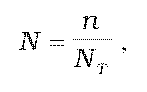

# Čl. I

Vyhláška Úradu pre reguláciu sieťových odvetví č. 315/2008 Z. z., ktorou sa ustanovujú štandardy kvality dodávanej elektriny a poskytovaných služieb sa mení a dopĺňa takto:

- 1. V § 1 písm. a) sa za bodkočiarku vkladajú tieto slová: „za poruchu sa nepovažuje neplánované prerušenie prenosu elektriny alebo distribúcie elektriny na vedení a transformátoroch prenosovej sústavy alebo distribučnej sústavy, ktoré nespôsobilo obmedzenie dodávky elektriny;“.

- 2. V § 1 sa za písmeno a) vkladá nové písmeno b), ktoré znie:

- „b)

- plánovaným prerušením prerušenie prenosu alebo distribúcie elektriny pri uskutočňovaní plánovaných prác na zariadeniach prenosovej sústavy alebo distribučnej sústavy alebo v ich ochrannom pásme,“.

- Doterajšie písmená b) a c) sa označujú ako písmená c) a d).

- 3. V § 1 písm. d) sa za slová „a dodávkou elektriny“ vkladajú slová „a štandardu kvality služieb poskytovaných organizátorom krátkodobého trhu s elektrinou“.

- 4. § 1 sa dopĺňa písmenami e) a f) ktoré znejú:

- „e)

- rokom t kalendárny rok, v ktorom regulovaný subjekt predkladá úradu vyhodnotenie štandardov kvality za rok t-1,

- f)

- rokom t-1 kalendárny rok predchádzajúci roku t.“.

- 5. V § 2 sa za písmeno a) vkladá nové písmeno b), ktoré znie:

- „b)

- dodržanie lehoty 30 dní na odoslanie stanoviska k podaniu prevádzkovateľa distribučnej sústavy alebo koncového odberateľa elektriny priamo pripojeného do prenosovej sústavy alebo dodávateľa elektriny alebo obchodníka s elektrinou týkajúceho sa kvality elektriny, pričom obsahom stanoviska je informácia, či je podanie oprávnené alebo nie; ak je podanie oprávnené, obsahom stanoviska je aj určenie spôsobu a termínu odstránenia príčin zníženej kvality elektriny,“.

- Doterajšie písmená b) až i) sa označujú ako písmená c) až j).

- 6. V § 2 písm. g) sa slová „ 48 hodín“ nahrádzajú slovami „24 hodín“.

- 7. V § 2 písm. i) sa za slová „odstránenie zistených nedostatkov vyúčtovania“ vkladá čiarka a slová „a odoslanie oznámenia, či je podanie oprávnené alebo nie; ak je podanie oprávnené, obsahom stanoviska je aj informácia o zistených nedostatkoch a spôsobe vyrovnania rozdielu v platbách,“.

- 8. V § 2 písm. j) sa na konci pripájajú tieto slová: „tak, aby

  - 1. priemerná doba prerušenia prenosu elektriny počas kalendárneho roka bola najviac päť minút,

  - 2. priemerný počet neplánovaných prerušení prenosu elektriny vzťahujúci sa na jeden transformátor okrem väzbových transformátorov 400/220 kV a záložných transformátorov 400/110 kV a 220/110 kV na napäťovej úrovni 400 kV bol najviac 0,40,

  - 3. priemerný počet neplánovaných prerušení prenosu elektriny vzťahujúci sa na jeden transformátor okrem väzbových transformátorov 400/220 kV a záložných transformátorov 400/110 kV a 220/110 kV na napäťovej úrovni 220 kV bol najviac 0,40,“.

- 9. § 2 sa dopĺňa písmenom k), ktoré znie:

- „k)

- dosiahnutie úrovne kvality pri prenose elektriny tak, aby výsledná hodnota vypočítaná podľa prílohy č. 3 bola najviac 27,55.“.

- 10. V § 3 ods. 1 sa za písmeno a) vkladá nové písmeno b), ktoré znie:

- „b)

- dodržanie lehoty 30 kalendárnych dní na odoslanie stanoviska k podaniu prevádzkovateľa miestnej distribučnej sústavy alebo koncového odberateľa elektriny alebo dodávateľa elektriny alebo obchodníka s elektrinou týkajúceho sa kvality elektriny, pričom obsahom stanoviska je informácia, či je podanie oprávnené alebo nie; ak je podanie oprávnené, obsahom stanoviska je aj určenie spôsobu a termínu odstránenia príčin zníženej kvality elektriny,“.

- Doterajšie písmená b) až l) sa označujú ako písmená c) až m).

- 11. V § 3 ods. 1 písm. c) sa na konci čiarka nahrádza bodkočiarkou a pripájajú sa tieto slová: „lehota podľa odseku 2 sa považuje za dodržanú, ak nedôjde k odstráneniu príčin zníženej kvality elektriny v tejto lehote z dôvodov, ktoré nie sú na strane prevádzkovateľa distribučnej sústavy.“.

- 12. V § 3 ods. 1 písmeno g) znie:

- „g)

- obnovenie distribúcie elektriny po neplánovanom prerušení distribúcie elektriny z dôvodu vzniku poruchy v distribučnej sústave v lehote do

- 1.

- 12 hodín v distribučnej sústave s napäťovou úrovňou nad 1 kV a do odberných miest zariadení ústavnej zdravotnej starostlivosti,3a) odkedy sa prevádzkovateľ distribučnej sústavy o poruche dozvedel; lehota 12 hodín sa vťahuje na odberné miesto zariadenia ústavnej zdravotnej starostlivosti3a) pripojené do sústavy s napäťovou úrovňou do 1 kV len vtedy, ak prevádzkovateľ zariadenia ústavnej zdravotnej starostlivosti3a) oznámil prevádzkovateľovi distribučnej sústavy, že je pripojený do jeho sústavy s napäťovou úrovňou do 1 kV,

- 2.

- 18 hodín v distribučnej sústave s napäťovou úrovňou do 1 kV, odkedy sa prevádzkovateľ distribučnej sústavy o poruche dozvedel,“.

- Poznámka pod čiarou k odkazu 3a znie:

- „3a)

- § 7 ods. 3 písm. a) zákona č. 578/2004 Z. z. o poskytovateľoch zdravotnej starostlivosti, zdravotníckych pracovníkoch, stavovských organizáciách v zdravotníctve a o zmene a doplnení niektorých zákonov v znení neskorších predpisov.“.

- 13. V § 3 ods. 1 písm. h) sa slová „48 hodín“ nahrádzajú slovami „24 hodín“.

- 15. V § 3 ods. 1 písm. j) sa čiarka na konci textu nahrádza bodkočiarkou a pripájajú sa slová „termín sa považuje za dodržaný aj vtedy, ak bola distribúcia elektriny obmedzená alebo prerušená v lehote podľa oznámeného termínu, ale v skutočnosti došlo ku skráteniu tejto lehoty, alebo ak plánované obmedzenie alebo prerušenie distribúcie elektriny nebolo uskutočnené,“.

- 16. V § 3 ods. 1 písm. l) sa za slová „odstránenie zistených nedostatkov vyúčtovania“ vkladá čiarka a slová „a odoslanie oznámenia, či podanie je oprávnené, alebo nie; ak je podanie oprávnené, obsahom stanoviska je aj informácia o zistených nedostatkoch a spôsobe vyrovnania rozdielu v platbách,“.

- 17. V § 3 ods. 1 písm. n) sa na konci pripájajú slová „tak, aby

  - 1. priemerná doba neplánovaného prerušenia distribúcie elektriny na jedno odberné miesto počas kalendárneho roka bola najviac 180 minút,

  - 2. priemerný počet neplánovaných prerušení distribúcie elektriny na jedno odberné miesto počas kalendárneho roka bol najviac 3,00,

  - 3. pomer množstva elektriny nedodanej odberateľom elektriny z dôvodu vzniku poruchy v distribučnej sústave k celkovému množstvu dodanej elektriny odberateľom elektriny počas kalendárneho roka bol najviac 0,005,“.

- 18. V § 3 sa odsek 1 dopĺňa písmenom o), ktoré znie:

- „o)

- dosiahnutie úrovne kvality pri distribúcii elektriny tak, aby výsledná hodnota vypočítaná podľa prílohy č. 6 bola najviac 23,28.“.

- 19. V § 4 písmená a) až c) znejú:

- „a)

- overenie vyúčtovania platby za dodanú elektrinu, odstránenie zistených nedostatkov vo vyúčtovaní a odoslanie oznámenia, či je podanie oprávnené alebo nie, v lehote do 30 dní odo dňa doručenia žiadosti o overenie vyúčtovania platby za dodávku elektriny; ak je podanie oprávnené, stanovisko obsahuje aj informáciu o zistených nedostatkoch a spôsobe vyrovnania rozdielu v platbách; ak je pre overenie správnosti vyúčtovania platby za dodanú elektrinu potrebná súčinnosť tretích osôb, táto lehota sa predlžuje o päť dní,

- b)

- dodržanie lehoty 24 hodín na požiadanie prevádzkovateľa sústavy na obnovenie dodávky elektriny, odkedy dodávateľ elektriny zaregistroval uhradenie dlžnej sumy za dodávku elektriny a nákladov spojených s prerušením a obnovením distribúcie elektriny, ak bola dodávka elektriny prerušená z dôvodu omeškania úhrady platieb koncového odberateľa elektriny za odobratú elektrinu; ak je dodávateľ elektriny súčasne prevádzkovateľom sústavy, do ktorej je odberné miesto pripojené, lehota 24 hodín sa vzťahuje na obnovenie dodávky elektriny do odberného miesta,

- c)

- odoslanie podania koncového odberateľa elektriny týkajúceho sa štandardu kvality pri prenose elektriny alebo distribúcii elektriny prevádzkovateľovi prenosovej sústavy alebo prevádzkovateľovi distribučnej sústavy, alebo stanoviska prevádzkovateľa prenosovej sústavy alebo prevádzkovateľa distribučnej sústavy koncovému odberateľovi elektriny v lehote dvoch pracovných dní od prijatia stanoviska; ak je dodávateľ elektriny zároveň prevádzkovateľom distribučnej sústavy, do ktorej je pripojené odberné miesto koncového odberateľa elektriny, lehota na odoslanie stanoviska koncovému odberateľovi k podaniu týkajúceho sa kvality dodávanej elektriny a poskytovaných služieb súvisiacich s distribúciou elektriny je 30 dní odo dňa doručenia podania,“.

- 20. § 4 sa dopĺňa písmenom d), ktoré znie:

- „d)

- dosiahnutie úrovne kvality pri dodávke elektriny tak, aby výsledná hodnota vypočítaná podľa prílohy č. 9 bola najviac 8,20.“.

- 21. V § 4 sa doterajší text označuje ako odsek 1 a dopĺňa sa odsekmi 2 a 3, ktoré znejú:

- „(2)

- Úhradou dlžnej sumy podľa odseku 1 písm. b) za dodávku elektriny a nákladov spojených s prerušením a obnovením distribúcie elektriny sa rozumie pripísanie tejto sumy na účet dodávateľa elektriny s uvedením variabilného symbolu.

- (3)

- Ak dodávateľ elektriny na základe zmluvy poskytuje koncovému odberateľovi elektriny súčasne dodávku elektriny a distribúciu elektriny do odberného miesta, dlžnou sumou za dodávku elektriny a platbou za odobratú elektrinu podľa odseku 1 písm. b) sa rozumie aj dlžná suma za distribúciu elektriny a prístup do distribučnej sústavy a platba za distribúciu elektriny a prístup do distribučnej sústavy.“.

- 23. V § 5 sa v prvej vete pred slovo „štandard“ vkladá slovo „splnený“.

- 24. V § 5 písmeno b) znie:

- „b)

- živelnej udalosti, najmä požiaru, úderu blesku, víchrice, záplavy, povodne, zosuvu pôdy, zosuvu skál, tiaži snehu alebo námrazy,“.

- 25. § 5 sa dopĺňa písmenom d), ktoré znie:

- „d)

- že dotknutý účastník trhu s elektrinou preukázateľne neposkytne regulovanému subjektu súčinnosť nevyhnutnú pre dodržanie štandardu kvality.“.

- 26. § 6 vrátane nadpisu znie:

- 㤠6

- Sledovanie, vyhodnocovanie a zverejňovanie štandardov kvality regulovaným subjektom

- (1)

- Štandardy kvality sa sledujú a vyhodnocujú v rozsahu uvedenom v prílohách č. 1 až 13 za každý kalendárny rok alebo jeho časť, počas ktorej regulovaný subjekt vykonával regulovanú činnosť na základe podaní účastníkov trhu s elektrinou a informácií zistených z vlastnej činnosti regulovaného subjektu. Udalosti a podania, pri ktorých lehota na vybavenie neuplynula do konca kalendárneho roka, v ktorom nastali, a ani neboli v danom roku vybavené, sa zaradia do vyhodnotenia štandardov kvality za kalendárny rok, v ktorom uplynie lehota na ich vybavenie.

- (2)

- Vyhodnotenie štandardov kvality podľa

- a)

- prílohy č. 2, 3 a 13 sa predkladá prevádzkovateľom prenosovej sústavy,

- b)

- prílohy č. 5, 6 a 13 sa predkladá prevádzkovateľom distribučnej sústavy,

- c)

- prílohy č. 8, 9 a 13 prvého a tretieho bodu sa predkladá dodávateľom elektriny,

- d)

- prílohy č. 11, 12 a 13 tretieho bodu sa predkladá operátorom krátkodobého trhu s elektrinou.

- (3)

- Vyhodnotenie štandardov kvality za rok t-1 podľa odseku 2 vrátane vyplnených tabuliek sa zverejňuje do 28. februára roku t po dobu najmenej 12 mesiacov na internetovej stránke regulovaného subjektu alebo vo výročnej správe regulovaného subjektu, alebo iným obvyklým spôsobom, ak regulovaný subjekt nemá zriadenú internetovú stránku alebo nevydáva výročnú správu.

- (4)

- Vyhodnotenie štandardov kvality za rok t-1 podľa odseku 2 vrátane vyplnených tabuliek sa predkladá úradu podľa osobitného predpisu6) do 28. februára roku t.“.

- 27. Za § 6 sa vkladá § 6a, ktorý vrátane nadpisu znie:

- 㤠6a

- Prechodné ustanovenia k úpravám účinným od 1. apríla 2011

- Vyhodnotenie štandardov kvality za mesiace január až marec roku 2011 sa regulovaným subjektom vykoná podľa doterajšej vyhlášky a vyhodnotenie štandardov kvality za mesiace apríl až december roku 2011 sa vykoná podľa tejto vyhlášky.“.

- 28. Prílohy č. 1 až 13 znejú:

- „Príloha č. 1 k vyhláške č. 315/2008 Z. z.

- SLEDOVANIE ŠTANDARDU KVALITY PRI PRENOSE ELEKTRINY

- 1.

- Evidencia dodržania lehoty na odoslanie stanoviska k podaniu týkajúceho sa kvality elektriny podľa § 2 písm. a) a b)

- Regulovaný subjekt:

- Obdobie od do

- Tabuľka č. 1

- r. 1 | Počet zaznamenaných podaní (udalostí) v sledovanom období | | | | |

- r. 2 | Počet neuzavretých podaní (udalostí) v sledovanom období | | | | |

- r. 3 | Počet podaní (udalostí) z minulých období | | | | |

- r. 4 | Počet podaní (udalostí) zaradených do hodnotenia za sledované obdobie (r. 4 = r. 1 – r. 2 + r. 3) | | | | |

- Podania z r. 4 | Oprávnené podanie | | | | |

- | Neoprávnené podanie | | | | |

- Číslo udalosti | Identifikačné údaje fyzickej osoby alebo právnickej osoby dotknutého odberného miesta a číslo odberného miesta | Dátum prijatia podania | Dátum odoslania stanoviska | Parameter elektriny mimo tolerancie uvedený v podaní | Podanie O / N | Vyhodnotenie 1 / 0

- Podania (udalosti) zo sledovaného obdobia | | | | | |

- Podania (udalosti) z minulých období | | | | | |

- Vysvetlivky k tabuľke č. 1:

- Ak je v podaní uvedených viacero parametrov elektriny mimo tolerancie, do riadkov v stĺpci „Parameter elektriny mimo tolerancie uvedený v podaní“ sa uvedie ten parameter, ktorý je najviac mimo povolenej tolerancie.

- V stĺpci „Podanie O / N“ sa uvedie:

- O – ak je podanie oprávnené,

- N – ak nie je podanie oprávnené.

- V stĺpci „Vyhodnotenie 1 / 0“ sa uvedie:

- 1 – v prípade dodržania ustanovenej lehoty,

- 0 – v ostatných prípadoch.

- Ak došlo ku zníženiu kvality elektriny udalosťou, ktorá nastala mimo prenosovej sústavy prevádzkovateľa prenosovej sústavy, ku ktorej je dotknuté odberné miesto pripojené, štandard kvality nebol prevádzkovateľom prenosovej sústavy porušený a podanie sa vyhodnotí ako neoprávnené.

- 2.

- Evidencia uzatvorenia zmluvy a uskutočnenia prenosu elektriny do siedmich pracovných dní podľa § 2 písm. c)

- Regulovaný subjekt:

- Obdobie od do

- Tabuľka č. 2

- r. 1 | Počet zaznamenaných udalostí v sledovanom období | | |

- r. 2 | Počet neuzavretých udalostí v sledovanom období | | |

- r. 3 | Počet udalostí z minulých období | | |

- r. 4 | Počet udalostí zaradených do hodnotenia za sledované obdobie (r. 4 = r. 1 – r. 2 + r. 3) | | |

- Udalosti z riadku 4 | Vybavené v lehote | | |

- | Vybavené mimo lehoty | | |

- | Nevybavené | | |

- Číslo udalosti | Identifikačné údaje fyzickej osoby alebo právnickej osoby, ktorá požiadala o prístup do prenosovej sústavy a o prenos elektriny | Dátum prijatia oznámenia o splnení podmienok | Dátum uskutočnenia prenosu elektriny | Vyhodnotenie 1 / 0 / X

- Udalosti zo sledovaného obdobia | | | |

- Udalosti z minulých období | | | |

- Vysvetlivky k tabuľke č. 2:

- V stĺpci „Vyhodnotenie 1 / 0 / X“ sa uvedie:

- 1 – v prípade dodržania ustanovenej lehoty,

- 0 – v prípade nedodržania ustanovenej lehoty,

- X – v prípade nedodržania ustanovenej lehoty alebo neuskutočnenia prenosu elektriny z dôvodu, že dotknutý účastník trhu neposkytne súčinnosť.

- 3.

- Evidencia obnovenia prenosu elektriny do odberného miesta do dvoch pracovných dní podľa § 2 písm. d)

- Regulovaný subjekt:

- Obdobie od do

- Tabuľka č. 3

- r. 1 | Počet zaznamenaných udalostí v sledovanom období | | |

- r. 2 | Počet neuzavretých udalostí v sledovanom období | | |

- r. 3 | Počet udalostí z minulých období | | |

- r. 4 | Počet udalostí zaradených do hodnotenia za sledované obdobie (r. 4 = r. 1 – r. 2 + r. 3) | | |

- Udalosti z riadku 4 | Vybavené v lehote | | |

- | Vybavené mimo lehoty | | |

- | Nevybavené | | |

- Číslo udalosti | Identifikačné údaje dotknutého koncového odberateľa alebo dodávateľa elektriny, alebo obchodníka s elektrinou | Dátum splnenia podmienok na obnovenie prenosu elektriny | Dátum obnovenia prenosu elektriny | Vyhodnotenie 1 / 0 / X

- Udalosti zo sledovaného obdobia | | | |

- Udalosti z minulých období | | | |

- Vysvetlivky k tabuľke č. 3:

- V stĺpci „Vyhodnotenie 1 / 0 / X“ sa uvedie:

- 1 – v prípade dodržania ustanovenej lehoty,

- 0 – v prípade nedodržania ustanovenej lehoty,

- X – v prípade nedodržania ustanovenej lehoty alebo neobnovenia prenosu elektriny z dôvodu, že dotknutý účastník trhu s elektrinou neposkytne

- súčinnosť.

- 4.

- Evidencia obnovenia prenosu elektriny do odberného miesta do dvoch pracovných dní podľa § 2 písm. e)

- Regulovaný subjekt:

- Obdobie od do

- Tabuľka č. 4

- r. 1 | Počet zaznamenaných udalostí v sledovanom období | | |

- r. 2 | Počet neuzavretých udalostí v sledovanom období | | |

- r. 3 | Počet udalostí z minulých období | | |

- r. 4 | Počet udalostí zaradených do hodnotenia za sledované obdobie (r. 4 = r. 1 – r. 2 + r. 3) | | |

- Udalosti z riadku 4 | Vybavené v lehote | | |

- | Vybavené mimo lehoty | | |

- | Nevybavené | | |

- Číslo udalosti | Identifikačné údaje dotknutého koncového odberateľa | Dátum doručenia žiadosti o obnovenie prenosu elektriny | Dátum obnovenia prenosu elektriny | Vyhodnotenie 1 / 0 / X

- Udalosti zo sledovaného obdobia | | | |

- Udalosti z minulých období | | | |

- Vysvetlivky k tabuľke č. 4:

- V stĺpci „Vyhodnotenie 1 / 0 / X“ sa uvedie:

- 1 – v prípade dodržania ustanovenej lehoty,

- 0 – v prípade nedodržania ustanovenej lehoty,

- X – v prípade nedodržania ustanovenej lehoty alebo neobnovenia prenosu elektriny z dôvodu, že dotknutý účastník trhu s elektrinou neposkytne

- súčinnosť.

- 5.

- Evidencia obnovenia prenosu elektriny po poruche v prenosovej sústave do 12 hodín podľa § 2 písm. f)

- Regulovaný subjekt:

- Obdobie od do

- Tabuľka č. 5

- r. 1 | Počet zaznamenaných udalostí v sledovanom období | | |

- r. 2 | Počet neuzavretých udalostí v sledovanom období | | |

- r. 3 | Počet udalostí z minulých období | | |

- r. 4 | Počet udalostí zaradených do hodnotenia za sledované obdobie (r. 4 = r. 1 – r. 2 + r. 3) | | |

- Udalosti z riadku 4 | Vybavené v lehote | | |

- | Vybavené mimo lehoty | | |

- | Nevybavené | | |

- Číslo udalosti | Identifikačné údaje dotknutého koncového odberateľa alebo dodávateľa elektriny, alebo obchodníka s elektrinou a číslo dotknutého odberného miesta | Dátum a čas, keď sa prevádzkovateľ sústavy o poruche dozvedel | Dátum a čas obnovenia prenosu elektriny | Vyhodnotenie 1 / 0

- Udalosti zo sledovaného obdobia | | | |

- Udalosti z minulých období | | | |

- Vysvetlivky k tabuľke č. 5:

- V stĺpci „Vyhodnotenie 1 / 0“ sa uvedie:

- 1 – v prípade dodržania stanovenej lehoty,

- 0 – v ostatných prípadoch.

- 6.

- Evidencia obnovenia prenosu elektriny do 24 hodín po odstránení poruchy na zariadení na výrobu elektriny podľa § 2 písm. g)

- Regulovaný subjekt:

- Obdobie od do

- Tabuľka č. 6

- r. 1 | Počet zaznamenaných udalostí v sledovanom období | | |

- r. 2 | Počet neuzavretých udalostí v sledovanom období | | |

- r. 3 | Počet udalostí z minulých období | | |

- r. 4 | Počet udalostí zaradených do hodnotenia za sledované obdobie (r. 4 = r. 1 – r. 2 + r. 3) | | |

- Udalosti z riadku 4 | Vybavené v lehote | | |

- | Vybavené mimo lehoty | | |

- | Nevybavené | | |

- Číslo udalosti | Identifikačné údaje o zariadení na výrobu elektriny, z odberného miesta ktorého bol prerušený prenos elektriny | Dátum a čas odstránenia poruchy na zariadení na výrobu elektriny | Dátum a čas obnovenia prenosu elektriny | Vyhodnotenie 1 / 0 / X

- Udalosti zo sledovaného obdobia | | | |

- Udalosti z minulých období | | | |

- Vysvetlivky k tabuľke č. 6:

- V stĺpci „Vyhodnotenie 1 / 0 / X“ sa uvedie:

- 1 – v prípade dodržania ustanovenej lehoty,

- 0 – v prípade nedodržania ustanovenej lehoty,

- X – v prípade nedodržania ustanovenej lehoty alebo neobnovenia prenosu elektriny z dôvodu, že dotknutý účastník trhu neposkytne súčinnosť.

- 7.

- Evidencia zabezpečenia preskúšania určeného meradla podľa § 2 písm. h)

- Regulovaný subjekt:

- Obdobie od do

- Tabuľka č. 7

- r. 1 | Počet zaznamenaných udalostí v sledovanom období | | |

- r. 2 | Počet neuzavretých udalostí v sledovanom období | | |

- r. 3 | Počet udalostí z minulých období | | |

- r. 4 | Počet udalostí zaradených do hodnotenia za sledované obdobie (r. 4 = r. 1 – r. 2 + r. 3) | | |

- Udalosti z riadku 4 | Vybavené v lehote | | |

- | Vybavené mimo lehoty | | |

- | Nevybavené | | |

- Číslo udalosti | Identifikačné údaje fyzickej osoby alebo právnickej osoby, na ktorej odberné miesto sa vzťahuje žiadosť o preskúšanie meradla a číslo meradla | Dátum prijatia podania | Dátum odoslania meradla na preskúšanie | Vyhodnotenie 1 / 0 / X

- Udalosti zo sledovaného obdobia | | | |

- Udalosti z minulých období | | | |

- Vysvetlivky k tabuľke č. 7:

- V stĺpci „Vyhodnotenie 1 / 0 / X“ sa uvedie:

- 1 – v prípade dodržania ustanovenej lehoty,

- 0 – v prípade nedodržania ustanovenej lehoty,

- X – v prípade nedodržania ustanovenej lehoty alebo nevybavenia podnetu z dôvodu, že dotknutý účastník trhu s elektrinou neposkytne súčinnosť.

- 8.

- Evidencia overenia správnosti vyúčtovania platby za prenos elektriny a odstránenie zistených nedostatkov vyúčtovania a odoslanie oznámenia, či je podanie oprávnené alebo nie v lehote podľa § 2 písm. i)

- Regulovaný subjekt:

- Obdobie od do

- Tabuľka č. 8

- r. 1 | Počet zaznamenaných udalostí v sledovanom období | | | |

- r. 2 | Počet neuzavretých udalostí v sledovanom období | | | |

- r. 3 | Počet udalostí z minulých období | | | |

- r. 4 | Počet udalostí zaradených do hodnotenia za sledované obdobie (r. 4 = r. 1 – r. 2 + r. 3) | | | |

- Udalosti z riadku 4 | Vybavené v lehote | | | |

- | Vybavené mimo lehoty | | | |

- | Nevybavené | | | |

- Číslo udalosti | Identifikačné údaje fyzickej osoby alebo právnickej osoby na ktorej odberné miesto sa vzťahuje žiadosť o overenie správnosti vyúčtovania | Dátum prijatia žiadosti o overenie vyúčtovania | Podanie O / N | Dátum odstránenia zistených nedostatkov a odoslania oznámenia | Vyhodnotenie 1 / 0 / X

- Udalosti zo sledovaného obdobia | | | | |

- Udalosti z minulých období | | | | |

- Vysvetlivky k tabuľke č. 8:

- V stĺpci „Podanie O / N“ sa uvedie:

- O – ak je podanie oprávnené,

- N – ak podanie nie je neoprávnené.

- V stĺpci „Vyhodnotenie 1 / 0 / X“ sa uvedie:

- 1 – v prípade dodržania ustanovenej lehoty na odstránenie zistených nedostatkov vyúčtovania a odoslanie oznámenia, či je podanie oprávnené

- alebo nie,

- 0 – v prípade nedodržania ustanovenej lehoty,

- X – v prípade nedodržania ustanovenej lehoty alebo nevybavenia podnetu z dôvodu, že dotknutý účastník trhu s elektrinou neposkytne súčinnosť.

- 9.

- Evidencia dodržania plynulosti prenosu elektriny podľa § 2 písm. j)

- Regulovaný subjekt:

- Obdobie od do

- Tabuľka č. 9.3

- Priemerný počet prerušení vzťahujúci sa na jeden transformátor okrem väzbových transformátorov 400/220 kV a záložných transformátorov 400/110 kV a 220/110 kV N (N400 alebo N220); hodnoty zaokrúhlené na dve desatinné miesta

- Napäťová úroveň [kV] | N400, N220 | Medziročný index N v roku t-1 / N v roku t-2

- 400 | |

- 220 | |

- Vysvetlivky k tabuľke č. 9.3:

- Hodnota N400 alebo N220 sa vypočíta podľa vzorca

- 

- kde

- n – celkový počet prerušení prenosu elektriny za kalendárny rok na napäťovej úrovni 400 kV alebo 220 kV,

- NT – celkový počet transformátorov v prenosovej sústave na napäťovej úrovni 400 kV alebo 220 kV okrem väzbových transformátorov

- 400/220 kV a záložných transformátorov 400/110 kV alebo 220/110 kV.

- Príloha č. 2 k vyhláške č. 315/2008 Z. z.

- VYHODNOTENIE ŠTANDARDU KVALITY PRI PRENOSE ELEKTRINY

- 1.

- Údaje o regulovanom subjekte, ktorý záznam predkladá

- Tabuľka č. 1

- Obchodné meno spoločnosti: | |

- Sídlo spoločnosti: | |

- IČO: | |

- Obdobie: od do | |

- Celkový počet odberných miest registrovaných regulovaným subjektom ku koncu kalendárneho roka: | |

- Meno a podpis osoby, ktorá záznam vyhotovila: | |

- Telefónne číslo / e-mailová adresa: | |

- Dátum vyhotovenia záznamu: | |

- Meno a podpis zodpovednej osoby: | |

- Odtlačok pečiatky: | |

- 2.

- Dodržiavanie kvality elektriny podľa § 2 písm. a)

- Tabuľka č. 2

- 1 | 2 | 3 | 4 | 5 | 6

- Celkový počet podaní | Počet podaní, pri ktorých nebola v roku t-1 zistená ich oprávnenosť | Počet podaní zaradených do hodnotenia | Počet oprávnených podaní | Počet neoprávnených podaní | Podiel počtu oprávnených podaní k celkovému počtu podaní

- – | – | P1C | P1O | – | P1 = P1O / P1C

- Vysvetlivky k tabuľke č. 2:

- Do stĺpca 2 sa uvádza počet podaní prijatých v roku t-1, pri ktorých do konca roka t-1 nebolo zistené, či sú oprávnené, alebo nie.

- Do stĺpca 3 sa uvádza súčet počtu podaní prijatých v roku t-1 a podania z minulých období, pri ktorých bolo do konca roka t-1 zistené, či sú oprávnené, alebo nie.

- Ak P1C = 0, potom P1 = 0,00.

- Hodnota P1sa zaokrúhľuje na dve desatinné miesta.

- 3.

- Dodržiavanie štandardu kvality podľa § 2 písm. b) až i)

- Tabuľka č. 3

- 1 | 2 | 3 | 4 | 5 | 6 | 7

- Opis štandardu kvality pri prenose elektriny | Celkový počet udalostí, ktoré nastali v roku t-1 | Počet udalostí, pri ktorých v roku t-1 neuplynula lehota na vybavenie | Počet udalostí zaradených do hodnotenia | Počet udalostí vybavených v lehote | Počet udalostí vybavených mimo lehoty | Podiel počtu vybavených udalostí mimo lehoty k celkovému počtu udalostí

- – | – | – | PiC | – | PiN | Pi = PiN / PiC

- Dodržanie lehoty na odoslanie stanoviska alebo oznámenia k podaniu týkajúcemu sa kvality elektriny podľa § 2 písm. b) | | | | | |

- Uskutočnenia prenosu elektriny do 7 pracovných dní, ak sú splnené podmienky podľa § 2 písm. c) | | | | | |

- Obnovenia prenosu elektriny do odberného miesta v lehote do dvoch pracovných dní podľa § 2 písm. d) | | | | | |

- Obnovenia prenosu elektriny do odberného miesta v lehote do dvoch pracovných dní podľa § 2 písm. e) | | | | | |

- Obnovenia prenosu elektriny po poruche do 12 hodín podľa § 2 písm. f) | | | | | |

- Obnovenia prenosu elektriny do 24 hodín od odstránenia poruchy na zariadení na výrobu elektriny podľa § 2 písm. g) | | | | | |

- Zabezpečenia preskúšania určeného meradla v ustanovenej lehote podľa § 2 písm. h) | | | | | |

- Overenia správnosti vyúčtovania platby za prenos elektriny v lehote do 30 dní podľa § 2 písm. i) | | | | | |

- Vysvetlivky k tabuľke č. 3:

- Do stĺpca 3 sa uvádza počet udalostí, ktoré nastali v roku t-1, ale do konca roka t-1 neuplynula doba na ich vybavenie a neboli v roku t-1 vybavené. Udalosti, pri ktorých do konca roka t-1 neuplynula doba na ich vybavenie a boli v roku t-1 vybavené, sa uvádzajú do stĺpca 4.

- Do stĺpca 4 sa uvádza súčet počtu

- – udalostí, ktoré nastali v roku t-1 a do konca roka t-1 uplynula doba na ich vybavenie,

- – udalostí, ktoré nastali v roku t-1 a do konca roka t-1 neuplynula doba na ich vybavenie a boli v roku t-1 vybavené,

- – udalostí z minulých období, ktorých lehota na vybavenie uplynula v roku t-1.

- V stĺpci 5 sa do počtu udalostí vybavených v lehote započítavajú aj udalosti, ktoré boli vybavené mimo lehoty, alebo neboli vôbec vybavené, z dôvodu, že dotknutý účastník trhu s elektrinou preukázateľne neposkytol regulovanému subjektu súčinnosť nevyhnutnú na dodržanie ustanovenej lehoty.

- Údaj v stĺpci 4 je rovný súčtu údajov v stĺpcoch 5 a 6.

- Písmeno i = 2 až 9.

- Ak PiC = 0, potom Pi = 0,00.

- Hodnota Pisa zaokrúhľuje na dve desatinné miesta.

- 4.

- Dodržiavanie plynulosti prenosu elektriny podľa § 2 písm. j)

- Tabuľka č. 4.2

- Priemerný počet prerušení vzťahujúci sa na jeden transformátor okrem väzbových transformátorov 400/220 kV a záložných transformátorov 400/110 kV a 220/110 kV.

- Napäťová úroveň [kV] | N400, N220 | Medziročný index N v roku t-1 / N v roku t-2

- 400 | |

- 220 | |

- Vysvetlivky k tabuľke č. 4.2:

- Do tabuľky sa uvedie hodnota N400 a N220 zaokrúhlená na dve desatinné miesta a hodnota medziročného indexu N zaokrúhlená na dve desatinné miesta.

- Príloha č. 4 k vyhláške č. 315/2008 Z. z.

- SLEDOVANIE ŠTANDARDU KVALITY PRI DISTRIBÚCII ELEKTRINY

- 1.

- Evidencia dodržania lehoty na odoslanie stanoviska k podaniu týkajúcemu sa kvality elektriny podľa § 3 ods. 1 písm. a) a b)

- Regulovaný subjekt:

- Obdobie od do

- Tabuľka č. 1

- r. 1 | Počet zaznamenaných podaní (udalostí) v sledovanom období | | | | |

- r. 2 | Počet neuzavretých podaní (udalostí) v sledovanom období | | | | |

- r. 3 | Počet podaní (udalostí) z minulých období | | | | |

- r. 4 | Počet podaní (udalostí) zaradených do hodnotenia za sledované obdobie (r. 4 = r. 1 – r. 2 + r. 3) | | | | |

- Podania z riadka 4 | Oprávnené podanie | | | | |

- | Neoprávnené podanie | | | | |

- Číslo udalosti | Identifikačné údaje fyzickej osoby alebo právnickej osoby dotknutého odberného miesta a číslo odberného miesta | Dátum prijatia podania | Dátum odoslania stanoviska | Parameter elektriny mimo tolerancie uvedený v podaní | Podanie O / N | Vyhodnotenie 1 / 0

- Podania (udalosti) zo sledovaného obdobia | | | | | |

- Podania (udalosti) z minulých období | | | | | |

- Vysvetlivky k tabuľke č. 1:

- Ak je v podaní uvedených viacero parametrov elektriny mimo tolerancie, do riadkov v stĺpci „Parameter elektriny mimo tolerancie uvedený v podaní“ sa uvedie ten parameter, ktorý je najviac mimo povolenej tolerancie.

- V stĺpci „Podanie O / N“ sa uvedie:

- O – ak je podanie oprávnené,

- N – ak podanie nie je oprávnené.

- V stĺpci „Vyhodnotenie 1 / 0“ sa uvedie:

- 1 – v prípade dodržania ustanovenej lehoty,

- 0 – v prípade nedodržania ustanovenej lehoty.

- Ak došlo ku zníženiu kvality elektriny udalosťou, ktorá nastala mimo distribučnej sústavy prevádzkovateľa distribučnej sústavy, do ktorej je dotknuté odberné miesto pripojené, štandard kvality nebol prevádzkovateľom tejto distribučnej sústavy porušený a podanie sa vyhodnotí ako neoprávnené.

- 2.

- Evidencia dodržania lehoty na odstránenie príčin zníženej kvality elektriny § 3 ods. 1 písm. c) a ods. 2 písm. a), b), c)

- Regulovaný subjekt:

- Obdobie od do

- Tabuľka č. 2

- r. 1 | Počet zaznamenaných udalostí v sledovanom období | | | | | |

- r. 2 | Počet neuzavretých udalostí v sledovanom období | | | | | |

- r. 3 | Počet udalostí z minulých období | | | | | |

- r. 4 | Počet udalostí zaradených do hodnotenia za sledované obdobie (r. 4 = r. 1 – r. 2 + r. 3) | | | | | |

- Udalosti z riadku 4 | Vybavené v lehote | | | | | |

- | Vybavené mimo lehoty | | | | | |

- | Nevybavené | | | | | |

- Číslo udalosti | Dátum prijatia podania | Identifikačné údaje fyzickej osoby alebo právnickej osoby a číslo dotknutého odberného miesta | Parameter kvality elektriny mimo tolerancie | Lehota na odstránenie príčin zníženej kvality elektriny | Právoplatnosť stavebného povolenia | Dátum odstránenia zníženej kvality elektriny | Vyhodnotenie 1 / 0 / X

- Udalosti zo sledovaného obdobia | | | | | | |

- Udalosti z minulých období | | | | | | |

- Vysvetlivky k tabuľke č. 2:

- Do riadkov v stĺpci „Parameter kvality elektriny mimo tolerancie“ sa v prípade viacerých parametrov mimo tolerancie uvedie ten, ktorý najviac prekračuje povolenú toleranciu.

- V stĺpci „Vyhodnotenie 1 / 0 / X“ sa uvedie:

- 1 – v prípade dodržania ustanovenej lehoty,

- 0 – v prípade nedodržania ustanovenej lehoty,

- X – v prípade nedodržania ustanovenej lehoty alebo neodstránenia príčin zníženej kvality elektriny z dôvodu, že dotknutý účastník trhu s elektrinou

- neposkytne nevyhnutnú súčinnosť.

- 3.

- Evidencia uskutočnenia distribúcie elektriny v lehote podľa § 3 ods. 1 písm. d)

- Regulovaný subjekt:

- Obdobie od do

- Tabuľka č. 3

- r. 1 | Počet zaznamenaných udalostí v sledovanom období | | |

- r. 2 | Počet neuzavretých udalostí v sledovanom období | | |

- r. 3 | Počet udalostí z minulých období | | |

- r. 4 | Počet udalostí zaradených do hodnotenia za sledované obdobie (r. 4 = r. 1 – r. 2 + r. 3) | | |

- Udalosti z riadku 4 | Vybavené v lehote | | |

- | Vybavené po lehote | | |

- | Nevybavené | | |

- Číslo udalosti | Identifikačné údaje fyzickej osoby alebo právnickej osoby, s ktorou je uzatvorená zmluva o dodávke a distribúcii elektriny | Dátum prijatia oznámenia o splnení podmienok | Dátum uskutočnenia distribúcie elektriny | Vyhodnotenie 1 / 0 / X

- Udalosti zo sledovaného obdobia | | | |

- Udalosti z minulých období | | | |

- Vysvetlivky k tabuľke č. 3:

- V stĺpci „Vyhodnotenie 1 / 0 / X“ sa uvedie:

- 1 – v prípade dodržania ustanovenej lehoty,

- 0 – v prípade nedodržania ustanovenej lehoty,

- X – v prípade nedodržania ustanovenej lehoty alebo neuskutočnenia distribúcie elektriny z dôvodu, že dotknutý účastník trhu s elektrinou

- neposkytne súčinnosť.

- 4.

- Evidencia obnovenia distribúcie elektriny do odberného miesta do dvoch pracovných dní podľa § 3 ods. 1 písm. e)

- Regulovaný subjekt:

- Obdobie od do

- Tabuľka č. 4

- r. 1 | Počet zaznamenaných udalostí v sledovanom období | | | |

- r. 2 | Počet neuzavretých udalostí v sledovanom období | | | |

- r. 3 | Počet udalostí z minulých období | | | |

- r. 4 | Počet udalostí zaradených do hodnotenia za sledované obdobie (r. 4 = r. 1 – r. 2 + r. 3) | | | |

- Udalosti z riadku 4 | Vybavené v lehote | | | |

- | Vybavené mimo lehoty | | | |

- | Nevybavené | | | |

- Číslo udalosti | Identifikačné údaje dotknutého koncového odberateľa alebo dodávateľa elektriny, alebo obchodníka s elektrinou | Dátum splnenia podmienok na obnovenie distribúcie elektriny podľa bodu č. 1 | Dátum splnenia podmienok na obnovenie distribúcie elektriny podľa bodu č. 2 | Dátum obnovenia distribúcie elektriny | Vyhodnotenie 1 / 0 / X

- Udalosti zo sledovaného obdobia | | | | |

- Udalosti z minulých období | | | | |

- Vysvetlivky k tabuľke č. 4:

- V stĺpci „Vyhodnotenie 1 / 0 / X“ sa uvedie:

- 1 – v prípade dodržania ustanovenej lehoty,

- 0 – v prípade nedodržania ustanovenej lehoty,

- X – v prípade nedodržania ustanovenej lehoty alebo neobnovenia distribúcie elektriny z dôvodu, že dotknutý účastník trhu s elektrinou neposkytne

- súčinnosť.

- 5.

- Evidencia obnovenia distribúcie elektriny do odberného miesta do dvoch pracovných dní podľa § 3 ods. 1 písm. f)

- Regulovaný subjekt:

- Obdobie od do

- Tabuľka č. 5

- r. 1 | Počet zaznamenaných udalostí v sledovanom období | | |

- r. 2 | Počet neuzavretých udalostí v sledovanom období | | |

- r. 3 | Počet udalostí z minulých období | | |

- r. 4 | Počet udalostí zaradených do hodnotenia za sledované obdobie (r. 4 = r. 1 – r. 2 + r. 3) | | |

- Udalosti z riadku 4 | Vybavené v lehote | | |

- | Vybavené mimo lehoty | | |

- | Nevybavené | | |

- Číslo udalosti | Identifikačné údaje dotknutého koncového odberateľa | Dátum doručenia žiadosti o obnovenie distribúcie elektriny | Dátum obnovenia distribúcie elektriny | Vyhodnotenie 1 / 0 / X

- Udalosti zo sledovaného obdobia | | | |

- Udalosti z minulých období | | | |

- Vysvetlivky k tabuľke č. 5:

- V stĺpci „Vyhodnotenie 1 / 0 / X“ sa uvedie:

- 1 – v prípade dodržania ustanovenej lehoty,

- 0 – v prípade nedodržania ustanovenej lehoty,

- X – v prípade nedodržania ustanovenej lehoty alebo neobnovenia distribúcie elektriny z dôvodu, že dotknutý účastník trhu s elektrinou neposkytne

- súčinnosť.

- 6.

- Evidencia obnovenia distribúcie elektriny po poruche v distribučnej sústave podľa § 3 ods. 1 písm. g) prvého bodu

- Regulovaný subjekt:

- Obdobie od do

- Tabuľka č. 6

- r. 1 | Počet zaznamenaných udalostí v sledovanom období | | | | | | |

- r. 2 | Počet neuzavretých udalostí v sledovanom období | | | | | | |

- r. 3 | Počet udalostí z minulých období | | | | | | |

- r. 4 | Počet udalostí zaradených do hodnotenia za sledované obdobie (r. 4 = r. 1 – r. 2 + r. 3) | | | | | | |

- Udalosti z riadku 4 | Vybavené v lehote | | | | | | |

- | Vybavené mimo lehoty | | | | | | |

- | Nevybavené | | | | | | |

- Číslo udalosti | Počet odberných miest dotknutých poruchou | Dátum a čas zistenia poruchy | | | Dátum a čas obnovenia distribúcie elektriny | | | Vyhodnotenie 1 / 0

- | | Dátum | Hodina | Minúta | Dátum | Hodina | Minúta |

- Udalosti zo sledovaného obdobia | | | | | | | |

- Udalosti z minulých období | | | | | | | |

- Vysvetlivky k tabuľke č. 6:

- V stĺpci „Vyhodnotenie 1 / 0“ sa uvedie:

- 1 – v prípade dodržania ustanovenej lehoty,

- 0 – v ostatných prípadoch.

- Údaje z tabuľky sa uvádzajú do prílohy č. 5 tabuľky č. 3, pričom sa počet odberných miest dotknutých poruchou považuje za počet udalostí.

- V prípade predkladania údajov úradu sa do rozšírenej časti tabuľky uvedú udalosti s nedodržaným štandardom kvality.

- 7.

- Evidencia obnovenia distribúcie elektriny po poruche v distribučnej sústave podľa § 3 ods. 1 písm. g) druhého bodu

- Regulovaný subjekt:

- Prevádzkovateľ regionálnej sústavy:

- Obdobie od do

- Tabuľka č. 7

- r. 1 | Počet zaznamenaných udalostí v sledovanom období | | | | | | |

- r. 2 | Počet neuzavretých udalostí v sledovanom období | | | | | | |

- r. 3 | Počet udalostí z minulých období | | | | | | |

- r. 4 | Počet udalostí zaradených do hodnotenia za sledované obdobie (r. 4 = r. 1 – r. 2 + r. 3) | | | | | | |

- Udalosti z riadku 4 | Vybavené v lehote | | | | | | |

- | Vybavené mimo lehoty | | | | | | |

- | Nevybavené | | | | | | |

- Číslo udalosti | Počet odberných miest dotknutých poruchou | Dátum a čas zistenia poruchy | | | Dátum a čas obnovenia distribúcie elektriny | | | Vyhodnotenie 1 / 0

- | | Dátum | Hodina | Minúta | Dátum | Hodina | Minúta |

- Udalosti zo sledovaného obdobia | | | | | | | |

- Udalosti z minulých období | | | | | | | |

- Vysvetlivky k tabuľke č. 7:

- V stĺpci „Vyhodnotenie 1 / 0“ sa uvedie:

- 1 – v prípade dodržania ustanovenej lehoty,

- 0 – v ostatných prípadoch.

- Údaje z tabuľky sa uvádzajú do prílohy č. 5 tabuľky č. 3, pričom sa počet odberných miest dotknutých poruchou považuje za počet udalostí.

- V prípade predkladania údajov úradu sa do rozšírenej časti tabuľky uvedú udalosti s nedodržaným štandardom kvality.

- 8.

- Evidencia obnovenia distribúcie elektriny do 24 hodín po odstránení poruchy na zariadení na výrobu elektriny podľa § 3 ods. 1 písm. h)

- Regulovaný subjekt:

- Obdobie od do

- Tabuľka č. 8

- r. 1 | Počet zaznamenaných udalostí v sledovanom období | | |

- r. 2 | Počet neuzavretých udalostí v sledovanom období | | |

- r. 3 | Počet udalostí z minulých období | | |

- r. 4 | Počet udalostí zaradených do hodnotenia za sledované obdobie (r. 4 = r. 1 – r. 2 + r. 3) | | |

- Udalosti z riadku 4 | Vybavené v lehote | | |

- | Vybavené mimo lehoty | | |

- | Nevybavené | | |

- Číslo udalosti | Identifikačné údaje o zariadení na výrobu elektriny, z ktorého odberného miesta bola prerušená distribúcia elektriny | Dátum a čas odstránenia poruchy na zariadení na výrobu elektriny | Dátum a čas obnovenia distribúcie elektriny | Vyhodnotenie 1 / 0 / X

- Udalosti zo sledovaného obdobia | | | |

- Udalosti z minulých období | | | |

- Vysvetlivky k tabuľke č. 8:

- V stĺpci „Vyhodnotenie 1 / 0 / X“ sa uvedie:

- 1 – v prípade dodržania ustanovenej lehoty,

- 0 – v prípade nedodržania ustanovenej lehoty,

- X – v prípade nedodržania ustanovenej lehoty alebo neobnovenia distribúcie elektriny z dôvodu, že dotknutý účastník trhu s elektrinou neposkytne

- súčinnosť.

- 9.

- Evidencia oznámenia termínu začatia a ukončenia plánovaného obmedzenia alebo prerušenia distribúcie elektriny dotknutým odberateľom elektriny podľa § 3 ods. 1 písm. i)

- Regulovaný subjekt:

- Obdobie od do

- Tabuľka č. 9

- r. 1 | Počet zaznamenaných udalostí v sledovanom období | | |

- r. 2 | Počet neuzavretých udalostí v sledovanom období | | |

- r. 3 | Počet udalostí z minulých období | | |

- r. 4 | Počet udalostí zaradených do hodnotenia za sledované obdobie (r. 4 = r. 1 – r. 2 + r. 3) | | |

- Udalosti z riadku 4 | Vybavené v lehote | | |

- | Vybavené mimo lehoty | | |

- | Nevybavené | | |

- Číslo udalosti | Počet odberných miest dotknutých plánovaným obmedzením alebo prerušením distribúcie elektriny | Dátum oznámenia plánovaného prerušenia alebo obmedzenia distribúcie elektriny | Dátum začiatku plánovaného prerušenia alebo obmedzenia distribúcie elektriny | Vyhodnotenie 1 / 0

- Udalosti zo sledovaného obdobia | | | |

- Udalosti z minulých období | | | |

- Vysvetlivky k tabuľke č. 9:

- Pri vyplňovaní údajov v prílohe č. 5 tabuľke č. 3 sa počet odberných miest dotknutých plánovaným prerušením alebo obmedzením distribúcie považuje za počet udalostí.

- V stĺpci „Vyhodnotenie 1 / 0“ sa uvedie:

- 1 – v prípade dodržania ustanovenej lehoty,

- 0 – v ostatných prípadoch.

- V prípade predkladania údajov úradu sa do rozšírenej časti tabuľky uvedú udalosti s nedodržaným štandardom kvality.

- 10.

- Evidencia dodržania oznámeného termínu začatia a ukončenia plánovaného obmedzenia alebo prerušenia distribúcie elektriny dotknutým odberateľom elektriny podľa § 3 ods. 1 písm. j)

- Regulovaný subjekt:

- Obdobie od do

- Tabuľka č. 10

- r. 1 | Počet zaznamenaných udalostí v sledovanom období | | | | | | | | | | |

- r. 2 | Počet neuzavretých udalostí v sledovanom období | | | | | | | | | | |

- r. 3 | Počet udalostí z minulých období | | | | | | | | | | |

- r. 4 | Počet udalostí zaradených do hodnotenia za sledované obdobie (r. 4 = r. 1 – r. 2 + r. 3) | | | | | | | | | | |

- Udalosti z riadku 4 | Vybavené v lehote | | | | | | | | | | |

- | Vybavené mimo lehoty | | | | | | | | | | |

- | Nevybavené | | | | | | | | | | |

- Číslo udalosti | Počet odberných miest dotknutých plánovaným obmedzením alebo prerušením distribúcie elektriny | Oznámený termín začiatku a ukončenia prerušenia alebo obmedzenia distribúcie el. | | | | Skutočný termín začiatku a ukončenia prerušenia alebo obmedzenia distribúcie el. | | | | Oznámenie, že prerušenie alebo obmedzenie distribúcie elektriny sa nekoná | | Vyhodn. 1 / 0

- | | začiatok | | koniec | | začiatok | | koniec | | | |

- | | dát. | hod. | dát. | hod. | dát. | hod. | dát. | hod. | dátum | hodina |

- Udalosti zo sledovaného obdobia | | | | | | | | | | | |

- Udalosti z minulých období | | | | | | | | | | | |

- Vysvetlivky k tabuľke č. 10:

- Pri vypĺňaní údajov v prílohe č. 5 tabuľke č. 3 sa počet odberných miest dotknutých plánovaným prerušením alebo obmedzením distribúcie považuje za počet udalostí.

- V stĺpci „Vyhodn. 1 / 0“ sa uvedie:

- 1 – v prípade dodržania ustanovenej lehoty,

- 0 – v ostatných prípadoch.

- V prípade predkladania údajov úradu sa do rozšírenej časti tabuľky uvedú udalosti s nedodržaným štandardom kvality.

- 11.

- Evidencia zabezpečenia preskúšania určeného meradla podľa § 3 ods. 1 písm. k)

- Regulovaný subjekt:

- Obdobie od do

- Tabuľka č. 11

- r. 1 | Počet zaznamenaných udalostí v sledovanom období | | |

- r. 2 | Počet neuzavretých udalostí v sledovanom období | | |

- r. 3 | Počet udalostí z minulých období | | |

- r. 4 | Počet udalostí zaradených do hodnotenia za sledované obdobie (r. 4 = r. 1 – r. 2 + r. 3) | | |

- Udalosti z riadku 4 | Vybavené v lehote | | |

- | Vybavené mimo lehoty | | |

- | Nevybavené | | |

- Číslo udalosti | Identifikačné údaje fyzickej osoby alebo právnickej osoby, na ktorej odberné miesto sa vzťahuje žiadosť o preskúšanie meradla a číslo meradla | Dátum prijatia podania | Dátum odoslania meradla na preskúšanie | Vyhodnotenie 1 / 0 / X

- Udalosti zo sledovaného obdobia | | | |

- Udalosti z minulých období | | | |

- Vysvetlivky k tabuľke č. 11:

- V stĺpci „Vyhodnotenie 1 / 0 / X“ sa uvedie:

- 1 – v prípade dodržania ustanovenej lehoty,

- 0 – v prípade nedodržania ustanovenej lehoty,

- X – v prípade nedodržania ustanovenej lehoty alebo nevybavenia podnetu z dôvodu, že dotknutý účastník trhu s elektrinou neposkytne súčinnosť.

- 12.

- Evidencia overenia správnosti vyúčtovania platby za distribúciu elektriny, odstránenie zistených nedostatkov vyúčtovania a odoslanie oznámenia, či je podanie oprávnené, alebo nie, v lehote podľa § 3 ods. 1 písm. l)

- Regulovaný subjekt:

- Obdobie od do

- Tabuľka č. 12

- r. 1 | Počet zaznamenaných udalostí v sledovanom období | | | |

- r. 2 | Počet neuzavretých udalostí v sledovanom období | | | |

- r. 3 | Počet udalostí z minulých období | | | |

- r. 4 | Počet udalostí zaradených do hodnotenia za sledované obdobie (r. 4 = r. 1 – r. 2 + r. 3) | | | |

- Udalosti z riadku 4 | Vybavené v lehote | | | |

- | Vybavené mimo lehoty | | | |

- | Nevybavené | | | |

- Číslo udalosti | Identifikačné údaje fyzickej osoby alebo právnickej osoby, na ktorej odberné miesto sa vzťahuje žiadosť o overenie správnosti vyúčtovania | Dátum prijatia žiadosti o overenie vyúčtovania | Podanie O / N | Dátum odstránenia zistených nedostatkov a odoslania oznámenia | Vyhodnotenie 1 / 0 / X

- Udalosti zo sledovaného obdobia | | | | |

- Udalosti z minulých období | | | | |

- Vysvetlivky k tabuľke č. 12:

- V stĺpci „Podanie O / N“ sa uvedie:

- O – ak je podanie oprávnené,

- N – ak podanie nie je oprávnené.

- V stĺpci „Vyhodnotenie 1 / 0 / X“ sa uvedie:

- 1 – v prípade dodržania ustanovenej lehoty na odstránenie zistených nedostatkov vo vyúčtovaní a odoslanie oznámenia, či je podanie oprávnené,

- alebo nie,

- 0 – prípade nedodržania ustanovenej lehoty,

- X – v prípade nedodržania ustanovenej lehoty alebo nevybavenia podnetu z dôvodu, že dotknutý účastník trhu s elektrinou neposkytne súčinnosť.

- 13.

- Evidencia dodržania lehoty 30 kalendárnych dní na odoslanie stanoviska k žiadosti o pripojenie zariadenia žiadateľa k distribučnej sústave podľa § 3 ods. 1 písm. m)

- Regulovaný subjekt:

- Obdobie od do

- Tabuľka č. 13

- r. 1 | Počet zaznamenaných udalostí v sledovanom období | | |

- r. 2 | Počet neuzavretých udalostí v sledovanom období | | |

- r. 3 | Počet udalostí z minulých období | | |

- r. 4 | Počet udalostí zaradených do hodnotenia za sledované obdobie (r. 4 = r. 1 – r. 2 + r. 3) | | |

- Udalosti z riadku 4 | Vybavené v lehote | | |

- | Vybavené mimo lehoty | | |

- | Nevybavené | | |

- Číslo udalosti | Identifikačné údaje žiadateľa alebo odosielateľa podania | Dátum prijatia žiadosti o pripojenie do sústavy | Dátum odoslania stanoviska | Vyhodnotenie 1 / 0

- Udalosti zo sledovaného obdobia | | | |

- Udalosti z minulých období | | | |

- Vysvetlivky k tabuľke č. 13:

- V stĺpci „Vyhodnotenie 1 / 0“ sa uvedie:

- 1 – v prípade dodržania ustanovenej lehoty,

- 0 – v ostatných prípadoch.

- 14.

- Dodržiavanie plynulosti distribúcie elektriny podľa § 3 ods. 1 písm. n)

- Príloha č. 5 k vyhláške č. 315/2008 Z. z.

- VYHODNOTENIE ŠTANDARDU KVALITY PRI DISTRIBÚCII ELEKTRINY

- Tabuľka č. 1

- Údaje o regulovanom subjekte, ktorý záznam predkladá

- Obchodné meno spoločnosti: | | |

- Sídlo spoločnosti: | | |

- IČO: | | |

- Obdobie od do | | |

- Celkový počet odberných miest registrovaných regulovaným subjektom ku koncu daného roka | | |

- Z toho | Na napäťovej úrovni nad 1 kV | |

- | Na napäťovej úrovni do 1 kV | |

- Meno a podpis osoby, ktorá záznam vyhotovila: | | |

- Telefónne číslo / e-mailová adresa: | | |

- Dátum vyhotovenia záznamu: | | |

- Meno a podpis zodpovednej osoby: | | |

- Odtlačok pečiatky: | | |

- Tabuľka č. 2

- Dodržiavanie štandardu kvality podľa § 3 ods. 1 písm. a)

- 1 | 2 | 3 | 4 | 5 | 6

- Celkový počet podaní | Počet podaní, pri ktorých nebola v roku t-1 zistená ich oprávnenosť | Počet podaní zaradených do hodnotenia | Počet oprávnených podaní | Počet neoprávnených podaní | Podiel počtu oprávnených podaní k celkovému počtu podaní

- – | – | D1C | D1O | – | D1 = D1O / D1C

- Vysvetlivky k tabuľke č. 2:

- V stĺpci 2 sa uvádza počet podaní prijatých v roku t-1, ale do konca roka t-1 nebolo zistené, či sú oprávnené, alebo nie.

- V stĺpci 3 sa uvádza súčet počtu podaní prijatých v roku t-1 a podania z minulých období, pri ktorých bolo do konca roka t-1 zistené, či sú oprávnené, alebo nie.

- Ak D1C = 0, potom D1 = 0,00.

- Hodnota D1sa zaokrúhľuje na dve desatinné čísla.

- Tabuľka č. 3

- Dodržiavanie štandardu kvality podľa § 3 písm. b) až m)

- 1 | 2 | 3 | 4 | 5 | 6 | 7

- Opis štandardu kvality pri distribúcii elektriny | Celkový počet udalostí, ktoré nastali v roku t-1 | Počet udalostí, pri ktorých v roku t-1 neuplynula lehota na vybavenie | Počet udalostí zaradených do hodnotenia | Počet udalostí vybavených v lehote | Počet udalostí vybavených mimo lehoty | Podiel počtu vybavených udalostí mimo lehoty k celkovému počtu udalostí

- – | – | – | DiC | – | DiN | Di = DiN / DiC

- Dodržanie lehoty na odoslanie stanoviska k podaniu týkajúceho sa kvality elektriny podľa § 3 ods. 1 písm. b) | | | | | |

- Dodržanie lehoty na odstránenie príčin zníženej kvality elektriny podľa § 3 ods. 1 písm. c) a ods. 2 | | | | | |

- Uskutočnenie distribúcie elektriny do piatich pracovných dní podľa § 3 ods. 1 písm. d) | | | | | |

- Obnovenie distribúcie elektriny do dvoch pracovných dní podľa § 3 ods. 1 písm. e) | | | | | |

- Obnovenie distribúcie elektriny do dvoch pracovných dní podľa § 3 ods. 1 písm. f) | | | | | |

- Obnovenie distribúcie elektriny po prerušení distribúcie elektriny podľa § 3 ods. 1 písm. g) prvého bodu | | | | | |

- Obnovenie distribúcie elektriny po prerušení distribúcie elektriny podľa § 3 ods. 1 písm. g) druhého bodu | | | | | |

- Obnovenie distribúcie elektriny do 24 hod. po odstránení poruchy na zariadení na výrobu elektriny podľa § 3 ods. 1 písm. h) | | | | | |

- Oznámenie termínu začiatku a ukončenia prerušenia alebo obmedzenia distribúcie elektriny odberateľom elektriny podľa § 3 ods. 1 písm. i) | | | | | |

- Dodržanie oznámeného termínu začiatku a ukončenia prerušenia alebo obmedzenia distribúcie elektriny podľa § 3 ods. 1 písm. j) | | | | | |

- Zabezpečenie preskúšania určeného meradla v ustanovenej lehote podľa § 3 ods. 1 písm. k) | | | | | |

- Overenie správnosti vyúčtovania a odstránenia zistených nedostatkov vo vyúčtovaní v lehote podľa § 3 ods. 1 písm. l) | | | | | |

- Dodržanie lehoty 30 dní na odoslanie stanoviska ku žiadosti o pripojenie k distribučnej sústave podľa § 3 ods. 1 písm. m) | | | | | |

- Vysvetlivky k tabuľke č. 3:

- V stĺpci 3 sa uvádza počet udalostí, ktoré nastali v roku t-1, ale do konca roka t-1 neuplynula doba na ich vybavenie a neboli v roku t-1 vybavené. Udalosti, pri ktorých do konca roka t-1 neuplynula doba na ich vybavenie a boli v roku t-1 vybavené, sa uvádzajú v stĺpci 4.

- V stĺpci 4 sa uvádza súčet počtu udalostí

- – ktoré nastali v roku t-1 a do konca roka t-1 uplynula doba na ich vybavenie,

- – ktoré nastali v roku t-1 a do konca roka t-1 neuplynula doba na ich vybavenie a boli v roku t-1 vybavené,

- – z minulých období, ktorých lehota na vybavenie uplynula v roku t-1.

- V stĺpci 5 sa do počtu udalostí vybavených v lehote započítavajú aj udalosti, ktoré boli vybavené mimo lehoty, alebo neboli vôbec vybavené, z dôvodu, že dotknutý účastník trhu s elektrinou preukázateľne neposkytol regulovanému subjektu súčinnosť nevyhnutnú na dodržanie ustanovenej lehoty.

- Údaj v stĺpci 4 sa rovná súčtu údajov v stĺpcoch 5 a 6.

- Písmeno i = 2 až 16.

- Ak DiC = 0, potom Di = 0,00.

- Hodnota Disa zaokrúhľuje na dve desatinné miesta.

- Pre štandard kvality podľa § 3 ods. 1 písm. g), i) a j) sa počet dotknutých odberných miest považuje za počet udalostí.

- Príloha č. 7 k vyhláške č. 315/2008 Z. z.

- SLEDOVANIE ŠTANDARDU KVALITY POSKYTOVANÝCH SLUŽIEB PEI DODÁVKE ELEKTRINY

- 1.

- Evidencia overenia správnosti vyúčtovania platby za dodanú elektrinu a odstránenie zistených nedostatkov vyúčtovania v lehote 30 kalendárnych dní, alebo v prípade potreby súčinnosti tretích osôb 35 kalendárnych dní, podľa § 4 písm. a)

- Regulovaný subjekt:

- Obdobie od do

- Tabuľka č. 1

- r. 1 | Počet zaznamenaných udalostí v sledovanom období | | | | |

- r. 2 | Počet neuzavretých udalostí v sledovanom období | | | | |

- r. 3 | Počet udalostí z minulých období | | | | |

- r. 4 | Počet udalostí zaradených do hodnotenia za sledované obdobie (r. 4 = r. 1 – r. 2 + r. 3) | | | | |

- Udalosti z riadku 4 | Vybavené v lehote | | | | |

- | Vybavené mimo lehoty | | | | |

- | Nevybavené | | | | |

- Číslo udalosti | Identifikačné údaje fyzickej osoby alebo právnickej osoby, na ktorej odberné miesto sa vzťahuje žiadosť o overenie správnosti vyúčtovania | Dátum prijatia žiadosti | Súčinnosť tretích osôb | Podanie O / N | Dátum odstránenia zistených nedostatkov a odoslania oznámenia | Vyhodnotenie 1 / 0 / X

- Udalosti zo sledovaného obdobia | | | | | |

- Udalosti z minulých období | | | | | |

- Vysvetlivky k tabuľke č. 1:

- V stĺpci „Súčinnosť tretej osoby“ sa uvedie názov subjektu, ktorého súčinnosť bola pre overenie správnosti vyúčtovania potrebná, alebo slovo „nie“.

- V stĺpci „Vyhodnotenie 1 / 0 / X“ sa uvedie:

- 1 – v prípade dodržania ustanovenej lehoty na odstránenie zistených nedostatkov vyúčtovania a odoslanie oznámenia, či je podanie oprávnené, alebo nie,

- 0 – prípade nedodržania stanovenej lehoty,

- X – v prípade nedodržania stanovenej lehoty alebo nevybavenia podnetu z dôvodu, že dotknutý účastník trhu s elektrinou neposkytne súčinnosť

- alebo že tretia osoba, ktorej súčinnosť je potrebná na vybavenie podnetu, neposkytne príslušné informácie regulovanému subjektu v lehote 30 dní

- od dátumu ich vyžiadania.

- 2.

- Evidencia dodržania lehoty 24 hodín na požiadanie prevádzkovateľa sústavy o obnovenie dodávky elektriny alebo obnovenie dodávky elektriny podľa § 4 písm. b)

- Regulovaný subjekt:

- Obdobie od do

- Tabuľka č. 2

- r. 1 | Počet zaznamenaných udalostí v sledovanom období | | |

- r. 2 | Počet neuzavretých udalostí v sledovanom období | | |

- r. 3 | Počet udalostí z minulých období | | |

- r. 4 | Počet udalostí zaradených do hodnotenia za sledované obdobie (r. 4 = r. 1 – r. 2 + r. 3) | | |

- Udalosti z riadku 4 | Vybavené v lehote | | |

- | Vybavené mimo lehoty | | |

- | Nevybavené | | |

- Číslo udalosti | Identifikačné údaje fyzickej osoby alebo právnickej osoby, na ktorej odberné miesto sa žiadosť vzťahuje | Dátum a čas splnenia podmienok na obnovenie dodávky elektriny | Dátum a čas požiadania prevádzkovateľa sústavy o obnovenie dodávky elektriny alebo obnovenie dodávky elektriny | Vyhodnotenie 1 / 0

- Udalosti zo sledovaného obdobia | | | |

- Udalosti z minulých období | | | |

- Vysvetlivky k tabuľke č. 2:

- V stĺpci „Vyhodnotenie 1 / 0“ sa uvedie:

- 1 – v prípade dodržania ustanovenej lehoty,

- 0 – v ostatných prípadoch.

- 3.

- Evidencia dodržania lehoty dvoch pracovných dní na odoslanie podania koncového odberateľa prevádzkovateľovi sústavy alebo stanoviska prevádzkovateľa sústavy koncovému odberateľovi podľa § 4 písm. c)

- Regulovaný subjekt:

- Obdobie od do

- Tabuľka č. 3

- r. 1 | Počet zaznamenaných udalostí v sledovanom období | | | | |

- r. 2 | Počet neuzavretých udalostí v sledovanom období | | | | |

- r. 3 | Počet udalostí z minulých období | | | | |

- r. 4 | Počet udalostí zaradených do hodnotenia za sledované obdobie (r. 4 = r. 1 – r. 2 + r. 3) | | | | |

- Udalosti z riadku 4 | Vybavené v lehote | | | | |

- | Vybavené mimo lehoty | | | | |

- | Nevybavené | | | | |

- Číslo udalosti | Identifikačné údaje koncového odberateľa, ktorý podanie podal, alebo identifikačné údaje prevádzkovateľa sústavy, ktorý zaujíma stanovisko k tomuto podaniu | Dátum doručenia podania | Dátum odoslania podania | Dátum doručenia stanoviska | Dátum odoslania stanoviska | Vyhodnotenie 1/0

- Udalosti zo sledovaného obdobia | | | | | |

- Udalosti z minulých období | | | | | |

- Vysvetlivky k tabuľke č. 3:

- V stĺpci „Vyhodnotenie 1/0“ sa uvedie:

- 1 – v prípade dodržania ustanovenej lehoty,

- 0 – v ostatných prípadoch.

- Ak je dodávateľ elektriny súčasne prevádzkovateľom sústavy, do ktorej je koncový odberateľ pripojený, v stĺpci „Dátum odoslania podania“ a v stĺpci „Dátum doručenia stanoviska“ sa uvedie „xx“.

- Príloha č. 8 k vyhláške č. 315/2008 Z. z.

- VYHODNOTENIE ŠTANDARDU KVALITY POSKYTOVANÝCH SLUŽIEB SÚVISIACICH S DODÁVKOU ELEKTRINY

- Tabuľka č. 1

- Údaje o regulovanom subjekte, ktorý záznam predkladá

- Obchodné meno spoločnosti: | | | |

- Sídlo spoločnosti: | | | |

- IČO: | | | |

- Obdobie od do | | | |

- Celkový počet odberných miest registrovaných regulovaným subjektom ku koncu daného roka: | | | |

- Z toho | Koncoví odberatelia | | Domácnosti |

- | | | Malé podniky |

- | | | Mimo domácnosti |

- | Iní odberatelia | | |

- Meno a podpis osoby, ktorá záznam vyhotovila: | | | |

- Telefónne číslo/e-mailová adresa: | | | |

- Dátum vyhotovenia záznamu: | | | |

- Meno a podpis zodpovednej osoby: | | | |

- Odtlačok pečiatky: | | | |

- Tabuľka č. 2

- Dodržiavanie štandardu kvality podľa § 4 písm. a) až c)

- 1 | 2 | 3 | 4 | 5 | 6 | 7

- Opis štandardu kvality pri distribúcii elektriny | Celkový počet udalostí, ktoré nastali v roku t-1 | Počet udalostí, pri ktorých v roku t-1 neuplynula lehota na vybavenie | Počet udalostí zaradených do hodnotenia | Počet udalostí vybavených v lehote | Počet udalostí vybavených mimo lehoty | Podiel počtu vybavených udalostí mimo lehoty k celkovému počtu udalostí

- – | – | – | DOiC | – | DOiN | DOi = DOiN / DOiC

- Overenie správnosti vyúčtovania a odstránenie zistených nedostatkov vyúčtovania v lehote podľa § 4 písm. a) | | | | | |

- Dodržanie lehoty 24 hod. na požiadanie prevádzkovateľa sústavy o obnovenie dodávky elektriny po uhradení dlžnej sumy podľa § 4 písm. b) | | | | | |

- Dodržanie lehoty na odoslanie podania prevádzkovateľovi sústavy alebo stanoviska prevádzkovateľova sústavy koncovému odberateľovi podľa § 4 písm. c) | | | | | |

- Vysvetlivky k tabuľke č. 2:

- V stĺpci 3 sa uvádza počet udalostí, ktoré nastali v roku t-1, ale do konca roka t-1 neuplynula doba na ich vybavenie a neboli v roku t-1 vybavené. Udalosti, pri ktorých do konca roka t-1 neuplynula doba na ich vybavenie a boli v roku t-1 vybavené, sa uvádzajú v stĺpci 4.

- V stĺpci 4 sa uvádza súčet počtu udalostí,

- – ktoré nastali v roku t-1 a do konca roka t-1 uplynula doba na ich vybavenie,

- – ktoré nastali v roku t-1 a do konca roka t-1 neuplynula doba na ich vybavenie a boli v roku t-1 vybavené,

- – udalostí z minulých období, ktorých lehota na vybavenie uplynula v roku t-1.

- V stĺpci 5 sa do počtu udalostí vybavených v lehote započítavajú aj udalosti, ktoré boli vybavené mimo lehoty alebo neboli vôbec vybavené preto, že dotknutý účastník trhu s elektrinou preukázateľne neposkytol regulovanému subjektu súčinnosť nevyhnutnú na dodržanie ustanovenej lehoty.

- Údaj v stĺpci 4 sa rovná súčtu údajov v stĺpcoch 5 a 6.

- Ak DOiC = 0, potom DOi = 0,00.

- Hodnota DOi sa zaokrúhľuje na dve desatinné miesta.

- Príloha č. 10 k vyhláške č. 315/2008 Z. z.

- SLEDOVANIE ŠTANDARDU KVALITY SLUŽIEB ORGANIZÁTORA KRÁTKODOBÉHO TRHU S ELEKTRINOU

- 1.

- Evidencia dodržania lehoty na uzatvorenie zmluvy o prístupe a podmienkach účasti na organizovanom krátkodobom trhu s elektrinou s účastníkom krátkodobého trhu s elektrinou do päť dní pred účinnosťou zmluvy podľa § 4a písm. a)

- Regulovaný subjekt:

- Obdobie od do

- Tabuľka č. 1

- r. 1 | Počet zaznamenaných udalostí v sledovanom období | | |

- r. 2 | Počet neuzavretých udalostí v sledovanom období | | |

- r. 3 | Počet udalostí z minulých období | | |

- r. 4 | Počet udalostí zaradených do hodnotenia za sledované obdobie (r. 4 = r. 1 – r. 2 + r. 3) | | |

- Udalosti z riadku 4 | Vybavené v lehote | | |

- | Vybavené mimo lehoty | | |

- | Nevybavené | | |

- Číslo udalosti | Identifikačné údaje účastníka krátkodobého trhu s elektrinou | Dátum uzatvorenia zmluvy | Dátum účinnosti uzatvorenej zmluvy | Vyhodnotenie 1/0

- Udalosti zo sledovaného obdobia | | | |

- Udalosti z minulých období | | | |

- Vysvetlivky k tabuľke č. 1:

- V stĺpci „Vyhodnotenie 1/0“ sa uvedie:

- 1 – v prípade dodržania ustanovenej lehoty,

- 0 – v ostatných prípadoch.

- 2.

- Evidencia dodržania lehoty vykonania mesačného vyhodnotenia odchýlok a obstaranej regulačnej elektriny do desiateho kalendárneho dňa za predchádzajúci mesiac podľa § 4a písm. b)

- Regulovaný subjekt:

- Obdobie od do

- Tabuľka č. 2

- r. 1 | Počet zaznamenaných udalostí v sledovanom období | | |

- r. 2 | Počet neuzavretých udalostí v sledovanom období | | |

- r. 3 | Počet udalostí z minulých období | | |

- r. 4 | Počet udalostí zaradených do hodnotenia za sledované obdobie (r. 4 = r. 1 – r. 2 + r. 3) | | |

- Udalosti z riadku 4 | Vybavené v lehote | | |

- | Vybavené mimo lehoty | | |

- Číslo udalosti | Obchodné meno subjektu zúčtovania | Identifikačné číslo subjektu zúčtovania | Dátum vykonania vyhodnotenia odchýlok a regulačnej elektriny | Vyhodnotenie 1/0

- Udalosti zo sledovaného obdobia | | | |

- Udalosti z minulých období | | | |

- Vysvetlivky k tabuľke č. 2:

- V stĺpci „Vyhodnotenie 1/0“ sa uvedie:

- 1 – v prípade dodržania ustanovenej lehoty,

- 0 – v ostatných prípadoch.

- Údaje z tabuľky č. 2 sa uvádzajú v prílohe č. 8 tabuľke č. 2, pričom sa počet subjektov zúčtovania, na ktoré sa vzťahuje vyhodnotenie odchýlok a regulačnej elektriny, považuje za počet udalostí.

- 3.

- Evidencia dodržania lehoty vysporiadania platieb za odchýlky so subjektmi zúčtovania a platieb za obstaranú regulačnú elektrinu s dodávateľmi regulačnej elektriny do 15 kalendárnych dní od mesačného vyhodnotenia odchýlok a obstaranej regulačnej elektriny podľa § 4a písm. c)

- Regulovaný subjekt:

- Obdobie od do

- Tabuľka č. 3

- r. 1 | Počet zaznamenaných udalostí v sledovanom období | | |

- r. 2 | Počet neuzavretých udalostí v sledovanom období | | |

- r. 3 | Počet udalostí z minulých období | | |

- r. 4 | Počet udalostí zaradených do hodnotenia za sledované obdobie (r. 4 = r. 1 – r. 2 + r. 3) | | |

- Udalosti z riadku 4 | Vybavené v lehote | | |

- | Vybavené mimo lehoty | | |

- | Nevybavené | | |

- Číslo udalosti | Obchodné meno a identifikačné číslo subjektu zúčtovania | Dátum mesačného vyhodnotenia odchýlok a regulačnej elektriny | Dátum vysporiadania platieb za odchýlky a regulačnú elektrinu | Vyhodnotenie 1/0

- Udalosti zo sledovaného obdobia | | | |

- Udalosti z minulých období | | | |

- Vysvetlivky k tabuľke č. 3:

- V stĺpci „Vyhodnotenie 1/0“ sa uvedie:

- 1 – v prípade dodržania ustanovenej lehoty,

- 0 – v ostatných prípadoch.

- Údaje z tabuľky č. 3 sa uvádzajú v prílohe č. 8 tabuľke č. 2, pričom sa počet subjektov zúčtovania, na ktoré sa vzťahuje vysporiadanie platieb za odchýlky a obstaranú regulačnú elektrinu, považuje za počet udalostí.

- 4.

- Evidencia dodržania lehoty na overenie správnosti vyhodnotenia odchýlok a obstaranej regulačnej elektriny a oznámenie výsledkov overenia subjektom zúčtovania 30 kalendárnych dní odo dňa doručenia žiadosti o overenie správnosti vyhodnotenia podľa § 4a písm. d)

- Regulovaný subjekt:

- Obdobie od do

- Tabuľka č. 4

- r. 1 | Počet zaznamenaných udalostí v sledovanom období | | |

- r. 2 | Počet neuzavretých udalostí v sledovanom období | | |

- r. 3 | Počet udalostí z minulých období | | |

- r. 4 | Počet udalostí zaradených do hodnotenia za sledované obdobie (r. 4 = r. 1 – r. 2 + r. 3) | | |

- Udalosti z riadku 4 | Vybavené v lehote | | |

- | Vybavené mimo lehoty | | |

- | Nevybavené | | |

- Číslo udalosti | Obchodné meno a identifikačné číslo subjektu zúčtovania | Dátum doručenia žiadosti o overenie správnosti vyhodnotenia | Dátum oznámenia výsledkov overenia správnosti vyhodnotenia | Vyhodnotenie 1/0

- Udalosti zo sledovaného obdobia | | | |

- Udalosti z minulých období | | | |

- Vysvetlivky k tabuľke č. 4:

- V stĺpci „Vyhodnotenie 1/0“ sa uvedie:

- 1 – v prípade dodržania ustanovenej lehoty,

- 0 – v ostatných prípadoch.

- Údaje z tabuľky č. 4 sa uvádzajú v prílohe č. 8 tabuľke č. 2, pričom sa počet subjektov zúčtovania, na ktoré sa vzťahuje vysporiadanie platieb za odchýlky a obstaranú regulačnú elektrinu, považuje za počet udalostí.

- 5.

- Evidencia dodržania lehoty na vysporiadanie zistených rozdielov v platbách za odchýlky a obstaranú regulačnú elektrinu 35 kalendárnych dní odo dňa doručenia žiadosti o overenie správnosti vyhodnotenia podľa § 4a písm. e)

- Regulovaný subjekt:

- Obdobie od do

- Tabuľka č. 5

- r. 1 | Počet zaznamenaných udalostí v sledovanom období | | |

- r. 2 | Počet neuzavretých udalostí v sledovanom období | | |

- r. 3 | Počet udalostí z minulých období | | |

- r. 4 | Počet udalostí zaradených do hodnotenia za sledované obdobie (r. 4 = r. 1 – r. 2 + r. 3) | | |

- Udalosti z riadku 4 | Vybavené v lehote | | |

- | Vybavené mimo lehoty | | |

- | Nevybavené | | |

- Číslo udalosti | Obchodné meno a identifikačné číslo subjektu zúčtovania | Dátum doručenia žiadosti o overenie správnosti vyhodnotenia | Dátum vysporiadania rozdielov v platbách | Vyhodnotenie 1/0

- Udalosti zo sledovaného obdobia | | | |

- Udalosti z minulých období | | | |

- Vysvetlivky k tabuľke č. 5:

- V stĺpci „Vyhodnotenie 1/0“ sa uvedie:

- 1 – v prípade dodržania ustanovenej lehoty,

- 0 – v ostatných prípadoch.

- Údaje z tabuľky č. 4 sa uvádzajú v prílohe č. 8 tabuľke č. 2, pričom sa počet subjektov zúčtovania, na ktoré sa vzťahuje vysporiadanie platieb za odchýlky a obstaranú regulačnú elektrinu, považuje za počet udalostí.

- Príloha č. 11 k vyhláške č. 315/2008 Z. z.

- ZÁZNAM O DOSIAHNUTÍ ÚROVNI ŠTANDARDU KVALITY ČINNOSTI ORGANIZÁTORA KRÁTKODOBÉHO TRHU S ELEKTRINOU

- Tabuľka č. 1

- Údaje o regulovanom subjekte, ktorý záznam predkladá

- Obchodné meno spoločnosti: |

- Sídlo spoločnosti: |

- IČO: |

- Obdobie od do |

- Meno, priezvisko a podpis osoby, ktorá záznam vyhotovila: |

- Telefónne číslo/e-mailová adresa: |

- Dátum vyhotovenia záznamu: |

- Meno, priezvisko a podpis zodpovednej osoby: |

- Odtlačok pečiatky: |

- Tabuľka č. 2

- Dodržiavanie štandardu kvality podľa § 4a písm. a) až e)

- 1 | 2 | 3 | 4 | 5 | 6 | 7

- Opis štandardu kvality služieb organizátora krátkodobého trhu s elektrinou | Celkový počet udalostí, ktoré nastali v roku t-1 | Počet udalostí, pri ktorých v roku t-1 neuplynula lehota na vybavenie | Počet udalostí zaradených do hodnotenia | Počet udalostí vybavených v lehote | Počet udalostí vybavených mimo lehoty | Podiel počtu vybavených udalostí v lehote k počtu udalostí zaradených do hodnotenia

- | – | – | OiC | – | OiN | Oi = OiN / OiC

- Uzatvorenie zmluvy s účastníkom krátkodobého trhu s elektrinou v lehote podľa § 4a písm. a) | | | | | |

- Dodržanie lehoty na vykonanie vyhodnotenia odchýlok a regulačnej elektriny podľa § 4a písm. b) | | | | | |

- Vysporiadanie platieb za odchýlky a obstaranú regulačnú elektrinu v lehote podľa § 4a písm. c) | | | | | |

- Overenie správnosti vyhodnotenia odchýlok a obstaranej regulačnej elektriny v lehote podľa § 4a písm. d) | | | | | |

- Dodržanie lehoty na vysporiadanie zistených rozdielov v platbách za odchýlky a obstaranú regulačnú elektrinu podľa § 4a písm. e) | | | | | |

- Vysvetlivky k tabuľke č. 2:

- V stĺpci 3 sa uvádza počet udalostí, ktoré nastali v roku t-1, ale do konca roka t-1 neuplynula doba na ich vybavenie a neboli v roku t-1 vybavené. Udalosti, pri ktorých do konca roka t-1 neuplynula doba na ich vybavenie a boli v roku t-1 vybavené, sa uvádzajú v stĺpci 4.

- V stĺpci 4 sa uvádza súčet počtu udalostí,

- – ktoré nastali v roku t-1 a do konca roka t-1 uplynula doba na ich vybavenie,

- – ktoré nastali v roku t-1 a do konca roka t-1 neuplynula doba na ich vybavenie a boli v roku t-1 vybavené,

- – udalostí z minulých období, ktorých lehota na vybavenie uplynula v roku t-1.

- Údaj v stĺpci 4 sa rovná súčtu údajov v stĺpcoch 5 a 6.

- Ak OiC = 0, potom Oi = 0,00.

- Hodnota Oi sa zaokrúhľuje na dve desatinné miesta.

- Príloha č. 12 k vyhláške č. 315/2008 Z. z.

- DODRŽIAVANIE ŠTANDARDU KVALITY PODĽA § 4a písm. f)

- Tabuľka č. 1

- Skrátený opis štandardu kvality služieb organizátora krátkodobého trhu s elektrinou | Miera závažnosti porušenia štandardu kvality | | Kritérium | XOi

- § 4a písm. a) – uzatvorenie zmluvy s účastníkom krátkodobého trhu s elektrinou | V1 | 15 | O1 | XO1

- § 4a písm. b) – dodržanie lehoty na vykonanie vyhodnotenia odchýlok a regulačnej elektriny | V2 | 15 | O2 | XO2

- § 4a písm. c) – vysporiadanie platieb za odchýlky a obstaranú regulačnú elektrinu | V3 | 30 | O3 | XO3

- § 4a písm. d) – overenie správnosti vyhodnotenia odchýlok a obstaranej regulačnej elektriny | V4 | 20 | O4 | XO1

- § 4a písm. e) – vysporiadanie zistených rozdielov v platbách za odchýlky a regulačnú elektrinu | V5 | 20 | O5 | XO2

- Vypočítaná hodnota čísla podľa § 4a písm. f) | | | | XO

- Vysvetlivky k tabuľke č.1:

- 1.

- Oi = OiN/OiC; i = 1 až 5(údaje podľa prílohy č. 11 tabuľky č. 2).

- 2.

- XOi = Vi x Oi; i = 1 až 5.

- 3.

- XO= ĺ XOi; i = 1 až 5.

- 4.

- Hodnoty XOi a XO sa zaokrúhľujú na dve desatinné miesta.

- Tabuľka č. 2

- Medziročné porovnanie XO

- XO v roku t-1 |

- XO v roku t-2 |

- XO podľa § 4a písm. f) | 5,00

- Vysvetlivky k tabuľke č. 2:

- V tabuľke sa uvádzajú hodnoty XOv roku t-1 a XOv roku t-2 zaokrúhlené na dve desatinné miesta.

- Príloha č. 13 k vyhláške č. 315/2008 Z. z.

- SLEDOVANIE UDALOSTÍ, KTORÉ NASTALI Z DOVÔDOV PODĽA § 5 písm. a), b), c) a d)

- 1.

- Evidencia udalostí, ktoré vznikli z dôvodu vyhlásenia stavu núdze podľa § 5 písm. a)

- Regulovaný subjekt:

- Obdobie od do

- Tabuľka č. 1

- 1 | 2 | 3 | 4 | 5 | 6

- Dátum a čas vyhlásenia stavu núdze | Územie, na ktorom bol stav núdze vyhlásený | Dátum a čas zrušenia stavu núdze | Celkový čas trvania vyhláseného stavu núdze | Počet odberných miest dotknutých vyhlásením stavu núdze pripojených do sústavy | Celkové množstvo nedodanej elektriny z dôvodu vyhlásenia stavu núdze

- Vysvetlivky k tabuľke č.1:

- Celkový čas trvania vyhláseného stavu núdze sa v stĺpci 4 uvádza v hodinách. Ak táto doba trvá viac ako 48 hodín, uvedie sa čas vyjadrený v dňoch a hodinách.

- 2.

- Evidencia udalostí, ktoré vznikli z dôvodov podľa § 5 písm. b) a c)

- Regulovaný subjekt:

- Obdobie od do

- Tabuľka č. 2

- 1 | 2 | 3 | 4 | 5 | 6 | 7 | 8

- Dátum a čas vzniku udalosti | Dôvod vzniku udalosti podľa § 5 písm. b), c) | Miesto alebo oblasť zasiahnutá udalosťou | Udalosťou zasiahnutá napäťová úroveň sústavy | Dátum a čas odstránenia následkov udalosti | Celková doba od vzniku udalosti po obnovenie prenosu alebo distribúcie elektriny | Počet odberných miest pripojených do sústavy dotknutých udalosťou | Celkové množstvo nedodanej elektriny z dôvodu vzniku udalosti

- Vysvetlivky k tabuľke č. 2:

- Celková doba od vzniku udalosti po obnovenie prenosu alebo distribúcie elektriny sa v stĺpci 6 uvedie v hodinách. Ak táto doba trvá viac ako 48 hodín, uvedie sa doba vyjadrená v dňoch a hodinách.

- Celkové množstvo nedodanej elektriny z dôvodu vzniku udalosti je celkovým množstvom elektriny nedodanej koncovým odberateľom pripojeným do sústavy, v ktorej udalosť vznikla. V stĺpci 8 sa uvedie množstvo nedodanej elektriny v MWh.

- 3.

- Evidencia udalostí, ktoré vznikli z dôvodov podľa § 5 písm. d)

- Regulovaný subjekt:

- Obdobie od do

- Tabuľka č. 3

- 1 | 2 | 3 | 4 | 5 | 6

- Číslo udalosti | Opis udalosti | Skrátený opis neposkytnutej súčinnosti | Udalosť V/N | Skutočná lehota vybavenia | Dôvod nevybavenia

- Vysvetlivky k tabuľke č. 3:

- V stĺpci 2 sa uvedie označenie ustanovenia vyhlášky, ktorého sa udalosť týka.

- V stĺpci 4 sa uvedie:

- V – v prípade, že udalosť alebo podanie bolo do konca roka t-1 vybavené,

- N – v prípade, že udalosť alebo podanie nebolo do konca roka t-1 vybavené.

- V stĺpci 5 sa uvedie skutočná lehota vybavenia udalosti alebo podania v dňoch.

- V stĺpci 6 sa uvedie dôvod nevybavenia udalosti (napríklad späťvzatie podania, zrušenie žiadosti o pripojenie do sústavy, zrušenie odberného miesta, zánik subjektu).“.
