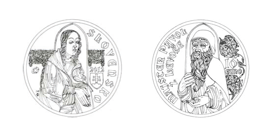

## 121

OZNÁMENIE

Národnej banky Slovenska

z 13. marca 2012

## o vydaní strieborných zberateľských euromincí v nominálnej hodnote 10 eur na pripomenutie Majstra Pavla z Levoče a jeho diela

1. Úvodné ustanovenia

- a) Národná banka Slovenska podľa § 17h ods. 1 zákona Národnej rady Slovenskej republiky č. 566/1992 Zb. o Národnej banke Slovenska v znení neskorších predpisov a podľa § 1 ods. 2 písm. d) zákona Národnej rady Slovenskej republiky č. 1/1993 Z. z. o Zbierke zákonov Slovenskej republiky v znení zákona č. 275/2002 Z. z. oznamuje, že na pripomenutie Majstra Pavla z Levoče a jeho diela vydáva do obehu strieborné zberateľské euromince v nominálnej hodnote 10 eur (ďalej len „zberateľská eurominca“).

- b) Zberateľská eurominca má štatút zákonného platidla len v Slovenskej republike.

- c) Zberateľská eurominca sa razí zo zliatiny obsahujúcej 900 dielov striebra a 100 dielov medi; jej hmotnosť je 18 g a priemer 34 mm. Pri razbe zberateľskej euromince je povolená horná a dolná odchýlka v priemere 0,1 mm; povolená horná odchýlka v hmotnosti je 0,4 g a v obsahu striebra 10/1000.

2. Vzhľad zberateľskej euromince

- a) Na líci zberateľskej euromince je vyobrazená Madona zo súsošia Narodenia vo farskom Kostole sv. Jakuba v Levoči, ktorá je v pozadí doplnená gotickým oblúkom a ornamentálnymi prvkami. V pravej časti mincového poľa je umiestnený štátny znak Slovenskej republiky, nad ktorým je letopočet „2012“. Názov štátu „SLOVENSKO“ je v opise pri pravom okraji zberateľskej euromince. V ľavej časti mincového poľa je umiestnená značka európskeho programu strieborných mincí znázorňujúca európsku hviezdu a symbol eura. Štylizované iniciálky mena a priezviska autorky výtvarného návrhu zberateľskej euromince Márie Poldaufovej „MP“ a značka Mincovne Kremnica, štátny podnik, ktorú tvorí skratka „MK“ umiestnená medzi dvoma razidlami, sú pri jej ľavom okraji.

- b) Na rube zberateľskej euromince je vyobrazený apoštol z predely hlavného oltára farského Kostola sv. Jakuba v Levoči, ktorý je v pozadí doplnený gotickým oblúkom. Pri ľavom okraji zberateľskej euromince je v opise v dvoch riadkoch nápis „MAJSTER PAVOL Z LEVOČE“. V pravej časti mincového poľa je medzi dvoma ornamentálnymi prvkami v dvoch riadkoch označenie nominálnej hodnoty zberateľskej euromince „10 EURO“.

- c) Na hrane zberateľskej euromince je reliéfny nápis do hĺbky „• OD GOTIKY K RENESANCII“.

- 

- Štát vydania: Slovenská republika

- Začiatok vydávania: máj 2012

v z. Viliam Ostrožlík v. r.
