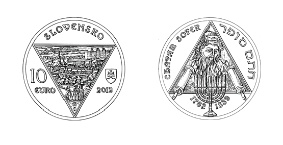

## 122

OZNÁMENIE

Národnej banky Slovenska

z 13. marca 2012

## o vydaní strieborných zberateľských euromincí v nominálnej hodnote 10 eur pri príležitosti 250. výročia narodenia Chatama Sofera

1. Úvodné ustanovenia

- a) Národná banka Slovenska podľa § 17h ods. 1 zákona Národnej rady Slovenskej republiky č. 566/1992 Zb. o Národnej banke Slovenska v znení neskorších predpisov a podľa § 1 ods. 2 písm. d) zákona Národnej rady Slovenskej republiky č. 1/1993 Z. z. o Zbierke zákonov Slovenskej republiky v znení zákona č. 275/2002 Z. z. oznamuje, že pri príležitosti 250. výročia narodenia Chatama Sofera vydáva do obehu strieborné zberateľské euromince v nominálnej hodnote 10 eur (ďalej len „zberateľská eurominca“).

- b) Zberateľská eurominca má štatút zákonného platidla len v Slovenskej republike.

- c) Zberateľská eurominca sa razí zo zliatiny obsahujúcej 900 dielov striebra a 100 dielov medi; jej hmotnosť je 18 g a priemer 34 mm. Pri razbe zberateľskej euromince je povolená horná a dolná odchýlka v priemere 0,1 mm; povolená horná odchýlka v hmotnosti je 0,4 g a v obsahu striebra 10/1000.

2. Vzhľad zberateľskej euromince

- a) Na líci zberateľskej euromince je historické vyobrazenie Bratislavy z obdobia pôsobenia Chatama Sofera. Naľavo od neho je v dvoch riadkoch označenie nominálnej hodnoty zberateľskej euromince „10 EURO“ a napravo je umiestnený štátny znak Slovenskej republiky, pod ktorým je letopočet „2012“. Názov štátu „SLOVENSKO“ je v opise zľava doprava v hornej časti mincového poľa. Štylizované iniciálky mena a priezviska autora výtvarného návrhu zberateľskej euromince Pavla Károlyho „PK“ a značka Mincovne Kremnica, štátny podnik, ktorú tvorí skratka „MK“ umiestnená medzi dvoma razidlami, sú v spodnej časti dobového vyobrazenia Bratislavy.

- b) Na rube zberateľskej euromince je vyobrazený portrét Chatama Sofera doplnený zvitkom Tóry a sedemramenným svietnikom. Pri ľavom okraji zberateľskej euromince je v opise zľava doprava meno a priezvisko „CHATAM SOFER“ a pri jej pravom okraji ich prepis v hebrejčine. V spodnej časti mincového poľa sú letopočty označujúce rok jeho narodenia „1762“ a úmrtia „1839“.

- c) Na hrane zberateľskej euromince je reliéfny nápis do hĺbky „ – RABÍN – UČENEC – SUDCA – UČITEĽ“.

- 

- Štát vydania: Slovenská republika

- Začiatok vydávania: jún 2012

v z. Viliam Ostrožlík v. r.
