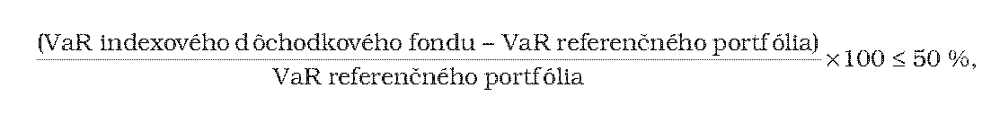
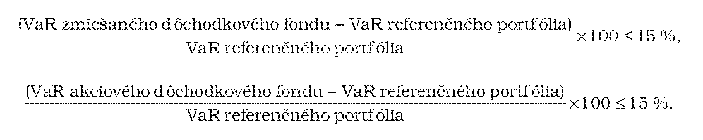

## ŠTVRTÁ ČASŤ

## VÝPOČET CELKOVÉHO RIZIKA FINANČNÝCH DERIVÁTOV A DERIVÁTOV DRAHÉHO KOVU ALEBO DERIVÁTOV INDEXU DRAHÝCH KOVOV POUŽITÍM PRÍSTUPU HODNOTY V RIZIKU

# § 26 Spôsob výpočtu metódou relatívnej hodnoty v riziku

(1) Celkové riziko sa pri používaní metódy relatívnej hodnoty v riziku vypočítava takto:

- a) vypočíta sa hodnota v riziku (value at risk) aktuálneho portfólia, ktoré zahŕňa deriváty,

- b) vypočíta sa hodnota v riziku referenčného portfólia,

- c) skontroluje sa, či hodnota v riziku

  - 1. indexového dôchodkového fondu nie je väčšia ako jedenapolnásobok hodnoty v riziku referenčného portfólia s cieľom zabezpečiť obmedzenie pomeru celkového pákového efektu indexového dôchodkového fondu a hodnoty v riziku referenčného portfólia na 1,5, pričom sa použije vzorec

  - 

  - kde VaR je hodnota v riziku,

  - 2. zmiešaného dôchodkového fondu a akciového dôchodkového fondu nie je väčšia ako 1,15-násobok hodnoty v riziku referenčného portfólia s cieľom zabezpečiť obmedzenie pomeru celkového pákového efektu zmiešaného dôchodkového fondu a akciového dôchodkového fondu k hodnote v riziku referenčného portfólia na 1,15, pričom sa použijú vzorce

  - 

  - kde VaR je hodnota v riziku.

(2) Na účely výpočtu celkového rizika metódou relatívnej hodnoty v riziku sa relatívnou hodnotou v riziku (relative value at risk) rozumie pomer medzi hodnotou v riziku majetku v indexovom dôchodkovom fonde, zmiešanom dôchodkovom fonde a akciovom dôchodkovom fonde a hodnotou v riziku referenčného ukazovateľa (benchmark) alebo referenčného portfólia.

(3) Referenčné portfólio a súvisiace postupy musia spĺňať tieto kritériá:

- a) referenčné portfólio neobsahuje žiadny pákový efekt ani žiadne finančné deriváty, deriváty drahého kovu alebo deriváty indexu drahých kovov, alebo vnorené deriváty okrem prípadov

  - 1. používania kombinovanej dlhej-krátkej investičnej stratégie, pri ktorých použité referenčné portfólio môže obsahovať finančné deriváty v indexovom dôchodkovom fonde alebo deriváty drahého kovu, alebo deriváty indexu drahých kovov v zmiešanom dôchodkovom fonde a akciovom dôchodkovom fonde na získanie krátkej expozície a

  - 2. používania investičnej stratégie, pri ktorej je cieľom zabezpečenie majetku v indexovom dôchodkovom fonde, zmiešanom dôchodkovom fonde a akciovom dôchodkovom fonde vo vzťahu k menovému riziku, pri ktorých môže byť referenčným portfóliom menovo zabezpečený index,

- b) rizikový profil referenčného portfólia je v súlade s cieľmi a investičnou politikou príslušného indexového dôchodkového fondu, zmiešaného dôchodkového fondu a akciového dôchodkového fondu a jeho obmedzením a rozložením rizika podľa zákona, jeho štatútu alebo vnútorných limitov,

- c) postup týkajúci sa určenia a nepretržitého udržovania referenčného portfólia je integrovaný do procesu riadenia rizík a má primeranú podporu a

- d) sú vypracované pravidlá na zloženie referenčného portfólia a aktuálne zloženie referenčného portfólia a akékoľvek zmeny sú riadne zdokumentované.

(4) Ak sa rizikovo-výnosový profil príslušného indexového dôchodkového fondu, zmiešaného dôchodkového fondu a akciového dôchodkového fondu často mení alebo ak definovanie referenčného portfólia nie je možné, metóda relatívnej hodnoty v riziku nemôže byť použitá.
