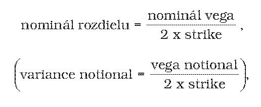
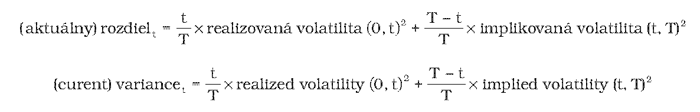

Príloha č. 3 k opatreniu č. 155/2012 Z. z.

- METÓDY KONVERZIE POZÍCIÍ NEŠTANDARDNÝCH FINANČNÝCH DERIVÁTOV PRI VÝPOČTE CELKOVÉHO RIZIKA ZÁVÄZKOVÝM PRÍSTUPOM Pozície neštandardných finančných derivátov sa konvertujú na ich ekvivalentnú pozíciu podkladového nástroja takto:

  - 1. Swapy rozdielu (Variance Swaps)

    - Nominál rozdielu (variance notional) sa vypočíta takto:

  - 

    - kde

    - nominál vega (vega notional) určuje teoretickú mieru zisku alebo straty vyplývajúcej z 1-percentnej zmeny volatility; pretože realizovaná volatilita nemôže byť nižšia než nula, dlhá swapová pozícia má známu maximálnu stratu; maximálna strata na krátky swap môže byť limitovaná zahrnutím obmedzenia (cap) na volatilitu; bez obmedzenia na volatilitu sú však možné straty krátkeho swapu nelimitované,

    - metóda konverzie, ktorá sa použije pre daný kontrakt v čase t, je

    - b) nominál rozdielu (variance notional) x (aktuálny) rozdielt (bez volatility cap),

    - c) nominál rozdielu (variance notional) x min [(aktuálny) rozdielt; volatilita cap2] (s volatilitou cap)

    - 

      - Na účely konverzie pozície neštandardného derivátu sa swapom rozdielu (Variance swap) rozumie swap, pri ktorom sa zmluvná strana zaväzuje zameniť peňažnú čiastku, ktorá je závislá od rozdielu zmien trhových hodnôt podkladového aktíva, za pevnú sumu určenú pri uzavretí swapového kontraktu.

  - 2. Swapy volatility (Volatility Swaps)

  - Analogicky so swapmi rozdielu sa pre swapy volatility použije metóda konverzie pre daný kontrakt v čase t takto:

    - a) nominál vega (notional vega) x (aktuálna) volatilitat (bez cap volatility),

    - b) nominál vega x min [(aktuálna) volatilitat; cap volatility] (s volatilitou cap),

    - pričom (aktuálna) volatilitat je funkciou realizovanej a implicitnej volatility.
