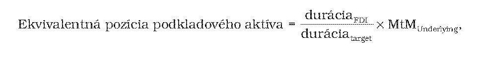

Príloha č. 6 k opatreniu č. 155/2012 Z. z.

- METÓDA KONVERZIE DERIVÁTOV ÚROKOVEJ SADZBY PRI POUŽITÍ VZÁJOMNÉHO ZAPOČÍTANIA DURÁCIE PRI VÝPOČTE CELKOVÉHO RIZIKA ZÁVÄZKOVÝM PRÍSTUPOM Deriváty úrokovej sadzby sa konvertujú na ich ekvivalentnú pozíciu podkladového nástroja takto:

  - 1. Každý finančný derivát úrokovej sadzby sa pridelí do príslušného pásma („bucket“) nasledujúceho rebríčka podľa splatnosti:

  - Bucket | Pásmo splatnosti

  - 1 | 0 – 2 roky

  - 2 | 2 – 7 rokov

  - 3 | 7 – 15 rokov

  - 4 | > 15 rokov

  - 2. Vypočíta sa ekvivalentná pozícia podkladového nástroja každého derivátu úrokovej sadzby ako jeho durácia vydelená cieľovou duráciou dôchodkového fondu a vynásobí trhovou hodnotou podkladového aktíva.

  - 

    - kde

    - duráciaFDIje durácia (citlivosť úrokovej sadzby) derivátu úrokovej sadzby,

    - duráciatargetje v súlade s investičnou stratégiou, smerovými pozíciami a s očakávanou úrovňou rizík v každom čase a bude iným spôsobom upravená a je zároveň v súlade s duráciou portfólia za normálnych trhových podmienok,

    - MtMunderlyingje trhová hodnota podkladového aktíva.

  - 3. Vzájomne sa započítajú dlhé a krátke ekvivalentné pozície podkladových nástrojov v rámci každého pásma (bucketu). Čiastka dlhej pozície, ktorá je započítaná s krátkou pozíciou, je započítaná pozícia pre to pásmo.

  - 4. Započíta sa čiastka zostávajúcej dlhej (alebo krátkej) pozície v pásme (i) s čiastkou zostávajúcej krátkej (dlhej) pozície zostávajúcej v pásme (i+2).

  - 5. Započíta sa čiastka medzi nezapočítanými dlhými a krátkymi pozíciami dvoch najvzdialenejších pásiem.

  - 6. Vypočíta sa celkové riziko podielového fondu ako súčet

    - a) 0 % započítanej pozície za každé pásmo,

    - b) 40 % započítaných pozícií medzi dvoma susednými pásmami (i) a (i+1),

    - c) 75 % započítaných pozícií medzi dvoma vzdialenými pásmami oddelenými ďalším pásmom, znamenajúce pásma (i) a (i+2),

    - d) 100 % započítaných pozícií medzi dvoma najvzdialenejšími pásmami,

    - e) 100 % zostávajúcich nezapočítaných pozícií.
